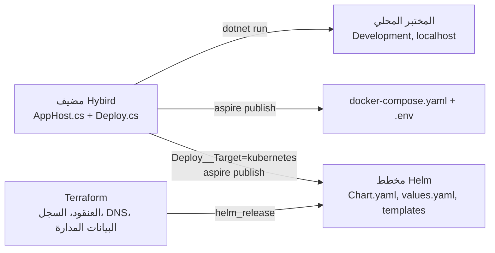

[مختبر Hybird](/ar/backend/hybrid-lab/) ليس أداة محلية فقط. يحول الأمر `aspire publish` المضيف نفسه إلى ملفات نشر:
**Docker Compose** (`docker-compose.yaml` و`.env`) أو **مخطط Helm** لـ Kubernetes. كل ما يختلف عن المختبر موجود في
`src/Aspire/Hybird/Deploy.cs`، ويعمل `dotnet run` كما كان تماما.

```bash
aspire publish --apphost src/Aspire/Hybird/Hybird.csproj -o deploy/compose
```

```bash
Deploy__Target=kubernetes aspire publish --apphost src/Aspire/Hybird/Hybird.csproj -o deploy/helm
```



يكتب `aspire publish` الملفات فقط. أما `aspire deploy` فيبني الصور أيضا، ويشغلها في حالة Compose.

## ما يتغير في وضع النشر

| | التشغيل (المختبر) | النشر |
| --- | --- | --- |
| البيئة | `Development`، شهادات التطوير، حسابات التطوير | `Production`، و`ASPNETCORE_FORWARDEDHEADERS_ENABLED=true` |
| العناوين العامة | `http://localhost:5090` و`:5080` و`:5070` | `https://` مع المعاملات `public-identity-host` و`public-gateway-host` و`public-client-host` |
| خدمة الهوية | مفاتيح توقيع التطوير، ومستخدمو التطوير | `signing.pfx` و`encryption.pfx` من `/certs` (كلمة المرور `identity-certificate-password`)، ومسؤول منصة واحد (`admin-email` و`admin-password`)، وعناوين إعادة التوجيه وCORS لمضيف العميل فقط |
| كتالوج الوحدات | `App_Data/modules-catalog` في مجلد المشروع | وحدة تخزين واحدة تركبها كل نسخ المجموعات في `/app/App_Data/modules-catalog` |
| العميل | خادم تطوير WebAssembly | صورة nginx، تكتب `OIDC_AUTHORITY` و`WEBAPI_BASE_URL` في `appsettings.json` عند بدئها |
| البوابة | المنفذ 5080 ومسارات `/pools/*` | المدخل العام، بلا مسارات `/pools/*` |

تصبح المعاملات مدخلات في `.env` (Compose) أو في `values.yaml` (Helm). ينتهي TLS أمام الخدمات، عند الـ ingress أو عند
وكيل عكسي، فتكون العناوين العامة `https` بينما تتحدث الخدمات HTTP عاديا في الداخل.

:::caution[يجب أن يكون كتالوج الوحدات مشتركا]
الوحدات المرفوعة وقت التشغيل موجودة في مجلد الكتالوج، وتقرؤه كل نسخة من كل مجموعة. بدون وحدة التخزين المشتركة، تغيب
الوحدة المثبتة عبر نسخة واحدة عن النسخ الأخرى، وتختفي عند إعادة تشغيل الحاوية. في Kubernetes تكون وحدة التخزين
PersistentVolumeClaim بنمط `ReadWriteMany`، لذا يجب أن تدعمه فئة التخزين (`modules-storage-class`): Azure Files أو
EFS أو Filestore أو NFS.
:::

## Docker Compose

1. املأ `.env`: المعاملات، وكل `*_IMAGE`، وكل `*_PORT` (`8080` لصور .NET).
2. ضع `signing.pfx` و`encryption.pfx` في `certs/` بجانب `docker-compose.yaml`.
3. `docker compose up -d`. البوابة على 5080، والهوية على 5090، والعميل على 5070. يربط وكيل TLS في المقدمة أسماء
   المضيفين العامة الثلاثة بها.

## Kubernetes مع Helm

```bash
kubectl create namespace modularblazor
```

```bash
kubectl -n modularblazor create secret generic identity-certificates --from-file=signing.pfx --from-file=encryption.pfx
```

```bash
helm upgrade --install modularblazor deploy/helm -n modularblazor -f prod-values.yaml
```

يضبط `prod-values.yaml` قيم `parameters.*`: الصور في سجلك، وأسماء المضيفين، وكلمات المرور، وفئة التخزين. يحصل كل
مضيف عام على ingress (الفئة `nginx`) مع TLS من الـ Secret المسمى `<name>-ingress-tls`، الذي ينشئه cert-manager أو
تنشئه أنت. تصبح نسخ المجموعات StatefulSets لأنها تركب وحدة تخزين الكتالوج.

## Terraform

لا يكتب Aspire ملفات Terraform. التقسيم المعتاد:

- **Terraform** ينشئ ما يعمل عليه المخطط: العنقود (AKS أو EKS أو GKE)، وسجل الحاويات، وDNS، وPostgreSQL وRedis
  وRabbitMQ المدارة إذا استبدلت بها الحاويات.
- **المخطط** يشغل المنصة. يثبته Terraform بالمورد `helm_release` من مزود `helm`، ويمرر قيم `parameters.*` من
  مخرجاته.

## ما لم يغط بعد

- كل نسخة من نسخ المجموعات مورد مستقل (انظر ملاحظات تصميم المختبر)، لذا تسمي المخرجات عشر صور كلها صورة WebApi.
  وجهها جميعا إلى وسم واحد.
- ما زالت PostgreSQL وRedis وRabbitMQ حاويات بوحدات تخزين. في الإنتاج استخدم خدمات مدارة ومرر سلاسل اتصالها بدلا منها.
- فحصت المخرجات بـ `docker compose config` و`helm lint`، ولم تنشر بعد على عنقود حقيقي.
