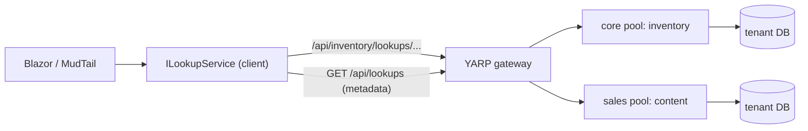
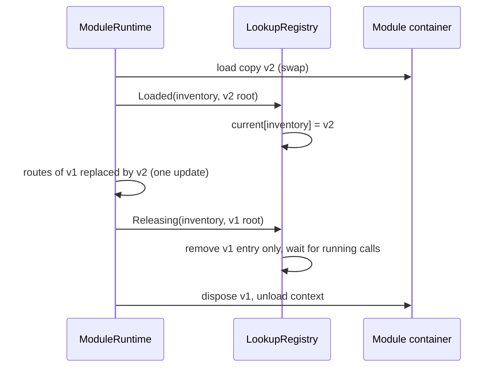

:::note[تصميم مقترح]
تصف هذه الصفحة التصميم المتفق عليه لخدمة قوائم البحث. لم ينفذ بعد، وقد تتغير الأسماء أثناء التنفيذ.
:::

**قائمة البحث** (lookup) تحول كيانا من كيانات الوحدة إلى أزواج مفتاح ونص: المفتاح هو ما يحفظه النموذج، والنص هو ما
يراه الشخص. تغذي قوائم البحث مكون الإكمال التلقائي في MudTail، والمنتقيات المتتالية للأشجار، ومنتقي المرشحات بالرقائق،
ومحرر DynamicFields. وتخدمها دائما الوحدة التي تملك الكيان، من قاعدة بيانات المستأجر الحالي.

| الحاجة | الميزة |
| --- | --- |
| اختيار عنصر أثناء الكتابة | الإكمال التلقائي (بحث مقسم إلى صفحات) |
| الاختيار نزولا في شجرة (فئة ← فئة فرعية) | قائمة متتالية ذاتية (`ParentField`) |
| اختيار مدينة من الدولة المختارة | قائمة تابعة (`ParentProperty`) |
| التصفح بمرشحات واختيار عنصر أو أكثر | منتق برقائق المرشحات (`FilterOn`) |
| عرض نص مفتاح محفوظ | الحل بالمفاتيح |
| تحقق وحدة أخرى من مفتاح | `ILookupClient` (داخل العملية أو عن بعد) |

## المبادئ

- **المالك يخدم قوائمه.** البيانات ونقطة النهاية وقاعدة البيانات تبقى مع الوحدة؛ ولا شيء مركزي يحمل بيانات.
- **مكان واحد لكل وحدة.** تعرف كل قوائم الوحدة في صنف واحد في طبقة Web الخاصة بها.
- **الجزء المركزي عقد** لا خادم: مخطط تسمية واحد، وكتالوج واحد للبيانات الوصفية، وخدمة عميل واحدة.
- **لا شيء يثبت الوحدة في الذاكرة.** تعيش التعريفات في حاوية الوحدة وتتخلص منها معها (انظر
  [تفريغ الوحدات أثناء التشغيل](/ar/backend/runtime-module-unloading/)).
- **العملاء لا يرسلون تعابير.** تتحقق حقول البحث والمرشحات من قائمة سماح تعلنها الوحدة.

## تعريف قوائم البحث

لكل وحدة `ILookupModule` واحد في طبقة Web. يكتشفه المضيف عند تحميل الوحدة، كما يكتشف `ICarterModule`.

```csharp
// Web/Endpoints/Lookups/InventoryLookups.cs
public sealed class InventoryLookups : ILookupModule
{
    public void Register(ILookupBuilder l)
    {
        l.For<StockItem>("stock-items")
         .Key(i => i.Id)
         .Text(i => i.Sku + " - " + i.Name)                 // render expression, translated to SQL
         .SearchOn(nameof(StockItem.Sku), nameof(StockItem.Name))
         .Where(i => i.Quantity > 0)                          // fixed filter, always applied
         .OrderBy(i => i.Sku)
         .FilterOn(nameof(StockItem.Name))
         .FilterOn(nameof(StockItem.KindId), valueLookup: "inventory.kinds")
         .FilterOn(nameof(StockItem.Quantity))
         .Columns(i => new { i.Sku, i.Quantity })             // extra columns for the picker
         .Permission(InventoryPermissions.Read);

        l.For<Warehouse>("warehouses").Key(w => w.Id).TextField(nameof(Warehouse.Name));

        l.For<Category>("categories")
         .Key(c => c.Id)
         .TextField(nameof(Category.Name))
         .ParentField(nameof(Category.ParentId));             // enables cascades
    }
}
```

| الاستدعاء | المعنى | الافتراضي |
| --- | --- | --- |
| `Key(...)` | القيمة المحفوظة. ترسل نصا عبر الشبكة. | مطلوب |
| `Text(expr)` | تعبير العرض. يترجم إلى SQL، فيجري البحث والترتيب والتقسيم إلى صفحات في قاعدة البيانات. | `TextField` |
| `TextField(name)` | اسم خاصية، يتحول إلى تعبير من النوع نفسه. | |
| `Text("ar", expr)` | نص لثقافة واحدة؛ تختاره ثقافة الطلب، مع الرجوع إلى النص الافتراضي. | |
| `Columns(...)` + `Render(func)` | لتنسيق لا يستطيعه SQL: يختار SQL هذه الأعمدة فقط، وتنسق الدالة كل صف من الصفحة في الذاكرة. | |
| `SearchOn(names...)` | قائمة السماح للحقول التي يستخدمها البحث النصي. للمستدعي أن يضيقها لا أن يوسعها. | النص |
| `Where(expr)` | مرشح ثابت يطبق دائما (وعند الحل أيضا). | |
| `OrderBy(expr)` | ترتيب القائمة. | النص |
| `ParentField(name)` | العمود الذي يرشحه `?parent=`: القائمة نفسها (شجرة) أو قائمة أخرى (تابعة). | |
| `LeafField(name)` | عمود يقول إن العنصر بلا أبناء. | استعلام فرعي `EXISTS` |
| `FilterOn(name, valueLookup?)` | حقل يمكن للمنتقي الترشيح به. تأتي العوامل من نوعه. | |
| `Permission(name)` | مطلوبة للبحث والحل. يجب إعلانها في البيان (manifest) كأي صلاحية. | مستخدم مصادق |

يفشل التفعيل حين لا يوجد اسم حقل في الكيان، كما يفشل مع صلاحية غير معلنة، فيكشف الخطأ الإملائي عند التحميل لا عند
أول ضغطة مفتاح.

:::caution[اعرض بتعبير لا بمفوض]
`Text(i => ...)` هو `Expression<Func<T,string>>`. أما `Func` العادية فستحمل الكيانات كاملة في الذاكرة وتكسر البحث
والتقسيم إلى صفحات في الجداول الكبيرة. استخدم `Columns` مع `Render` حين تحتاج تنسيقا بلغة C#.
:::

محرك المضيف عام ويعمل على `IQueryable<T>` من `DbContext` الخاص بالوحدة، فيجري كل استعلام على قاعدة بيانات المستأجر
الحالي. وهو غير مرتبط بـ Ardalis؛ ويمكن للوحدة التي لديها مواصفة أساسية أن تضيفها. لا يحتفظ المحرك بذاكرات مؤقتة
ساكنة مفهرسة بالنوع، ويبني تعابير ذات معاملات كي يعيد EF استخدام خطط الاستعلام.

### قائمة البحث ليست حالة استخدام البحث

يعيد `SearchNotesQuery` في القالب كائنات نقل كاملة ومجموعا كليا لشاشة قائمة. إعادة استخدامه للإكمال التلقائي
تحمل الكيانات كاملة، وتعد في كل ضغطة مفتاح، وتشترط حرفين قبل عرض أي شيء، وتطابق نصا لا يراه المستخدم (`Body`)،
وترتب بالمعرف. أما قائمة البحث فتعيد عمودين، وترتب بنصها، وتحسب `hasMore` بقراءة `take + 1` صفا. شارك **قواعد
الترشيح** الخاصة بالوحدة (تعبير أو مواصفة أساسية في Core) بين الاثنين، لا الأمر نفسه.

## نقاط النهاية

يربط المضيف نقاط نهاية كل قائمة مسجلة داخل مجموعة مسارات الوحدة نفسها، فتعيش تحت بادئة الوحدة وتأتي وتذهب مع
مساراتها (التفعيل والتعطيل والتفريغ والتبديل الأزرق/الأخضر).

| الطلب | الجواب |
| --- | --- |
| `GET /api/{prefix}/lookups/{name}?q=&fields=&parent=&skip=&take=` | `{ items: [{ key, text, hasChildren? }], hasMore }` |
| `GET /api/{prefix}/lookups/{name}/keys?keys=3,17` | `[{ key, text, parentKey?, hasChildren? }]` |
| `POST /api/{prefix}/lookups/{name}/query` | `{ items: [{ key, text, extra }], hasMore, total? }` (منتقي المرشحات) |
| `GET /api/lookups` | الكتالوج: كل قوائم كل وحدة مثبتة (بيانات وصفية فقط) |

- `q` الفارغ يعيد الصفحة الأولى، فتفتح القائمة عند التركيز.
- `hasMore` يأتي من قراءة `take + 1` صفا؛ ولا يحسب المجموع إلا عند طلبه (يطلبه المنتقي حين تتغير مرشحاته، لا مع
  كل ضغطة مفتاح).
- حذف `parent` في قائمة لها `ParentField` يعيد الجذور (`ParentId == null`).
- `keys` يعرض نص القيم المحفوظة عند فتح سجل، ويتيح لوحدات أخرى التحقق من المفاتيح.
- تصبح كل قائمة عملية OpenAPI مستقلة (مثل `Inventory_Lookup_StockItems`)، فيحصل العميل المولد للوحدة على دالة
  ذات نوع.

## المفاتيح والكتالوج والمجموعات

مفتاح القائمة هو `{routePrefix}.{name}`، مثل `inventory.stock-items`. يحوله العميل إلى
`/api/inventory/lookups/stock-items`، والبوابة توجه أصلا `/api/inventory/**` إلى المجموعة التي تشغل الوحدة. لا
يضاف مسار في البوابة لكل قائمة، ولا تقف مجموعة في المنتصف.



الكتالوج بيانات وصفية فقط: الأسماء والتسميات والصلاحية وحقول البحث والترشيح و`ParentField`. ويسجل عند **التثبيت**:
الخطوة التي تقرأ البيان في سياق تحميل مؤقت تشغل أيضا `ILookupModule.Register` على باني لا يسجل إلا نصوصا، وتحفظها
في سجل الوحدة في الكتالوج، مثل `ModuleManifest.Permissions`. فيستطيع أي نسخة في أي مجموعة أن تسرد قوائم وحدة لا
تحملها أبدا.

| التصميم | فصل المجموعات |
| --- | --- |
| نقطة نهاية مركزية للبيانات على core تجيب عن كل الوحدات | **يكسره**: سيعمل core وكيلا إلى المجموعات الأخرى ويصبح محورا تعتمد عليه كل مجموعة |
| استدعاء داخل العملية لقائمة وحدة أخرى | **يكسره بصمت**: يعمل حين تتشارك الوحدتان مجموعة، ويفشل بعد نقل إحداهما |
| نقاط نهاية تحت بادئة الوحدة، وكتالوج بيانات وصفية، و`ILookupClient` | يحافظ عليه |

## دورة الحياة والتفريغ



- `LookupRegistry` في كل نسخة هو `IModuleLifecycleObserver`. لا يحفظ إلا معرف الوحدة ومرجع الحاوية وأسماء القوائم،
  ولا يحفظ أبدا أنواع الكيانات أو المفوضات.
- في التبديل تحمل النسخة الجديدة **قبل** تحرير القديمة، لذا يفهرس السجل مدخلاته بمرجع الحاوية ولا يحذف إلا مدخل
  النسخة التي تحرر (نمط `ModuleTenantInitializer`).
- التعريفات، بتعابيرها على أنواع الوحدة، كائنات مفردة في حاوية الوحدة وتتخلص منها معها.
- النتائج المخزنة مؤقتا كائنات نقل من المضيف مكونة من نصوص، فلا يمكن لذاكرة مؤقتة أن تثبت وحدة.

## القوائم المتتالية الذاتية

القائمة التي لها `ParentField` على كيانها نفسه تقود سلسلة: اختيار عنصر في مستوى يفتح المستوى التالي، مرشحا بـ
`parent = المفتاح المختار`.

```text
levels = [ Level(parent = RootKey) ]            level 0 is always visible

select X at level i:
    drop the levels after i
    if X.hasChildren and i + 1 < MaxDepth: add Level(parent = X.key)
    value = path of levels 0..i

clear level i:
    drop the levels after i
    value = path of levels 0..i-1 (null when i = 0)
```

- المستوى الذي يتغير يفرغ المستوى التالي ويعيد ترشيحه؛ ولا يوجد مستوى أبعد حتى يأخذ الذي قبله قيمة.
- `hasChildren` يقرر ظهور المستوى التالي. يأتي من `LeafField`، أو من استعلام فرعي `EXISTS` في استعلام SQL نفسه؛
  أنشئ فهرسا على `ParentId` في ترحيل الوحدة.
- كل مستوى يحمل صفحته الأولى عند التركيز، ويؤخر طلباته ويلغيها بنفسه، ويخزن في العميل مؤقتا الصفحة الأولى لكل
  `(lookup, parent)` لمدة قصيرة، لأن تصفح الشجرة يكرر الطلبات نفسها.
- `MaxDepth` (الافتراضي 5) يحد السلسلة ويحمي من الدورات في البيانات.
- الآلية نفسها تخدم القوائم التابعة بين قائمتين (دولة ← مدينة): وتأتي قيمة الأب عندئذ من حقل شقيق.

للأشجار العميقة أو الكبيرة، يمكن لاحقا لوضع "البحث في الشجرة كلها" أن يعرض مسارات التنقل في إكمال تلقائي واحد؛
ويحتاج عمود مسار مخزن (`PathField`).

## المنتقي برقائق المرشحات

المنتقي حوار (`Platform/lookup-picker`، يفتح عبر [حوارات الوحدات](/ar/guides/module-dialogs/)) للتصفح بمرشحات
مركبة واختيار عنصر أو أكثر.

```text
┌ Filter bar:  [Field ▾] [Operator ▾] [Value…] [+ Add]                              ┐
│ Filter chips:   ⧩ Name contains "SKU" ✕    ⧩ Kind = Hardware ✕                     │
│ Results (318)                                          [search in results…]       │
│   ☐ SKU-1 - Widget       SKU-1   12                                                │
│   ☑ SKU-7 - Gear         SKU-7    4                                                │
│ Selected:   SKU-7 - Gear ✕    SKU-12 - Bolt ✕                                      │
└                                                         [Cancel]  [Select 2]       ┘
```

```json
POST /api/inventory/lookups/stock-items/query
{ "q": "", "skip": 0, "take": 50, "includeTotal": true,
  "filters": [ { "field": "Name",   "op": "contains", "value": "SKU" },
               { "field": "KindId", "op": "eq",       "value": "25"  } ] }
```

| نوع الحقل | العوامل |
| --- | --- |
| نص | `eq`، `contains`، `startsWith` |
| رقم، تاريخ | `eq`، `ne`، `gt`، `gte`، `lt`، `lte`، `between` |
| تعداد، قائمة بحث | `eq`، `in` |
| منطقي | `eq` |
| أي نوع | `isEmpty` |

- تجمع الرقائق بـ **و** (AND)؛ أما **أو** (OR) فداخل رقاقة واحدة بـ `in` (`Kind in [Hardware, Tools]`).
- المرشح الذي لحقله `valueLookup` يختار قيمته بإكمال تلقائي، وتعرض رقاقته النص ("Kind = Hardware") لا المفتاح.
- لا تقبل إلا حقول `FilterOn`. الحدود: 10 مرشحات على الأكثر، و100 قيمة في `in`، وطول قيمة محدود، و`take` محدود.
  ويرد على المرشح غير الصالح بتفاصيل مشكلة (problem details) تسميه، فتعلم الواجهة تلك الرقاقة.
- لا `$filter` من OData ولا نصوص Dynamic LINQ: المرشح المنظم الذي يتحقق من قائمة سماح لا يصل إلى أعمدة لم تكشفها
  الوحدة، ولا يحقن شفرة (كانت في System.Linq.Dynamic.Core الثغرة CVE-2023-32571).
- رقائق المرشحات (محددة الإطار بأيقونة قمع) والعناصر المختارة (رقائق ممتلئة) تبدو مختلفة. والاختيار مجموعة منفصلة
  تحتفظ بنص كل عنصر، فتبقى عند تغير المرشحات.
- على الهواتف يملأ الحوار الشاشة ويصبح جدول النتائج قائمة بطاقات.

## MudTail وعميل Blazor

| القطعة | الدور |
| --- | --- |
| `ILookupService` (العميل) | `SearchAsync(key, q, fields, parent, skip, take)`، `ResolveAsync(key, keys)`، `QueryAsync(key, filters, ...)`. يقرأ الكتالوج مرة في الجلسة؛ ويستخدم HttpClient الخاص بالوحدة، فلا يصل الرمز وترويسة المستأجر إلى JavaScript أبدا. |
| الوضع البعيد في `MudAutocomplete.js` | `search(q, { skip, take, signal })` يعيد `{ items: [{ key, text }], hasMore }`؛ تأخير (نحو 250 ms)، وإلغاء الطلب السابق، وتحميل المزيد عند التمرير، وضبط مفتاح ونص أوليين، وإطلاق `{ key, text }`، ورقائق عند الاختيار المتعدد. |
| `<LookupAutocomplete>` | غلاف Blazor؛ تستدعي JavaScript ‏.NET لكل بحث. |
| `<LookupCascade>` | قائمة مستويات `LookupAutocomplete` تقودها قواعد السلسلة أعلاه. |
| `Platform/lookup-picker` | حوار منتقي المرشحات؛ يعرضه الإكمال التلقائي عبر زر "متقدم…". |

## المستهلكون في الخادم

الوحدة الأخرى التي تحتاج قائمة بحث تستدعي `ILookupClient` بمفتاح القائمة. حين تكون الوحدة المالكة محملة في النسخة
نفسها يجري الاستدعاء داخل العملية؛ وإلا فيذهب إلى المجموعة المالكة عبر الشبكة الداخلية، ولا يعود أبدا عبر البوابة
العامة (انظر [التواصل بين الوحدات](/ar/backend/communication/)). وموضع الاستدعاء واحد في كل تخطيط.

- فضل حفظ **المفتاح ولقطة من النص** على استدعاء وحدة أخرى كلما عرض سجل.
- تحقق من المفاتيح حين ينشأ المرجع أو يتغير؛ وارفض الكتابة حين لا تستطيع الوحدة المالكة الإجابة.
- تحمل الاستدعاءات هوية المستخدم، فلا يستطيع مستخدم الإشارة إلى عنصر لا يحق له رؤيته.

## التكامل مع DynamicFields

يحصل [DynamicFields](/ar/modules/dynamic-fields/) على نوع خاصية جديد يتيح للمؤلف ربط حقل بقائمة بحث أي وحدة، دون
أي إشارة إلى تلك الوحدة.

```csharp
public enum PropertyKind { …, Lookup }

public sealed record LookupBinding(
    string Key,                                   // "inventory.stock-items"
    IReadOnlyList<string>? SearchFields = null,   // a subset of the lookup's allowlist
    string? ParentProperty = null,                // sibling property → dependent lookup
    int MinChars = 0,
    LookupMode Mode = LookupMode.Autocomplete,    // Autocomplete | Picker
    bool Recursive = false,                       // cascade over the lookup's ParentField
    string? RootKey = null,                       // first level starts under this item
    int MaxDepth = 5,
    bool LeafOnly = false,                        // the author must reach an item with no children
    IReadOnlyList<LookupFilter>? PresetFilters = null, // chips the author locks
    bool AllowUserFilters = true,
    int? MaxSelections = null);

public sealed record FieldProperty(…, LookupBinding? Lookup = null);
```

**القيمة المحفوظة**: المفتاح مع لقطة من النص، وللسلسلة المسار.

```json
"product":  { "key": "42", "text": "SKU-1 - Widget" }
"category": { "key": "17", "text": "Phones",
              "path": [ { "key": "3", "text": "Electronics" }, { "key": "17", "text": "Phones" } ] }
```

تعرض اللقطة القوائم ومسارات التنقل ومخرجات schema.org دون استدعاء المجموعة المالكة، وتبقي المحتوى مقروءا حين تكون
تلك الوحدة معطلة أو محذوفة. يحدث النص عند الحفظ؛ وتحل الثقافات الأخرى عند عرض المحتوى، مع الرجوع إلى اللقطة. قيم
قوائم البحث غير قابلة للترجمة. ومخطط JSON للقيمة كائن فيه `key` مطلوب، و`x-lookup` يساوي مفتاح القائمة.

**باني الحقول**: يعرض النوع "Lookup" منتقيا لقائمة البحث يغذيه الكتالوج، ومربعات اختيار لحقول البحث من قائمة
سماحها، و"يعتمد على" (خصائص بحث شقيقة)، و"ذاتي" (فقط حين يكون للقائمة `ParentField`)، وعنصر البداية، والوضع،
ورقائق المرشحات المسبقة. والمعاينة الحية تعرض المحرر أصلا، فيجرب المؤلف الإكمال التلقائي أثناء بناء الحقل. ونشر
الحقل يتحقق من الربط في الكتالوج. ويرفض الجمع بين `Recursive` و`Multiple`.

**التحقق** يبقى على طبقات:

1. يبقى `ContentTreeValidator` (Core) نقيا ولا يفحص إلا الشكل.
2. يجمع `ValidateContentHandler` (UseCases) كل قيم قوائم البحث في الشجرة، ويصنفها بمفتاح القائمة، ويجري استدعاء
   `ResolveAsync(key, keys)` واحدا لكل قائمة، مع المرشحات المسبقة. ويبلغ عن المفاتيح المجهولة، والمفاتيح خارج
   المرشحات المسبقة، والمسار المكسور (يجب أن يكون كل `parentKey` هو المفتاح السابق، وأن يكون الأول `RootKey`)، والمسار
   الأعمق من `MaxDepth`، والنهاية غير الورقية حين يضبط `LeafOnly`، وكلها `ContentIssue` بمؤشرات JSON. لا حاجة إلى
   SQL تعاودي، وهذا مهم مع أربعة محركات قواعد بيانات.
3. حين لا تستطيع الوحدة المالكة الإجابة، تمنع المشكلة النشر.

يمكن لاحقا أن يصبح `Keyword` و`Term` إعدادين مسبقين لـ `Lookup` (`keywords.concepts`، `taxonomies.terms`)؛ ويبقى
`Asset` بحوار معرضه. وتبقى الأنواع القديمة صالحة لأن الأنواع تحفظ بأسمائها.

## التخزين المؤقت

| أين | ماذا |
| --- | --- |
| العميل | الصفحة الأولى لكل `(lookup, parent)` للسلاسل؛ ونتائج قصيرة العمر لكل استعلام؛ وإعادة تحقق بـ ETag (`304`). |
| الخادم | لا شيء في الإصدار الأول: قوائم البحث تبحث في بيانات المستأجر الحية. |
| لاحقا | للقوائم الصغيرة كثيرة الطلب: ختم إصدار لكل مستأجر وقائمة في Redis، يرفعه المالك عند التغيير ويبث على `lookups.changed`، مع مدة صلاحية احتياطية. |

## لاحقا

- البحث في الشجرة كلها مع مسارات التنقل (`PathField`).
- إعدادات مرشحات محفوظة لكل مستخدم.
- القيم الديناميكية: حفظ مرشح بدل المفاتيح ("منتجات ذات صلة: Kind is Phones")، يقيم عند عرض المحتوى، مع لقطة مخزنة.
- نقطة نهاية دفعية، إن أظهرت النماذج كثيرة القوائم حاجة إليها.

## كيف يفعلها الآخرون

| النظام | فكرة مشابهة |
| --- | --- |
| مجموعات القيم في Oracle EBS | مجموعات مستقلة وتابعة ومتحقق منها بجدول: ما يقابل عندنا القوائم الثابتة و`ParentProperty` وقوائم الكيانات |
| `ValueSet/$expand` و`$validate-code` في FHIR | بحث بـ `filter` و`count` و`offset` و`displayLanguage`؛ ما يقابل عندنا البحث و`keys` |
| `name_search` / `name_get` في Odoo | كل نموذج يجيب عن عقد البحث نفسه |
| ABP وOrchard Core | نقطة نهاية بحث لكل كيان يخدمها مالكه (`GetXxxLookup`، منتقي المحتوى) |
| Advanced Find في Dynamics 365، ومرشحات Jira | رقائق مرشحات بعوامل ذات أنواع على قائمة سماح |
