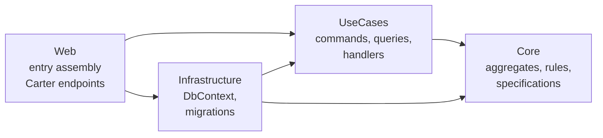

import { Aside, Card, CardGrid, FileTree, Steps, Tabs, TabItem } from '@astrojs/starlight/components';

`ModuleTemplate.CleanArchitecture` قالب لـ `dotnet new` ينشئ **وحدة تشغيل كاملة** بأمر واحد: جزء خادم بطبقات
[Ardalis Clean Architecture](https://github.com/ardalis/CleanArchitecture)، وعميل API مولد، وصفحة واجهة Blazor، واختبارات
وحدة وتكامل، وبيئة تجربة (playground) مبنية على Aspire. تبنى الوحدة الناتجة وتنجح اختباراتها، وتثبت وتعمل على المنصة فور
إنشائها.

```bash
dotnet new platform-module-ca -n Billing -o Module.Billing
```

| | |
| --- | --- |
| الاسم المختصر | `platform-module-ca` |
| الحزمة | `soft.square.net.ModularBlazor.ModuleTemplate` |
| المستودع | [soft-square-net/ModularBlazor.ModuleTemplate](https://github.com/soft-square-net/ModularBlazor.ModuleTemplate)، المجلد `templates/ModuleTemplate.CleanArchitecture` |
| ما ينشئه | مستودع وحدة واحد: `ModularBlazor.Module.<Name>.slnx` بستة مشاريع، ومشروعي اختبار، وبيئة تجربة |
| الميزة النموذجية | التجميعة `Note` مع الإضافة والتعديل والحذف والجلب والعرض والبحث |

## ما هو

الوحدة حزمة واحدة من ثلاثة أجزاء على الأكثر، تصدر معا ([إنشاء وحدة من الألف إلى الياء](/ar/backend/create-a-module/) يمر على
كل جزء يدويا). يعطيك القالب الأجزاء الثلاثة موصولة مسبقا، حول مثال صغير تستبدله بميزتك:

<CardGrid>
	<Card title="جزء الخادم" icon="seti:c-sharp">
		مشاريع Core وUseCases وInfrastructure وWeb. يحملها WebApi في سياق تحميل قابل للتفريغ، ويشغل ترحيلات المستأجرين،
		ويربط المسارات تحت `/api/<id>`.
	</Card>
	<Card title="عميل API" icon="puzzle">
		`WebApi.Modules.<Name>.Client`، يولده NSwag من مستند OpenAPI الخاص بالوحدة. يشحن مرة واحدة، وحدة عميل مخفية يمكن
		لوحدات العميل الأخرى أن تعتمد عليها.
	</Card>
	<Card title="واجهة Blazor" icon="laptop">
		`Module.<Name>`: عنصر في القائمة وصفحة ملاحظات (عرض، وبحث، وإضافة، وتعديل، وحذف) يحملها عميل Blazor أثناء التشغيل.
	</Card>
	<Card title="الاختبارات وبيئة التجربة" icon="rocket">
		اختبارات وحدة بـ xUnit ‏(NSubstitute) واختبارات تكامل (SQLite)، ومضيف Aspire يشغل المنصة ووحدتك فيها: عدل، وابن،
		وأعد التشغيل.
	</Card>
</CardGrid>

## عن القالب

أخذ القالب من وحدة **المحتوى** (Content) في المنصة، وهي المثال العملي لكل جزء من أجزاء الوحدة. يحتفظ ببنيتها وقواعدها،
ويستبدل مجالها التحريري بميزة ملاحظات صغيرة، فتبدأ الوحدة الجديدة من شيفرة مجربة على المنصة: تثبت، وتفرغ بنظافة، وتنجح
اختباراتها على كل مزود قواعد بيانات مدعوم.

### الطبقات



| الطبقة | المشروع | ما تحويه |
| --- | --- | --- |
| Core | `WebApi.Modules.<Name>.Core` | التجميعات وقواعدها (`Note.Create` و`Note.Edit`، وترمي `DomainException`)، ومواصفات Ardalis |
| UseCases | `WebApi.Modules.<Name>.UseCases` | مجلد لكل حالة استخدام: أمر أو استعلام Mediator ومعالجه، ويعيد `Result` من Ardalis؛ والصلاحيات؛ والخيارات |
| Infrastructure | `WebApi.Modules.<Name>.Infrastructure` | ‏`<Name>DbContext` ‏(`TenantDbContext`: مخطط ومرشح استعلام لكل مستأجر)، وإعدادات الكيانات، وترحيلات PostgreSQL وSQL Server وMySQL وOracle |
| Web | `WebApi.Modules.<Name>.Web` | التجميعة الرئيسية: `IRuntimeModule`، وجدول مسارات Carter، وصنف نقطة نهاية واحد لكل مسار (REPR)، وتحويل الأخطاء إلى problem details |

### قرارات التصميم

- **Mediator خاص بالوحدة.** [Mediator](https://github.com/martinothamar/Mediator) مولد من الشيفرة المصدرية: تكتشف
  المعالجات وقت الترجمة، دون مسح بالانعكاس ودون سجل مشترك. وينسخ هو وArdalis.Result إلى مخرجات بناء الوحدة ولا يشاركان
  المضيف أبدا، فتبقى الوحدة قابلة للتفريغ.
- **حزم المضيف للترجمة فقط.** تأتي حزم عقود المنصة (`WebApi.Contracts` و`WebApi.Data` و`ModularBlazor.Abstractions`
  ...) من Module SDK مع `ExcludeAssets=runtime`: يوفرها المضيف أثناء التشغيل.
- **صنف نقطة نهاية واحد لكل مسار** (REPR)، ولكل منها معرف عملية `<Name>_<Action>`، فيحصل العميل المولد على أسماء دوال
  مقروءة (`ListNotesAsync` و`EditNoteAsync`).
- **التزامن المتفائل.** للملاحظة `Version`؛ يرسله التعديل والحذف، ويحصلان على `409 Conflict` إذا غير شخص آخر الملاحظة في
  الأثناء.
- **السجلات بالاسم.** تستخدم شيفرة الوحدة `ILoggerFactory`، ولا تستخدم أبدا `ILogger<T>` لنوع من أنواع الوحدة، لأنه يبقي
  سياق تحميل الوحدة حيا.

### الميزة النموذجية

| الطريقة والمسار (تحت `/api/<id>`) | الصلاحية | حالة الاستخدام |
| --- | --- | --- |
| `GET /notes?page=&pageSize=` | `<id>.read` | `ListNotesQuery`: صفحة واحدة، الأحدث أولا، مع العدد الكلي |
| `GET /notes/search?text=&page=&pageSize=` | `<id>.read` | `SearchNotesQuery`: العنوان أو النص يحتوي النص المطلوب (حرفان على الأقل) |
| `GET /notes/{id}` | `<id>.read` | `GetNoteByIdQuery` |
| `POST /notes` `{ title, body }` | `<id>.write` | `CreateNoteCommand`: ‏`201` مع الملاحظة |
| `PUT /notes/{id}` `{ version, title, body }` | `<id>.write` | `EditNoteCommand`: ‏`409` إذا تغيرت الملاحظة بعد `version` |
| `DELETE /notes/{id}?version=` | `<id>.write` | `DeleteNoteCommand`: ‏`204`؛ و`409` إذا تغيرت الملاحظة بعد `version` |

يحتاج كل طلب إلى مستخدم مسجل الدخول في مستأجر. ويحدد إعداد الوحدة `<Name>:MaxPageSize` (الافتراضي 100) أكبر حجم للصفحة،
ويمكن تغييره من صفحة Host Modules.

## طريقة التثبيت

يحزم القالب حزمة قوالب NuGet، ويثبت في .NET SDK بالأمر `dotnet new install`.

**المتطلبات**

- ‏.NET SDK 10 (يثبت `global.json` في الوحدة الناتجة الإصدار وModule SDK).
- رمز وصول شخصي (classic) من GitHub بصلاحية `read:packages`، في متغير البيئة `GITHUB_PACKAGES_TOKEN`: تستعيد الوحدة
  الناتجة حزم المنصة من مستودع حزم soft-square-net على GitHub Packages (انظر [المستودعات والحزم](/ar/backend/repositories/)).
- لبيئة التجربة فقط: Docker، ونسخة من مستودع المنصة بجوار الوحدة.

<Tabs>
	<TabItem label="من المصدر">
		<Steps>

		1. انسخ مستودع القالب واحزمه:

		   ```bash
		   git clone https://github.com/soft-square-net/ModularBlazor.ModuleTemplate
		   cd ModularBlazor.ModuleTemplate
		   dotnet pack ModularBlazor.ModuleTemplate.csproj -c Release -o artifacts
		   ```

		2. ثبت الحزمة:

		   ```bash
		   dotnet new install artifacts/soft.square.net.ModularBlazor.ModuleTemplate.0.1.0.nupkg
		   ```

		3. تحقق من وجوده:

		   ```bash
		   dotnet new list platform-module-ca
		   ```

		</Steps>
	</TabItem>
	<TabItem label="من مستودع الحزم">
		بعد نشر إصدار من الحزمة على مستودع حزم soft-square-net (مع ضبط `GITHUB_PACKAGES_TOKEN` وإضافة المستودع إلى
		إعدادات NuGet لديك):

		```bash
		dotnet new install soft.square.net.ModularBlazor.ModuleTemplate
		```
	</TabItem>
</Tabs>

<Aside type="tip" title="التحديث والإزالة">
	ثبت حزمة أحدث بالطريقة نفسها: تحل محل المثبتة. وأزلها بالأمر
	`dotnet new uninstall soft.square.net.ModularBlazor.ModuleTemplate`. ولا تتأثر الوحدات التي أنشأتها من قبل: فهي
	مستودعات عادية.
</Aside>

<Aside type="note">
	قد يحذر التحزيم على Windows بالرمز `NU5123` (مسار طويل جدا) لملفات ترحيلات SQL Server. تبقى الحزمة صالحة؛ وثبتها على
	جهاز فعلت فيه المسارات الطويلة إذا اعترض `dotnet new install`.
</Aside>

## طريقة الاستخدام

### أنشئ وحدة

أنشئ الوحدة بجوار نسخة المنصة لديك، لتجد بيئة التجربة المنصة:

<div dir="ltr">

<FileTree>
- workspace/
  - Platform/ نسخة ModularBlazor.Platform
  - Module.Billing/ الوحدة التي تنشئها
</FileTree>

</div>

```bash
cd workspace
dotnet new platform-module-ca -n Billing -o Module.Billing
```

‏`-n` اسم الوحدة بصيغة PascalCase، كلمة واحدة (`Billing` و`Inventory`). ويحل محل العنصر النائب `ModuleName` في كل مكان:

| أين | يصبح |
| --- | --- |
| المشاريع والتجميعات | `WebApi.Modules.Billing.Web` و`soft.square.net.WebApi.Modules.Billing.Web.dll` و`Module.Billing` |
| مساحات الأسماء والأنواع | `soft.square.net.WebApi.Modules.Billing.*` و`BillingModule` و`BillingDbContext` و`BillingClient` |
| معرف الوحدة وبادئة المسار والمخطط (بأحرف صغيرة) | `billing` و`/api/billing` ومخطط قاعدة البيانات `billing` |
| الصلاحيات | `billing.read` و`billing.write` |
| الملفات | `src/openapi/billing.json` و`wwwroot/billing.css` ووحدة تخزين بيئة التجربة `billing-playground-data` |

<Aside type="caution">
	لا يتغير معرف الوحدة أبدا بعد أول تثبيت: فهو يسمي مدخل الفهرس، وبادئة المسار، ومخطط قاعدة البيانات، ومدخلات
	`Modules:Enabled` في المجموعات. اختر الاسم وأنت تضع ذلك في حسابك.
</Aside>

### ما تحصل عليه

<div dir="ltr">

<FileTree>
- Module.Billing/
  - ModularBlazor.Module.Billing.slnx
  - global.json يثبت إصدار .NET SDK وModule SDK
  - NuGet.Config مستودع حزم soft-square-net (يقرأ GITHUB_PACKAGES_TOKEN)
  - Directory.Build.props
  - .github/workflows/build.yml بناء واختبار مع كل دفع
  - src/
    - WebApi.Modules.Billing.Core/ ‏NoteAggregate والمواصفات
    - WebApi.Modules.Billing.UseCases/ ‏Notes/Create وEdit وDelete وGetById وList وSearch
    - WebApi.Modules.Billing.Infrastructure/ ‏BillingDbContext و‏Data/Migrations/\{PostgreSql,SqlServer,MySql,Oracle\}
    - WebApi.Modules.Billing.Web/ ‏BillingModule وBillingRoutes و‏Notes/ (نقطة نهاية في كل ملف)
    - openapi/
      - billing.json مستند OpenAPI المصدر
    - WebApi.Modules.Billing.Client/ عميل NSwag، ‏Generated/BillingClient.g.cs
    - Module.Billing/ ‏Pages/Notes.razor و‏BillingPageBase.cs و‏wwwroot/billing.css
  - tests/
    - WebApi.Modules.Billing.UnitTests/
    - WebApi.Modules.Billing.IntegrationTests/
  - playground/ مضيف Aspire (ليس ضمن الحل)
  - docs/
    - clean-architecture.md
  - README.md
</FileTree>

</div>

### البناء والاختبار

```bash
cd Module.Billing
dotnet build
dotnet test
```

يبنى الحل دون نسخة من المنصة (وكذلك يفعل CI). تغطي اختبارات الوحدة قواعد التجميعة وكل معالج؛ وتشغل اختبارات التكامل
المستودع والمواصفات على SQLite.

### شغلها في بيئة التجربة

تشغل بيئة التجربة منصة صغيرة (PostgreSQL، وخدمة الهوية، وWebApi واحدا، وعميل Blazor) وتبنيها من نسخة المنصة المجاورة
للوحدة.

<Steps>

1. أوقف مختبر المنصة وأي بيئة تجربة لوحدة أخرى: فهي تستخدم المنافذ نفسها (الهوية 5090، وAPI ‏5080، والعميل 5070).

2. شغل بيئة التجربة:

   ```bash
   dotnet run --project playground --launch-profile dev
   ```

   هل نسخة المنصة في مكان آخر؟ أضف `-p:PlatformRoot=<path to Platform>/`.

3. افتح http://localhost:5070، وسجل الدخول إلى المستأجر `acme` بالحساب `acme-admin@modular.local` (كلمات مرور التطوير في
   الملف `WebApi.Identity.Server/appsettings.Development.json` في المنصة)، ثم افتح **Billing** من القائمة.

4. أضف ملاحظة، وانقر صفها لتعديلها أو حذفها، وابحث عنها. ويمكن تصفح API على http://localhost:5080/scalar.

</Steps>

في الملف الشخصي `dev` يحمل WebApi جزء الخادم وجزأي العميل مباشرة من مخرجات بنائها، فتكون الحلقة: عدل الشيفرة، وابن، ثم
أعد تشغيل المورد `webapi` من لوحة Aspire. وتمنح بيئة التجربة `billing.*` للحساب `acme-admin@modular.local`
و`billing.read` للحساب `editor@modular.local` في `acme`؛ جرب الحساب الثاني لترى رسائل `403` في الصفحة. وتبقى البيانات
في وحدة تخزين Docker ‏`billing-playground-data` وفي `playground/.data`؛ احذفهما لتبدأ من جديد.

<Aside type="tip">
	بعد تسجيل الدخول مباشرة قد يعرض العميل 404 للمسار `/billing`، لأنه يعرض الصفحة قبل أن تحمل وحدات العميل. انقر عنصر
	القائمة فتظهر الصفحة.
</Aside>

### ثبتها على منصة

يجهز كل بناء لبيئة التجربة أيضا الأجزاء للرفع في `playground/out/`. ويشغل الملف الشخصي `install`
‏(`--launch-profile install`) المنصة دون الوحدة، كما في الإنتاج، لتجرب المسار الحقيقي:

<Steps>

1. ارفع `playground/out/billing.zip` (جزء الخادم: مخرجات بناء مشروع Web) من صفحة **Host modules** في العميل
   (`/host-modules`، بصفة مسؤول المنصة) ثم فعله. تشغل ترحيلات كل مستأجر، وتربط المسارات تحت `/api/billing`.

2. ارفع أجزاء العميل من `playground/out/client/` من صفحة **Client modules** ‏(`/client-modules`)، عميل API أولا:
   - `soft.square.net.WebApi.Modules.Billing.Client.dll` (مخفية)
   - `soft.square.net.Module.Billing.dll` (صفحة الملاحظات)

3. امنح `billing.read` و`billing.write` للمستخدمين الذين يحتاجونها، في مستأجرهم.

</Steps>

### اجعلها وحدتك

احتفظ بمثال الملاحظات مرجعا وأنت تضيف ميزتك، ثم احذفه. يشرح الملف `docs/clean-architecture.md` في الوحدة الناتجة كل خطوة؛
وباختصار، لإجراء جديد:

<Steps>

1. **Core**: القاعدة على التجميعة، ومواصفة لكل شكل استعلام جديد.
2. **UseCases**: مجلد فيه الأمر أو الاستعلام ومعالجه، ويعيد `Result`. وأضف صلاحية إن احتاج إلى واحدة.
3. **Web**: صنف نقطة نهاية واحد بمعرف عملية `<Name>_<Action>`، وسطر واحد في جدول المسارات.
4. **Infrastructure**، إذا تغير النموذج: الربط، ثم ترحيل لـ**كل** مزود بالسكربت `src/WebApi/scripts/Add-Migration.ps1`
   في المنصة.
5. **العميل**: صدر مستند OpenAPI من جديد بالسكربت `src/WebApi/scripts/Export-ModuleOpenApi.ps1` في المنصة
   (`-Output <module>/src/openapi/billing.json`) ثم ابن: يعاد توليد العميل. التزم بالاثنين معا، لتظهر تغييرات API في
   المراجعة. واستخدم الدالة الجديدة من صفحة ترث `BillingPageBase`.
6. **الاختبارات**: القاعدة، والمعالج، والربط أو المواصفة الجديدة.

</Steps>

## انظر أيضا

- [إنشاء وحدة من الألف إلى الياء](/ar/backend/create-a-module/): كل أجزاء الوحدة، مبنية يدويا.
- [وحدات أثناء التشغيل](/ar/backend/runtime-modules/) و[تفريغ وحدات التشغيل](/ar/backend/runtime-module-unloading/): كيف
  تحمل الوحدات، ولماذا يجب ألا تسرب شيفرة الوحدة المراجع.
- [نقاط النهاية: Minimal API مع Carter](/ar/backend/endpoints-carter/) و[المستأجرون وبياناتهم](/ar/backend/tenancy-data/).
- [المستودعات والحزم](/ar/backend/repositories/): مستودع الحزم ورمزه وCI.
