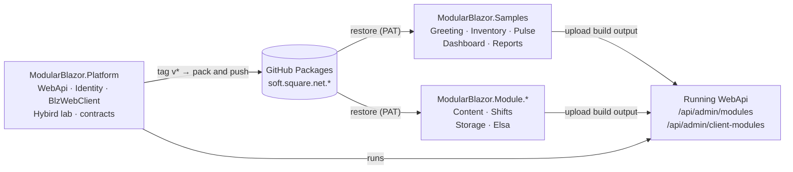

تعيش المنصة ووحداتها في مستودعات منفصلة داخل المنظمة `soft-square-net`. تنشر المنصة العقود التي تبنى عليها الوحدات حزم
NuGet؛ ويشير مستودع الوحدة إلى تلك الحزم ولا يشير أبدا إلى شيفرة المنصة المصدرية. وما زالت الوحدة تثبت بالطريقة نفسها: ترفع
مخرجات بنائها إلى WebApi وهي تعمل.



## المستودعات

| المستودع | يحوي |
| --- | --- |
| [`ModularBlazor.Platform`](https://github.com/soft-square-net/ModularBlazor.Platform) | WebApi ووحداتها الأساسية (الهوية والمستأجرون ووحدات العميل)، وخدمة الهوية OpenIddict، وبوابة YARP، و`ModularBlazor.BlzWebClient` ووحدات العميل الأساسية، وMudTail، ومختبر Aspire ‏Hybird، وحزم العقود وModule SDK، وهذا التوثيق |
| [`ModularBlazor.Samples`](https://github.com/soft-square-net/ModularBlazor.Samples) | وحدات تجريبية صغيرة، لكل منها مجلد تحت `samples/`: Greeting (مشروع واحد)، وInventory (بطبقات وبيانات مستأجرين)، وPulse (خط معالجة خاص وخدمة مستضافة)، وDashboard (وحدة عميل `.dll`)، وReports (وحدة عميل `.nupkg`) |
| [`ModularBlazor.Module.Content`](https://github.com/soft-square-net/ModularBlazor.Module.Content) | منشورات غرفة الأخبار وسير عملها |
| [`ModularBlazor.Module.Shifts`](https://github.com/soft-square-net/ModularBlazor.Module.Shifts) | المناوبات وصلاحيات المناوبة |
| [`ModularBlazor.Module.Storage`](https://github.com/soft-square-net/ModularBlazor.Module.Storage) | تخزين الملفات |
| [`ModularBlazor.Module.Elsa`](https://github.com/soft-square-net/ModularBlazor.Module.Elsa) | Elsa 3.9 وحدة تشغيل. انظر [Elsa](/ar/modules/elsa/) |
| [`ModularBlazor.ModuleTemplate`](https://github.com/soft-square-net/ModularBlazor.ModuleTemplate) | نقطة البدء لمستودع وحدة جديد (هيكل أولي، ما زال ينمو) |

`soft-square-net/ModularBlazor` هو المستودع القديم الجامع. وهو متقادم: ما زال يحوي `ModularBlazor.Host` و`ModularBlazor.Client`
القديمين والوحدات قبل نقلها، ولا يتلقى تغييرات بعد الآن.

## الحزم

يحزم سير العمل `Platform packages` في المنصة (`.github/workflows/platform-packages.yml`، والسكربت `build/pack-platform.ps1`)
ست حزم بإصدار واحد:

| الحزمة | تستخدمها الوحدة لـ |
| --- | --- |
| `soft.square.net.WebApi.Contracts` | `IRuntimeModule` و`ModuleManifest` وعقود المستأجرين والأمان |
| `soft.square.net.WebApi.SharedKernel` | `AggregateRoot<T>` و`ITenantOwned` و`DomainException` و`IRepository<T>` |
| `soft.square.net.WebApi.Data` | `TenantDbContext` ومزودو EF Core الأربعة |
| `soft.square.net.ModularBlazor.Abstractions` | وحدات العميل: `[assembly: ClientModule]` و`IModuleNavigation` وربط MudTail و`HttpClientNames` |
| `soft.square.net.Share.All` | أنواع مشتركة بين العميل والخادم |
| `soft.square.net.ModularBlazor.Module.Sdk` | حزمة MSBuild SDK الموصوفة أدناه |

| المشغل | الإصدار | ينشر |
| --- | --- | --- |
| دفع أو طلب دمج | `1.0.0-ci.<run>` | لا، يحفظ مخرجا لسير العمل |
| تشغيل يدوي | `1.0.0-ci.<run>` | نعم، إصدارا تجريبيا |
| الوسم `v1.2.0` | `1.2.0` | نعم |

تنشر إلى `https://nuget.pkg.github.com/soft-square-net/index.json`، وإلى nuget.org أيضا حين يكون في المستودع السر
`NUGET_API_KEY`. صدر حتى الآن: `1.0.0-preview.1` و`1.0.0-preview.2`.

## Module SDK

يسمي مشروع الوحدة هذه الحزمة فوق `Microsoft.NET.Sdk` (خادم) أو `Microsoft.NET.Sdk.Razor` (عميل)، ويتركها تختار المراجع
بحسب **لاحقة اسم المشروع** (أو `<ModuleLayer>` مضبوطا في المشروع):

```xml title="src/WebApi.Modules.Notes.Infrastructure/WebApi.Modules.Notes.Infrastructure.csproj"
<Project Sdk="Microsoft.NET.Sdk">
  <Sdk Name="soft.square.net.ModularBlazor.Module.Sdk" />

  <ItemGroup>
    <ProjectReference Include="..\WebApi.Modules.Notes.Application\WebApi.Modules.Notes.Application.csproj" />
  </ItemGroup>
</Project>
```

| الطبقة | تعرف بـ | تأخذ |
| --- | --- | --- |
| `Domain` | `*.Domain`، أو `*.Core` (المعمارية النظيفة) | SharedKernel |
| `Application` | `*.Application`، أو `*.UseCases` | SharedKernel وContracts وASP.NET Core |
| `Infrastructure` | `*.Infrastructure` | Data (‏EF Core والمزودون) وContracts وCarter وASP.NET Core و`EnableDynamicLoading`: تجميعة الدخول |
| `Module` | أي مشروع خادم آخر | Contracts وCarter وASP.NET Core؛ ويضيف `ModuleUsesData=true` الحزمة Data. والوحدة ذات المشروع الواحد (Greeting) تضبط `EnableDynamicLoading=true` بنفسها |
| `Module` بوصفها الدخول | `*.Web` (ليس مشروع Razor) | تجميعة الدخول لوحدة بالمعمارية النظيفة (Core وUseCases وInfrastructure وWeb): ‏`EnableDynamicLoading` و`ModuleUsesData` مفعلان افتراضيا. اضبط `ModuleUsesData=false` لوحدة بلا بيانات |
| `Client` | مشروع Razor SDK، أو `<ModuleLayer>Client</ModuleLayer>` (عميل API مولد) | Abstractions ومنصة المتصفح؛ ويضمن `wwwroot` في التجميعة |

ما يضبطه ملف المشروع من `ModuleLayer` أو `EnableDynamicLoading` أو `ModuleUsesData` يغلب الاسم. وكل طبقة تضمّن ترجماتها
أيضا، `i18n/{culture}.json` (انظر [اللغات](/ar/guides/i18n/)). وللمعمارية النظيفة قالب `dotnet new` خاص بها:
[قالب الوحدة بالمعمارية النظيفة](/ar/backend/module-template-clean-architecture/).

التجميعات التي يشحنها المضيف للبناء فقط، فلا تحوي مخرجات البناء إلا تجميعاتك وتبعياتك الخاصة، حتى حين تعتمد حزمة خاصة
(Elsa) على EF Core نفسها. لا تضف `PackageReference` خاصا بك إلى EF Core أو Carter أو Ardalis.Specification.

يثبت إصدار الحزمة مرة واحدة لكل مستودع، في `global.json`:

```json title="global.json"
{
  "msbuild-sdks": {
    "soft.square.net.ModularBlazor.Module.Sdk": "1.0.0-preview.2"
  }
}
```

تجلب الحزمة حزم العقود بالإصدار نفسه (تجاوز `ModularBlazorPlatformVersion` لاستخدام غيره)، فالانتقال بمستودع إلى إصدار
جديد من المنصة تغيير لهذا السطر وحده.

ولأمر `dotnet ef migrations add` اضبط `EfDesignAssets=all` (يحتاج dotnet-ef إلى تجميعات المضيف بجانب المشروع)، ثم ابن مرة
أخرى بدونه قبل ضغط المخرجات.

## مستودع وحدة

```text
ModularBlazor.Module.<Name>/
  global.json                 the Module SDK version
  NuGet.Config                nuget.org + the soft-square-net feed
  Directory.Build.props       net10.0, nullable, the soft.square.net. prefix
  ModularBlazor.Module.<Name>.slnx
  src/
    WebApi.Modules.<Name>.Domain/
    WebApi.Modules.<Name>.Application/
    WebApi.Modules.<Name>.Infrastructure/   entry assembly: its build output is the package
    WebApi.Modules.<Name>.Client/           generated API client (NSwag), shipped as a hidden client module
    Module.<Name>/                          Blazor UI client module, optional
    openapi/<id>.json                       the committed API document
  tests/
  playground/                 Aspire AppHost: the platform from a Platform checkout next to the repo, with this module
  .github/workflows/build.yml
```

يربط `NuGet.Config` الحزم `soft.square.net.*` بمصدر المنظمة، وكل ما عداها بـ nuget.org:

```xml title="NuGet.Config"
<packageSourceMapping>
  <packageSource key="soft-square-net"><package pattern="soft.square.net.*" /></packageSource>
  <packageSource key="nuget.org"><package pattern="*" /></packageSource>
</packageSourceMapping>
<packageSourceCredentials>
  <soft-square-net>
    <add key="Username" value="soft-square-net" />
    <add key="ClearTextPassword" value="%GITHUB_PACKAGES_TOKEN%" />
  </soft-square-net>
</packageSourceCredentials>
```

### رمز المصدر

يطلب GitHub Packages رمزا حتى للحزم العامة.

- **على جهازك:** أنشئ رمز وصول شخصيا (classic) بصلاحية `read:packages` وضعه في البيئة باسم `GITHUB_PACKAGES_TOKEN`. ثم
  `dotnet build ModularBlazor.Module.<Name>.slnx`.
- **في CI:** لا يستطيع `GITHUB_TOKEN` الخاص بمستودع قراءة حزم تخص مستودعا آخر، لذا تقرأ سير العمل سر المنظمة `PACKAGES_TOKEN`
  (رمز وصول شخصي بصلاحية `read:packages`) وترجع إلى `GITHUB_TOKEN` إن لم يوجد:

```yaml title=".github/workflows/build.yml"
permissions:
  contents: read
  packages: read

jobs:
  build:
    runs-on: ubuntu-latest
    env:
      GITHUB_PACKAGES_TOKEN: ${{ secrets.PACKAGES_TOKEN || secrets.GITHUB_TOKEN }}
    steps:
      - uses: actions/checkout@v4
      - uses: actions/setup-dotnet@v4
        with: { dotnet-version: 10.0.x }
      - run: dotnet build ModularBlazor.Module.Name.slnx -c Release
```

والطريقة الأخرى أن تعطي كل مستودع وحدة صلاحية قراءة Actions في إعدادات كل حزمة.

### سكربتات المنصة على مستودع وحدة

تحتاج الترحيلات وتصدير OpenAPI إلى مضيف يعمل، لذا تبقى في مستودع المنصة وتأخذ مسار الوحدة. انسخ المستودعين متجاورين:

```powershell
# from the ModularBlazor.Platform folder
./src/WebApi/scripts/Add-Migration.ps1 -Project ../ModularBlazor.Module.Content/src/WebApi.Modules.Content.Infrastructure -Name AddSlug
./src/WebApi/scripts/Export-ModuleOpenApi.ps1 -Project ../ModularBlazor.Module.Content/src/WebApi.Modules.Content.Infrastructure -ModuleId content
./src/WebApi/scripts/Export-ModuleOpenApi.ps1 -Project ../ModularBlazor.Module.Content/src/WebApi.Modules.Content.Infrastructure -ModuleId content -Check
```

### ثبتها وجربها

أثناء العمل، شغل الوحدة في **ساحة التجربة** الخاصة بها (`dotnet run --project playground`). ففي بيئة Development يحمل
WebApi الجزء الخادمي مباشرة من مخرجات بنائه (`Modules:Local`). ويكتب بناء ساحة التجربة كذلك كل جزء جاهزا للرفع في
`playground/out/`.

ولتثبيتها في مكان آخر، اضغط محتويات `bin/<Configuration>/net10.0` لمشروع Infrastructure. ثم ارفع الملف المضغوط في منطقة
الإدارة (`/host-modules`)، أو إلى `POST /api/admin/modules` (في مختبر Hybird: ‏`/pools/<pool>/api/admin/modules`).
أما وحدات العميل (`.dll` أو `.nupkg` أو `.zip`) فترفع في صفحة `/client-modules` في العميل: عميل API المخفي أولا، ثم
الواجهة. الخطوات بالتفصيل في [الصفحة الإنجليزية: Create a module, A to Z](/backend/create-a-module/)، الخطوات من 7 إلى 12.

### الفروع والإصدارات

تطوير على الجذع: `main` يبنى دائما، وفروع قصيرة `feat/…` و`fix/…`، والإصدار وسم مثل `v1.2.0`. يبني CI كل طلب دمج ويحفظ
مخرجات البناء. والمخطط: حزمة `<module>-<version>.modpkg` واحدة لكل إصدار (`module.json` و`server/` و`client/` و`contracts/`)
تثبتها منطقة الإدارة بخطوة واحدة.

## عمل يخص المنصة وحدها

تغيير عقد (عضو جديد في `IRuntimeModule`، أو ميزة جديدة في `TenantDbContext`) تغيير في المنصة: ادمجه في Platform، وضع وسم
إصدار، ثم ارفع `global.json` في مستودعات الوحدات التي تحتاجه. ولا ترقع وحدة العقود محليا أبدا.
