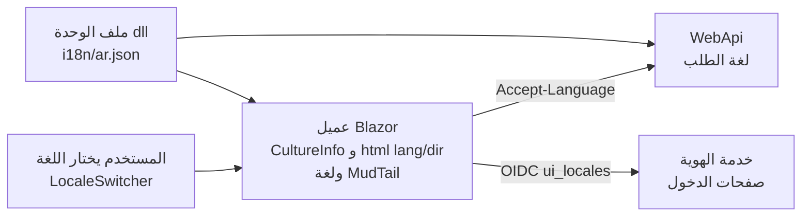

المنصة **بالعربية افتراضيا**، وتكتب من اليمين إلى اليسار، وكذلك **بالإنجليزية**. يتبع عميل Blazor وتخطيطاته ووحداته،
ورسائل WebApi، وصفحات الدخول في خدمة الهوية، اللغة التي يختارها المستخدم. أما المحتوى (نص المقال) فيترجم على حدة، كما في
[ترجمة المحتوى](#ترجمة-المحتوى).



## النصوص في الكود: مفاتيح إنجليزية وJSON مضمن

يكتب النص بالإنجليزية في الكود ويقرأ عبر `IStringLocalizer<T>`، والنص الإنجليزي هو المفتاح:

```razor
@inject IStringLocalizer<Notes> L

<h1>@L["Notes"]</h1>
<button>@L["Save"]</button>
<p>@L["{0} notes", notes.Count]</p>
```

يحفظ كل مشروع ملفا لكل لغة في `i18n/`، مفاتيحه النصوص الإنجليزية:

```json title="src/Module.Notes/i18n/ar.json"
{
  "Notes": "الملاحظات",
  "Save": "حفظ",
  "{0} notes": "{0} ملاحظة"
}
```

- **الترجمة الناقصة تعرض النص الإنجليزي**، لا مفتاحا خاما. لا حاجة إلى `en.json` إلا لإعادة صياغة الإنجليزية.
- **الملفات مضمنة في التجميعة** باسم `i18n/{culture}.json`. يفعل Module SDK ذلك لكل طبقة، في العميل والخادم؛ وفي مستودع
  المنصة يفعله `modules/client/Directory.Build.targets` لوحدات العميل المشحونة معها.
- **لماذا لا `.resx`:** تذهب الموارد إلى تجميعات تابعة (`ar/x.resources.dll`)، أما الوحدة فتجميعة واحدة ترفع وتحمل في سياق
  تحميل خاص بها قابل للتفريغ. يسافر JSON المضمن داخل الوحدة، ويعمل في أي مجموعة وفي المتصفح، ولا تقرأ وحدة نصوص وحدة أخرى.
- **ترتيب البحث** عن `L["Save"]` في التجميعة A باللغة `ar-EG`: `ar-EG` في A، ثم `ar` في A، ثم النصوص المشتركة
  (`ModularBlazor.Abstractions`: حفظ، إلغاء، ...) بـ `ar-EG` ثم `ar`، ثم المفتاح نفسه.

المصنع هو `EmbeddedJsonStringLocalizerFactory` في `Share.All`، وهو نفسه في العميل والخادم. يحفظ النصوص المحللة في جدول
ضعيف المراجع، فيبقى سياق تحميل الوحدة قابلا للتفريغ.

## عميل Blazor

| الجزء | عمله |
| --- | --- |
| `ILocaleService` (`ModularBlazor.Abstractions.Localization`) | اللغة الحالية، وهل هي من اليمين إلى اليسار، واللغات المتاحة، و`SetCultureAsync`، وحدث `Changed` |
| `LocaleSwitcher` | قائمة اللغات، تعرضها التخطيطات وصفحة الدخول |
| الإعداد | `wwwroot/appsettings.json`: `"Localization": { "DefaultCulture": "ar", "Cultures": ["ar", "en"] }` |
| الاختيار | يحفظ في المتصفح (`localStorage`، `mb.culture`). يطبقه `index.html` على `<html lang dir>` قبل بدء Blazor، فيظهر أول عرض بالاتجاه الصحيح |

يضبط التبديل `CultureInfo` (النصوص والتواريخ والأرقام)، و`<html lang dir>`، ولغة MudTail، و`Accept-Language` في كل طلب
API، ثم يعيد عرض التطبيق كله: فلا تحتاج المكونات إلا إلى قراءة نصوصها بـ `L[...]`. اكتب CSS بالخصائص المنطقية
(`margin-inline-start` و`padding-inline` و`inset-inline-end`)، لا يسار ويمين، لتعمل ورقة أنماط واحدة في الاتجاهين.

**عناوين القوائم** مترجمة أيضا. عند الرفع يقرأ كتالوج وحدات العميل عناوين مداخل القائمة من `i18n/*.json` في الوحدة
(بيانات وصفية فقط، لا يشغل أي كود)، ويحفظها مع المدخل (`Titles`)، فتظهر القائمة بلغة المستخدم قبل تنزيل الوحدة.

## WebApi

يعمل كل طلب بلغة المستدعي، وتعرف بهذا الترتيب: `?culture=ar` ثم `Accept-Language`. يجب أن تكون من
`Localization:Cultures` (افتراضيا `ar` و`en`)، وإلا طبقت `Localization:DefaultCulture` (افتراضيا `ar`). ويذكر الرد اللغة في
`Content-Language`. لا يوجد ملف تعريف ارتباط للغة: يستدعى WebApi برمز حامل.

تحقن الوحدة `IStringLocalizer<T>` لأنواعها، فتخرج رسائلها (التحقق وتفاصيل المشكلات) بلغة المستدعي من `i18n/*.json` الخاص بها.

## خدمة الهوية

صفحات الدخول واختيار المستأجر والخروج والدعوات بالعربية افتراضيا، وتتبع التطبيق: يرسل العميل لغته في معامل OIDC
`ui_locales`، وفي كل صفحة روابط لغة `?culture=`. ويحفظ الاختيار في ملف تعريف ارتباط اللغة.

## ترجمة المحتوى

النصوص أعلاه نصوص التطبيق. أما نص المقال فيترجم لكل مقال، طبقة فوق مستنده:

- **DynamicFields** يحدد الصيغة: الترجمة، لكل معرف عقدة (`$root` للجذر) ومفتاح محتوى، هي النص المترجم وبصمة النص المصدر
  الذي ترجم منه. يسرد `POST /api/dynamicfields/content/translations/check` ما يقبل الترجمة وما هو حديث أو قديم أو ناقص؛
  ويعيد `.../apply` الشجرة بلغة القارئ (طبقة اللغة، ثم طبقات اللغات الأم، ثم المصدر).
- **Contents** يحفظ طبقة لكل لغة بجانب كل مقال (`PUT` و`DELETE /api/content/posts/{id}/translations/{language}`، لمن يحق
  له تعديل المقال). يأخذ النشر الترجمات مع المستند. ويدمج `GET /api/content/public/{publicId}?culture=ar` ترجمة اللغة فوق
  المستند المنشور.
- في صفحة المقال قسم **الترجمات** يفتح نافذة الترجمة من DynamicFields عندما تكون الوحدة مثبتة.

## إضافة لغة إلى وحدة

1. أضف `i18n/{culture}.json` إلى كل مشروع فيه نصوص (الصفحات، عناوين القوائم، رسائل حالات الاستخدام).
2. ابن المشروع. يضمن SDK الملفات، ولا يتغير شيء آخر.
3. لتقديم لغة جديدة في التطبيق، أضفها إلى `Localization:Cultures` في `appsettings.json` للعميل، وفي إعدادات WebApi وخدمة الهوية.
