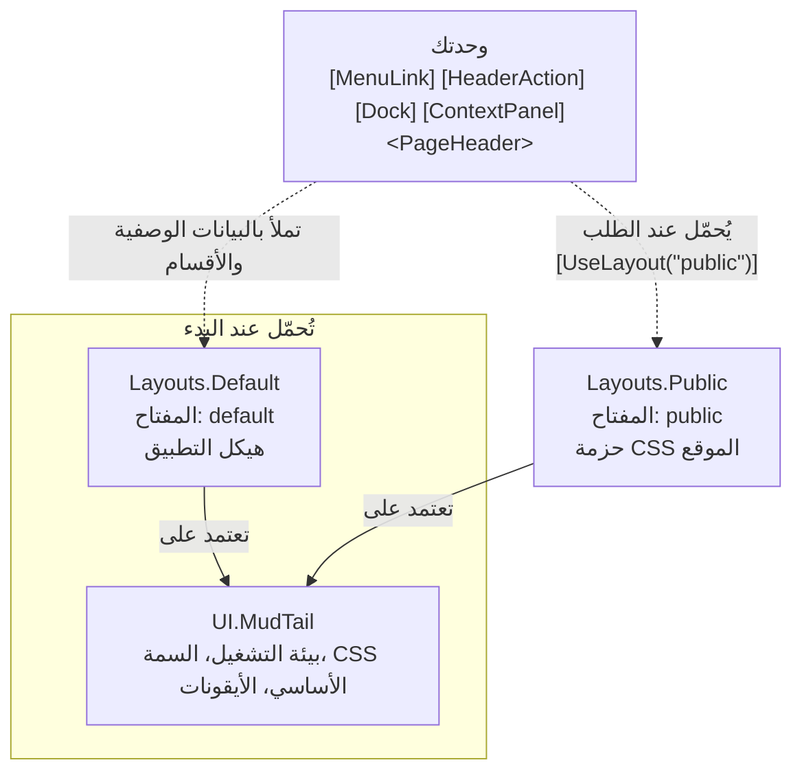

يرسم الصفحةَ في العميل **تخطيطٌ**، وهو `LayoutComponentBase` في وحدة عميل. التخطيطات وحدات كغيرها: تُرفع إلى الكتالوج،
ويمكن استبدالها، ويحمّل المضيف التخطيط الذي تطلبه الصفحة. لا تشير الوحدات إلى تخطيط بعينه أبدا، بل تملأ أماكنه
بالبيانات الوصفية (القوائم، أزرار الشريط العلوي، الألواح السفلية، ألواح السياق) وبأقسام Blazor (عنوان الصفحة ومسارها
وأزرارها)، فتعمل الوحدة نفسها تحت أي تخطيط.



## الوحدات الثلاث

| الوحدة | تُحمّل | تحمل |
| --- | --- | --- |
| **UI.MudTail** | عند البدء، مخفية | نسخة MudTail الوحيدة (`js/module.js`)، وسمتها، وورقة الأنماط الأساسية (`css/mudtail.min.css`)، وحزمة الأيقونات. يتشاركها كل تخطيط وكل وحدة. |
| **Layouts.Default** | عند البدء، مخفية | مفتاح التخطيط `default`: هيكل التطبيق للمستخدم المسجّل. أنماطه الخاصة فقط (`css/main.min.css`). |
| **Layouts.Public** | عند الطلب، مخفية | مفتاح التخطيط `public`: الموقع العام (الترويسة، القائمة الكبرى، التذييل) وحزمة الموقع من MudTail (`css/site.min.css`: الأخبار والرياضة والمعارض). |

استبدال التخطيط يُبقي بيئة التشغيل: السمة والإشعارات وكل مكوّن أنشأته وحدة تبقى كما هي.

### استخدام MudTail من وحدة

احقن `MudTailRuntime` (من ModularBlazor.Abstractions) بدل استيراد سكربت خاص بك:

```csharp
@inject MudTailRuntime MudTail

await MudTail.ToastAsync(L["Saved"], "success");

if (await MudTail.GetAsync() is { } mud)                // null when UI.MudTail failed to load
{
    _tabs = await mud.InvokeAsync<IJSObjectReference>("create", "tabs", host, options, DotNetObjectReference.Create(this));
}
```

يعيد `GetAsync()` الكائن الذي يسلّمه `moduleHost.get('UI.MudTail')`، وفيه واجهة MudTail الكاملة لـ Blazor (انظر
`src/MudTail/README.md`) مع بعض أدوات الهيكل: `iconNames()` و`addIcons(...)` و`mode()` / `setMode(...)`
و`watchMedia(queries, dotNetRef)`.

**كود يُحمّل عند أول استخدام.** أكبر أربعة مكوّنات، `dock` و`tree` و`image-editor` و`explorer`، ليست في
`module.js`. يستورد `create('tree', …)` المكوّن وورقة أنماطه في المرة الأولى، وينتظره `InvokeAsync` كالمعتاد. ويستورد
`load('explorer')` أحدها مسبقا. وكل ما عداها، ومنه جدول البيانات، موجود من البداية.

### الأيقونات

يرسم الهيكل أيقونات Lucide من حزمة تضعها UI.MudTail في أول `<body>`. خاصية `Icon` لمدخل القائمة أو زر الشريط العلوي
أو اللوح السفلي أو لوح السياق اسمٌ منها (`users` و`bell` و`messages-square`…). والوحدة التي تحتاج أيقونة أخرى تضيفها:

```csharp
await mud.InvokeVoidAsync("addIcons", new Dictionary<string, string> { ["rocket"] = "<path d=\"…\"/>" });
```

والاسم غير المعروف يُعرض بدلا منه أول حرف من عنوان المدخل.

## اختيار التخطيط

يسجّل التخطيط نفسه بمفتاح، وتطلبه الصفحة أو الوحدة:

```razor title="Layouts.Public/PublicLayout.razor"
@inherits LayoutComponentBase
@attribute [LayoutKey("public")]
```

```razor title="صفحة في وحدتك"
@page "/news/{Slug}"
@attribute [UseLayout("public")]     @* "none" renders the page with no layout *@
```

```csharp title="أو كل صفحات الوحدة"
[assembly: ClientModule(Name = "News", Layout = "public")]
```

يفوز `[UseLayout]` على الصفحة نفسها، ثم `Layout` في الوحدة، ثم `default` (ويُستخدم أيضا لمفتاح لا توفره أي وحدة).
ويتقدم على كل ذلك `[Layout(typeof(...))]` من Blazor على الصفحة. يسجّل الكتالوج المفاتيح التي توفرها كل وحدة
(`ProvidesLayouts`)، فإذا طلبت صفحة مفتاحا لا تملكه أي وحدة محمّلة، حمّل المضيف الوحدة التي توفره أولا ثم رسم الصفحة.
وهكذا لا ينزّل مستأجر لا صفحات عامة له Layouts.Public أبدا.

يصف `[LayoutInfo]` بجوار `[LayoutKey]` ما يقدمه التخطيط (دوره، وأقسامه، ومناطق قوائمه، وأنواع الإضافات التي يعرضها).
وهو بيانات وصفية اختيارية يقرؤها الكتالوج عند الرفع، والأدوار في `LayoutRoles` (`app` و`admin` و`public` و`auth`
و`blank`).

## رأس الصفحة

تملأ الصفحة عنوان التخطيط ومسار التنقل وأزرار الإجراءات بـ `<PageHeader>`:

```razor
<PageHeader Title="@L["Posts"]">
  <Breadcrumbs><a href="content">@L["Content"]</a></Breadcrumbs>
  <Actions><button class="mud-btn mud-btn--primary" @onclick="New">@L["New post"]</button></Actions>
</PageHeader>
```

والعنوان هو أيضا عنوان تبويب المتصفح. هذه في الحقيقة أقسام Blazor، أسماؤها في `LayoutSections`:

| القسم | أين يعرضه التخطيط الافتراضي |
| --- | --- |
| `LayoutSections.Title` | في الشريط العلوي |
| `LayoutSections.Breadcrumbs` | فوق العنوان |
| `LayoutSections.PageActions` | في نهاية الشريط العلوي |
| `LayoutSections.ContextPanel` | أولا في لوح السياق، قبل تبويبات الوحدات |

يمكن ملء أحدها مباشرة بـ `<SectionContent SectionName="@LayoutSections.ContextPanel">…</SectionContent>`. والتخطيط الذي لا
مكان فيه لقسم ما يتركه ببساطة، ويذهب المحتوى مع الصفحة.

## ما تضيفه الوحدات إلى الهيكل

إلى جانب روابط القوائم ([القوائم](/ar/guides/menus/))، يمكن للوحدة أن تضيف إلى التخطيط ثلاثة أنواع من المكوّنات، تُعلن
بسمات التجميعة. وكمداخل القوائم، يقرؤها الكتالوج من البيانات الوصفية عند الرفع، فيعرف التخطيط المدخل (عنوانه وأيقونته
وشارته) **قبل تنزيل الوحدة**، ويذهب المدخل حين تخرج الوحدة من كتالوج المستخدم.

```csharp title="Module.Chat/AssemblyInfo.cs"
[assembly: HeaderAction("bell", "Notifications", typeof(NotificationBell), Icon = "bell", Order = 10)]
[assembly: Dock("chat", "Chat", typeof(ChatDock), Icon = "messages-square", Badge = "api/chat/unread")]
[assembly: ContextPanel("comments", "Comments", typeof(PostComments), Icon = "message-circle",
    ForContext = new[] { "content.post" }, Permissions = new[] { "content.comments.read" })]
```

| السمة | أين تظهر | متى تُحمّل وحدتها |
| --- | --- | --- |
| `HeaderAction` | مكوّن صغير في الشريط العلوي قبل قائمة المستخدم | يُرسم بعد تحميل الوحدة، لذا تُحمّل هذه الوحدة عادة باستراتيجية Preload |
| `Dock` | تبويب في شريط الألواح السفلي؛ يبقى اللوح مفتوحا بين الصفحات، ويمكن تثبيته | عند فتح اللوح أول مرة |
| `ContextPanel` | تبويب في اللوح بجوار الصفحة، لمسارات معينة أو لما حددته الصفحة | عند فتح التبويب أول مرة |

الخصائص المشتركة: `Icon`، و`Order` (الأصغر أولا، والافتراضي 100)، و`Permissions` (يحتاج المستخدم واحدة منها؛ وبدونها
يراه كل من تصله الوحدة). ويأخذ `Dock` و`ContextPanel` الخاصيتين `Badge` و`BadgeRefresh` كرابط القائمة. والعناوين
بالإنجليزية وتُترجم من ملفات `i18n/*.json` في الوحدة كعناوين القوائم.

ويمكن للمكوّن أن يستقبل السياق الذي يمرره التخطيط:

```razor
@code {
  [Parameter] public ContributionContext? Context { get; set; }
  // Context.ContributionId = "Module.Chat:comments"; for a context panel, ContextKey / ContextValue
}
```

يُرسم كل مكوّن داخل حاجز أخطاء: الإضافة التي تفشل تظهر غير متاحة ويبقى الهيكل عاملا.

### ألواح السياق وسياق الصفحة

يتيح لوح السياق لوحدة أن تضيف إلى صفحات وحدة أخرى دون أن تشير إليها. يظهر حين يطابق مساره (`ForRoutes`:
`"content/posts/*"` جزء واحد، و`"content/**"` كل ما تحته) أو حين تضبط الصفحة أحد مفاتيح سياقه (`ForContext`). المفاتيح
ملك الصفحة، وتعلنها ثوابت (`"{module}.{entity}"`):

```csharp
@inject IPageContext PageContext

void Select(Post post) => PageContext.Set(ContentContext.Post, post.Id.ToString());   // a row was selected
void Unselect() => PageContext.Clear(ContentContext.Post);
```

ثم يُفتح اللوح لذلك المفتاح وقيمته (`Context.ContextKey` و`Context.ContextValue`)، ويُعاد إنشاؤه حين تتغير القيمة. ويُمسح
كل ما في سياق الصفحة عند التنقل.

يقرأ التخطيط المداخل من `IShellContributions` (`Of(ShellContributionKinds.Dock)`، و`ResolveAsync(entry)` لتحميل الوحدة
والحصول على نوع المكوّن). ولا تستدعيه الوحدات أبدا، بل تعلن فقط.

ونوع رابع، `[DockPanel]`، يضيف لوحة إلى استوديو وحدة أخرى لا إلى التخطيط، فلا تعرضه التخطيطات. انظر
[لوحات الاستوديو](/ar/guides/studio-panels/).

## العلامة التجارية

لكل مستأجر علامة: الاسم، والاسم القصير، وشعاران للخلفية الفاتحة والداكنة، وأيقونة الموقع، واللونان الأساسي والثانوي،
ونصف قطر الزوايا، والخط، ووضع الألوان الافتراضي، والأوضاع التي يمكن للمستخدمين اختيارها، وهل يمكنهم تغيير الألوان. تقرؤها
التخطيطات من `IBranding.Current` (من النوع `BrandInfo`) وتعيد الرسم عند حدث `Changed`:

```razor
@inject IBranding Branding

<a class="brand" href="">@Branding.Current.DisplayShortName</a>
```

تحفظها الوحدة الأساسية **branding** في WebApi على طبقتين، طبقة المنصة وطبقة كل مستأجر فوقها، كالقوائم:

| النقطة | من | تفعل |
| --- | --- | --- |
| `GET /api/branding` | أي أحد (صفحة الدخول تحمل العلامة أيضا) | العلامة الفعلية لمستأجر الطلب |
| `GET /api/branding/assets/{folder}/{name}` | أي أحد | صورة العلامة، مخزّنة مؤقتا للأبد |
| `GET` و`PUT /api/branding/admin` | `branding.manage` في المستأجر، أو `platform.modules.manage` | طبقة واحدة للتحرير؛ يحمل الحفظ الإصدار الذي قرأه |
| `POST /api/branding/admin/assets/{kind}` | كذلك | يرفع `logo` أو `logo-dark` أو `favicon` (.png و.jpg و.webp و.svg و.ico؛ 512 كيلوبايت على الأكثر) |

تحتفظ صفحة المضيف في المتصفح بآخر علامة استلمتها وتطبق ألوانها ووضعها قبل بدء Blazor، فيرى الزائر العائد العلامة من أول
رسم. واختيار المستخدم نفسه للوضع (وللألوان حين تسمح العلامة) محفوظ في المتصفح أيضا ويتقدم على العلامة.

## الصلاحيات

تخفي `Permissions` على `MenuLink` و`MenuGroup` وسمات الإضافات الثلاث ما لا يستطيع المستخدم استخدامه. يصفّي WebApi
بيان الوحدات بمنح المستدعي، فلا يصل إلى العميل مدخل لا يحق للمستخدم رؤيته، ويتغير وسم ETag للبيان حين تتغير منحة.

ولأزرار الصفحة نفسها، احقن `IUserPermissions`:

```razor
@inject IUserPermissions Permissions

@if (Permissions.Has("content.posts.publish"))
{
  <button @onclick="Publish">@L["Publish"]</button>
}
```

يقرأ منح المستخدم من وحدة الهوية (`GET api/identity/me`)؛ وتكون `IsLoaded` خاطئة حتى ذلك الحين وطوال الخروج، فاعتبر كل
شيء غير ممنوح. وهي تشكّل الواجهة فقط: الـ API يتحقق من كل طلب بنفسه.

## التخطيط الافتراضي

Layouts.Default 2.0 هو هيكل التطبيق للمستخدم المسجّل:

- **درج التنقل** بمنطقتي القوائم `main` و`secondary`. تحت 1024 بكسل يطفو فوق الصفحة؛ ومن 1024 إلى 1279 بكسل يبدأ شريط
  أيقونات تنبثق منه المجموعات؛ ومن 1280 بكسل يكون موسعا ما لم يصغّره المستخدم.
- **الشريط العلوي:** زر القائمة، ومسار التنقل والعنوان، وإجراءات الصفحة، وأزرار الوحدات، وزر لوح السياق، وزر السمة،
  وقائمة المستخدم (منطقة `user`).
- **لوح السياق** في نهاية السطر: بجوار الصفحة من 1280 بكسل، وفوقها كورقة تحت ذلك.
- **شريط الألواح** في الأسفل، بتبويب لكل لوح؛ ويمكن تثبيت لوح واحد مفتوحا.
- **درج السمة:** وضع الألوان، ولوحة الألوان، والزوايا، والكثافة (مريحة أو مضغوطة)، والأرقام (لاتينية أو عربية)، في حدود
  ما تسمح به العلامة.

كل شيء يستخدم بداية السطر ونهايته، فينعكس الهيكل في العربية. ويُحفظ وضع الدرج والمجموعات المفتوحة واللوح المثبّت
والكثافة لكل متصفح.

## التخطيط العام

يرسم Layouts.Public صفحة موقع إخباري من أصناف `mud-site` في MudTail: ترويسة بشعار العلامة، وقائمة كبرى، وشريط تقدم
القراءة، وتذييل. تأتي أقسام القائمة الكبرى من منطقة القوائم **`public`** (ومن `main` إن لم تملأها أي وحدة): المجموعة
`MenuGroup` قسم، وروابطها لوح القسم، والمجموعة داخلها عمود في اللوح. وسلوكياتها (`mega-nav` و`reading-progress`
و`theme-toggle`) تأتي من سمات `data-mud` في UI.MudTail، فلا سكربت خاص بالتخطيط.

## الملفات

يُضمَّن مجلد `wwwroot` للوحدة في ملف DLL. عند الرفع يستخرجه WebApi ويقدم كل ملف من عنوانه الخاص،
`api/client-modules/files/{id}/{version}/{token}/{path}`، حيث يتغير الرمز مع المحتوى (فيمكن تخزين الملفات مؤقتا للأبد)،
وتأتي السكربتات ببصمة سلامة يتحقق منها المتصفح. وتُحل الاستيرادات النسبية في السكربت (`./chunks/…`) بالنسبة إلى ذلك العنوان.

وحين لا تكون في الكتالوج نسخة مقدَّمة من ملف (مثل حزمة رُفعت قبل استخراج الملفات)، يسلّم المضيف الكود إلى المتصفح من
الحزمة التي نزّلها، من الذاكرة. وتُربط أجزاء السكربت من الذاكرة كذلك، فتعمل الوحدات المجزّأة مثل UI.MudTail؛ لكن أوراق
أنماط مكوّنات MudTail لا تُحمّل في هذا الوضع.
