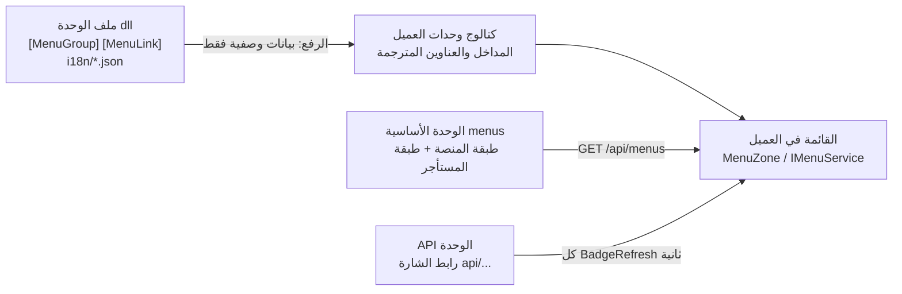

للعميل ثلاث قوائم تسمى **مناطق**: `main` و`secondary` و`user`. تضع وحدة العميل فيها روابط ومجموعات (قوائم فرعية) بسمات
التجميعة. يقرأها الكتالوج من بيانات الوحدة الوصفية عند الرفع، كما يقرأ `[ClientModule]`، فتظهر المداخل في القائمة قبل
تنزيل الوحدة. ثم يغير المسؤولون القوائم في صفحة **القوائم** في العميل، وتحفظها الوحدة الأساسية `menus` في WebApi.



## تعريف المداخل

```csharp title="Module.Admin/AssemblyInfo.cs"
[assembly: MenuGroup("admin", "Administration", Href = "admin", Zone = "secondary", Order = 90)]
[assembly: MenuLink("members", "Members", "admin/members", Parent = "admin", Order = 20)]
```

وتنضم وحدة أخرى إلى تلك المجموعة بمعرفها الكامل `{moduleId}:{id}`:

```csharp title="Module.Tenants/AssemblyInfo.cs"
[assembly: MenuLink("tenants", "Tenants", "tenants", Zone = "secondary", Parent = "Module.Admin:admin", Order = 10)]
```

| الخاصية | `MenuGroup` | `MenuLink` | المعنى |
| --- | --- | --- | --- |
| `id` | نعم | نعم | فريد في الوحدة؛ والمعرف الكامل `{moduleId}:{id}` |
| `title` | نعم | نعم | بالإنجليزية، ويترجم من `i18n/*.json` في الوحدة |
| `href` | `Href`، اختياري | نعم | صفحة من صفحات الوحدة نفسها (تحت بادئات مساراتها) |
| `Zone` | نعم | نعم | `main` (الافتراضي) أو `secondary` أو `user` |
| `Parent` | نعم | نعم | معرف مجموعة في هذه الوحدة، أو `{moduleId}:{id}` في وحدة أخرى |
| `Icon`، `Order` | نعم | نعم | `Order` يرتب داخل الأب (افتراضيا 100) |
| `Badge`، `BadgeRefresh` | نعم | نعم | انظر [الشارات](#الشارات) |

القواعد:

- **الروابط تبقى داخل الوحدة.** يحذر الرفع من أي رابط آخر (عنوان خارجي، صفحة وحدة أخرى) ويتركه. يستطيع المسؤولون إضافة
  هذه في صفحة القوائم.
- **المداخل تتبع الوحدة.** تخرج من القائمة عندما تخرج الوحدة من كتالوج المستخدم: معطلة، محذوفة، لم تعد لأدواره أو مستأجره.
- **الموضع.** يظهر الابن في منطقة أبيه. إن لم تكن وحدة الأب موجودة، يظهر الابن في أعلى منطقته. وتخفى المجموعة الفارغة التي
  لا `Href` لها.
- **الوحدات القديمة.** تحتفظ الوحدة التي لا سمات قوائم لها بمدخل `NavTitle`، رابطا في `main`.
- **العناوين** إنجليزية في الكود، وتترجم عند الرفع من `i18n/{culture}.json` في الوحدة (انظر [اللغات](/ar/guides/i18n/)).

## عرض منطقة في تخطيط

```razor
<MenuZone Zone="@MenuZones.Main" />
<MenuZone Zone="@MenuZones.Secondary" />
```

والتخطيط الذي يرسم قائمته بنفسه يقرأ الشجرة من `IMenuService.Zone(MenuZones.User)` ويعيد العرض عند حدث التغيير.

## صفحة القوائم

يغير المسؤولون القوائم في `/menus`، وتحفظ الوحدة الأساسية `menus` (الإصدار 1.0.0) التغييرات:

| النقطة | من | العمل |
| --- | --- | --- |
| `GET /api/menus` | الجميع | التغييرات التي تنطبق على مستأجر المستدعي، مع ETag (304 عند عدم التغيير) |
| `GET /api/menus/admin` | `menus.manage` في المستأجر، أو `platform.modules.manage` | طبقة واحدة للتحرير |
| `PUT /api/menus/admin` | نفسه | يحفظ طبقة، ويحمل الحفظ الإصدار الذي قرأه؛ 409 إذا حفظ أحد في الأثناء |

هناك طبقتان: **طبقة المنصة** (لكل المستأجرين؛ لمسؤولي المنصة، دون مستأجر) و**طبقة كل مستأجر** فوقها (صلاحية `menus.manage`
في المستأجر، أو مسؤول منصة يسمي المستأجر). في الطبقة يستطيع المسؤول:

- **تغيير أي مدخل بمعرفه:** إخفاؤه، إعادة تسميته لكل لغة، نقله إلى منطقة أو مجموعة أخرى، إعادة ترتيبه.
- **إضافة روابط ومجموعات خاصة به،** إلى صفحات التطبيق أو إلى عناوين `http(s)` خارجية (تفتح في تبويب جديد)، للجميع أو
  للمستخدمين المسجلين أو للزوار فقط. تعرف المداخل المضافة بـ `@platform:{id}` و`@tenant:{id}`.

لا تقرأ الوحدة مداخل الوحدات أبدا: تحفظ التغييرات بالمعرف ويطبقها العميل، فالمدخل الذي خرجت وحدته من الكتالوج لا يبقى له ما
يتغير.

## الشارات

يمكن أن يعرض المدخل شارة (عددا، "جديد") من API الوحدة نفسها:

```csharp
[assembly: MenuLink("tenants", "Tenants", "tenants", Zone = "secondary", Parent = "Module.Admin:admin",
    Badge = "api/tenancy/subscriptions/attention", BadgeRefresh = 300)]
```

- يطلب العميل الرابط (نسبة إلى WebApi، ويجب أن يبدأ بـ `api/`) برمز المستخدم عندما يكون المدخل في القائمة، ثم كل
  `BadgeRefresh` ثانية (من 15 إلى 3600؛ افتراضيا 60). المداخل ذات الرابط نفسه تتشارك طلبا واحدا.
- **الرد** رقم، أو مصفوفة (طولها)، أو كائن:

  ```json
  { "count": 3, "tone": "warning", "label": "3 اشتراكات تحتاج إلى انتباه" }
  ```

  يمكن أن يحل `text` (حتى 12 حرفا) محل `count`. والألوان `neutral` و`info` و`success` و`warning` و`error`.
- الصفر أو المصفوفة الفارغة أو 204 لا تعرض شارة. والخطأ (403، 404) لا يعرض شيئا ويعاد طلبه بعد عشر دقائق.
- يحقن كود الوحدة المحملة `IMenuBadges`: `RefreshAsync(entryId)` بعد أن يغير ما يعد، و`Set(entryId, badge)` لمدخل بلا رابط.
- تنسق التخطيطات `.menu-badge` و`.menu-badge--{tone}`.

مثال شارة المستأجرين هو `GET /api/tenancy/subscriptions/attention` في وحدة Tenancy.
