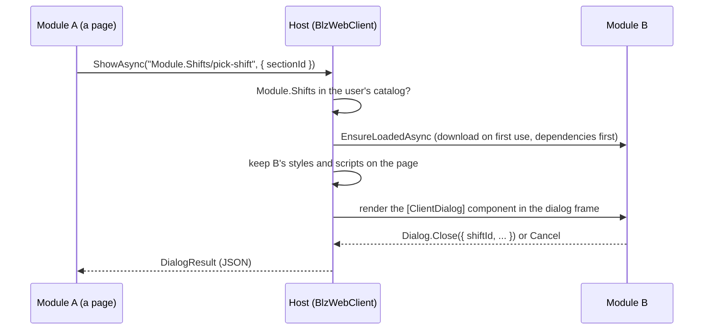

تبنى وحدات العميل وتثبت كل واحدة على حدة، فلا تشير وحدة إلى أخرى أبدا. ومع ذلك تستطيع وحدة أن تفتح نافذة حوار توفرها وحدة
أخرى: تطلبها من المضيف **بمعرف النافذة**. فيحمل المضيف الوحدة المالكة، ويعرض النافذة في إطار الحوار في MudTail، ويعيد النتيجة
إلى الوحدة الطالبة.



يجري كل ذلك في المتصفح، في بيئة .NET واحدة: لا رحلة إلى الخادم، ولا وسيط رسائل، ولا مركز SignalR. وحين يحتاج الخادم أو
مستخدم آخر أن يسأل المستخدم شيئا، أوصل ذلك الحدث إلى العميل (SignalR) واعرض النافذة عبر الخدمة نفسها.

## توفير نافذة حوار (الوحدة B)

ضع `[ClientDialog]` على مكون. معرفه `"{module id}/{name}"`، ويجب أن يبدأ بمعرف الوحدة نفسها في الكتالوج (يتجاهل المضيف،
مع رسالة في وحدة التحكم، معرفا يقع تحت معرف وحدة أخرى).

```razor title="Module.Shifts/Dialogs/PickShiftDialog.razor"
@attribute [ClientDialog("Module.Shifts/pick-shift", Title = "Pick a shift")]

@*
  Contract, for other modules:
    parameters  { sectionId?: number }
    result      { shiftId, section, startsAt }
*@

<div class="mud-dialog-content">
  …the module's own UI, calling its own API…
</div>
<div class="mud-dialog-actions">
  <button type="button" class="mud-button-root mud-button-text mud-button-medium" @onclick="Dialog.Cancel">Cancel</button>
  <button type="button" class="mud-button-root mud-button-filled mud-button-primary mud-button-medium"
          @onclick="() => Dialog.Close(new { shiftId = _id, section = _section, startsAt = _startsAt })">Choose</button>
</div>

@code {
  [CascadingParameter] public IDialogReference Dialog { get; set; } = default!;

  private sealed record Parameters(int? SectionId);

  protected override async Task OnAfterRenderAsync(bool firstRender)
  {
    if (!firstRender) return;
    var sectionId = Dialog.GetParameters<Parameters>()?.SectionId;
    …
  }
}
```

يرسم المضيف الإطار: الغطاء وشريط العنوان وزر الإغلاق. ويرسم المكون المحتوى وأزراره، عادة `div.mud-dialog-content` و
`div.mud-dialog-actions`، وينهي النافذة عبر `IDialogReference` المتتالي:

| العضو | ما يفعله |
| --- | --- |
| `Close(object? data)` | يغلق النافذة بنتيجة؛ تتلقى الوحدة الطالبة `data` بصيغة JSON |
| `Cancel()` | يغلقها بلا نتيجة |
| `GetParameters<T>()` | معاملات الطالب بنوع النافذة نفسها |
| `Parameters` | الشيء نفسه، بصيغة `JsonElement` |

النافذة مكون عادي في وحدتها: تحقن الخدمات (`IHttpClientFactory`، `MudTailRuntime`، ...) وتستخدم أنماط وحدتها، التي تبقى في
الصفحة ما دامت النافذة مفتوحة، أيا كانت الصفحة التي فتحتها.

## فتح نافذة حوار (الوحدة A)

احقن `IModuleDialogs` وانتظر النتيجة. لا تعلن الوحدة A اعتمادها على الوحدة B ولا تشير إلى أي من أنواعها؛ بل تقرأ النتيجة في
سجل (record) خاص بها.

```razor
@inject IModuleDialogs Dialogs

@code {
  private sealed record PickedShift(int ShiftId, string Section, DateTimeOffset StartsAt);

  private async Task PickAsync()
  {
    var result = await Dialogs.ShowAsync("Module.Shifts/pick-shift", new { sectionId = 3 },
        new DialogOptions { Title = "Pick a sports shift" });
    if (result.Canceled) return;
    var picked = result.As<PickedShift>();
  }
}
```

| | |
| --- | --- |
| `ShowAsync(id, parameters?, options?, cancellationToken?)` | يكتمل حين تغلق النافذة. تنتقل المعاملات والنتيجة بصيغة JSON للويب (camelCase، دون حساسية لحالة الأحرف) |
| `DialogResult.Canceled` | صحيح بعد ✕، أو Escape، أو نقرة على الغطاء، أو `Cancel()`، أو الانتقال من الصفحة، أو رمز الإلغاء |
| `DialogResult.As<T>()` / `Data` | النتيجة بنوع الطالب، أو بصيغة `JsonElement` |
| `DialogOptions` | `Title`، و`MaxWidth` (طول CSS)، و`CloseOnOverlayClick`، و`CloseOnEscape`؛ وما لم يضبط يؤخذ من `[ClientDialog]` |
| `IsAvailable(id)` | هل الوحدة المالكة في كتالوج المستخدم، لإخفاء زر لن يعمل. لا ينزل شيء |
| `ModuleDialogException` | معرف مجهول، أو وحدة لا يحق للمستخدم استخدامها، أو وحدة فشل تحميلها، أو وحدة بلا تلك النافذة |

قد تفتح نافذة نافذة أخرى: تتراكب، والأحدث في الأعلى، والعليا وحدها تتلقى النقرات.

## العقد

معرف النافذة وشكلا JSON هما العقد بين الوحدتين، كمسار HTTP وأجسامه. اكتبها بجوار المكون (كما في المثال)، وأبقها متوافقة مع ما
سبق، وأعط العقد المتغير معرفا جديدا (`Module.Shifts/pick-shift-v2`) ريثما ينتقل الطالبون إليه. لا شيء يفحص العقد وقت
الترجمة: اختبر الاستدعاء في ساحة تجربة (playground) تثبت الوحدتين.

الوصول يتبع الكتالوج. فكتالوج المستخدم لا يضم إلا الوحدات التي تسمح بها أدواره ومستأجره، فتفشل نافذة وحدة لا يحق له
استخدامها بـ `ModuleDialogException` (افحص `IsAvailable` أولا). أما ما تقرؤه النافذة أو تغيره فتقرره الواجهة البرمجية لوحدتها،
كما في صفحاتها.

## كيف يفعلها المضيف

- يسجل `ModuleManager` مكونات `[ClientDialog]` في كل وحدة محملة، كما يسجل تخطيطات `[LayoutKey]`، ويسقطها حين تفرغ الوحدة.
- يفحص `ModuleDialogService` (‏`IModuleDialogs`) الكتالوج، ويستدعي `EnsureLoadedAsync` للوحدة المالكة (اعتمادياتها أولا،
  كما للصفحة)، ويمسك الوحدة في `ActiveModuleService` ما دامت النافذة مفتوحة، فتسري أنماطها وسكربتاتها على صفحة وحدة أخرى.
- يعرض `Components/ModuleDialogHost.razor`، المرسوم مرة واحدة في `App.razor` خارج الموجه، النوافذ المفتوحة في إطار
  `mud-dialog-*` في MudTail. وكل نافذة داخل `ErrorBoundary`، فتعرض النافذة الفاشلة خطأها بدل أن تكسر الصفحة. وينتقل التركيز
  إلى النافذة حين تفتح.
