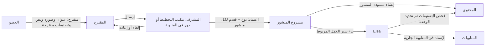

:::note[الحالة: مبنية جزئيا]
غرفة الأخبار هي المرحلة **P4** من خطة غرفة الأخبار، وتبنى في الموجة 5 في المستودع `ModularBlazor.Module.NewsRoom` (المنصة 1.0.0-preview.8).

- **مدمج:** N1 الهيكل والمقترحات (طلب الدمج #1)، وN2 الإشراف ومشاريع المنشورات (طلب الدمج #2): المقترحات وقرار المشرف ومشاريع المنشورات حتى النشر، والواجهة البرمجية التي يستخدمها سير العمل. وجانب Elsa (E1) مدمج أيضا: المشروع المعتمد يبدأ سير عمل.
- **مخطط:** N3 (ربط سير العمل وقواعد التوجيه ونموذج القراءة والمواضيع الحية) وN4 (الواجهة الكاملة). الواجهة اليوم فيها صفحة "مقترحاتي" فقط.
- **لم يتحقق منه:** لا تشغيل كامل مع المحتوى وDynamicFields والهيكل التنظيمي وخدمة الهوية الحية؛ فالاختبارات تحاكي واجهاتها.

جداول الواجهة البرمجية الكاملة في [الصفحة الإنجليزية](/modules/newsroom/proposals-and-projects/).
:::

تملك وحدة **غرفة الأخبار** *تخطيط* القصة: **المقترح** الذي يرسله العضو، وقرار **الإشراف**، و**مشروع المنشور** الذي يتابع كل منشور معتمد من الإنتاج حتى النشر. لا تملك المنشورات ولا المحتويات ولا المناوبات ولا الوحدات، بل تديرها عبر عقود الوحدات المالكة:

- **الهيكل التنظيمي** يملك شجرة الوحدات (المؤسسة ← القطاع ← الإدارة ← القسم) وأعضاءها.
- **المناوبات** تملك من هو في الخدمة في كل وحدة، وتمنحه الصلاحيات بين تسجيل الحضور والانصراف فقط.
- **المحتوى** يملك المنشورات والمحتويات ومراحلها وفحصها مقابل تعريفات الحقول الديناميكية.
- **الحقول الديناميكية** تملك نموذج المقترح، وحقول المنشور الجذرية التي *هي* أنواع المنشورات، ولكل نوع بادئة رابط ثابتة.
- **Elsa** تشغّل سير العمل المربوط بكل نوع منشور، وسير عمل فرعيا لكل نوع محتوى.

## المراحل

1. يكتب **العضو** (شخص مرتبط بحساب هوية، وغالبا موظف) **مقترحا**: عنوانا، وصورة ونصا اختياريين، وتصنيفات مقترحة.
2. **يعتمد المشرف** المقترح أو يلغيه أو يعيده للتعديل. عند الاعتماد يحدد، لكل منشور، **نوع المنشور** و**القسم** المنتج. قد يصبح المقترح الواحد عدة منشورات.
3. لكل منشور تطلب غرفة الأخبار من المحتوى إنشاء مسودة المنشور، وتنشئ **مشروع منشور**، وتبدأ سير عمل Elsa المربوط بالنوع والقسم.
4. يتحقق سير العمل من أن تصنيفات المنشور تنتمي إلى القسم، ثم يحدد وحدة المنشور، ويقسم العمل إلى محتويات، ويسند كل محتوى إلى شخص **في المناوبة** في الوحدة الصحيحة.

## الاعتماد والمسودة

يرسل المشرف سطرا لكل منشور (من 1 إلى 10): نوع المنشور، والقسم، وتصنيفات صحيفة واحدة. الاعتماد والمشاريع وأحداثها حفظ واحد. ثم ينشئ المحتوى مسودة كل منشور **باسم المشرف** (فيحتاج صلاحية الكاتب في تلك التصنيفات)، ولا تحدد غرفة الأخبار وحدة المنشور أبدا: سير العمل يفعل ذلك. فشل المسودة لا يلغي الاعتماد، ويعيدها المشرف بأمان عبر `POST /projects/{id}/draft`. وحين يملك المشروع مسودته يصدر الحدث `newsroom.project-approved.v1` مرة واحدة، فتبدأ Elsa سير العمل.

يحتاج الكاتب أيضا إلى `dynamicfields.read` لأن فحص النموذج يجري باسمه. وكل تعديل يحمل `version` الذي قرأه المستدعي، فيجيب 409 إن تغير.

## حالات مشروع المنشور

معتمد ← (فحص التصنيفات) ← قيد الإنتاج ← جاهز للديسك ← مجدول ← منشور. إذا فشل فحص التصنيفات يعود المشروع إلى المشرف (يحتاج إشرافا) ولا يفشل سير العمل، ويصلحه المشرف فيعتمد من جديد برقم اعتماد تال. يبلغ سير العمل الحالات عبر `POST /projects/{id}/state` بصلاحية `newsroom.workflow`. يمكن إلغاء المشروع (Killed) من أي حالة قبل النشر، ويبقى المنشور في المحتوى؛ وإلغاء مشروع مجدول لا يلغي جدولة المحتوى بعد.

## قاعدة تصنيفات القسم

لا يُسند منشور إلى وحدة إلا إذا كان أحد تصنيفاته على الأقل من تصنيفات تلك الوحدة (أو كانت الوحدة تغطي كل التصنيفات `*`). يتحقق النشاط `EnsurePostInUnitCategories` من ذلك عند الاعتماد، ويعيد الفحص كلما تغيرت تصنيفات المنشور أو وحدته. هوية خدمة سير العمل وحدها تملك `content.unit.assign`، فلا يمكن تجاوز الفحص باستدعاء مباشر.

## الصلاحيات

`newsroom.propose` للكتابة والإرسال، و`newsroom.moderate` على نطاق وحدة، من منصب دائم (مكتب التخطيط) أو من دور في المناوبة (فقط أثناء تسجيل الحضور)، و`newsroom.projects` لمتابعة المشاريع، و`newsroom.workflow` لهوية خدمة سير العمل (تمنح لـ`elsa-workflows` على مستوى المستأجر)، و`newsroom.manage` لربط سير العمل وقواعد التوجيه (معلنة ولم تستخدم قبل N3). سلطة المدير تنتقل إلى أسفل الشجرة: صلاحية على إدارة تشمل أقسامها.
