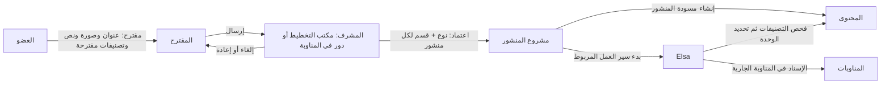

:::note[الحالة: مصممة ولم تبن بعد]
غرفة الأخبار هي المرحلة **P4** من خطة غرفة الأخبار. أنشئ مستودعها (`ModularBlazor.Module.NewsRoom`) في 2026-11-28 ولا يحوي سوى ملف README. خطة البناء (الموجة 5: N1 الهيكل والمقترحات، وN2 الإشراف ومشاريع المنشورات، وN3 الربط والتوجيه ونموذج القراءة، وN4 الواجهة الأساسية) معتمدة ولم تبدأ. كل ما تعتمد عليه مدمج الآن: وحدات الهيكل التنظيمي (Organization)، والمناوبات v2 (الوحدات، والأدوار كبيانات، والقوالب، ومنح الصلاحيات عند تسجيل الحضور، وساعة المناوبة)، ونواة غرفة الأخبار في وحدة المحتوى. هذه الصفحة تصف التصميم المتفق عليه، والتفاصيل الكاملة في [الصفحة الإنجليزية](/modules/newsroom/).
:::

تملك وحدة **غرفة الأخبار** *تخطيط* القصة: **المقترح** الذي يرسله العضو، وقرار **الإشراف**، و**مشروع المنشور** الذي يتابع كل منشور معتمد من الإنتاج حتى النشر. لا تملك المنشورات ولا المحتويات ولا المناوبات ولا الوحدات، بل تديرها عبر عقود الوحدات المالكة:

- **الهيكل التنظيمي** يملك شجرة الوحدات (المؤسسة ← القطاع ← الإدارة ← القسم) وأعضاءها.
- **المناوبات** تملك من هو في الخدمة في كل وحدة، وتمنحه الصلاحيات بين تسجيل الحضور والانصراف فقط.
- **المحتوى** يملك المنشورات والمحتويات ومراحلها وفحصها مقابل تعريفات الحقول الديناميكية.
- **الحقول الديناميكية** تملك نموذج المقترح، وحقول المنشور الجذرية التي *هي* أنواع المنشورات، ولكل نوع بادئة رابط ثابتة.
- **Elsa** تشغّل سير العمل المربوط بكل نوع منشور، وسير عمل فرعيا لكل نوع محتوى.

## المراحل

1. يكتب **العضو** (شخص مرتبط بحساب هوية، وغالبا موظف) **مقترحا**: عنوانا، وصورة ونصا اختياريين، وتصنيفات مقترحة.
2. **يعتمد المشرف** المقترح أو يلغيه أو يعيده للتعديل. عند الاعتماد يحدد، لكل منشور، **نوع المنشور** و**القسم** المنتج. قد يصبح المقترح الواحد عدة منشورات.
3. لكل منشور تطلب غرفة الأخبار من المحتوى إنشاء مسودة المنشور، وتنشئ **مشروع منشور**، وتبدأ سير عمل Elsa المربوط بالنوع والقسم.
4. يتحقق سير العمل من أن تصنيفات المنشور تنتمي إلى القسم، ثم يحدد وحدة المنشور، ويقسم العمل إلى محتويات، ويسند كل محتوى إلى شخص **في المناوبة** في الوحدة الصحيحة.

## حالات مشروع المنشور

معتمد ← (فحص التصنيفات) ← قيد الإنتاج ← جاهز للديسك ← مجدول ← منشور. إذا فشل فحص التصنيفات يعود المشروع إلى المشرف (يحتاج إشرافا) ولا يفشل سير العمل. يمكن إلغاء المشروع (Killed) من أي حالة قبل النشر.

## قاعدة تصنيفات القسم

لا يُسند منشور إلى وحدة إلا إذا كان أحد تصنيفاته على الأقل من تصنيفات تلك الوحدة (أو كانت الوحدة تغطي كل التصنيفات `*`). يتحقق النشاط `EnsurePostInUnitCategories` من ذلك عند الاعتماد، ويعيد الفحص كلما تغيرت تصنيفات المنشور أو وحدته. هوية خدمة سير العمل وحدها تملك `content.unit.assign`، فلا يمكن تجاوز الفحص باستدعاء مباشر.

## الصلاحيات

`newsroom.moderate` على نطاق وحدة، من منصب دائم (مكتب التخطيط) أو من دور في المناوبة (فقط أثناء تسجيل الحضور). سلطة المدير تنتقل إلى أسفل الشجرة: صلاحية على إدارة تشمل أقسامها.
