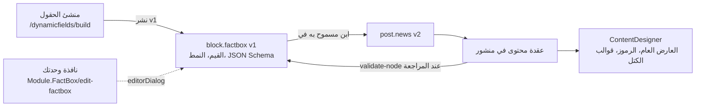

**الحقل** نوع واحد من المحتوى: فقرة، أو صورة، أو معرض، أو منشور كامل. يضيف هذا الدرس **صندوق حقائق**، `block.factbox`:
صندوق معنون من حقائق قصيرة يحمله الخبر، وله محرر خاص به. في النهاية يمكن إضافته إلى المنشورات الخبرية، ويفحص في كل خطوة
مراجعة، ويظهر في ContentDesigner.



## الخطوة 1. خطط القيم

لكل قيمة **مفتاح** (اسمها في JSON، ثابت بعد النشر)، و**عنوان**، و**نوع**، و**خاصية schema.org** التي تنشر بها، وهي ما
تقرؤه محركات البحث والذكاء الاصطناعي.

| المفتاح | العنوان | النوع | القواعد | schema.org |
| --- | --- | --- | --- | --- |
| `heading` | Heading | Text | مطلوب، 80 حرفا على الأكثر | `name` |
| `facts` | Facts | Text، متعدد | مطلوب، كل منها 140 حرفا على الأكثر | `text` |
| `source` | Source | Url | | `isBasedOn` |
| `kind` | Box type | Choice | `numbers` و`timeline` و`glossary` | |
| `image` | Image | Asset | صور فقط (`image/*`) | `image` |

أنواع القيم: Text وRichText وInteger وDecimal وBoolean وDate وDateTime وUrl وChoice وAsset وKeyword وTerm وLookup.
والحدود `minLength` و`maxLength` للنص، و`minimum` و`maximum` للأرقام، و`options` للاختيار، و`accept` للملف.

يجب أن يكون **نوع** schema.org للحقل من الكتالوج المنتقى (`GET /api/dynamicfields/catalog/schema-org`). وصندوق الحقائق
`WebPageElement`.

## الخطوة 2. أنشئ الحقل

**من:** صاحب `dynamicfields.manage`.

افتح **Fields** (`/dynamicfields`) ثم **New field**. في المنشئ خمسة أقسام، في شريط فيه عدد وعلامة ✓ أو ! لكل قسم:

1. **What it is**: المفتاح `block.factbox`، والعنوان والوصف، ونوع schema.org، وهل يصنع منه منشور. صندوق الحقائق كتلة لا
   نوع منشور، فاترك **can be root** مطفأ. اختيار النوع يضيف قيمه المقترحة.
2. **Values**: بطاقة لكل قيمة. أضف صفوف الخطوة 1، أو اختر خصائص schema.org من الدرج أسفلها بنقرة.
3. **Style**: خيارات العرض المتاحة للمحرر، رموزا من السمة. أضف القالبين الجاهزين **width** و**tone**.
4. **What it can contain**: الحقول المسموح بها داخله، بأعدادها. لا شيء لصندوق الحقائق.
5. **Advanced**: **نافذة التحرير** (الخطوة 5).

بجانب النموذج تعرض **المعاينة** نموذج التحرير كما سيراه الكتّاب، والقيم بصيغة JSON-LD. ويعرض تبويب **JSON** المسودة.
والمسودة نفسها عبر الواجهة البرمجية:

```bash
curl -X POST http://localhost:5080/api/dynamicfields/fields -H "Authorization: Bearer $TOKEN" -H "X-Tenant: daily" \
  -H "Content-Type: application/json" --data @factbox.json
```

```json title="factbox.json"
{
  "key": "block.factbox",
  "draft": {
    "title": "Fact box",
    "description": "A titled box of short facts.",
    "schemaType": "WebPageElement",
    "canBeRoot": false,
    "properties": [
      { "key": "heading", "label": "Heading", "kind": "Text", "required": true, "maxLength": 80, "schemaProperty": "name" },
      { "key": "facts", "label": "Facts", "kind": "Text", "required": true, "multiple": true, "maxLength": 140,
        "schemaProperty": "text" },
      { "key": "source", "label": "Source", "kind": "Url", "schemaProperty": "isBasedOn" },
      { "key": "kind", "label": "Box type", "kind": "Choice", "options": ["numbers", "timeline", "glossary"] },
      { "key": "image", "label": "Image", "kind": "Asset", "accept": ["image/*"], "schemaProperty": "image" }
    ],
    "style": [
      { "key": "width", "label": "Width", "values": ["content", "wide", "full", "half", "third"], "responsive": true,
        "default": "content" },
      { "key": "tone", "label": "Tone", "values": ["default", "muted", "accent", "inverse"], "default": "muted" }
    ],
    "children": [],
    "editorDialog": null
  }
}
```

القاعدة المكسورة في مسودة (مفتاح خاطئ، اختيار بلا خيارات، نوع schema.org مجهول...) جواب **409** يسمي القاعدة. احفظ كلما
شئت: النشر وحده يجعلها صالحة للاستخدام.

:::caution[النمط رموز فقط]
قيم النمط رموز من السمة، لا CSS ولا ألوان. استخدم رموز المفردات المشتركة وقيمها (`width` و`align` و`spacing` و`tone`
و`size` و`level` و`aspect` و`columns` و`layout`): ورقة أنماط MudTail تنسق هذه بالضبط، ويتخطى ContentDesigner ما عداها.
ويمكن للقيمة المتجاوبة أن تختلف حسب نقطة التوقف: `{ "base": "full", "md": "half" }`.
:::

## الخطوة 3. التحقق: ما يفحص ومتى

لا تكتب شيفرة تحقق. الحقل **هو** القواعد، وتفحص DynamicFields كل عقدة محتوى مقابل الإصدار المنشور الذي تسميه:

- للعقدة قيم الحقل بالضبط، بالأنواع الصحيحة، والمطلوب منها موجود؛
- كل قيمة ضمن حدودها (الطول، المدى، الخيارات، الملفات المقبولة)؛
- النمط لا يستخدم إلا رموز الحقل وقيمه ونقاط التوقف المعروفة (`base` و`sm` و`md` و`lg` و`xl`)؛
- الأبناء مسموح بهم من الأصل، ضمن أعدادهم، بالإصدارات المثبتة؛
- للشجرة 500 عقدة و12 مستوى على الأكثر.

تجري الفحوص في ثلاث لحظات:

| متى | من يستدعي | ما يفشل |
| --- | --- | --- |
| **الحفظ** في نافذة التحرير | النافذة، `POST /content/validate-node` | تظهر كل مشكلة تحت قيمتها |
| انتقال محتوى إلى **المراجعة** أو **القبول** | المحتوى، `validate-node` على المحتوى وعقده | 422 مع `problems`، ولوحة Problems في الاستوديو |
| **اعتماد** المنشور أو **جدولته** أو **نشره** | المحتوى، `validate` على المنشور كله | 422؛ لا يتغير شيء |

جربه قبل أن يكتب أحد صندوقا حقيقيا:

```bash
curl -X POST http://localhost:5080/api/dynamicfields/content/validate-node -H "Authorization: Bearer $TOKEN" \
  -H "X-Tenant: daily" -H "Content-Type: application/json" \
  -d '{ "field": "block.factbox", "fieldVersion": 1, "content": { "heading": "", "facts": [] }, "style": {} }'
```

الجواب `{ valid: false, issues: [{ path, message }], warnings }`، بمسارات JSON Pointer مثل `/heading`. وحدها `issues` تجعل
المحتوى غير صالح؛ و`warnings` نصائح.

## الخطوة 4. اعتماد القيم بعضها على بعض

ليس كل اعتماد مبنيا بعد. هذا ما لديك اليوم:

| تريد | اليوم |
| --- | --- |
| قائمة مصفاة بأخرى (مدينة بعد دولتها) | **مبني.** قيمتا Lookup، الثانية بـ`lookup.parentProperty` تسمي الأولى. يصفيها المحرر، ويفحص الخادم أصل القيمة المحفوظة. ويجب أن يكون للبحث حقل أصل |
| تتابع على شجرة (منطقة › دولة › مدينة) | **مبني.** قيمة Lookup واحدة بـ`lookup.recursive: true`، واختياريا `rootKey` و`maxDepth` و`leafOnly` |
| مرشحات ثابتة على قائمة اختيار | **مبني.** `lookup.presetFilters`: شرائح لا يستطيع المحرر إزالتها، وتفحص على الخادم |
| قيم تحرر وتراجع منفصلة (القصة، تحسين البحث) | **مبني**، لأنواع المنشورات فقط: مجموعات القيم (`groups`، و`group` على كل قيمة) |
| قيمة تظهر أو تطلب فقط حين يكون لأخرى قيمة ما | **غير مبني.** مصمم في [الإظهار المشروط](/modules/dynamic-fields/conditional-visibility/) |

وللأخير، حتى يوجد الإظهار المشروط:

- أبق القيمة المعتمدة **اختيارية** في الحقل، لأن الخادم يفحص `required` على كل عقدة.
- أخفها أو أظهرها في **نافذة التحرير الخاصة بك** (الخطوة 5) بحسب حالة القيمة الأخرى.
- وإن وجب أن تصح القاعدة على الخادم أيضا فافحصها في الوحدة التي تملك خطوة سير العمل، لا في الحقل.

## الخطوة 5. اربط نافذة تحرير

المحرر العام في DynamicFields، `Module.DynamicFields/edit-content`، يبني عنصر تحكم لكل قيمة. وحين يحتاج الحقل عنصرا أفضل
(معاينة حية، قائمة حقائق تُرتب بالسحب، قواعد الإظهار في الخطوة 4) فأعطه نافذة من وحدة عميل خاصة بك، وسمّها في **نافذة
التحرير** للحقل: `Module.FactBox/edit-factbox`.

العقد هو نفسه في `edit-content`: تستلم النافذة `{ field, version, content, style, nodeId }` وتغلق بـ
`{ field, version, nodeId, content, style }`. أبق معرف العقدة الذي أعطيته، أو أنشئ واحدا (`n` و12 رقما ست عشريا)، لأن
الترجمات وطبقات التصميم تعتمد عليه.

```razor title="Module.FactBox/Dialogs/EditFactBoxDialog.razor"
@attribute [ClientDialog("Module.FactBox/edit-factbox", Title = "Fact box")]
@*
  Contract (the same as Module.DynamicFields/edit-content):
    parameters  { field, version?, content?, style?, nodeId? }
    result      { field, version, nodeId, content, style }
*@
@inject IHttpClientFactory Http

<div class="mud-dialog-content">
  <label class="mud-input-label" for="fb-heading">Heading</label>
  <input id="fb-heading" class="mud-input-slot" maxlength="80" @bind="_heading" />

  @for (var i = 0; i < _facts.Count; i++)
  {
    var at = i;
    <input class="mud-input-slot" maxlength="140" value="@_facts[at]" @onchange="e => _facts[at] = (string)e.Value!" />
  }
  <button type="button" class="mud-button-root mud-button-text mud-button-medium" @onclick="() => _facts.Add(string.Empty)">Add a fact</button>

  @if (_kind == "timeline")   @* shown only for timelines: the field keeps "source" optional *@
  {
    <label class="mud-input-label" for="fb-source">Source</label>
    <input id="fb-source" class="mud-input-slot" type="url" @bind="_source" />
  }
  @foreach (var issue in _issues) { <p class="mud-typography mud-error-text">@issue.Path: @issue.Message</p> }
</div>
<div class="mud-dialog-actions">
  <button type="button" class="mud-button-root mud-button-text mud-button-medium" @onclick="Dialog.Cancel">Cancel</button>
  <button type="button" class="mud-button-root mud-button-filled mud-button-primary mud-button-medium" @onclick="SaveAsync">Save</button>
</div>

@code {
  [CascadingParameter] public IDialogReference Dialog { get; set; } = default!;
  private sealed record Parameters(string Field, int? Version, JsonObject? Content, JsonObject? Style, string? NodeId);
  private sealed record Issue(string Path, string Message);
  private sealed record Report(bool Valid, List<Issue> Issues);

  private Parameters _p = default!;
  private string _heading = "", _kind = "numbers";
  private string? _source;
  private List<string> _facts = [];
  private List<Issue> _issues = [];

  protected override void OnInitialized()
  {
    _p = Dialog.GetParameters<Parameters>()!;
    _heading = (string?)_p.Content?["heading"] ?? "";
    _facts = _p.Content?["facts"]?.AsArray().Select(f => (string)f!).ToList() ?? [""];
    _kind = (string?)_p.Content?["kind"] ?? "numbers";
    _source = (string?)_p.Content?["source"];
  }

  private async Task SaveAsync()
  {
    var content = new JsonObject
    {
      ["heading"] = _heading,
      ["facts"] = new JsonArray([.. _facts.Where(f => f.Length > 0).Select(f => JsonValue.Create(f))]),
      ["kind"] = _kind,
    };
    if (_kind == "timeline" && !string.IsNullOrWhiteSpace(_source)) content["source"] = _source;
    var style = _p.Style ?? new JsonObject();
    var version = _p.Version ?? 1;

    // The same check Content will run on review: ask DynamicFields, show its issues, close only when valid.
    var api = Http.CreateClient("api");
    var answer = await api.PostAsJsonAsync("api/dynamicfields/content/validate-node",
        new { field = _p.Field, fieldVersion = version, content, style });
    var report = await answer.Content.ReadFromJsonAsync<Report>();
    _issues = report?.Issues ?? [];
    if (report is not { Valid: true }) return;

    var nodeId = _p.NodeId ?? "n" + Convert.ToHexString(RandomNumberGenerator.GetBytes(6)).ToLowerInvariant();
    Dialog.Close(new { field = _p.Field, version, nodeId, content, style });
  }
}
```

عميل HTTP المسمى ومجالات الأسماء (`System.Text.Json.Nodes` و`System.Net.Http.Json` و`System.Security.Cryptography`) تعتمد
على وحدتك. انظر [النوافذ بين وحدات العميل](/ar/guides/module-dialogs/) لـ`[ClientDialog]` و`IDialogReference`
و`IModuleDialogs`، و[إنشاء وحدة](/backend/create-a-module/) لوحدة عميل خاصة بك.

ثم اضبط نافذة التحرير للحقل (**Advanced** في المنشئ، أو `"editorDialog": "Module.FactBox/edit-factbox"`) واحفظ. ويجب أن
يكون المعرف `{module id}/{name}`.

:::caution[من يفتح نافذة التحرير]
تخزن DynamicFields نافذة التحرير مع الحقل وتعيدها في كل إصدار منشور (`editorDialog`، وفي المخطط المترجم أيضا). **لا يفتحها
أي مستهلك تلقائيا بعد**: صفحة المنشور في المحتوى والاستوديو يفتحان `edit-content` العام. وتفتح صفحتك النافذة الصحيحة هكذا:

```csharp
var version = await Fields.GetFieldVersionAsync("block.factbox", 0);   // 0: the newest published
var dialog = version.EditorDialog is { } id && ModuleDialogs.IsAvailable(id) ? id : "Module.DynamicFields/edit-content";
var result = await ModuleDialogs.ShowAsync(dialog, new { field = "block.factbox", version = version.Version, content, style, nodeId });
```

`Fields` هو عميل الواجهة البرمجية لـDynamicFields ‏(`DynamicFieldsClient`). و`IsAvailable` يرجع إلى المحرر العام حين لا
تكون وحدتك في كتالوج المستخدم.
:::

## الخطوة 6. انشر الحقل

**Publish** يجمد المسودة **إصدارا 1**. المحتوى المصنوع بالإصدار 1 يفحص دائما بالطريقة نفسها، حتى بعد تغيير المسودة ونشر
الإصدار 2. ولا يحذف الحقل إلا قبل نشره أول مرة.

```bash
curl -X POST http://localhost:5080/api/dynamicfields/fields/block.factbox/publish -H "Authorization: Bearer $TOKEN" \
  -H "X-Tenant: daily" -H "Content-Type: application/json" -d '{ "version": 1 }'
```

`version` هو إصدار التزامن للمسودة، يقرأ من `GET /fields/block.factbox`؛ والمسودة المتغيرة تجيب 409.

## الخطوة 7. اسمح به في نوع منشور

لا يحتوي المنشور إلا الحقول التي يسمح بها نوعه. افتح `post.news` في المنشئ، وأضف `block.factbox` تحت **What it can
contain** (مثلا 3 على الأكثر)، و**انشر** `post.news` ثانية. النشر يثبت كل ابن على أحدث إصدار منشور له، فيسمح `post.news`
v2 بـ`block.factbox` v1. والمنشورات المصنوعة بـ`post.news` v1 تبقى على قواعدها.

الآن يستطيع الكاتب إضافة صندوق حقائق إلى منشور خبري، محتوى من محتويات المنشور، وتحريره بالنافذة.

## الخطوة 8. شاهده في ContentDesigner

افتح منشورا خبريا فيه صندوق حقائق في الاستوديو (`/contentdesigner/studio/{postId}`):

- صندوق الحقائق **محتوى** من محتويات المنشور: هو في درج **Contents** بمرحلته والمكلف به، وعلى اللوحة حيث يضعه التصميم (أو
  في `items` مع كل محتوى لم يوضع باسمه).
- يرسمه **العارض العام**. كتل البداية (`block.heading` و`text` و`paragraph` و`quote` و`image` و`video` و`audio`
  و`gallery`) لها عارضاتها الخاصة مع نسخ AMP؛ وأي حقل آخر يستخدم العام. والعارض المخصص اليوم تغيير في مكتبة
  `ContentDesigner.Rendering`.
- **Properties** تعرض رموز نمطه (العرض والطابع) لكل عرض. ويقارنها Check بنمط الحقل.
- **Save as block template** يحفظ هيئة صندوق الحقائق في عرض ما (ترتيب الأجزاء، والأجزاء المخفية، والرموز، والقيم الابتدائية
  اختياريا)، لهذا العرض أو للأربعة. ويسرد **Explorer** قوالب الكتل حسب الحقل والعرض، لتطبيقها على صندوق الحقائق التالي.
- **Check** يتحقق من المنشور عبر DynamicFields ويبني JSON-LD له: `heading` و`facts` و`image` في الصندوق تنشر تحت خصائص
  schema.org الخاصة بها. وانظر في مشكلات عرض AMP أيضا.

## الخطوة 9. وجهه إلى الأشخاص المناسبين (اختياري)

نوع المحتوى هو مفتاح حقله، فتستطيع غرفة الأخبار معاملة صناديق الحقائق على حدة:

- **قاعدة توجيه** `{ "contentKind": "block.factbox", "unitTag": "data-desk", "order": 1 }` ترسل كل صندوق حقائق إلى الوحدة
  الموسومة `data-desk`، فينتجه أفرادها في المناوبة؛
- و**ربط** نوعه `content` ونوع محتواه `block.factbox` يشغل سير عمل فرعيا خاصا بك له بدل `newsroom-content`.

انظر [سير العمل والإسناد](/modules/newsroom/workflows-and-assignment/).

## قائمة تحقق

- [ ] للقيم مفاتيح ثابتة وحدود وخصائص schema.org.
- [ ] النمط لا يستخدم إلا مفردات الرموز المشتركة.
- [ ] القيم المشروطة اختيارية في الحقل، ويعالجها المحرر.
- [ ] نافذة التحرير تبقي معرف العقدة وتتحقق قبل أن تغلق.
- [ ] الحقل منشور، ونوع المنشور منشور ثانية ليسمح به.
- [ ] يمر Check في الاستوديو في العروض الأربعة، وAMP منها.
