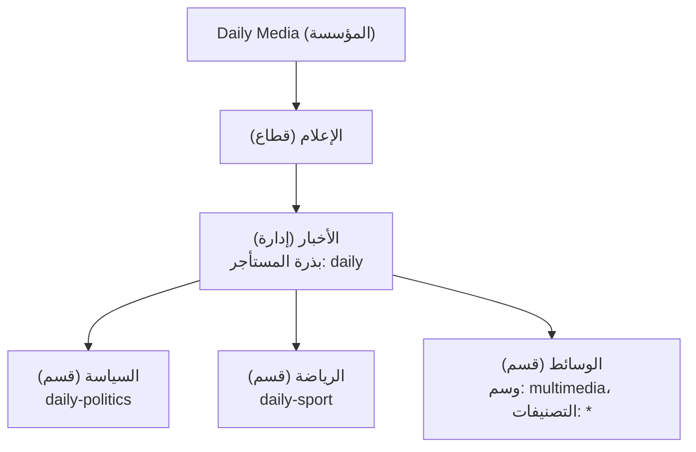

في نهاية هذا الدرس يكون للمستأجر `daily`:

- مؤسسة **Daily Media** فيها قطاع، وإدارة **الأخبار**، وقسمان: **السياسة** و**الرياضة**؛
- صحيفة **The Daily** بالتصنيفين `daily-politics` و`daily-sport`؛
- مدير تحرير، ومشرف، وكاتبان، ومحرر مراجع، ومحرر ديسك، لكل منهم صلاحيات عمله؛
- قالب مناوبة لكل قسم، وحسابات الخدمة التي يحتاجها سير العمل.



## القطع ومن يملكها

| ماذا | المالك | أين تضبطه |
| --- | --- | --- |
| المؤسسة وشجرة وحداتها وأشخاصها وعضوياتها ومناصبها وبذور المستأجرين | [الهيكل التنظيمي](/ar/modules/organization/)، الخدمة المركزية | صفحات `/organization` أو `/api/organization` |
| المستأجر نفسه (قاعدة البيانات والمضيفون والوحدات) | مضيف المنصة، من بذرة المستأجر | البذرة؛ ويجهزها موفّق المضيف |
| الصحف والتصنيفات | [المحتوى](/modules/contents/) | **Contents Management** أو `/api/content` |
| الحسابات وعضوية المستأجر | خدمة الهوية | إدارة الهوية أو الدعوات |
| المنح الدائمة (حقوق خارج المناوبة) | مخزن المنح في المضيف | `POST /api/identity/grants` أو صفحة العضو |
| أدوار المناوبات وقوالبها والمناوبات والحضور | [المناوبات](/ar/modules/shifts/) | صفحات `/shifts` أو `/api/shifts` |
| أنواع المنشورات ونموذج المقترح | [DynamicFields](/modules/dynamic-fields/) | `/dynamicfields` |
| ربط سير العمل وقواعد التوجيه | [غرفة الأخبار](/ar/modules/newsroom/) | `/newsroom/admin/*` |

تعيش شجرة الوحدات في خدمة الهيكل التنظيمي **المركزية**. وكل نشر آخر يشغل الوحدة **موصلا**: ينسخ الشجرة إلى كل مستأجر،
ويكتب منح المناصب هناك، ويعيد نشر أحداث `org.*` محليا. ويمكن لنشر واحد أن يكون الاثنين: الوضع المركزي يشغل الموصل
لمستأجريه أيضا.

## الخطوة 1. أنشئ المؤسسة

سجل الدخول مشرفا للمنصة (الدور `platform-admin`) وأنشئ المؤسسة. ينشئ ذلك أنواع الوحدات (`org` و`sector` و`department`
و`section`) والمنصبين `unit-admin` و`manager` والوحدة الجذرية.

```bash
curl -X POST http://localhost:5080/api/organization/orgs \
  -H "Authorization: Bearer $ADMIN" -H "Content-Type: application/json" \
  -d '{ "key": "daily-media", "nameEn": "Daily Media", "nameAr": "ديلي ميديا",
        "admins": [{ "issuer": "http://localhost:5090/", "subject": "<managing editor sub>" }] }'
```

`admins` مشرفو المؤسسة بمصدر الرمز ومعرّف صاحبه، ويديرون المؤسسة كلها من الآن. وفي الجواب معرف المؤسسة ومعرف وحدتها الجذرية.

تتداخل الأنواع المنشأة هكذا: **مؤسسة ← قطاع ← إدارة ← قسم**، والقسم وحده يحمل تصنيفات. أضف نوعا خاصا بك عبر
`POST /orgs/{orgId}/unit-types` (`key` والأسماء و`allowedParents` و`holdsCategories`) إن كان في غرفة أخبارك مستوى آخر.

## الخطوة 2. ابن شجرة الوحدات

أضف كل وحدة تحت أصلها. الإدارة لا تحتاج تصنيفات؛ أما القسم فيحتاجها، فتضيف الأقسام في الخطوة 5 بعد أن يملك المستأجر
تصنيفاته.

```bash
curl -X POST http://localhost:5080/api/organization/orgs/$ORG/units -H "Authorization: Bearer $ADMIN" \
  -H "Content-Type: application/json" \
  -d '{ "parentId": "<root unit id>", "typeKey": "sector", "nameEn": "Media", "nameAr": "الإعلام" }'

curl -X POST http://localhost:5080/api/organization/orgs/$ORG/units -H "Authorization: Bearer $ADMIN" \
  -H "Content-Type: application/json" \
  -d '{ "parentId": "<sector id>", "typeKey": "department", "nameEn": "News", "nameAr": "الأخبار",
        "timeZone": "Africa/Cairo" }'
```

- **المنطقة الزمنية.** اضبطها على الإدارة: تخطط المناوبات وتعرض مناوبات الوحدة على ساعتها، مأخوذة من أقرب وحدة أعلى الشجرة
  تحددها.
- **الوسوم** (`tags: ["multimedia"]`) تتيح لقواعد توجيه غرفة الأخبار إيجاد الوحدة بدورها لا بمعرفها.
- **نقل** وحدة (`POST .../units/{id}/move`) يعيد تأسيس شجرتها الفرعية كلها، وكل وحدة تخزن مسارات الوحدات تتبع الحدث
  `org.unit-moved.v1`.

والشيء نفسه في صفحات **الهيكل التنظيمي** (`/organization`).

## الخطوة 3. أعط غرفة الأخبار مستأجرها

**بذرة المستأجر** تقول إن وحدة ما تأخذ مستأجرا خاصا بها في نشر ما. اجعل جذرها إدارة الأخبار، فيحمل المستأجر `daily`
الإدارة وكل الأقسام تحتها.

```bash
curl -X POST http://localhost:5080/api/organization/orgs/$ORG/seeds -H "Authorization: Bearer $ADMIN" \
  -H "Content-Type: application/json" \
  -d '{ "rootUnitId": "<news department id>", "deploymentId": "central", "tenantId": "daily",
        "name": "The Daily", "hosts": ["daily.localhost"], "databaseServer": "TenantStore",
        "databaseName": "daily", "adminPersonIds": ["<managing editor person id>"] }'
```

يسحب موصل النشر البذرة، ويجهز المضيف المستأجر (قاعدته وترحيلاته)، ويبلغ الموصل الحالة: انتظر حتى تظهر البذرة
**Provisioned**. يصبح مشرفو البذرة (`adminPersonIds`) مشرفي وحدة على جذرها، مع `access.grants.manage` في المستأجر. انظر
[بذور المستأجرين](/ar/backend/tenant-seeds/).

## الخطوة 4. أنشئ الصحيفة وتصنيفاتها

**الصحيفة** (press) مطبوعة؛ ينتمي المنشور إلى صحيفة واحدة، وكل تصنيفاته من تلك الصحيفة. معرفات التصنيفات أسماء ثابتة
تختارها. في المستأجر، بصلاحية `content.manage` على مستوى المستأجر:

```bash
curl -X POST http://localhost:5080/api/content/presses -H "Authorization: Bearer $TOKEN" -H "X-Tenant: daily" \
  -H "Content-Type: application/json" -d '{ "id": "daily", "name": "The Daily" }'

curl -X POST http://localhost:5080/api/content/categories -H "Authorization: Bearer $TOKEN" -H "X-Tenant: daily" \
  -H "Content-Type: application/json" \
  -d '{ "id": "daily-politics", "pressId": "daily", "nameEn": "Politics", "nameAr": "سياسة" }'
```

أضف `daily-sport` بالطريقة نفسها. وفي **Contents Management** (`/contents`) النماذج نفسها.

## الخطوة 5. أضف الأقسام بتصنيفاتها

يخدم القسم تصنيفات المنشورات التي يذكرها. وتقرر هذه القائمة أمرين: أي قسم يعمل أفراده على المنشور، وفي أي قسم يجوز
لسير العمل أن يضع المنشور (لا يذهب المنشور إلى وحدة إلا إذا كان أحد تصنيفاته من تصنيفاتها).

```bash
curl -X POST http://localhost:5080/api/organization/orgs/$ORG/units -H "Authorization: Bearer $ADMIN" \
  -H "Content-Type: application/json" \
  -d '{ "parentId": "<news department id>", "typeKey": "section", "nameEn": "Politics", "nameAr": "السياسة",
        "categories": ["daily-politics"] }'
```

- أضف **الرياضة** بـ`["daily-sport"]`.
- القسم الذي يخدم **كل** التصنيفات، مثل الوسائط أو تحسين محركات البحث، يذكر `*` وحدها ويأخذ وسما:
  `"categories": ["*"], "tags": ["multimedia"]`.
- في صفحة الوحدة منتقي تصنيفات يقرأ تصنيفات المحتوى حين تكون الوحدة مثبتة.
- خلال ثوان يصل الموصل بالوحدات الجديدة إلى المستأجر: `GET /api/organization/local/units` مع `X-Tenant: daily` يسردها.

## الخطوة 6. ادع الأشخاص

يسجل الأشخاص الدخول بحساب هوية **عضو في المستأجر**. ادعهم أولا. مع وحدة [إدارة الهوية](/modules/identity-admin/) يكون ذلك
من صفحة **Members** (`/identity`) أو `POST /api/identity-admin/members { email, role }`، والعنوان الذي بلا حساب يأخذ
حسابا جديدا. وفي بيئة التجريب حسابات التطوير موجودة سلفا.

ثم سجل كل شخص في المؤسسة بالمصدر والمعرّف نفسيهما في رمزه، وضعه في وحدة:

```bash
curl -X POST http://localhost:5080/api/organization/orgs/$ORG/persons -H "Authorization: Bearer $ADMIN" \
  -H "Content-Type: application/json" \
  -d '{ "issuer": "http://localhost:5090/", "subject": "<sub>", "displayName": "Mona Adel",
        "email": "mona@daily.example", "employee": { "employeeNumber": "E-104", "jobTitle": "Moderator" } }'

curl -X POST http://localhost:5080/api/organization/orgs/$ORG/memberships -H "Authorization: Bearer $ADMIN" \
  -H "Content-Type: application/json" \
  -d '{ "personId": "<person id>", "unitId": "<politics id>", "positionId": "<position id>", "primary": true }'
```

للشخص عضوية **أساسية** واحدة وقد تكون له أخرى بتواريخ اختيارية. ولا تسمح المناوبات على جدول وحدة إلا لأعضائها أو أعضاء
وحدة فوقها. وتذكر البذرة في الخطوة 3 مشرفها بمعرف الشخص، فسجل مدير التحرير أولا عمليا ثم أنشئ البذرة.

## الخطوة 7. المناصب: حقوق دائمة على وحدة

**المنصب** مجموعة صلاحيات مسماة. العضوية ذات المنصب تعطي صلاحياته منحا دائمة على `unit:{id}` لتلك الوحدة، وهو يشمل كل
وحدة تحتها. يكتب الموصل هذه المنح في المستأجر ويعيد كتابتها كلما تغيرت العضويات أو المنصب.

| المنصب | منشأ مسبقا | الصلاحيات | لمن |
| --- | --- | --- | --- |
| `unit-admin` | نعم | `org.read` و`org.units.manage` و`org.members.manage` و`org.seeds.manage` | من يدير هيكل الوحدة |
| `manager` | نعم | `org.read` و`org.units.manage` و`shifts.manage` | رئيس الإدارة أو القسم: يخطط مناوباته |
| `planning-desk` | أضفه | `newsroom.moderate` و`newsroom.projects` و`dynamicfields.read` | مشرف دائم خارج أي مناوبة |
| `editor-in-chief` | أضفه | `newsroom.projects` و`newsroom.manage` و`contentdesigner.read` و`contentdesigner.arrange` و`contentdesigner.publish` | مدير التحرير، على الإدارة |

```bash
curl -X POST http://localhost:5080/api/organization/orgs/$ORG/positions -H "Authorization: Bearer $ADMIN" \
  -H "Content-Type: application/json" \
  -d '{ "key": "planning-desk", "nameEn": "Planning desk", "nameAr": "مكتب التخطيط",
        "permissions": ["newsroom.moderate", "newsroom.projects", "dynamicfields.read"] }'
```

كل منحة منصب في مستأجر موصل تتضمن `org.read` مهما ذكر المنصب.

## الخطوة 8. منح على الصحيفة أو التصنيف

يغطي المنصب نطاقات **الوحدات**، لكن المنشور الجديد بلا وحدة بعد: سير العمل يحددها لاحقا. لذلك تمنح حقوق **كتابة**
المنشورات على **صحيفة** المنشور أو **تصنيفه** عبر مخزن المنح في المضيف. يحتاج المستدعي `access.grants.manage` في
المستأجر (ومشرف البذرة يملكها).

```bash
curl -X POST http://localhost:5080/api/identity/grants -H "Authorization: Bearer $TOKEN" -H "X-Tenant: daily" \
  -H "Content-Type: application/json" \
  -d '{ "userId": "<writer sub>", "permission": "content.author", "scope": "category:daily-politics" }'
```

| من | الصلاحيات | النطاق |
| --- | --- | --- |
| الكتّاب | `content.author` | `category:daily-politics` (أو `press:daily` لكل التصنيفات) |
| الكتّاب | `newsroom.propose` و`dynamicfields.read` | المستأجر |
| المشرفون | `content.author` (ينشئ المحتوى مسودة المنشور باسم المشرف) | التصنيفات التي يعتمدونها |
| مدير التحرير | `content.editor` و`content.manage` و`dynamicfields.manage` | `press:daily`، والمستأجر للأخيرتين |

تفحص المنح مع كل طلب، فيسري التغيير فورا دون رمز جديد. و`validFrom` و`validTo` يجعلان المنحة محددة بوقت.

## الخطوة 9. أدوار المناوبات: حقوق أثناء الخدمة فقط

تأتي الحقوق اليومية لغرفة الأخبار من **المناوبات**: يأخذ عضو الجدول صلاحيات دوره من تسجيل الحضور حتى الانصراف (أو النهاية
مع مهلة السماح). لا أحد في مناوبة يملك هذه الحقوق دون تسجيل الحضور.

يبدأ المستأجر بثلاثة أدوار:

| الدور | قائد | الصلاحيات |
| --- | --- | --- |
| `manager` | نعم | `content.accept` و`content.assign` و`content.transfer` و`content.return` |
| `desk` | | `content.publish` و`content.return` |
| `editor` | | `content.review` |

أضف أدوار غرفة أخبارك في **Shifts ← Roles** (`/shifts/roles`) أو عبر الواجهة البرمجية. الدور المعرف على وحدة يتجاوز دور
المستأجر ذا المفتاح نفسه فيها.

```bash
curl -X POST http://localhost:5080/api/shifts/roles -H "Authorization: Bearer $TOKEN" -H "X-Tenant: daily" \
  -H "Content-Type: application/json" \
  -d '{ "key": "writer", "nameEn": "Writer", "nameAr": "كاتب",
        "permissions": ["content.author", "contentdesigner.read", "contentdesigner.arrange"], "isLead": false }'
```

إضافات مفيدة: دور `writer` كما سبق، ودور `moderator` بصلاحية `newsroom.moderate` للإشراف أثناء المناوبة. يجب أن تكون
الصلاحيات في كتالوج المنصة (من وحدة مثبتة)، وإلا أجاب الاستدعاء 400.

## الخطوة 10. خطط المناوبات

1. **القالب.** في **Shifts ← Templates** (`/shifts/templates`) أعط كل قسم مناوبته المتكررة: وقت بدء على ساعة الوحدة،
   ومدة، وخانات لكل دور (`manager` واحد و`writer` اثنان و`desk` واحد...)، وأعضاء افتراضيين.
2. **انسخ** القالب إلى تاريخ: ينشئ مناوبة **مسودة**، مع تحذيرات لمن لم يعد عضوا أو لم يعد دوره قائما.
3. **انشر** المناوبة. تحتاج المناوبة المنشورة قائدا واحدا بالضبط.
4. يوم المناوبة يسجل كل عضو حضوره في **My shifts** (`/shifts/mine`) منذ 30 دقيقة قبل البدء، ويستطيع القائد أو المدير تسجيل
   غيره. تبدأ منحه حينها على نطاق `unit:` للقسم وتصنيفاته.
5. **ساعة المناوبة** تسجل الغياب، وتسجل انصراف الجميع عند النهاية مع المهلة (15 دقيقة افتراضيا)، وتنهي المناوبة. ويكتب
   القائد ملاحظة **التسليم** للمناوبة التالية.

منصب `manager` على الإدارة (`shifts.manage` على نطاقها) يخطط مناوبات كل الأقسام تحتها.

## الخطوة 11. أنواع المنشورات ونموذج المقترح

بصلاحية `dynamicfields.manage`:

1. افتح **Fields** (`/dynamicfields`) وثبت **مكتبة البداية**. ينشئ ذلك حقول الكتل وأنواع المنشورات الثمانية
   (`post.article` و`post.news` و`post.video`...) وينشرها، لكل منها بادئة رابطه.
2. أنشئ نموذج المقترح `proposal.default` مرة لكل مستأجر، إذ لا بداية له في DynamicFields. أرسل التعريف الموصى به من مستودع
   غرفة الأخبار (`docs/proposal.default.json`) ثم انشر الإصدار 1:

   ```bash
   curl -X POST http://localhost:5080/api/dynamicfields/fields -H "Authorization: Bearer $TOKEN" -H "X-Tenant: daily" \
     -H "Content-Type: application/json" --data @proposal.default.json
   curl -X POST http://localhost:5080/api/dynamicfields/fields/proposal.default/publish -H "Authorization: Bearer $TOKEN" \
     -H "X-Tenant: daily" -H "Content-Type: application/json" -d '{ "version": 1 }'
   ```

   أبقه حقلا غير جذري، وأبق قيمته `title`. وحتى ينشر تحفظ المقترحات ولا ترسل.

## الخطوة 12. اربط سير العمل والتوجيه

بصلاحية `newsroom.manage` (في **NewsRoom ← Admin**):

- **الربط** (`/newsroom/admin/bindings`): اربط كل نوع منشور بسير عمل على الإدارة. تأتي Elsa بـ`newsroom-post` للمنشورات
  و`newsroom-content` لمحتوياتها. الربط على الإدارة يسري على أقسامها ما لم يكن لقسم ربطه. ونوع منشور بلا ربط **خطأ
  إعداد** على مشاريعه.

  ```bash
  curl -X POST http://localhost:5080/api/newsroom/bindings -H "Authorization: Bearer $TOKEN" -H "X-Tenant: daily" \
    -H "Content-Type: application/json" \
    -d '{ "kindType": "post", "kind": "post.news", "unitId": "<news department id>", "definitionId": "newsroom-post" }'
  ```

- **قواعد التوجيه** (`/newsroom/admin/routing`، على مستوى المستأجر): أي وحدة تصنع نوع محتوى. مثلا تذهب الصور والفيديو إلى
  الوحدة الموسومة `multimedia`: `{ "contentKind": "block.image", "unitTag": "multimedia", "order": 1 }`. والمحتوى الذي
  لا قاعدة له يبقى مع قسم المنشور.

## الخطوة 13. حسابات الخدمة

يعمل سير العمل بعميل الخدمة `elsa-workflows`. امنحه على مستوى المستأجر **في كل مستأجر**:

| الصلاحية | لماذا |
| --- | --- |
| `content.assign` و`content.transfer` و`content.publish` | الإسناد في المناوبة والتسليم والنشر |
| `content.unit.assign` | وضع المنشور في قسمه والمحتوى في وحدته (لا يملكها غيره) |
| `shifts.manage` | قراءة المناوبات المتأخرة والمنتهية |
| `newsroom.workflow` | قراءة المشاريع والإبلاغ عن حالاتها، والربط والتوجيه وعبء العمل |
| `org.read` | إيجاد مديري الوحدة حين يفوت موعد |
| `dynamicfields.read` | النشر: يفحص المحتوى المنشور باسم المستدعي |

واضبط أيضا `Elsa:Newsroom:ProjectWorkflow`، وامنح عميل خدمة ContentDesigner صلاحية `newsroom.projects` على مستوى المستأجر
(قراءة فقط) ليعرف الاستوديو هل للمنشور مشروع. واضبط `NewsRoom:ApiBaseUrl` و`Content:ApiBaseUrl` على البوابة: حتى ذلك
تجيب غرفة الأخبار 503 ولا يقرأ المحتوى أنواع المنشورات ولا الوحدات.

:::caution[من يسند العمل]
الإعداد `Content:Newsroom:WorkflowOwnsAssignment` في المحتوى قيمته `false` افتراضيا: مدير المناوبة يقبل ويسند يدويا.
اجعله `true` فقط حين يعمل سير العمل، لأن `content.unit.assign` (سير العمل) يصبح وحده من يقبل ويسند وينقل ويعيد.
:::

## من يملك ماذا

| الشخص | دائم (منصب أو منحة) | في المناوبة (دور) |
| --- | --- | --- |
| مدير التحرير | مشرف المؤسسة؛ `editor-in-chief` على الإدارة؛ `content.editor` و`content.manage` و`dynamicfields.manage` | |
| رئيس القسم | `manager` على القسم (يخطط مناوباته) | `manager` (قائد): القبول والإسناد والنقل والإعادة |
| المشرف | `planning-desk` على الإدارة، أو لا شيء | `moderator`: `newsroom.moderate` |
| الكاتب | `content.author` على تصنيفاته؛ `newsroom.propose` و`dynamicfields.read` | `writer`: `content.author` ودخول الاستوديو |
| المحرر المراجع | | `editor`: `content.review` |
| محرر الديسك | | `desk`: `content.publish` و`content.return` |
| `elsa-workflows` | منح الخطوة 13، على مستوى المستأجر | |

التالي: [2. حياة المنشور](/ar/tutorials/post-lifecycle/).
