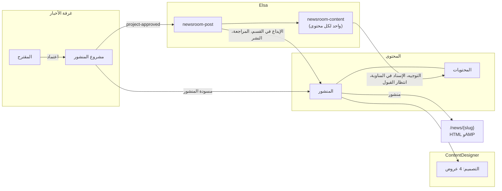
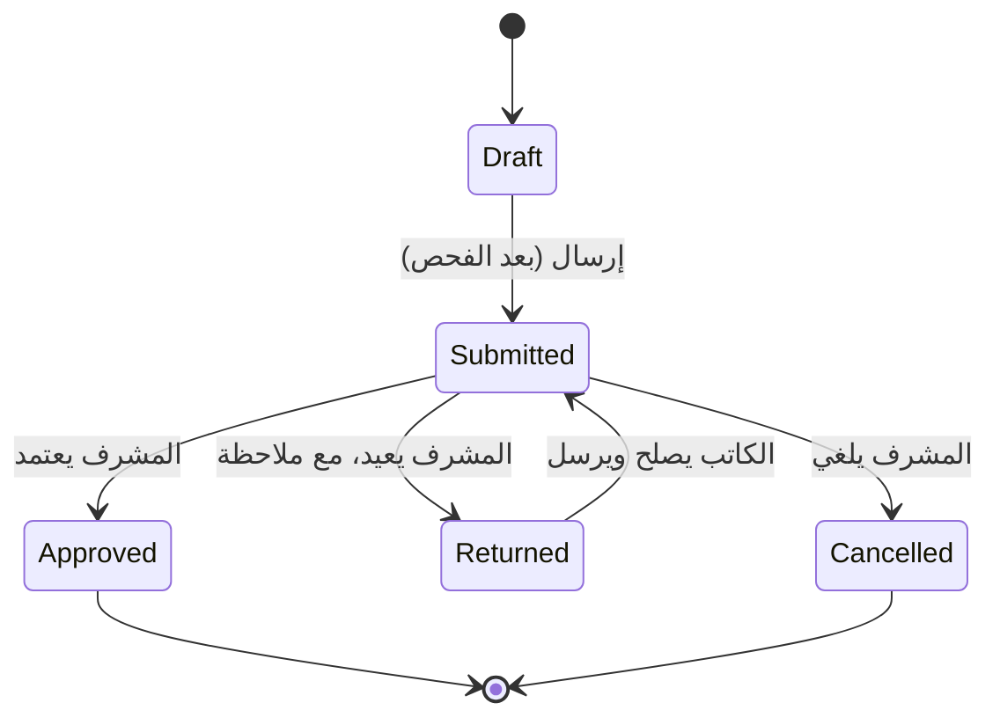
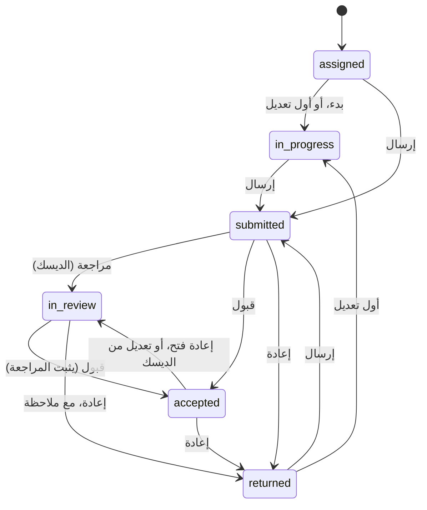
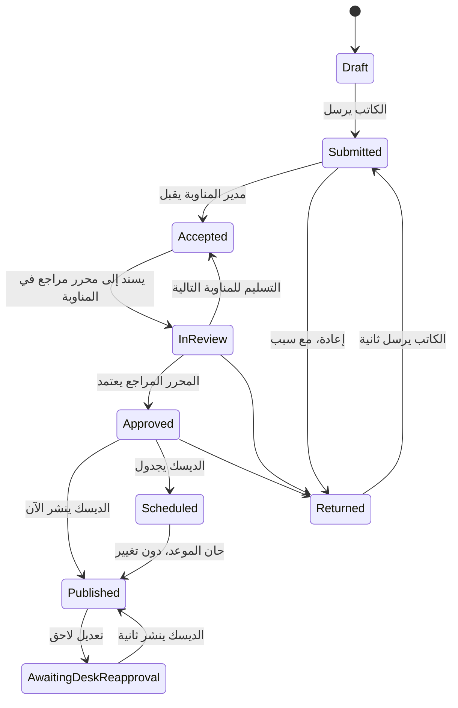

**المنشور** أي عمل إبداعي تنشره غرفة الأخبار: خبر، مقال، مراجعة، فيديو، تحقيق، قصة مصورة. ويأتي نوعه من **نوع المنشور**،
وهو حقل جذري في DynamicFields مثل `post.news`، ويعطيه أيضا بادئة رابطه (`/news/...`). يتابع هذا الدرس خبرا واحدا في
المستأجر الذي أعددته في [الدرس 1](/ar/tutorials/newsroom-setup/).

يتكون المنشور من **محتويات مشتركة**: فقراته وصوره وفيديوهاته واقتباساته كل منها محتوى في مكتبة المحتوى، له مرحلته
والمكلف به ومراجعاته. تعمل الأقسام على المحتويات، ويراجع الديسك المنشور.

هناك طريقان للدخول. مع **غرفة الأخبار** يبدأ الخبر مقترحا ويقوده سير العمل. وبدونها ينشئ الكاتب المنشور مباشرة في
Contents Management وينقله الأشخاص يدويا؛ وهذا الطريق في [آخر الصفحة](#بدون-غرفة-الأخبار).

## المرحلة 1. المقترح

**من:** كاتب يملك `newsroom.propose` (و`dynamicfields.read`).

1. افتح **NewsRoom ← My proposals** (`/newsroom/proposals`) ثم **New proposal**. النموذج هو `proposal.default` للمستأجر:
   عنوان وصورة ونص وما أضافه المستأجر. اختر الوحدة التي ينتمي إليها المقترح، واقترح تصنيفات (`daily-politics`).
2. **احفظ المسودة** كلما شئت. المسودة ناقصة عمدا ولا يراها إلا كاتبها.
3. **أرسل.** تفحص غرفة الأخبار القيم مقابل أحدث إصدار منشور من `proposal.default`. يسرد الجواب 422 المشكلات حسب الحقل؛
   لا يرسل شيء دون فحص، وإن لم تجب DynamicFields فالجواب 503.

لا يعدل الكاتب إلا والمقترح مسودة أو معاد، ولا يستطيع سحبه بعد إرساله.

## المرحلة 2. الإشراف

**من:** مشرف: `newsroom.moderate` على وحدة تشمل المقترح، من منصب (مكتب التخطيط) أو من دور مناوبة أثناء الحضور. ويحتاج
أيضا `content.author` في التصنيفات، لأن المحتوى ينشئ مسودة المنشور باسمه.

1. **قائمة الإشراف** (`/newsroom/queue`) تسرد المقترحات المرسلة في الوحدات التي يشرف عليها، الأقدم أولا.
2. **أعده** بملاحظة، أو **ألغه**، أو **اعتمده**. يضيف الاعتماد سطرا لكل منشور يصير إليه الخبر (من 1 إلى 10): نوع المنشور
   (`post.news`)، والقسم الذي سينتجه (تقترح غرفة الأخبار الأقسام التي تطابق تصنيفاتها)، والتصنيفات والأساسي أولا.
3. يمكن لخبر واحد أن يصير عدة منشورات: منشور خبري الآن وفيديو لاحقا سطران ومنشوران ومشروعان، لكل منها نوعه وقسمه وسير
   عمله.

لكل سطر تحفظ غرفة الأخبار **مشروع منشور**، وينشئ المحتوى **مسودة المنشور**: جذر النوع وعنوان المقترح في `headline`،
وصورته ونصه حيث للنوع قيم مطابقة، والتصنيفات. المنشور **بلا وحدة** بعد. وحين يصير للمشروع منشوره تنشر غرفة الأخبار
`newsroom.project-approved.v1`.

إن لم يستطع المحتوى إنشاء المسودة يبقى الاعتماد قائما؛ تعرض صفحة المشروع الخطأ، و**Retry** ينشئ المسودة بأمان دون منشور
ثان.

## المرحلة 3. سير العمل يودع المنشور

**من:** Elsa، بصفة `elsa-workflows`. يبدأ الحدث سير العمل **المربوط** بنوع المنشور على القسم (مثل `newsroom-post`). ونوع
بلا ربط خطأ إعداد على المشروع، ويبدأ سير العمل حالما يوجد ربط.

1. **الإيداع.** يفحص `EnsurePostInUnitCategories` أن أحد تصنيفات المنشور من تصنيفات القسم. إن كان كذلك يضبط وحدة المنشور،
   وينتقل المشروع إلى **InProduction**.
2. وإلا ينتقل المشروع إلى **NeedsModeration** مع السبب، وتمحى وحدة المنشور، وينتظر سير العمل. **يصلح** المشرف المشروع
   (تصنيفات أو قسم أو نوع آخر) من صفحته؛ فيعتمده من جديد ويعاد الفحص. لا يفشل سير العمل بسبب هذا أبدا.
3. سير العمل وحده يملك `content.unit.assign`، فلا يستطيع أحد ضبط وحدة منشور يدويا وتخطي الفحص.

## المرحلة 4. إنتاج المحتويات في المناوبة

نص المنشور هو محتوياته. يضيفها الكاتب في صفحة المنشور في Contents Management، أو يضيف محتوى موجودا من المكتبة المشتركة
في الاستوديو. ولكل **محتوى** يبدأ سير عمل المنشور سير عمل فرعيا (`newsroom-content`، أو المربوط بنوع ذلك المحتوى):

1. **التوجيه**: تعطي قواعد توجيه غرفة الأخبار الوحدة التي تصنع هذا النوع من المحتوى (الصور إلى الوحدة الموسومة
   `multimedia`)؛ ودون قاعدة يبقى مع قسم المنشور.
2. **الإسناد في المناوبة**: لمدير المناوبة مهلة قصيرة ليسنده يدويا؛ وإلا يذهب إلى أقل حاملي الدور عبئا ممن **سجلوا
   حضورهم** في مناوبة جارية لتلك الوحدة.
3. **الانتظار** حتى يقبل المحتوى. ويمكن لموعد نهائي أن يصعّد إلى قائد المناوبة، وإلا إلى مديري الوحدة.
4. عند **التسليم** ينتقل العمل غير المنتهي إلى المناوبة التالية للوحدة.

يمر كل محتوى بمراحله، وهي حالات بند عمله:

كل انتقال إلى مرحلة مراجعة أو قبول يشغل أولا `validate-node` من DynamicFields على المحتوى. المشكلة جواب 422 فيه
`problems: [{ path, message, nodeId }]`، فلا ينتقل شيء، ويظهر الرفض في لوحة Problems في الاستوديو. وكل تعديل على محتوى
**مراجعة** جديدة؛ والقبول يثبت المراجعة التي سينشرها المنشور.

## المرحلة 5. كتابة المنشور وتنسيقه

**من:** الكاتب، بـ`content.author` وحقوق الاستوديو أثناء المناوبة.

- **قيم النوع.** في صفحة المنشور يفتح **Edit values** محرر DynamicFields على جذر المنشور: العنوان والملخص والصورة والكلمات
  المفتاحية وبقية النوع. والنوع ذو مجموعات القيم يعرضها أقساما (**Story** و**Search and sharing**). ويجب ملء المطلوب منها
  قبل اعتماد المنشور أو نشره.
- **التصميم.** الاستوديو (`/contentdesigner/studio/{postId}`، ويفتح من صفحة تصاميم ContentDesigner بسطر المنشور أو معرفه)
  ينسق المنشور في أربعة عروض: الجوال واللوحي وسطح المكتب وAMP. اسحب المحتويات إلى اللوحة، واضبط رموزها (العرض والمحاذاة
  والطابع...)، وطبق قالب مستند أو قوالب كتل، وعدل النص العادي في مكانه. النص المعدل على اللوحة يحفظ عبر المحتوى، مراجعة
  جديدة لذلك المحتوى.
- **الفحوص.** **Check** يشغل قواعد المصمم وتحقق DynamicFields وJSON-LD. الأجزاء ذات المشكلة تأخذ إطارا متقطعا؛ الأخطاء
  تمنع النشر والتحذيرات لا تمنعه.
- **الحقوق تتبع المناوبة.** حين يسجل الكاتب انصرافه يعرض الاستوديو **"Your shift ended"**، ويحفظ العمل غير المحفوظ في
  المتصفح، ويفتح من جديد حين تعود الحقوق.

## المرحلة 6. المراجعة والديسك

للمنشور حالاته، بجانب حالات المحتويات:

1. **يرسل** الكاتب المنشور (**Submit for review**). وتنقل مراجعة الديسك في سير العمل المشروع إلى **ReadyForDesk**.
2. **يقبله** مدير المناوبة في قائمة المناوبة (**Accept into shift**) و**يسنده** إلى محرر مراجع سجل حضوره ويملك
   `content.review` على المنشور. ومع تفعيل `Content:Newsroom:WorkflowOwnsAssignment` وتحديد دور مراجع في سير العمل، يفعل
   سير العمل الأمرين بعد مهلة، ولا يختار صاحب المنشور أبدا.
3. **يعتمده** المحرر المراجع، أو **يعيده** بسبب؛ فيعود المنشور المعاد إلى الإنتاج، ثم إلى الديسك ثانية.
4. **ينشره** الديسك (`content.publish` أثناء المناوبة) الآن أو **يجدوله**. الاعتماد والجدولة والنشر تشغل أولا `validate`
   من DynamicFields على المنشور كله (422 عند أي مشكلة)، ويجب أن يكون لكل محتوى **مطلوب** مراجعة مقبولة.

حيث تعمل غرفة الأخبار لا ينشر الاستوديو **تصميم** المنشور إلا ومشروعه **InProduction** أو **ReadyForDesk**؛ ويذكر السبب
في غير ذلك.

## المرحلة 7. منشور

- يقدم المنشور على مساره القانوني `/{urlPrefix}/{slug}` (`/news/final-day-at-the-venue`) من **اللقطة المنشورة**: المراجعات
  المثبتة، لا مسودة أحدث أبدا. و`GET /api/content/public/{publicId}` عنوانه الدائم المتاح دون تسجيل.
- يعرضه ContentDesigner صفحة متجاوبة (`/api/contentdesigner/render/{publicId}`) وصفحة AMP (`.../amp`) مع JSON-LD.
- تتبع غرفة الأخبار المحتوى: يصير المشروع **Published**، ويخبر سير العمل كاتب المقترح.
- **التعديلات اللاحقة** ترسل المنشور إلى **AwaitingDeskReapproval**. تبقى النسخة الحية متاحة حتى ينشر الديسك الجديدة.
  والتعديل قبل موعد مجدول يلغي الجدولة.
- **الترجمات** طبقات لكل لغة تحفظ بجانب الأصل؛ وتغير الأصل يعلّم ترجماته قديمة.
- **إيقاف** المشروع يوقف سير عمله قبل النشر. يبقى المنشور في المحتوى، والمنشور المجدول يجب إلغاء جدولته هناك.

## الحياة كلها في جدول

| الخطوة | من | الوحدة | المنشور | المشروع | المحتويات |
| --- | --- | --- | --- | --- | --- |
| الاقتراح والإرسال | الكاتب | غرفة الأخبار | | | |
| الاعتماد | المشرف | غرفة الأخبار، المحتوى | Draft، بلا وحدة | Approved | |
| الإيداع في القسم | سير العمل | Elsa، المحتوى | Draft، بوحدة | InProduction | |
| الإنتاج | الكتّاب في المناوبة | المحتوى، الاستوديو | Draft | InProduction | assigned ← accepted |
| الإرسال والمراجعة | الكاتب، المدير، المحرر المراجع | المحتوى | Submitted ← Approved | ReadyForDesk | accepted |
| النشر | الديسك | المحتوى، الاستوديو | Published | Published | مثبتة |
| تعديل لاحق | الكاتب، الديسك | المحتوى | AwaitingDeskReapproval ← Published | Published | مراجعات جديدة |

## بدون غرفة الأخبار

يمكن للمنشور نفسه أن يبدأ في **Contents Management** (`/contents`):

1. **New post**: اختر الصحيفة والتصنيف الأساسي وغيره، و**النوع** من أنواع المنشورات المنشورة للمستأجر. يحتاج الكاتب
   `content.author` في كل تصنيف.
2. املأ قيم النوع، وأضف المحتويات، ونسقه في الاستوديو.
3. **أرسل**، ثم يقبل مدير المناوبة ويسند، ويعتمد المحرر المراجع، وينشر الديسك، كما في المرحلة 6. لا وحدة للمنشور ما لم
   يضبطها سير عمل، فتأتي حقوقه من صحيفته وتصنيفاته.

التالي: [3. حقل جديد ومحرره](/ar/tutorials/custom-field/).
