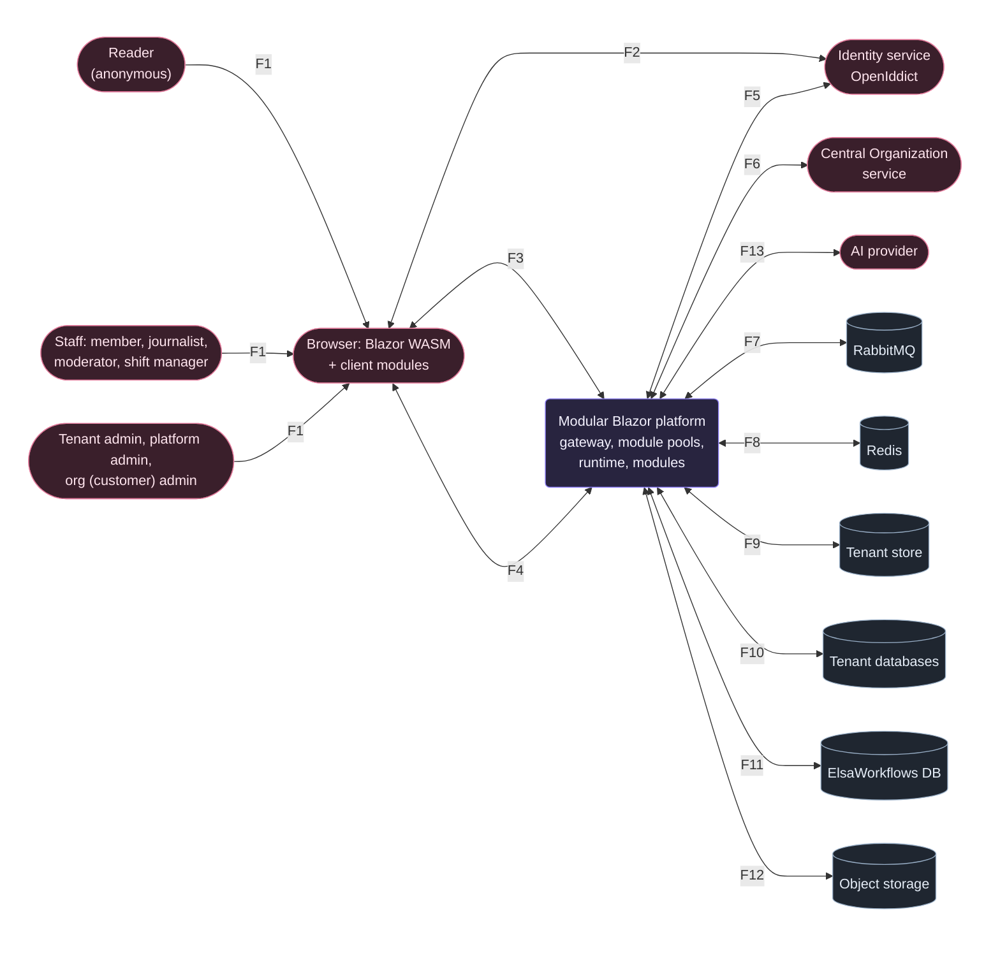
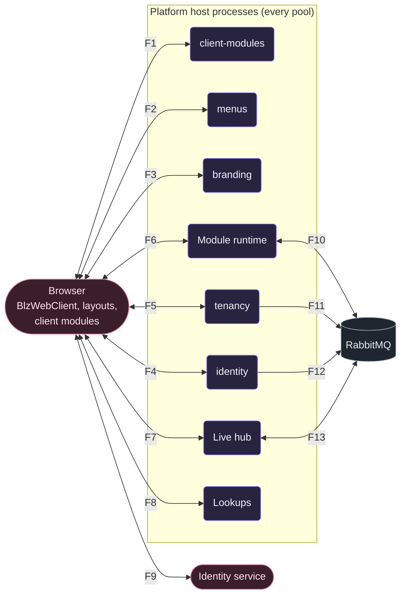
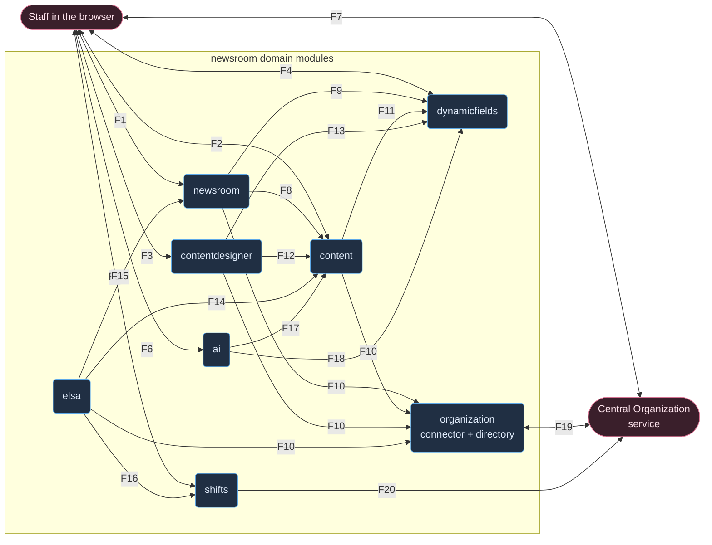
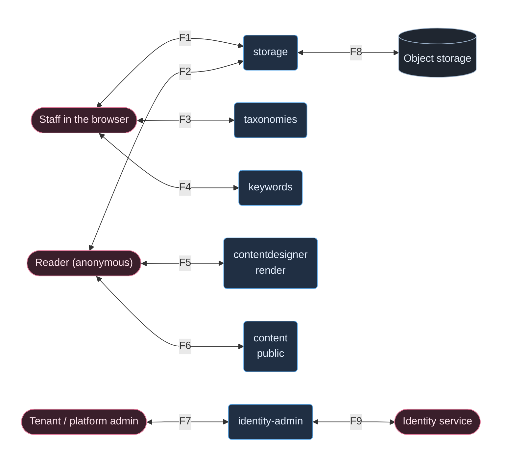
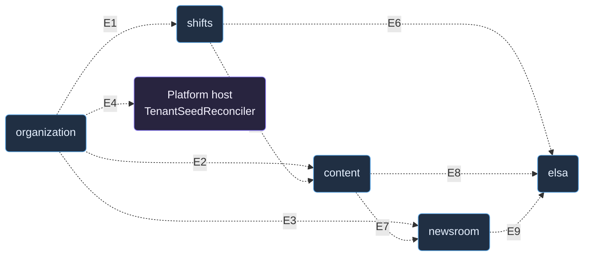
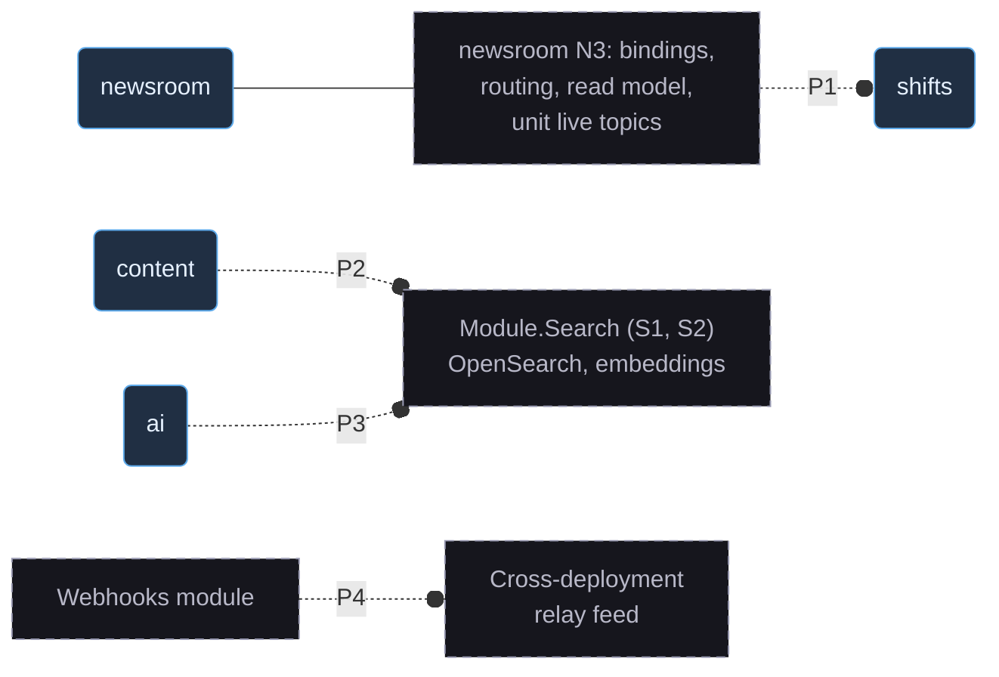

Level 0 draws the platform from the outside first. Then it opens the platform up to show the modules as processes.

- Each edge carries a short flow id (F1, F2, ...). The table under each diagram gives that flow's transport and its
  payloads.
- The payloads are the request and response DTOs of the generated typed clients (`I{Name}Client`), and the event
  records in each module's `Contracts` package.
- Shapes follow the [legend](../). **Processes** are rounded.

## 0. The platform as one process

| Flow | Transport | Payload |
|---|---|---|
| F1 | UI interaction | clicks, forms, uploads |
| F2 | OIDC authorization code + PKCE, refresh | → access token (JWT: sub, tenant, roles), id token |
| F3 | HTTPS + Bearer, `/api/{module}/...` through the gateway | JSON DTOs → JSON DTOs, `ProblemDetails`, files |
| F4 | SignalR `/hubs/live` | `Subscribe(topic)` → `LiveMessage(Topic, Type, Payload, Sequence, At)` |
| F5 | `client_credentials` service tokens; `/api/service/*` admin calls | → tokens, members, accounts, applications |
| F6 | `seeds?deployment`, `events?after=`, `links`, `reports` | → `DeploymentSeedDto`, `FeedPage`, `TenantLinkDto`; `SeedReportRequest` |
| F7 | exchanges `integration` (topic), `integration.dlx`; fanouts `modules.state`, `tenants.changed`, `access.grants.changed`, `live` | `IntegrationEnvelope`, fanout signals, `LiveMessage` |
| F8 | HybridCache, distributed locks, Data Protection keys | cache entries |
| F9 | schema `platform` (`HybirdTenants`) | `tenants`, `access_grants`, `tenant_subscriptions` |
| F10 | one database per tenant, one schema per module | module rows, `integration_outbox`, `integration_inbox` |
| F11 | schemas `elsa`, `elsa_events` | workflow definitions, instances, bookmarks, the inbox |
| F12 | S3-compatible store or the file system | blobs, upload chunks, thumbnails |
| F13 | Ollama, OpenAI, Azure OpenAI, OpenAI-compatible | chat and structured prompts → completions |

## 0.1 Inside: platform and shell processes

The browser starts from the core modules. It loads the module manifest, the menus, the branding and the caller.
Then it loads the client modules' files and opens the live hub. All `/api` and `/hubs` traffic passes through the
YARP gateway, which is left out of the drawing.

| Flow | Route or channel | Payload |
|---|---|---|
| F1 | `GET /api/client-modules/manifest`, `files/{id}/{version}/...` | → `ClientModuleManifest(Etag, Modules)`, assemblies, styles |
| F2 | `GET /api/menus` | → combined menus (platform + tenant) |
| F3 | `GET /api/branding` | → effective `BrandLayer`, assets |
| F4 | `GET /api/identity/me`, `grants` | `NewGrant` → `CurrentPrincipal` (user, tenant, permissions, claims), `AccessGrant` |
| F5 | `/api/tenancy/tenants`, `subscriptions` | `CreateTenantRequest`, `UpdateTenantRequest`, `NewSubscription` → `TenantInfo`, `TenantSubscription` |
| F6 | `/api/admin/modules` | package upload (`.dll`, `.zip`, `.nupkg`) → module state |
| F7 | `/hubs/live` | `Subscribe(topic)` → `LiveSubscribeResult`, `LiveMessage` |
| F8 | `/api/lookups/{name}` | `LookupQuery` → `LookupPage` of `LookupItem` |
| F9 | OIDC sign-in, token refresh | tokens |
| F10 | fanout `modules.state` | module id + state |
| F11 | fanout `tenants.changed` | a reload signal |
| F12 | fanout `access.grants.changed` | a signal |
| F13 | fanout `live` | `LiveMessage` for every replica's hub |

## 0.2 Inside: the newsroom domain (HTTP)

The browser calls each module through its typed client. The servers also call each other through the gateway. The
table gives the main payloads of each flow. The [level-1 pages](#level-1-pages) list them all.

| Flow | Route | Payload (request → response) |
|---|---|---|
| F1 | `/api/newsroom/proposals`, `projects` | `NewProposal`, `Submission`, `Approval`, `KillDecision` → `ProposalDto`, `ProjectDto`, `ProposalPage` |
| F2 | `/api/content/posts`, `contents` | `NewPost`, `PostEdit`, `NewContent`, `ContentEdit`, `ContentAction`, `VersionRequest`, `ScheduleRequest` → `PostDetail`, `PostSummary`, `ContentDetail`, `FeedPage` |
| F3 | `/api/contentdesigner/posts/{id}/design`, `workspace` | `SaveRequest`, `ArrangeRequest`, `ApplyRequest`, `PublishRequest` → `PostDesignDto`, `WorkspaceDto`, `PreviewDto` |
| F4 | `/api/dynamicfields/fields`, `catalog` | `NewField`, `DraftEdit`, `PublishRequest` → `FieldDetailDto`, `FieldPage`, `SchemaOrgCatalogDto` |
| F5 | `/api/shifts/shifts`, `templates`, `check-in` | `ShiftRequest`, `TemplateCloneRequest`, `HandoverRequest` → `ShiftDto`, `ShiftTemplateDto`, `UnitAttendanceDto` |
| F6 | `/api/ai/seo/optimize`, `jobs/{id}` | `SeoRequest` → `JobStarted`, `JobView`, `AiJobResult` |
| F7 | central `/api/organization/orgs/...` | `CreateUnitRequest`, `MoveUnitRequest`, `CreateMembershipRequest`, `CreateSeedRequest` → `OrgUnitDto`, `MembershipDto`, `TenantSeedDto` |
| F8 | `POST posts`, `GET categories` | `NewPost` → `PostDetail`, `CategoryDto[]` |
| F9 | `content/validate-node`, `catalog/root-post-fields` | `NodeValues` → `ContentReport`, `RootPostFieldDto[]` |
| F10 | `/api/organization/local/units...` | → `DirectoryUnitDto`, `DirectoryMemberDto` |
| F11 | `content/validate`, `validate-node`, `fields/{key}/versions/{n}` | `ContentTree`, `NodeValues` → `ContentReport`, `FieldVersionDto`, `RootPostFieldDto` |
| F12 | `categories`, `contents`, `posts/{id}`, `posts/{id}/events`, `public/{publicId}` | → `CategoryDto`, `ContentSummary`, `PostDetail`, `FeedPage`, `PublishedPost` |
| F13 | `content/jsonld`, `content/validate` | `JsonLdRequest`, `ContentTree` → `JsonLdReport`, `ContentReport` |
| F14 | `posts/{id}/unit`, `schedule`, `publish`, `contents/{id}/assign`, `automation/*` | `UnitAssignment`, `ScheduleRequest`, `ContentAssignment` → `PostDetail` |
| F15 | `GET projects/{id}`, `POST projects/{id}/state` | `StateReport` → `ProjectDto` |
| F16 | `shifts?from&to`, `shifts/ended`, `overdue`, `shifts/{id}/automation` | → `ShiftDto[]`, `EndedShiftDto[]`, `ShiftAutomationInfo` |
| F17 | `posts/{id}` | → `PostDetail` |
| F18 | `fields/{key}/versions/{n}`, `content/validate-node` | `NodeValues` → `FieldVersionDto`, `ContentReport` |
| F19 | `seeds?deployment`, `events?after=`, `links`, `seeds/{id}/reports` | → `DeploymentSeedDto`, `FeedPage`, `TenantLinkDto`; `SeedReportRequest` |
| F20 | `IOrganizationClient`, as the caller | `CreateUnitRequest` → `OrgUnitDto` |

## 0.3 Inside: the asset and directory modules (HTTP)

These modules call no other module. Readers reach `storage`, `contentdesigner` and `content` without signing in,
through the public routes.

| Flow | Route | Payload (request → response) |
|---|---|---|
| F1 | `/api/storage/uploads`, `folders`, `items`, `sharing` | `StartUploadCommand`, chunks, `CreateFolderCommand`, `MoveItemsCommand`, `SetAclRequest`, `CreateShareLinkRequest` → `UploadDto`, `ItemDto`, `FolderView`, `SharingDto`, `DownloadLink` |
| F2 | `GET shares/{tenant}/{token}`, `public/{tenant}/{fileId}/{name}` | → `SharedView`, a file stream |
| F3 | `/api/taxonomies/schemes`, `terms` | `NewScheme`, `NewTerm`, `TermMove` → `SchemeDto`, `TermRefDto`, `JsonLdDto` |
| F4 | `/api/keywords/concepts` | `ConceptValues`, `ConceptEdit` → `ConceptDto`, `ConceptSummaryDto`, `ConceptJsonLdDto` |
| F5 | `GET render/{publicId}`, `render/{publicId}/amp` | → an HTML page, an AMP page |
| F6 | `GET public/{publicId}` | → `PublishedPost` |
| F7 | `/api/identity-admin/members`, `grants`, `platform/...` | `InviteMemberRequest`, `NewGrantRequest`, `ClientApplicationRequest`, `TenantPolicyRequest` → `Member`, `MemberAccess`, `ClientApplication`, `TenantPolicy` |
| F8 | `IBlobStore` | blobs |
| F9 | `/api/service/*` (client credentials) | `InviteMember`, `UpdateMember`, `ApplicationInput`, ... |

## 0.4 Inside: integration events and their payloads

Every event travels as an `IntegrationEnvelope` on the `integration` topic exchange. The diagram draws only the
flows that have a subscriber in the code.

| Flow | Event type | Record in `data` |
|---|---|---|
| E1 | `org.unit-created.v1`, `org.unit-updated.v1`, `org.unit-moved.v1`, `org.unit-removed.v1`, `org.membership-changed.v1` | `UnitCreated`, `UnitUpdated` (`OrgUnitSnapshot`), `UnitMoved`, `UnitRemoved`, `MembershipChanged` |
| E2 | `org.unit-*.v1` | `UnitCreated`, `UnitUpdated`, `UnitMoved`, `UnitRemoved` |
| E3 | `org.unit-moved.v1` | `UnitMoved` |
| E4 | `tenancy.seed-changed.v1` | a seed change; the host reconciles the tenants |
| E5 | `shifts.section-moved.v1` | `SectionMoved(SectionId, UnitId)` |
| E6 | `shifts.published.v1`, `shifts.member-added.v1`, `shifts.checked-in.v1` | `ShiftPublished` (`ShiftSnapshot`), `ShiftMemberAdded`, `ShiftCheckedIn` |
| E7 | `content.post-state-changed.v1`, `content.post-categories-changed.v1` | `ContentFeedEvent`, `PostCategoriesChanged` |
| E8 | `content.post-*.v1`, `content.work-item-*.v1` | `PostCreated`, `PostCategoriesChanged`, `PostUnitChanged`, `ContentFeedEvent`, `WorkItemAssigned`, `WorkItemStateChanged` |
| E9 | `newsroom.project-approved.v1`, `newsroom.project-reapproved.v1`, `newsroom.project-state-changed.v1` | `ProjectApproved`, `ProjectStateChanged` |

**Live messages** are not integration events. `content`, `shifts`, `organization`, `elsa` and `ai` call
`ILiveNotifier`, and the message reaches every replica's hub over the `live` fanout. The hub sends it as
`LiveMessage(topic, type, payload, sequence, at)` to the subscribers of the topic. The topics are:

- `content:post:{id}`
- `shifts:shift:{id}`
- `organization:org:{id}`
- the unit groups `unit:{id}`
- `user:{id}`

## Planned (not built)

| Flow | What is planned |
|---|---|
| P1 | NewsRoom N3 assigns work to the running shift, routes by rules and keeps a load read model per unit |
| P2 | A Content indexer feeds per-tenant OpenSearch indices |
| P3 | Ai grounds its compose jobs on Search and shows related posts |
| P4 | A Webhooks module acts on tenant links, fed across deployments by a relay feed |

## Level-1 pages

The sidebar lists one level-1 dataflow page for each module, under **Module architecture → Dataflow level 1**.
