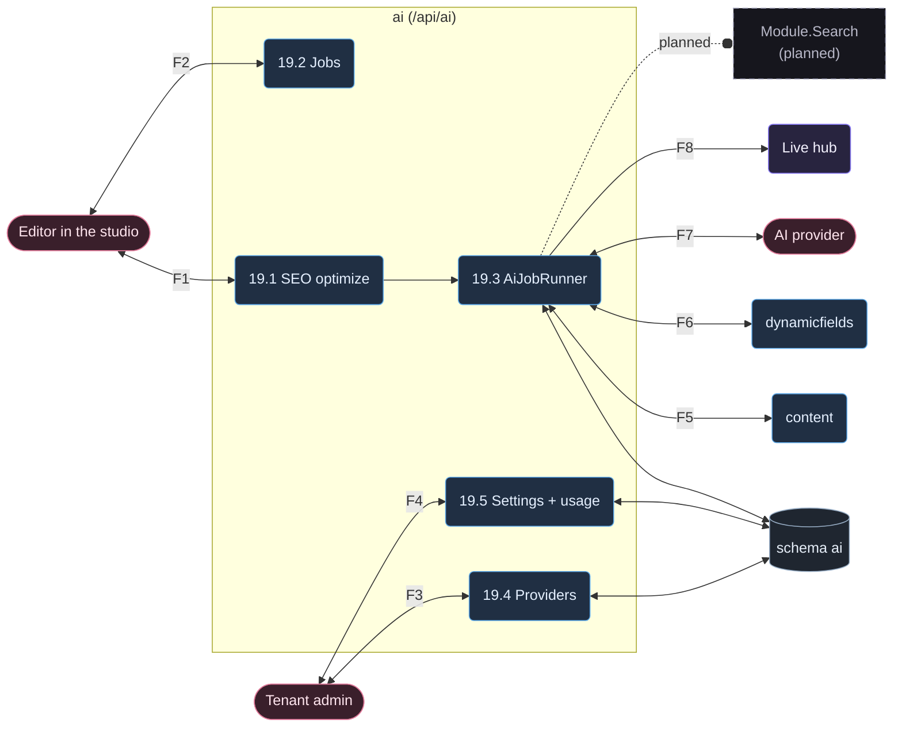

`ai` (Module.Ai, v0.1.0, **core pool**) exists only as local commits, with no remote yet. Step A1 is built:

- per-tenant providers: Ollama, OpenAI, Azure OpenAI or OpenAI-compatible, with write-only encrypted keys
- settings and usage metering
- the SEO optimize job

A job is queued, the `AiJobRunner` runs it, and the chunks reach the user through the live hub. The result is read
over HTTP. **Module.Search is planned** (S1, S2): OpenSearch with per-tenant indices, and Ai depends on it, never the
reverse.

| Flow | Route or channel | Payload |
|---|---|---|
| F1 | `POST seo/optimize` (`ai.use`) | `SeoRequest` → `JobStarted` (jobId) |
| F2 | `GET jobs/{id}?after=`, `jobs/{id}/result`, `POST jobs/{id}/cancel` | → `JobView`, `AiJobResult` (SuggestionPatch) |
| F3 | `providers` (CRUD), `{id}/secret`, `{id}/secret/clear`, `{id}/test`, `default/test` | `ProviderFields`, `ProviderChange`, `SecretBody`, `VersionBody` → `ProviderDto`, `ProviderTestResult` |
| F4 | `GET/PUT settings`, `GET usage` | `SettingsChange` → `SettingsDto`, `UsageSummary` |
| F5 | `GET /api/content/posts/{id}` | → `PostDetail` |
| F6 | `GET /api/dynamicfields/fields/{key}/versions/{n}`, `POST content/validate-node` | `NodeValues` → `FieldVersionDto`, `ContentReport` |
| F7 | `IChatClientFactory` (OllamaSharp, OpenAI-compatible) | chat and structured prompts → completions |
| F8 | `ILiveNotifier`, topic `user:{id}` | `LiveMessage` of type `ai.chunk` (the chunk number in the payload) and `ai.done` |

**Tables (schema `ai`):** `providers`, `settings`, `usage`, `capability_policies`.

The module publishes and consumes no integration events. **Planned:**

- S1, S2: Module.Search, with a Content indexer, embeddings and the related-posts panel
- A0: Keywords `concepts/match`
- A2–A6: streaming compose grounded on Search, and keyword suggestion
