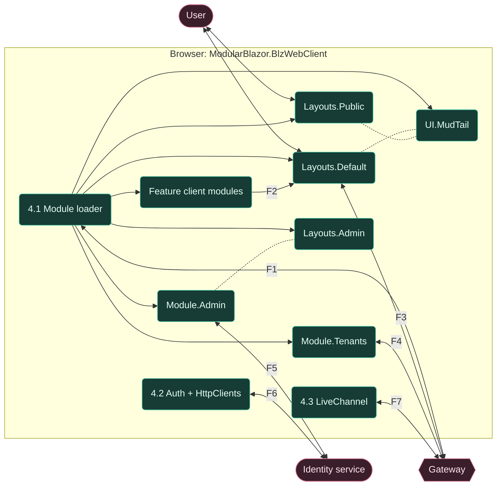

These core client modules live in Platform `modules/client`. They run in the browser, and other client modules
contribute to them through contribution points.

| Flow | Route or channel | Payload |
|---|---|---|
| F1 | `GET api/client-modules/manifest`, `files/{id}/{version}/...` | → `ClientModuleManifest`; then each module's assemblies and `Styles` |
| F2 | contribution points: menus (`MenuGroup`, `MenuLink`), dock panels, dialogs, studio panels; `Layout = default` or `public` | Razor components, `MenuItem` |
| F3 | `api/identity/me`, `api/menus`, `api/branding` | → `CurrentPrincipal`, menus, `BrandLayer` |
| F4 | `api/tenancy/tenants`, `subscriptions/attention` (`Core.Tenancy.Client`) | → `TenantInfo`, count |
| F5 | `api/admin/tenants/{tenant}/members` on the identity service | invite (email, role, displayName), suspend, activate, remove |
| F6 | OIDC sign-in and token refresh; named clients `WebApiClient`, `WebApiPublicClient`, `IdentityClient` | tokens |
| F7 | SignalR `/hubs/live` (`HubLiveTransport`) | `Subscribe(topic)`, `LiveMessage` |

| Client module | Manifest (`[assembly: ClientModule]`) |
|---|---|
| `UI.MudTail` | LoadOnStartup, Hidden, RequiresAuth = false, `css/mudtail.min.css` |
| `Layouts.Default` | LoadOnStartup, Hidden, `Dependencies = UI.MudTail` |
| `Layouts.Public` | Hidden, RequiresAuth = false, `Dependencies = UI.MudTail` |
| `Layouts.Admin` | Hidden, AvailableToRoles = platform-admin |
| `Module.Admin` | RequiredRole = platform-admin, Layout = admin, `Dependencies = Layouts.Admin`, menu group `admin` |
| `Module.Tenants` | RequiredRole = platform-admin, Layout = default, a menu link under `Module.Admin:admin` with the badge `api/tenancy/subscriptions/attention` |

The dotted lines are the manifest `Dependencies`.
