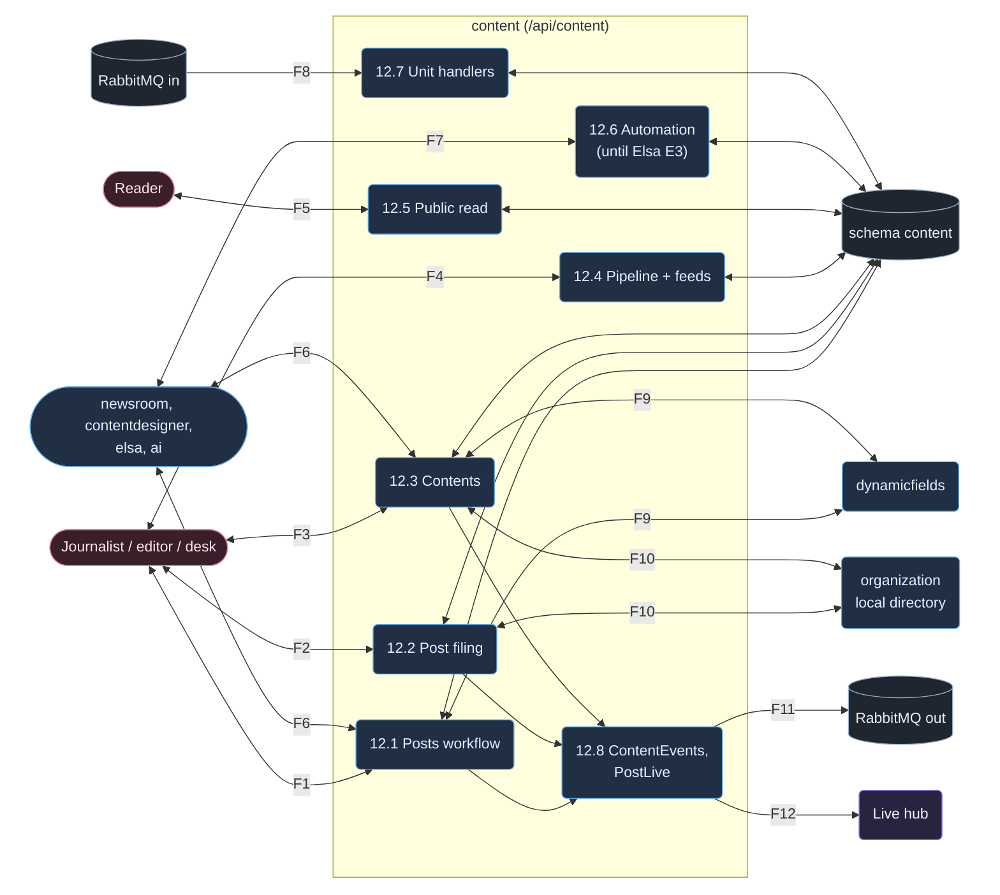

`content` (Module.Content, v0.1.0, **sales pool**) owns posts and the shared contents a post is made of. It also
owns the editorial pipeline, the content work items (stage and assignee) and a change feed. The post kind and the
content kinds are DynamicFields field keys. Validation is done by calling DynamicFields.

| Flow | Route or channel | Payload (request → response) |
|---|---|---|
| F1 | `POST posts`, `PUT posts/{id}`, `posts/{id}/submit`, `approve`, `accept`, `return`, `assign`, `transfer`, `schedule`, `publish`, `publish-due` | `NewPost`, `PostEdit`, `VersionRequest`, `AcceptRequest`, `ReturnRequest`, `Assignment`, `TransferRequest`, `ScheduleRequest` → `PostDetail`, `PostSummary[]` |
| F2 | `PUT posts/{id}/categories`, `unit`, `root`, `slugs`, `translations/{lang}`; `POST/DELETE posts/{id}/contents`, `PUT contents/order` | `PostCategories`, `UnitAssignment`, `PostRootEdit`, `PostSlugsEdit`, `PostTranslationEdit`, `PostContentAttachment`, `PostContentOrder` → `PostDetail` |
| F3 | `GET/POST/PUT/DELETE contents`, `contents/{id}/act`, `assign`, `unit`, `archive`, `revisions/{n}` | `NewContent`, `ContentEdit`, `ContentAction`, `ContentAssignment`, `ContentVersion` → `ContentDetail`, `ContentSummary[]`, `ContentRevisionDetail` |
| F4 | `GET/PUT pipeline`, `GET events?after=`, `posts/{id}/events?after=`, `categories`, `presses`, `kinds` | `PipelineDefinition` → `PipelineInfo`, `FeedPage`, `CategoryDto`, `PressDto`, `PostKindInfo` |
| F5 | `GET public/{publicId}` (anonymous) | → `PublishedPost` |
| F6 | the same routes as F1 and F3, called by other modules through the gateway | as in F1 and F3 |
| F7 | `GET automation/accepted`, `POST automation/accepted/{id}/assign`, `automation/shifts/{shiftId}/handover` (Elsa's poller) | → `PostSummary[]`, `PostDetail` |
| F8 | queue `integration.content.sales` | `SectionMoved` (`shifts.section-moved.v1`); `UnitCreated`, `UnitUpdated`, `UnitMoved`, `UnitRemoved` (`org.unit-*.v1`) |
| F9 | `GET /api/dynamicfields/catalog/root-post-fields`, `fields/{key}/versions/{n}`; `POST content/validate`, `content/validate-node` | `ContentTree`, `NodeValues` → `RootPostFieldDto[]`, `FieldVersionDto`, `ContentReport` |
| F10 | `GET /api/organization/local/units...` | → `DirectoryUnitDto` |
| F11 | topic `integration` | see the events below |
| F12 | `ILiveNotifier`, topic `content:post:{id}` | `LiveMessage` (feed type, version) |

**Tables (schema `content`):**

- posts: `articles`, `article_history`, `post_categories`, `post_contents`, `post_slugs`
- contents: `contents`, `content_revisions`, `content_history`
- `pipelines`, `events` (the feed), `categories`, `presses`
- `integration_outbox`, `integration_inbox`

## Events (`Content.Contracts`)

| Type | Data | Subscribers |
|---|---|---|
| `content.post-created.v1` | `PostCreated(PostId, PublicId, Version, PostKind, Title, OwnerId, State, ...)` | elsa (`content.post-*`) |
| `content.post-changed.v1`, `content.post-state-changed.v1` | `ContentFeedEvent(FeedType, PostId, ContentId, Version, Revision, Stage, ...)` | newsroom (state-changed), elsa |
| `content.post-categories-changed.v1` | `PostCategoriesChanged(PostId, PublicId, Version, PressId, PrimaryCategoryId, ...)` | newsroom, elsa |
| `content.post-unit-changed.v1` | `PostUnitChanged(PostId, PublicId, Version, PressId, PrimaryCategoryId, ...)` | elsa |
| `content.content-attached / detached / created / changed / state-changed / assigned / archived / deleted.v1` | `ContentFeedEvent` | none yet |
| `content.validation-failed.v1` | `ContentValidationFailed(Check, Action, ContentId, PostId, Version, ... ContentProblem[])` | none yet |
| `content.work-item-assigned.v1`, `content.work-item-state-changed.v1` | `WorkItemAssigned`, `WorkItemStateChanged` (platform work-item contract) | elsa |
