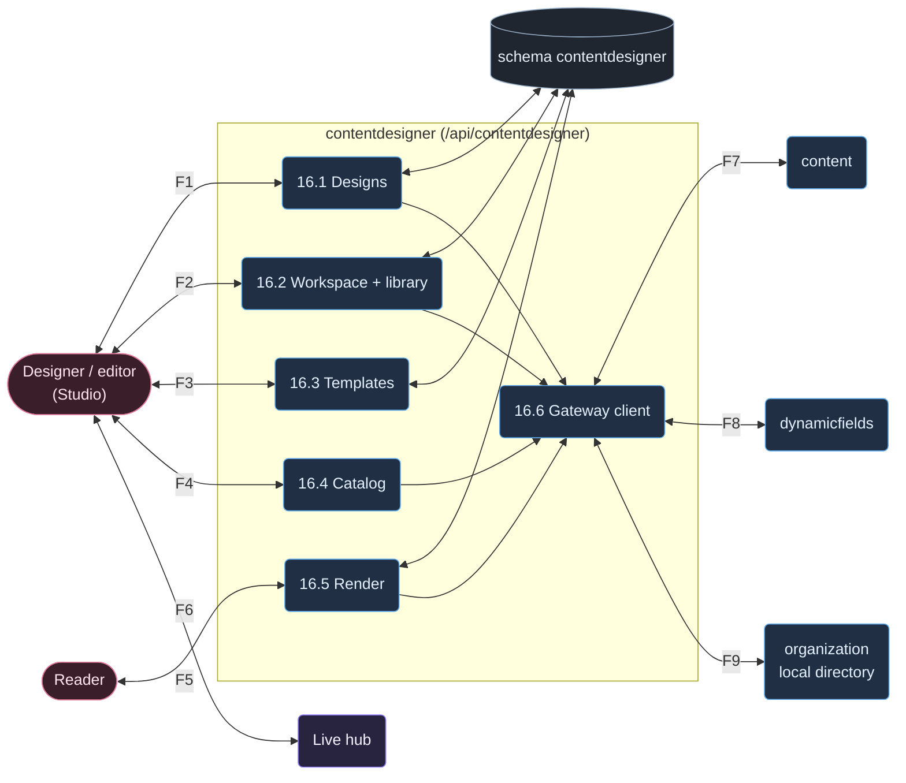

`contentdesigner` (Module.ContentDesigner, v0.2, **core pool**) stores the design of each post: its views,
including AMP. It also stores document and block templates, gives the studio a library of shared contents, and
renders published posts for readers. It reads posts and contents from Content, and checks designs with
DynamicFields. The studio's hot reload listens to Content's live topic `content:post:{id}`.

| Flow | Route or channel | Payload |
|---|---|---|
| F1 | `GET designs`, `posts/{id}/design` (`GET`, `POST` open, `PUT` save, `DELETE`), `design/views/{view}`, `apply-template`, `check`, `preview`, `publish`, `unpublish` | `OpenRequest`, `SaveRequest`, `ArrangeRequest`, `ApplyRequest`, `CheckRequest`, `PreviewRequest`, `PublishRequest`, `UnpublishRequest` → `PostDesignDto`, `DesignPage`, `DesignReport`, `PreviewDto` |
| F2 | `posts/{id}/workspace`, `library`, `library/{contentId}`, `POST posts/{id}/contents`, `posts/{id}/events` | `AttachRequest` → `WorkspaceDto`, `LibraryPage`, `LibraryItemDto`, `FeedPage` |
| F3 | `document-templates` (+ `{id}`, `{id}/default`), `block-templates` (+ `{id}`), `design/save-as-template`, `views/{view}/save-block-as-template` | `NewDocumentTemplate`, `DocumentTemplateEdit`, `NewBlockTemplate`, `BlockTemplateEdit`, `SaveAsTemplateRequest`, `SaveBlockRequest`, `DefaultRequest` → `DocumentTemplateDto`, `BlockTemplateDto` |
| F4 | `GET kinds`, `units`, `posts/{id}/rights` | → `PostKindInfo[]`, `UnitName[]`, `PostRightsDto` |
| F5 | `GET render/{publicId}`, `render/{publicId}/amp` (anonymous) | → an HTML page, or an AMP page |
| F6 | `ILiveChannel`, topic `content:post:{id}` (`StudioHotReload`; catches up from `posts/{id}/events`) | `LiveMessage` |
| F7 | `/api/content/categories`, `contents?`, `contents/{id}`, `posts/{id}`, `posts/{id}/contents`, `posts/{id}/events?after`, `public/{publicId}` | → `CategoryDto[]`, `ContentSummary[]`, `ContentDetail`, `PostDetail`, `FeedPage`, `PublishedPost` |
| F8 | `/api/dynamicfields/catalog/root-post-fields`, `fields/{key}/versions/{n}`, `content/jsonld`, `content/validate` | `JsonLdRequest`, `ContentTree` → `RootPostFieldDto[]`, `FieldVersionDto`, `JsonLdReport`, `ContentReport` |
| F9 | `/api/organization/local/units` | → `DirectoryUnitDto[]` |

**Tables (schema `contentdesigner`):** `post_designs`, `document_templates`, `block_templates`.

The module publishes and consumes no integration events. **References:** `Organization.Contracts` and
`ModularBlazor.Abstractions` (the studio's dock panels and dialogs).
