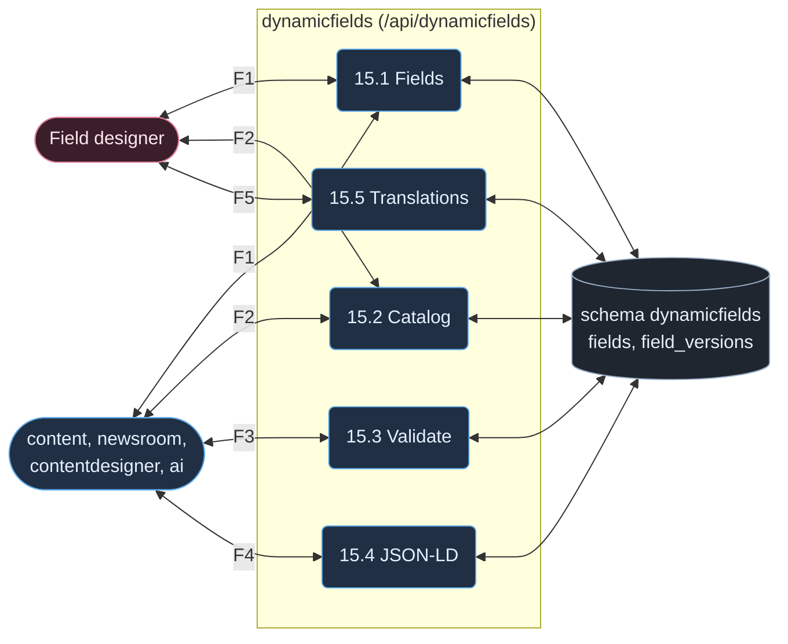

`dynamicfields` (Module.DynamicFields, v0.1.0, **core pool**) owns the versioned field definitions: post kinds,
content kinds, the proposal form and the SEO group. They are built on the schema.org catalog. The module validates
content trees against those definitions and builds their JSON-LD. It publishes and consumes no events: the other
modules call it over HTTP.

| Flow | Route | Payload |
|---|---|---|
| F1 | `GET fields`, `fields/{key}`, `fields/{key}/versions/{n}`; `POST fields`, `PUT {key}/draft`, `POST {key}/publish`, `DELETE {key}` | `NewField`, `DraftEdit`, `PublishRequest` → `FieldDetailDto`, `FieldPage`, `FieldVersionDto` |
| F2 | `GET catalog/schema-org`, `catalog/root-post-fields`, `catalog/starter-fields`, `POST starter-fields/install` | `StarterInstall` → `SchemaOrgCatalogDto`, `RootPostFieldDto[]`, `StarterFieldDto[]`, `StarterInstallReport` |
| F3 | `POST content/validate`, `content/validate-node` | `ContentTree`, `NodeValues` → `ContentReport` |
| F4 | `POST content/jsonld` | `JsonLdRequest` → `JsonLdReport` |
| F5 | `POST content/translations/check`, `translations/apply` | `TranslationCheck`, `TranslationMerge` → `TranslationReport`, `LocalizedContent` |

| Caller | Routes it uses |
|---|---|
| content | `catalog/root-post-fields`, `fields/{key}/versions/{n}`, `content/validate`, `content/validate-node` |
| newsroom | `catalog/root-post-fields`, `fields/...`, `content/validate-node` |
| contentdesigner | `catalog/root-post-fields`, `fields/{key}/versions/{n}`, `content/jsonld`, `content/validate` |
| ai | `fields/{key}/versions/{n}`, `content/validate-node` |
