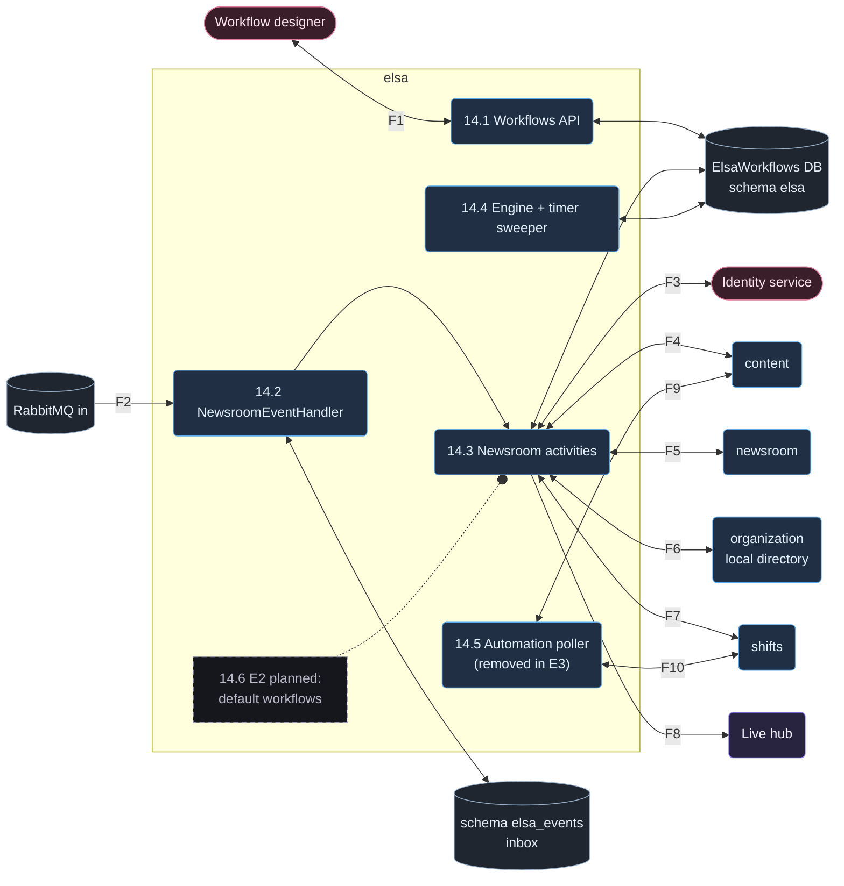

`elsa` (Module.Elsa, v0.1.0) runs only in the **workflow pool**, which the gateway reaches at `/api/elsa`. It
hosts the Elsa 3.9 engine, with its own database (`ConnectionStrings:elsa`). Workflows start from integration
events (step E1). Their activities change Content, NewsRoom and Shifts through those modules' HTTP APIs, with the
`elsa-workflows` client-credentials token. **E2 and E3 are planned:**

- E2: default workflows per post kind and per content kind
- E3: remove the poller and Content's `/automation/*` routes

| Flow | Route or channel | Payload |
|---|---|---|
| F1 | Elsa workflows API (`MapWorkflowsApi`, authorized; `workflow.view`, `workflow.design`, `workflow.run`) | workflow definitions and instances (Elsa JSON) |
| F2 | queue `integration.elsa.workflow` | `ProjectApproved`, `ProjectStateChanged`; `WorkItemAssigned`, `WorkItemStateChanged`; `PostCreated`, `PostCategoriesChanged`, `PostUnitChanged`, `ContentFeedEvent`; `ShiftPublished`, `ShiftMemberAdded`, `ShiftCheckedIn` |
| F3 | `client_credentials` (`elsa-workflows`) | → service token |
| F4 | `PUT posts/{id}/unit`, `POST posts/{id}/schedule`, `posts/{id}/publish`, `contents/{id}/assign`, `GET posts/{id}`, `contents/{id}`, `contents?assigneeId` | `UnitAssignment`, `ScheduleRequest`, `VersionRequest`, `ContentAssignment` → `PostDetail`, `ContentDetail` |
| F5 | `GET projects/{id}`, `POST projects/{id}/state` | `(state, approvalNumber, reason)` → `ProjectSnapshot` |
| F6 | `GET local/units/{id}`, `{id}/members`, `{id}/categories` | → `DirectoryUnitDto`, `DirectoryMemberDto` |
| F7 | `GET shifts?from&to` | → `ShiftDto[]` |
| F8 | `Notify` → `HostLiveMessenger` → `ILiveNotifier` | `LiveMessage` |
| F9 | `GET automation/accepted`, `POST accepted/{id}/assign`, `automation/shifts/{id}/handover`, `posts/publish-due` | → `PostSummary[]`, `PostDetail`, `int[]` |
| F10 | `GET shifts/ended?since`, `overdue`, `shifts/{id}/automation` | → `EndedShiftDto[]`, `ShiftDto[]`, `ShiftAutomationInfo` |

**Activities (14.3):** `RouteToUnit`, `EnsurePostInUnitCategories`, `WaitForRefiling`, `AssignInShift`,
`WaitForStage`, `Deadline`, `DeskReview`, `PublishPost`, `Notify`.

**Background services:** `ElsaEngineService`, `TimerSweeperService` and `NewsroomAutomationService`.

Elsa publishes no integration events. It reports back over HTTP. **Subscriptions:**

- `newsroom.project-approved.v1`, `newsroom.project-reapproved.v1`, `newsroom.project-state-changed.v1`
- `content.work-item-*.v1`, `content.post-*.v1`
- `shifts.checked-in.v1`, `shifts.published.v1`, `shifts.member-added.v1`
