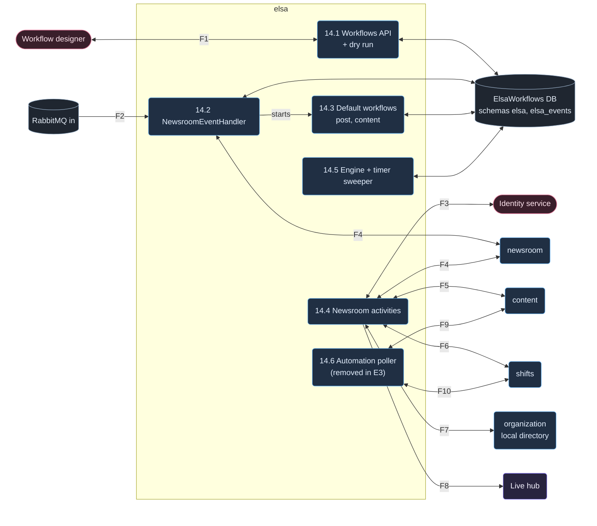

`elsa` (Module.Elsa, v0.1.0) runs only in the **workflow pool**, which the gateway reaches at `/api/elsa`. It
hosts the Elsa 3.9 engine, with its own database (`ConnectionStrings:elsa`). Steps E1 and E2 are built:

- **E1:** workflows start and resume from integration events.
- **E2:** default code workflows ship with the module: `newsroom-post` (a post project) and `newsroom-content` (one
  content, as a sub-workflow). NewsRoom's bindings choose them, or a definition authored in Elsa Studio. E2 also
  adds the shift handover and a dry run.

The activities change Content, NewsRoom and Shifts through their HTTP APIs, with the `elsa-workflows`
client-credentials token. **E3 is planned:** remove the deadline poller and Content's `/automation/*` routes.

| Flow | Route or channel | Payload |
|---|---|---|
| F1 | Elsa workflows API (`workflow.view`, `workflow.design`, `workflow.run`); `POST /api/elsa/newsroom/dry-run` (`workflow.design`, changes nothing) | workflow definitions and instances (Elsa JSON); `DryRunRequest(PostId, ...)` → what the bound workflow would do |
| F2 | queue `integration.elsa.workflow` | see the subscriptions below |
| F3 | `client_credentials` (`elsa-workflows`) | → service token |
| F4 | `GET /api/newsroom/bindings/resolve`, `projects/{id}`, `projects/{id}/workflow`, `POST projects/{id}/state`, `routing/route`, `workload/query` | `StateReport`, `RouteRequest`, `WorkloadRequest` → `BindingResolution`, `ProjectDto`, `RouteResult`, `WorkloadCounts` |
| F5 | `/api/content/posts/{id}`, `posts/{id}/unit`, `assign`, `accept`, `transfer`, `schedule`, `publish`; `contents/{id}`, `contents/{id}/assign`, `contents/{id}/unit` | `UnitAssignment`, `ContentAssignment`, `ScheduleRequest`, `VersionRequest` → `PostDetail`, `ContentDetail` |
| F6 | `GET /api/shifts/shifts?from&to`, `shifts/{id}` | → `ShiftDto` (who is on, in which role, checked in) |
| F7 | `GET /api/organization/local/units`, `{id}`, `{id}/members`, `{id}/categories` | → `DirectoryUnitDto`, `DirectoryMemberDto` |
| F8 | `Notify`, `Deadline` → `HostLiveMessenger` → `ILiveNotifier`, topic `user:{id}` or the unit's topics | `workflow.notification`, `workflow.deadline-missed`, `workflow.published`, `workflow.publish-refused` |
| F9 | `GET automation/accepted`, `POST accepted/{id}/assign`, `automation/shifts/{id}/handover`, `posts/publish-due` | → `PostSummary[]`, `PostDetail`, `int[]` |
| F10 | `GET shifts/ended?since`, `overdue` | → `EndedShiftDto[]`, `ShiftDto[]` |

**Workflows (14.3):**

- `newsroom-post` v1: `EnsurePostInUnitCategories`, `WaitForRefiling`, `ProduceContents`, `DeskReview`,
  `PublishPost`, `Notify`
- `newsroom-content` v1, one per content: `FileContentInUnit`, `WorkInShift`

A released version never changes. A change ships as the next version beside the old one, so suspended instances
still resume.

**Activities (14.4):** `RouteToUnit`, `FileContentInUnit`, `EnsurePostInUnitCategories`, `WaitForRefiling`,
`ProduceContents`, `AssignInShift`, `WorkInShift`, `WaitForStage`, `Deadline`, `DeskReview`, `PublishPost`, `Notify`.
`AssignInShift` and `WorkInShift` pick a checked-in member with the shift role (`Elsa:Newsroom:ContentRole`, by
default `writer`) and the fewest open items (F4 `workload/query`).

**Background services:** `ElsaEngineService`, `TimerSweeperService` and `NewsroomAutomationService`.

## Subscriptions

| Pattern | Data | What it does |
|---|---|---|
| `newsroom.project-approved.v1`, `newsroom.project-reapproved.v1`, `newsroom.project-binding-available.v1` | `ProjectApproved` | resolves the binding (F4) and starts the project's workflow |
| `newsroom.project-state-changed.v1` | `ProjectStateChanged` | resumes or ends the project's workflow |
| `content.post-*.v1` | `PostCreated`, `PostCategoriesChanged`, `PostUnitChanged`, `ContentFeedEvent` | resumes the post's waiting activities |
| `content.work-item-*.v1` | `WorkItemAssigned`, `WorkItemStateChanged` | resumes the content's waiting activities |
| `shifts.published`, `member-added`, `checked-in`, `checked-out`, `handover`, `ended` (`.v1`) | the Shifts records | resumes the unit's waiting activities; hands open work over at a handover or the end of a shift |

Elsa publishes no integration events. It reports back over HTTP.
