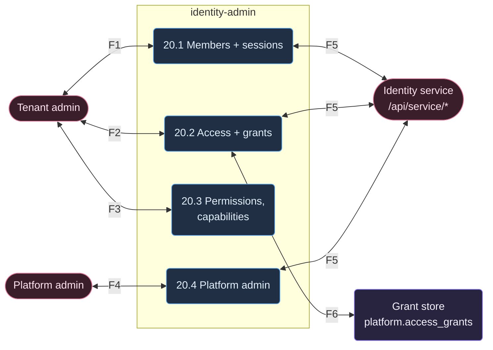

`identity-admin` (Module.Admin.OpenIddict, v1.0.0, **core pool**) exists only as local commits, with no remote yet.
It has no tables of its own:

- Tenant and platform admin calls go to the identity service's `/api/service/*`, with a client-credentials token
  (`IdentityService`).
- Grants go to the host's `IGrantStore`.

| Flow | Route (`/api/identity-admin`) | Payload |
|---|---|---|
| F1 | `members` (list, get, invite, `PUT`), `{userId}/suspend`, `activate`, `DELETE`, `sessions`, `sessions/{id}/revoke`, `members/{userId}/sessions/revoke` | `InviteMemberRequest`, `UpdateMemberRequest` → `Member`, `MemberInvited`, `MemberStatusChanged`, `MemberRemoved`, `MemberSession`, `SessionsRevoked` |
| F2 | `members/{userId}/access`, `POST grants`, `DELETE grants/{grantId}` | `NewGrantRequest` → `MemberAccess`, `MemberGrant` |
| F3 | `GET permissions`, `capabilities`, `platform/capabilities` | → `PermissionGroup[]`, `AdminCapabilities`, `PlatformCapabilities` |
| F4 | `platform/tenants`, `accounts` (+ `lock`, `unlock`, `sign-out`, `roles`), `applications` (+ `secret`, `rotation/complete`, `rotation/cancel`, `tokens/revoke`), `scopes` | `TenantPolicyRequest`, `AccountRolesRequest`, `ClientApplicationRequest` → `TenantPolicy`, `Account`, `AccountChanged`, `ClientApplication`, `ClientApplicationCreated`, `ClientSecret`, `ClientTokensRevoked`, `ScopeInfo` |
| F5 | `/api/service/tenants/{tenant}/members...`, `/api/service/platform/...` (client credentials) | `InviteMember`, `UpdateMember`, `TenantPolicyInput`, `AccountRolesInput`, `ApplicationInput` |
| F6 | `IGrantStore` | `AccessGrant` |
