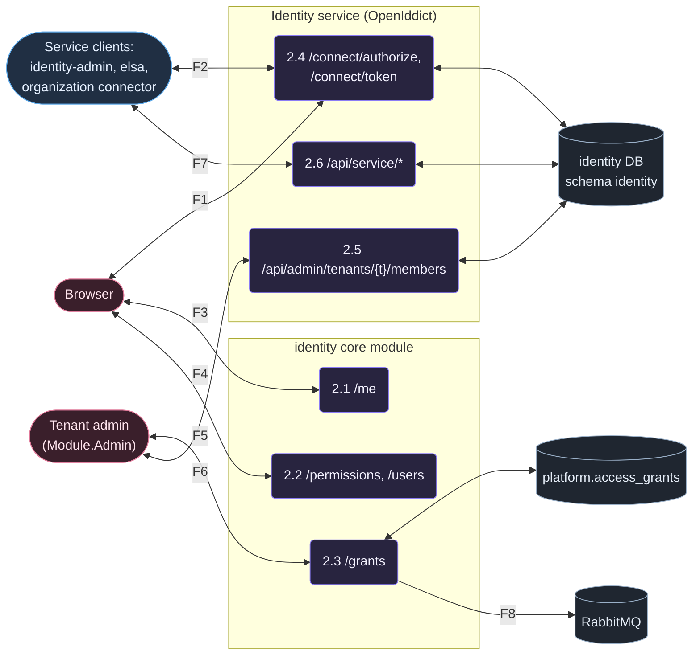

Identity has two parts:

- **`identity`**, a core module in every pool, served at `/api/identity`. It answers who the caller is, lists
  permissions and users, and manages grants.
- **The identity service** (`src/WebApi/Identity/WebApi.Identity.Server`), its own process. It is the OpenIddict
  server, with the accounts, tenant memberships and client applications.

| Flow | Route or channel | Payload |
|---|---|---|
| F1 | authorization code + PKCE, refresh | → access token (JWT: sub, tenant, roles), id token, refresh token |
| F2 | `client_credentials` (`elsa-workflows`, connector, identity-admin clients) | → service access token |
| F3 | `GET /api/identity/me` (anonymous allowed) | → `CurrentPrincipal(IsAuthenticated, UserId, Name, TenantId, AuthType, Permissions, ClaimItem[])` |
| F4 | `GET /api/identity/permissions`, `/users`, `/users/{userName}` | → `PermissionDefinition[]`, users |
| F5 | `GET/POST /api/identity/grants`, `DELETE grants/{id}` (`access.grants.manage`) | `NewGrant` → `AccessGrant` |
| F6 | `GET/POST members`, `{userId}/suspend`, `activate`, `DELETE`, `PUT /` | `InviteMember` (email, role, displayName) → members |
| F7 | `/api/service/tenants/{t}/members`, `sessions`, `/api/service/platform/tenants`, `accounts`, `applications`, `scopes` | `InviteMember`, `UpdateMember`, `TenantPolicyInput`, `AccountRolesInput`, `ApplicationInput` → members, sessions, accounts, applications |
| F8 | fanout `access.grants.changed` | a signal |

**Tables:**

- schema `identity`: `AspNetUsers` and the other ASP.NET Identity tables, `TenantMemberships`, `TenantProfiles`,
  `Tenants`, and the OpenIddict tables
- schema `platform`: `access_grants`

The identity module publishes no integration events.
