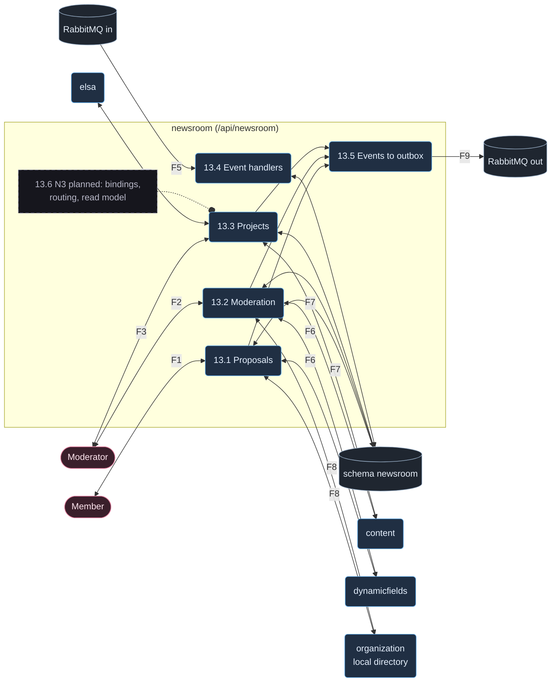

`newsroom` (Module.NewsRoom, v0.1.0, **core pool**) turns a member's proposal into a post project. A moderator
approves the proposal, which creates the draft post in Content and starts the bound workflow in Elsa. Steps N1 and
N2 are built. **N3 is planned:** workflow bindings, routing rules, the load read model and the unit live topics.

| Flow | Route or channel | Payload |
|---|---|---|
| F1 | `POST proposals`, `PUT/DELETE proposals/{id}`, `{id}/submit`, `GET {id}`, `mine` | `NewProposal`, `ProposalEdit`, `Submission` → `ProposalDto`, `ProposalPage` |
| F2 | `GET proposals/queue`, `POST {id}/approve`, `return`, `cancel` (`newsroom.moderate`) | `Approval`, `ReturnDecision`, `CancelDecision` → `ApprovalDto`, `ProposalDto` |
| F3 | `GET projects`, `{id}`, `{id}/proposal`, `POST {id}/draft`, `fix`, `kill` | `DraftRequest`, `Correction`, `KillDecision` → `ProjectDto`, `ProjectPage` |
| F4 | Elsa: `GET projects/{id}`, `POST projects/{id}/state` | `StateReport` (state, approvalNumber, reason) → `ProjectDto` |
| F5 | queue `integration.newsroom.core` | `UnitMoved` (`org.unit-moved.v1`), `ContentFeedEvent` (`content.post-state-changed.v1`), `PostCategoriesChanged` |
| F6 | `/api/dynamicfields/fields/{key}`, `versions/{n}`, `catalog/root-post-fields`, `content/validate-node` | `NodeValues` → `FieldVersionDto`, `RootPostFieldDto[]`, `ContentReport` |
| F7 | `POST /api/content/posts`, `GET /api/content/categories` | `NewPost` → `PostDetail`, `CategoryDto[]` |
| F8 | `GET /api/organization/local/units...` (`IUnitLookup`) | → `DirectoryUnitDto` |
| F9 | topic `integration` | see the events below |

**Tables (schema `newsroom`):** `proposals`, `post_projects`, plus the outbox and inbox.

## Events (`NewsRoom.Contracts`)

| Type | Data | Subscribers |
|---|---|---|
| `newsroom.proposal-submitted.v1` | `ProposalSubmitted(ProposalId, Version, Title, AuthorId, UnitId, UnitPath, ...)` | none yet |
| `newsroom.proposal-decided.v1` | `ProposalDecided(ProposalId, Version, Decision, Title, AuthorId, UnitId, ...)` | none yet |
| `newsroom.project-approved.v1`, `newsroom.project-reapproved.v1` | `ProjectApproved(ProjectId, ProposalId, Version, ApprovalNumber, PostId, PostPublicId, ...)` | elsa |
| `newsroom.project-state-changed.v1` | `ProjectStateChanged(ProjectId, ProposalId, Version, ApprovalNumber, PreviousState, ...)` | elsa |
| `newsroom.work-item-assigned.v1`, `newsroom.work-item-state-changed.v1` | `WorkItemAssigned`, `WorkItemStateChanged` (`ProjectWorkItem`) | none yet |

**References:** `Organization.Contracts` and `Content.Contracts`.
