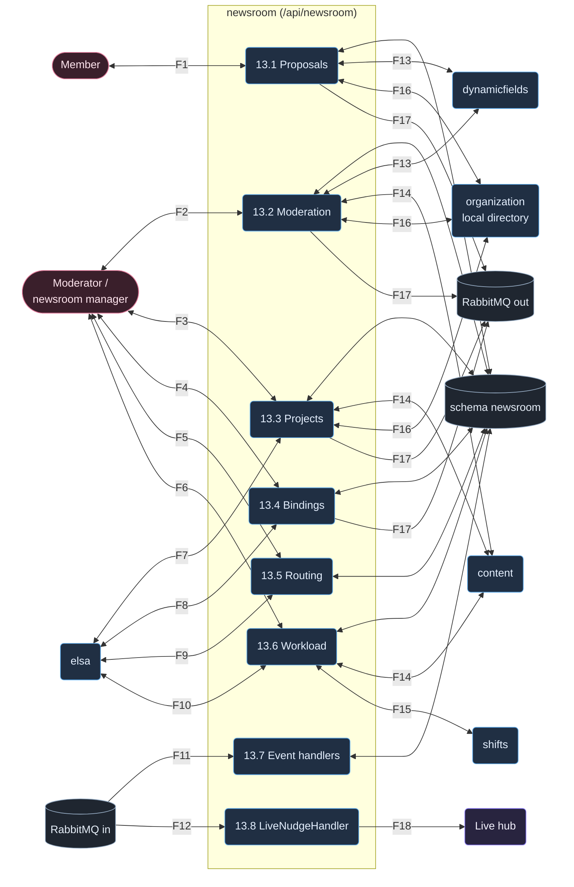

`newsroom` (Module.NewsRoom, v0.1.0, **core pool**) turns a member's proposal into a post project. Steps N1 to N3 are
built:

- **N1, N2:** proposals, moderation, and post projects. Approval creates the draft post in Content.
- **N3:** workflow bindings (which Elsa workflow runs for a post or content kind in a unit), routing rules, a
  workload read model fed by Shifts and work-item events, and live boards per unit.

| Flow | Route or channel | Payload |
|---|---|---|
| F1 | `POST proposals`, `PUT/DELETE proposals/{id}`, `{id}/submit`, `GET {id}`, `mine` | `NewProposal`, `ProposalEdit`, `Submission` → `ProposalDto`, `ProposalPage` |
| F2 | `GET proposals/queue`, `POST {id}/approve`, `return`, `cancel` (`newsroom.moderate`) | `Approval`, `ReturnDecision`, `CancelDecision` → `ApprovalDto`, `ProposalDto` |
| F3 | `GET projects`, `{id}`, `{id}/proposal`, `POST {id}/draft`, `fix`, `kill` | `DraftRequest(Version, AbandonEarlier)`, `Correction` (post kind, Section, categories), `KillDecision` → `ProjectDto`, `ProjectPage` |
| F4 | `GET/POST bindings`, `PUT/DELETE bindings/{id}` | `NewBinding(KindType, Kind, UnitId, DefinitionId, DefinitionVersion)`, `BindingChange` → `BindingDto` |
| F5 | `GET/POST routing-rules`, `PUT/DELETE routing-rules/{id}`, `GET sections/suggestions` | `NewRule(ContentKind, UnitId, UnitTag, Order)`, `RuleChange` → `RoutingRuleDto`, `SectionSuggestion[]` |
| F6 | `GET workload?unitId`, `POST workload/reconcile?prune` | → `UnitWorkload`, `ReconcileReport` |
| F7 | Elsa: `GET projects/{id}`, `projects/{id}/workflow`, `POST projects/{id}/state` | `StateReport(State, ApprovalNumber, Reason)` → `ProjectDto`, `BindingResolution` |
| F8 | Elsa: `GET bindings/resolve?kindType&kind&unitId` | → `BindingResolution` (the definition to run, or none) |
| F9 | Elsa: `POST routing/route` | `RouteRequest(ContentKind, Categories)` → `RouteResult` (the unit) |
| F10 | Elsa: `POST workload/query` | `WorkloadRequest(UserIds)` → `WorkloadCounts` (open items per member) |
| F11 | queue `integration.newsroom.core`, see the subscriptions below | `UnitMoved`, `ContentFeedEvent`, `PostCategoriesChanged`, the Shifts records, `WorkItemAssigned`, `WorkItemStateChanged`, content removals |
| F12 | the module's own events, delivered back after the commit | `ProposalSubmitted`, `ProposalDecided`, `ProjectApproved`, `ProjectStateChanged`, `ProjectDetailsChanged` |
| F13 | `/api/dynamicfields/fields/proposal/versions/0`, `catalog/root-post-fields`, `fields/{key}/versions/{n}`, `content/validate-node` | `NodeValues` → `FieldVersionDto`, `RootPostFieldDto[]`, `ContentReport` |
| F14 | `POST /api/content/posts`, `GET categories`, `GET contents?assigneeId` (reconcile) | `NewPost` → `PostDetail`, `CategoryDto[]`, `ContentSummary[]` |
| F15 | `GET /api/shifts/shifts?from&to` (reconcile) | → `ShiftDto[]` |
| F16 | `GET /api/organization/local/units...` (`IUnitLookup`) | → `DirectoryUnitDto` |
| F17 | topic `integration` | see the events below |
| F18 | `ILiveNotifier`, topics `newsroom:board:{unit}` and `unit:{unit}`, for each unit from the nearest up | `newsroom.proposal.changed` (`ProposalNudge`), `newsroom.project.changed` (`ProjectNudge`) |

**Tables (schema `newsroom`):**

- `proposals`, `post_projects`
- `workflow_bindings`, `routing_rules`
- the workload read model: `work_items`, `shift_records`, `shift_attendance`
- the outbox and inbox

## Events published (`NewsRoom.Contracts`)

| Type | Data | Subscribers |
|---|---|---|
| `newsroom.proposal-submitted.v1` | `ProposalSubmitted(ProposalId, Version, Title, AuthorId, UnitId, UnitPath, ...)` | newsroom (live) |
| `newsroom.proposal-decided.v1` | `ProposalDecided(ProposalId, Version, Decision, ...)` | newsroom (live) |
| `newsroom.project-approved.v1`, `newsroom.project-reapproved.v1` | `ProjectApproved(ProjectId, ProposalId, Version, ApprovalNumber, PostId, PostPublicId, ...)` | elsa, newsroom (live, approved only) |
| `newsroom.project-binding-available.v1` | `ProjectApproved` data, for a project approved before its binding existed | elsa |
| `newsroom.project-state-changed.v1` | `ProjectStateChanged(ProjectId, ProposalId, Version, ApprovalNumber, PreviousState, ...)` | elsa, newsroom (live) |
| `newsroom.project-details-changed.v1` | `ProjectDetailsChanged(ProjectId, ..., PostKind, SectionId, SectionPath, Categories, Title, ChangedAt)` | newsroom (live) |
| `newsroom.work-item-assigned.v1`, `newsroom.work-item-state-changed.v1` | `WorkItemAssigned`, `WorkItemStateChanged` (`ProjectWorkItem`) | newsroom (workload) |

## Subscriptions

| Pattern | Handler | What it does |
|---|---|---|
| `org.unit-moved.v1` | `UnitMovedHandler` | re-paths proposals and projects; may announce a binding |
| `content.post-state-changed.v1` | `PostStateChangedHandler` | moves the project's state |
| `content.post-categories-changed.v1` | `PostCategoriesChangedHandler` | updates the project's categories |
| `shifts.published`, `updated`, `cancelled`, `checked-in`, `checked-out`, `ended`, `section-moved` (`.v1`) | `ShiftEventsHandler` | the workload model: `shift_records`, `shift_attendance` |
| `*.work-item-assigned.v1`, `*.work-item-state-changed.v1` | `WorkItemAssignedHandler`, `WorkItemStateHandler` | the workload model: `work_items` |
| `content.content-deleted.v1`, `content.content-archived.v1` | `ContentRemovedHandler` | closes the content's work items |
| its own proposal and project events | `LiveNudgeHandler` | the live boards (F18) |

**References:** `Organization.Contracts`, `Content.Contracts` and `Shifts.Contracts`. **Live topic:** `board`, open to
any of `newsroom.moderate`, `newsroom.projects`, `newsroom.workflow` and `newsroom.manage`.
