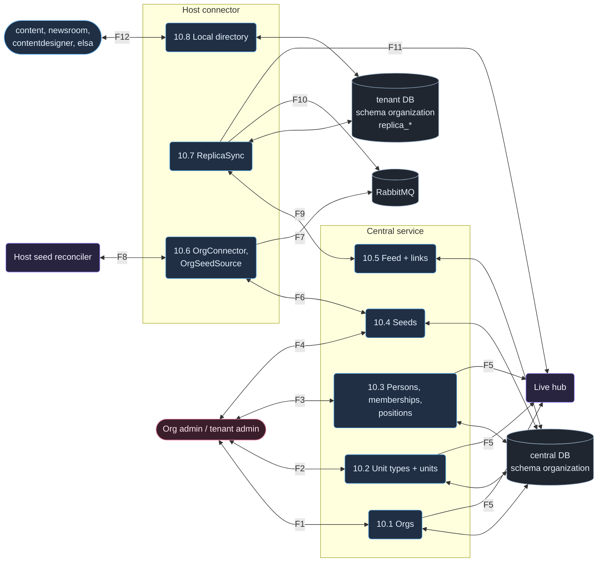

`organization` (Module.Organization) is optional. The same package runs in two roles:

- **The central service** (`/api/organization/orgs/...`, `/api/organization/seeds`). It holds customers, unit
  types, the unit tree, people, memberships, positions, tenant seeds, tenant links and a change feed, in a
  central database.
- **The host connector**. It pulls the seeds and the feed of its deployment, keeps a per-tenant **replica**,
  replays the feed entries as local integration events, and serves the local directory
  (`/api/organization/local/units`). Other modules read that directory.

| Flow | Route or channel | Payload |
|---|---|---|
| F1 | `/orgs`, `/orgs/{orgId}`, `PUT /orgs/{orgId}/admins` | `CreateOrgRequest`, `UpdateOrgRequest`, `SetOrgAdminsRequest` → `OrgDto` |
| F2 | `/orgs/{orgId}/unit-types`, `/units`, `units/{id}`, `units/{id}/move`, `units/{id}/tenant` | `CreateUnitTypeRequest`, `CreateUnitRequest`, `UpdateUnitRequest`, `MoveUnitRequest` → `UnitTypeDto`, `OrgUnitDto`, `UnitTenantDto` |
| F3 | `/orgs/{orgId}/persons`, `/memberships`, `/positions` | `CreatePersonRequest`, `CreateMembershipRequest`, `CreatePositionRequest` (+ `Update*`) → `PersonDto`, `MembershipDto`, `PositionDto` |
| F4 | `/orgs/{orgId}/seeds`, `seeds/{seedId}` | `CreateSeedRequest`, `UpdateSeedRequest` → `TenantSeedDto` |
| F5 | `OrgLiveNudges` → `ILiveNotifier`, topic `organization:org:{id}` | a change nudge |
| F6 | `GET /seeds?deployment=`, `POST /seeds/{seedId}/reports` (service token) | → `DeploymentSeedDto[]`; `SeedReportRequest` (Provisioned, Rejected, Adjusted) |
| F7 | topic `integration` | `tenancy.seed-changed.v1` |
| F8 | `ITenantSeedSource` | seeds → `TenantInfo`, reports |
| F9 | `GET /orgs/{orgId}/events?after=`, `/orgs/{orgId}/links` | → `FeedPage` (`FeedEntry`), `TenantLinkDto[]` |
| F10 | topic `integration`: the feed entries, replayed | `org.*` events (below) |
| F11 | `ILiveNotifier`, topic `unit:{id}` | a change nudge |
| F12 | `GET /local/units`, `{id}`, `{id}/ancestors`, `{id}/categories`, `{id}/members` | → `DirectoryUnitDto`, `DirectoryMemberDto`, `string[]` |

**Tables:**

- central, schema `organization`: `orgs`, `org_admins`, `unit_types`, `units`, `unit_categories`, `persons`,
  `memberships`, `positions`, `tenant_seeds`, `tenant_seed_history`, `tenant_links`, `feed`
- replica in each tenant database: `replica_units`, `replica_persons`, `replica_positions`, `replica_memberships`,
  `replica_links`, `replica_sync`, plus the outbox and inbox

## Events (`Organization.Contracts/OrgEvents.cs`)

| Type | Data | Subscribers |
|---|---|---|
| `org.unit-created.v1` | `UnitCreated(OrgUnitSnapshot Unit)` | shifts, content |
| `org.unit-updated.v1` | `UnitUpdated(OrgUnitSnapshot Unit)` | shifts, content |
| `org.unit-moved.v1` | `UnitMoved(UnitId, OrgId, OldParentId, NewParentId, OldPath, NewPath, Version)` | shifts, content, newsroom |
| `org.unit-removed.v1` | `UnitRemoved(UnitId, OrgId, Path)` | shifts, content |
| `org.membership-changed.v1` | `MembershipChanged(...)` | shifts |
| `org.person-changed.v1` | `PersonChanged(PersonId, OrgId, Issuer, Subject, DisplayName, Email, IsEmployee)` | none yet |
| `org.position-changed.v1` | `PositionChanged(PositionId, OrgId, Key, NameEn, NameAr, Permissions)` | none yet |
| `org.tenant-seed-changed.v1` | `TenantSeedChanged(SeedId, OrgId, RootUnitId, Version, DeploymentId, TenantId, Status, ReportedVersion)` | none yet |
| `org.tenant-link-changed.v1` | `TenantLinkChanged(...)` | none yet (planned: Webhooks) |

**Live topics (manifest):** `unit` and `org`, both requiring `organization.read`.

**Planned:** the cross-deployment relay feed for tenant links, and a Webhooks module that acts on links. Today the
links are a skeleton.
