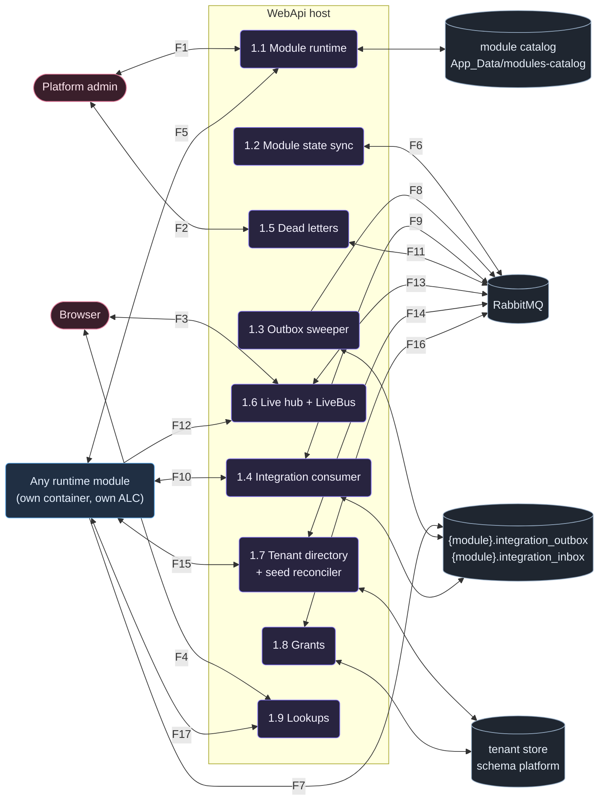

The host (`src/WebApi/WebApi`) runs in every pool replica. The modules do not call its processes: the host
provides them through `WebApi.Contracts` and `WebApi.Data`. They are drawn here because every module's flows pass
through them.

| Flow | Route or channel | Payload |
|---|---|---|
| F1 | `/api/admin/modules`: `POST` (multipart), `{id}/activate`, `deactivate`, `unload`, `PUT {id}/settings`, `DELETE {id}` | package `.dll`, `.zip` or `.nupkg`, settings → module list and state |
| F2 | `/api/admin/integration/dead-letters`, `{moduleId}`, `{moduleId}/replay` | → dead-lettered envelopes |
| F3 | SignalR `/hubs/live`: `Subscribe(topic)`, `Unsubscribe(topic)` | → `LiveSubscribeResult`; pushes `LiveMessage(Topic, Type, Payload, Sequence, At)` |
| F4 | `GET /api/lookups`, `/api/lookups/{name}?q`, `{name}/keys`, `POST {name}/query` | `LookupQuery`, `LookupKeysRequest` → `LookupPage` (`LookupItem`), `LookupDescriptor[]` |
| F5 | load into a collectible ALC, map its Carter routes under `/api/{RoutePrefix}` | `ModuleManifest(Id, Name, Version, RoutePrefix, Permissions, LiveTopics, Subscriptions, HotUnload)` |
| F6 | fanout `modules.state` | module id + state; each replica re-syncs |
| F7 | `IIntegrationEvents.Publish(type, data, subject, unitPath, orgId)` | an outbox row in the same `SaveChanges` |
| F8 | topic exchange `integration` (routing key = type) | `IntegrationEnvelope(Id, Type, TenantId, Subject, OccurredAt, CorrelationId, Source, Data, OrgId, UnitPath)` |
| F9 | durable queue `integration.{module}.{pool}`, bound to the manifest's `Subscriptions` | `IntegrationEnvelope` |
| F10 | `IIntegrationEventHandler.HandleAsync`, in one transaction with the inbox row | `envelope.DataAs<T>()`, into the subscriber's own record |
| F11 | `integration.dlx`: an envelope lands there after the retries; the admin replays it | `IntegrationEnvelope` |
| F12 | `ILiveNotifier.PublishAsync(topic, type, payload, seq)` | checked against the manifest's `LiveTopics` |
| F13 | fanout `live` | `LiveMessage(TenantId, Topics, Type, Payload, Sequence, ...)` |
| F14 | fanout `tenants.changed`; host subscription `tenancy.seed-changed.v1` | a reload signal; the seed-changed event triggers a reconciliation |
| F15 | `ITenantSeedSource` (the Organization connector) and `ITenantInitializer` (each module) | `DeploymentSeedDto` → `TenantInfo`, then a `SeedReportRequest` back |
| F16 | fanout `access.grants.changed` | a signal: drop the grant caches and re-check the live groups |
| F17 | the lookup's owner module answers it over HTTP | `LookupQuery` → `LookupPage` |

**Background services:** `ModuleReconciler`, `LocalModuleWatcher`, `ModuleStateSubscriber`, `OutboxSweeper<T>`,
`RabbitMqHostIntegrationSubscriber`, `LiveSubscriber`, `TenantDirectoryService`, `TenantChangeSubscriber`,
`TenantSeedReconciler` and `GrantChangeSubscriber`.

**Tables (schema `platform`, in the tenant store):** `tenants`, `access_grants`, `tenant_subscriptions`.

**Shared work-item contract (`WebApi.Contracts/WorkItems`):** `WorkItemAssigned(item, previousAssignee)` and
`WorkItemStateChanged(item, previousState)`. A module publishes them as `{module}.work-item-*.v1`.
