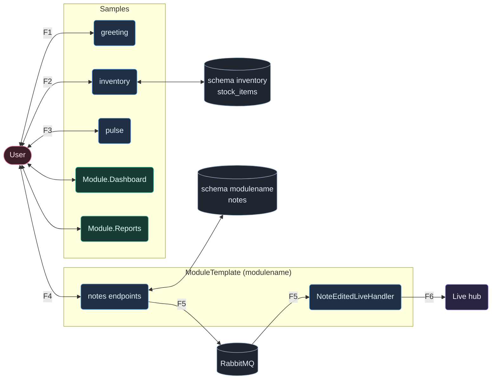

The Samples repository shows the runtime with small modules. ModuleTemplate is the `dotnet new` template that
every `Module.*` repository started from.

| Flow | Route or channel | Payload |
|---|---|---|
| F1 | `/api/greeting`: `GET /`, `GET /{name}`, `POST /echo` (sales and worker pools) | a greeting text |
| F2 | `/api/inventory` (v1.2.0): `GET items`, `POST items`, `POST items/{sku}/adjust` | stock items |
| F3 | `/api/pulse`: `whoami`, `beats`, `echo/{word}`, `status` (`PulseWorker`, `StartupProbe`) | the beat state |
| F4 | `/api/modulename/notes`: list, search, get, create, update, delete | note DTOs |
| F5 | outbox, then topic `integration`, then the module's own queue | `modulename.note-edited.v1` (subscription `modulename.note-*.v1`) |
| F6 | `ILiveNotifier`, the note's topic | `LiveMessage` |

The template's own module subscribes to its own `modulename.note-*.v1` events, to show the whole path: outbox,
broker, inbox, handler and live hub.
