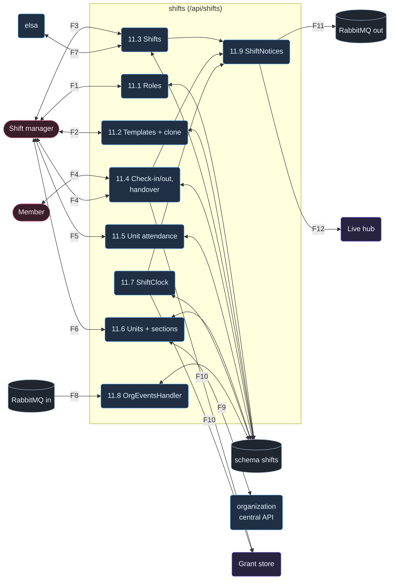

`shifts` (Module.Shifts, v0.1.0, **sales pool**) plans and runs shifts on Organization units. Shifts v2 has
landed: roles as data, templates cloned into shifts, units, attendance and handover. A rota becomes standing
grants (`shift:{id}`) from check-in to check-out.

| Flow | Route or channel | Payload |
|---|---|---|
| F1 | `GET roles`, `roles/effective`, `POST roles`, `PUT/DELETE roles/{id}` | `RoleRequest`, `RoleUpdateRequest` → `RoleDefinitionDto` |
| F2 | `templates`, `templates/{id}`, `POST templates/{id}/clone` | `TemplateRequest`, `TemplateCloneRequest` → `ShiftTemplateDto`, `TemplateCloneResult` |
| F3 | `shifts`, `shifts/{id}`, `{id}/publish`, `mine`, `overdue`, `shifts/ended`, `{id}/automation` | `ShiftRequest` → `ShiftDto`, `EndedShiftDto`, `ShiftAutomationInfo` |
| F4 | `shifts/{id}/check-in`, `check-out`, `members/{userId}/check-in`, `check-out`, `PUT {id}/handover` | `HandoverRequest` → `ShiftDto` |
| F5 | `GET/PUT units/{id}/attendance` | `UnitAttendanceRequest` → `UnitAttendanceDto` |
| F6 | `units`, `units/resync`, `sections`, `sections/serving`, `{id}/settings`, `export`, `move-to-organization` | `MoveSectionsRequest` → `UnitDto`, `UnitResyncResult`, `SectionDto`, `SectionSettings`, `SectionsExport`, `SectionMoveReport` |
| F7 | Elsa: `GET shifts?from&to`, `shifts/ended?since`, `overdue`, `shifts/{id}/automation` | → `ShiftDto[]`, `EndedShiftDto[]`, `ShiftAutomationInfo` |
| F8 | queue `integration.shifts.sales` | `UnitCreated`, `UnitUpdated`, `UnitMoved`, `UnitRemoved`, `MembershipChanged` → `unit_cache` |
| F9 | `IOrganizationClient` (central, as the caller), to create section units | `CreateUnitRequest` → `OrgUnitDto` |
| F10 | standing grants, source `shift:{id}`, scope `unit:{id}` (written at check-in; the clock rewrites them) | `AccessGrant` |
| F11 | topic `integration` | see the events below |
| F12 | `ILiveNotifier`, topic `shifts:shift:{id}` | `LiveMessage` |

**Tables (schema `shifts`):**

- `shift_roles`, `shift_templates`, `shift_template_slots`, `shift_template_members`
- `shifts`, `shift_members`, `unit_attendance`, `unit_cache`
- `sections`, `section_categories`, `section_unit_map`
- the outbox and inbox

## Events (`Shifts.Contracts/ShiftsEvents.cs`)

| Type | Data | Subscribers |
|---|---|---|
| `shifts.published.v1` | `ShiftPublished(ShiftSnapshot)` | elsa |
| `shifts.updated.v1` | `ShiftUpdated(ShiftSnapshot)` | none yet |
| `shifts.cancelled.v1` | `ShiftCancelled(ShiftSnapshot, By, At)` | none yet |
| `shifts.member-added.v1` | `ShiftMemberAdded(ShiftId, UnitId, UserId, RoleKey, IsLead)` | elsa |
| `shifts.member-removed.v1` | `ShiftMemberRemoved(...)` | none yet |
| `shifts.checked-in.v1` | `ShiftCheckedIn(ShiftId, UnitId, UserId, RoleKeys, At, By, Status)` | elsa |
| `shifts.checked-out.v1` | `ShiftCheckedOut(ShiftId, UnitId, UserId, At, By, Automatic, Status)` | none yet |
| `shifts.handover.v1` | `ShiftHandover(ShiftId, UnitId, Note, By, At)` | none yet |
| `shifts.ended.v1` | `ShiftEnded(ShiftSnapshot, By, At)` | none yet |
| `shifts.section-moved.v1` | `SectionMoved(SectionId, UnitId)` | content |

**References:** `Organization.Contracts` and `Organization.Client`. **Live topic:** `shift`, requiring
`shifts.view`.
