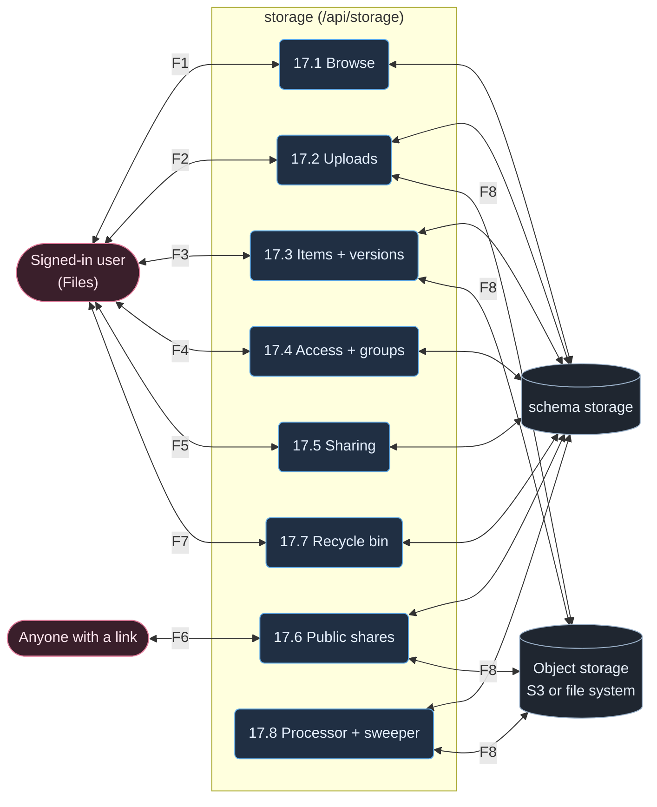

`storage` (Module.Storage, v0.1.0, **core pool**) is the tenant's file system. Blobs live in an S3-compatible
store or on the file system (`BlobStores`: `IBlobStore` per location). Two client modules use it:

- `Module.Storage`, the Files app, at `/files`
- `Module.Storage.Shares`, the anonymous share pages, at `/s`, inside `Layouts.Public`

| Flow | Route | Payload |
|---|---|---|
| F1 | `GET roots`, `folders/{id}/items`, `items/{id}`, `usage`, `events` | → `Roots`, `FolderView`, `ItemDetail`, `StorageUsage`, `EventPage` |
| F2 | `POST uploads`, `PUT uploads/{id}/chunks`, `POST uploads/{id}/complete`, `GET/DELETE uploads/{id}` | `StartUploadCommand`, chunk (`FileParameter`) → `UploadDto`, `ItemDto` |
| F3 | `POST folders`, `PATCH items/{id}`, `items/move`, `copy`, `delete`, `versions/{n}/restore`, `DELETE versions/{n}`, `items/{id}/content`, `items/{id}/link` | `CreateFolderCommand`, `RenameRequest`, `MoveItemsCommand`, `CopyItemsCommand`, `DeleteItemsCommand` → `ItemDto`, `BatchResult`, `ItemDetail`, `FileResponse`, `DownloadLink` |
| F4 | `GET/PUT items/{id}/acl`, `PUT owner`, `GET effective-access`, `groups` (CRUD), `people` | `SetAclRequest`, `SetOwnerRequest`, `GroupInput` → `AclDto`, `EffectiveAccessDto`, `GroupDto`, `PersonDto` |
| F5 | `items/{id}/sharing`, `sharing/people`, `sharing/public`, `sharing/links`, `DELETE sharing/links/{id}`, `shared-with-me` | `ShareWithPeopleRequest`, `SetPublicRequest`, `CreateShareLinkRequest` → `SharingDto`, `ShareLinkDto`, `SharedItemDto` |
| F6 | `GET links/{token}`, `shares/{tenant}/{token}`, `shares/{tenant}/{token}/files/{id}/link`, `public/{tenant}/{fileId}/{name}` | → `SharedView`, `DownloadLink`, a file stream |
| F7 | `GET recycle-bin`, `POST recycle-bin/restore`, `purge` | `RestoreItemsCommand`, `PurgeItemsCommand` → `DeletedItemDto[]`, `BatchResult` |
| F8 | `IBlobStore` (`AWSSDK.S3`, or `FileSystemBlobStore`); `StorageProcessor` scans files and makes thumbnails; `StorageSweeper` and `POST maintenance/sweep` clean up | blobs, chunks → `SweepResult` |

**Tables (schema `storage`):** `items`, `file_versions`, `blobs`, `uploads`, `access_entries`, `groups`,
`group_members`, `people`, `share_links`, `events`.

The module publishes and consumes no integration events. The string `soft.square.net.storage.download-links.v1` in
the code is a Data Protection purpose for signed download links, not an event.
