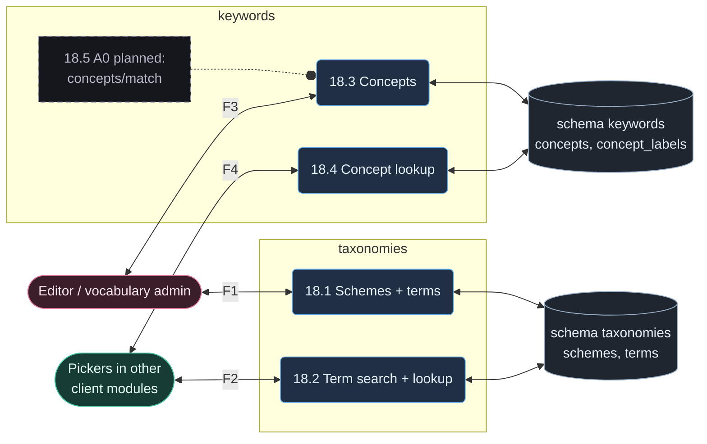

These are two leaf modules in the **core pool**. They call no other module and use no events. Pickers in other
client modules reach them through their `lookup` endpoints, which take ids and return short summaries.

| Flow | Route (`/api/taxonomies`, `/api/keywords`) | Payload |
|---|---|---|
| F1 | `schemes` (CRUD), `schemes/{key}/jsonld`, `schemes/{key}/terms`, `terms/{id}` (`PUT`, `DELETE`), `terms/{id}/move` | `NewScheme`, `SchemeEdit`, `NewTerm`, `TermEdit`, `TermMove` → `SchemeDto`, `SchemeSummaryDto[]`, `JsonLdDto` |
| F2 | `GET terms`, `terms/lookup?ids`, `terms/{id}/jsonld` | ids → `TermRefDto[]`, `JsonLdDto` |
| F3 | `concepts` (list, get, create, edit), `{id}/retire`, `{id}/restore`, `types` | `ConceptValues`, `ConceptEdit`, `VersionRead` → `ConceptDto`, `ConceptPage`, `ConceptType[]` |
| F4 | `GET concepts/lookup?ids`, `concepts/{id}/jsonld` | ids → `ConceptSummaryDto[]`, `ConceptJsonLdDto` |
