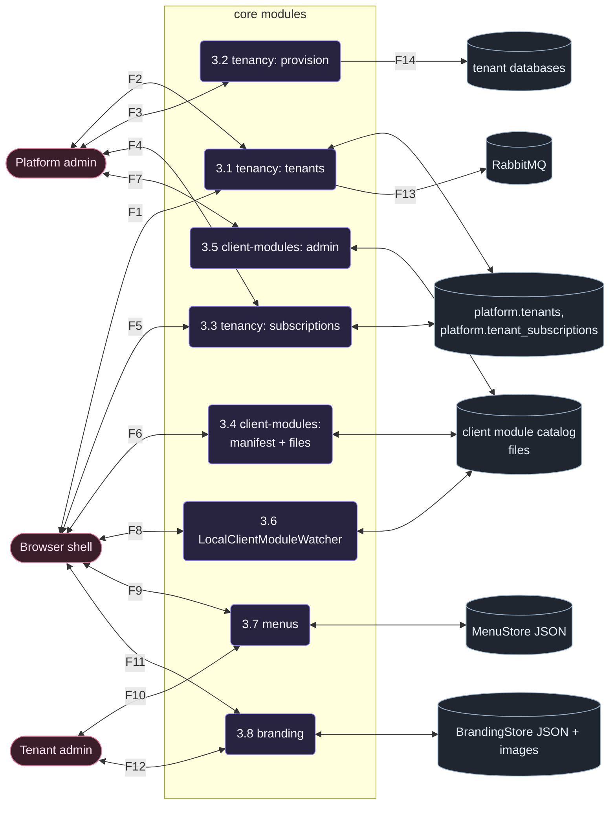

Four core modules in every pool. They serve the browser's shell: the tenants and their subscriptions, the client
module manifest and files, the menus, and the branding.

| Flow | Route or channel | Payload |
|---|---|---|
| F1 | `GET /api/tenancy/tenants`, `tenants/{id}`, `current` | → `TenantInfo` |
| F2 | `POST tenants`, `PATCH tenants/{id}`, `{id}/activate`, `suspend` | `CreateTenantRequest`, `UpdateTenantRequest` → `TenantInfo` |
| F3 | `POST tenants/{id}/provision` | → the tenant database is created, and each module's migrations run |
| F4 | `GET subscriptions`, `tenants/{id}/subscriptions`; `POST` add, `{sid}/extend`, `{sid}/cancel` | `NewSubscription` → `TenantSubscription`, `TenantSubscriptionStatus` |
| F5 | `GET subscriptions/attention` (the menu badge of `Module.Tenants`) | → count |
| F6 | `GET /api/client-modules/manifest` (ETag), `files/{id}/{version}/{file}`, `files/{id}/{version}/{token}/{**path}` | → `ClientModuleManifest(Etag, Modules)`, `_framework` `.wasm`, `.css`, `.js` |
| F7 | `modules`, `modules/{id}`, `POST uploads`, `uploads/{token}/install`, `PUT modules/{id}/settings`, `enable`, `disable`, `versions/{v}/activate`, `DELETE` | package, `InstallClientModule`, `ClientModuleSettings` → catalog entries |
| F8 | `GET dev/events` (server-sent events, when local reload is on) | `hello`, `changed` + module ids |
| F9 | `GET /api/menus` | → combined menus (platform + tenant, `MenuItem` tree) |
| F10 | `GET/PUT /api/menus/admin` | `SaveMenuCustomization` |
| F11 | `GET /api/branding`, `assets/{folder}/{name}` | → effective `BrandLayer`, images |
| F12 | `GET/PUT /api/branding/admin`, `POST admin/assets/{kind}` | `SaveBrandLayer`, image file |
| F13 | fanout `tenants.changed` | a reload signal |
| F14 | `DatabaseServers:*` (PostgreSQL, SQL Server, MySQL, Oracle) | a database per tenant, a schema per module |

None of the four modules publishes or consumes integration events.
