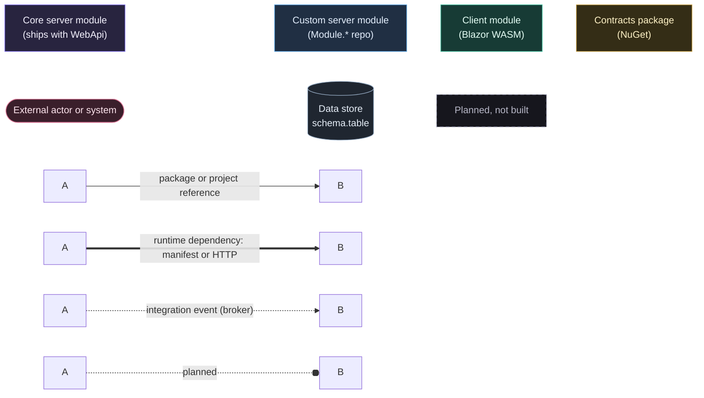

These pages draw the platform's modules **from the code**:

- the manifests (`ModuleManifest` on the server, `[assembly: ClientModule]` in the browser)
- the `.csproj` package and project references
- the Carter and minimal API routes
- the integration event types, with their publishers and their `AddIntegrationHandler` subscribers
- the DbContexts and their tables
- the live topics, and the `ILiveNotifier` and `ILiveChannel` calls

They describe the default branches as of 2026-11-28:

- Platform `main`
- `Module.*` `main` or `master`
- `Module.Ai` and `Module.Admin.OpenIddict` at their local `HEAD`, because they have no remote yet

## Pages

| Page | What it shows |
|---|---|
| [Module dependencies](./module-dependencies/) | Every module, and how they depend on each other: package and contract references, runtime dependencies, broker events, and which pool runs what. |
| [Context: dataflow level 0](./context-dataflow/) | The whole platform as one process, with its actors and external systems. The modules are shown as processes, with the HTTP calls, events and payloads between them. |
| Dataflow level 1 (sidebar) | One page per module: its endpoints, handlers and background services, its tables, and every flow in and out. |

## Legend

Every diagram on these pages uses the same shapes, colours and lines.

- **Core and custom.** Core modules (`identity`, `tenancy`, `client-modules`, `menus`, `branding`) ship in every
  WebApi release, and the host seeds them as Active. Custom modules come from their own `Module.*` repositories,
  and are uploaded or watched at runtime.
- **Server and client.** A server module is an `IRuntimeModule`, loaded into a collectible AssemblyLoadContext. A
  client module is a Razor class library that the browser loads from `/api/client-modules/manifest`.
- **The three line types:**
  - A **reference** is fixed at build time.
  - A **runtime dependency** is either declared in a manifest (`Dependencies`, `Layout`) or is an HTTP call
    through the gateway (`/api/{module}/...`).
  - An **event** reaches the other module only through RabbitMQ (`integration`, a topic exchange). The two modules
    share no type: each has its own copy of the record.
- **Planned** items come from the agreed newsroom design (v4) and the AI and search plan. Nothing in the code
  implements them yet.

## Message channels

These are the broker exchanges the host declares (`src/WebApi/WebApi`). Every diagram names its events after them.

| Exchange | Type | Carries | Declared in |
|---|---|---|---|
| `integration` (+ `integration.dlx`) | topic | `IntegrationEnvelope` (id, type `{module}.{event}.vN`, tenant, subject, org, unit path, correlation, source, data). Each module has a durable queue `integration.{module}.{pool}`. | `Messaging/RabbitMqIntegration.cs` |
| `modules.state` | fanout | the module catalog changed: every replica re-syncs its loaded modules | `Modularity/ModuleStateBus.cs` |
| `tenants.changed` | fanout | the tenant directory changed: every replica reloads it | `Tenancy/TenantChangeBus.cs` |
| `access.grants.changed` | fanout | grants changed: every replica drops its grant cache, and the live hub re-checks its groups | `Security/GrantStore.cs` |
| `live` | fanout | `ILiveNotifier` messages to the live hub on every replica (`/hubs/live`) | `Live/LiveBus.cs` |
