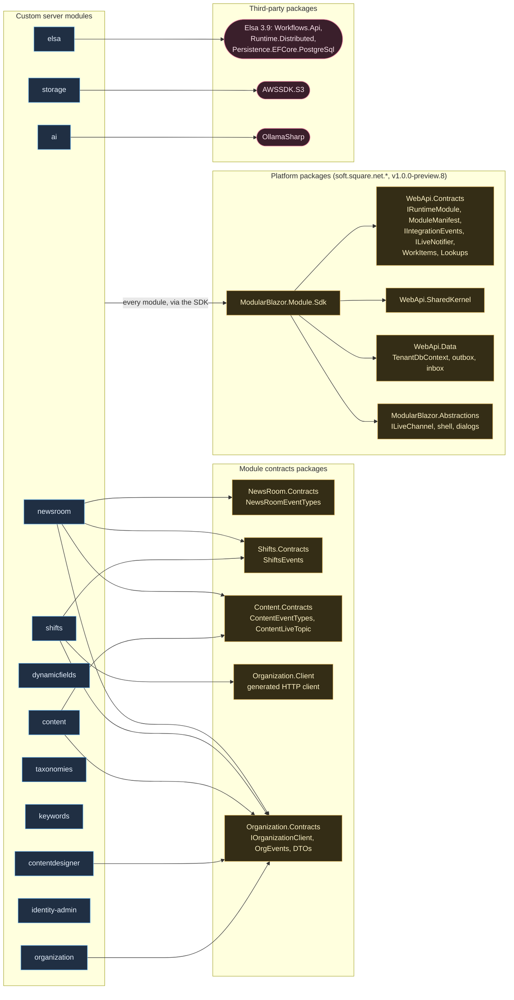
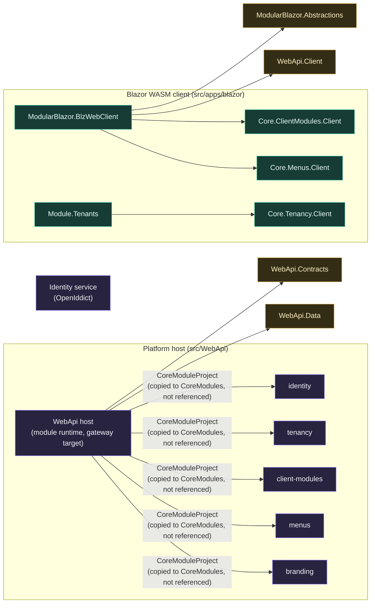
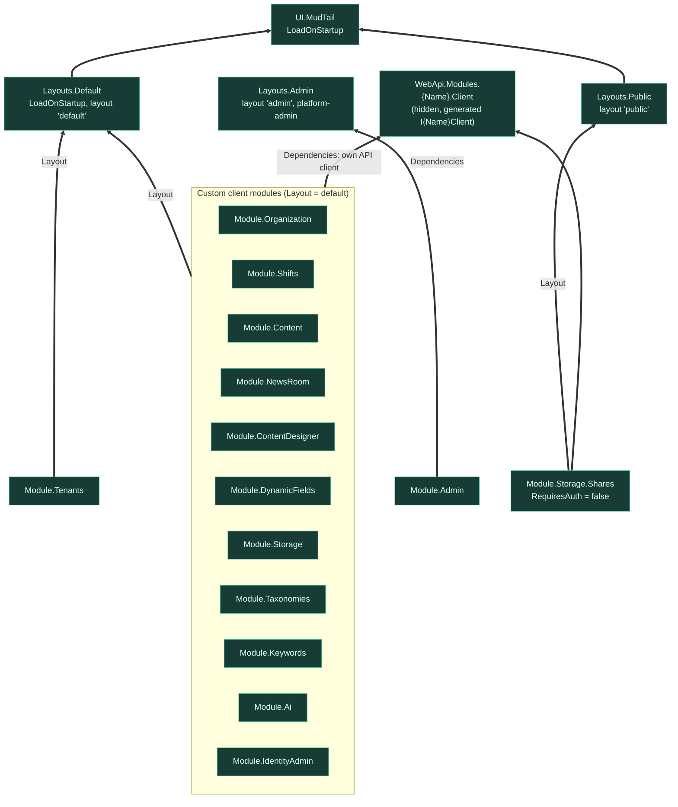
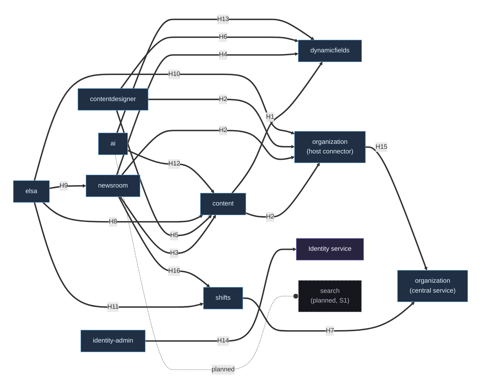
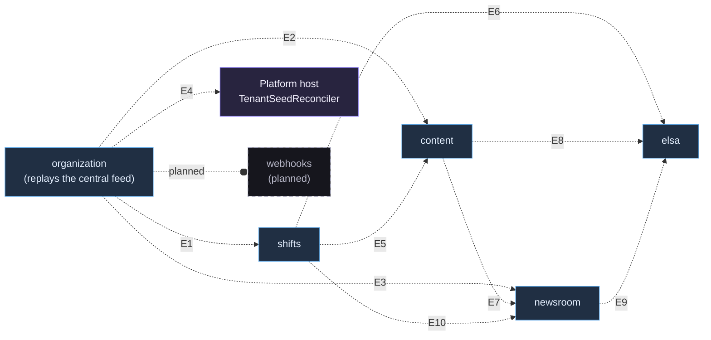
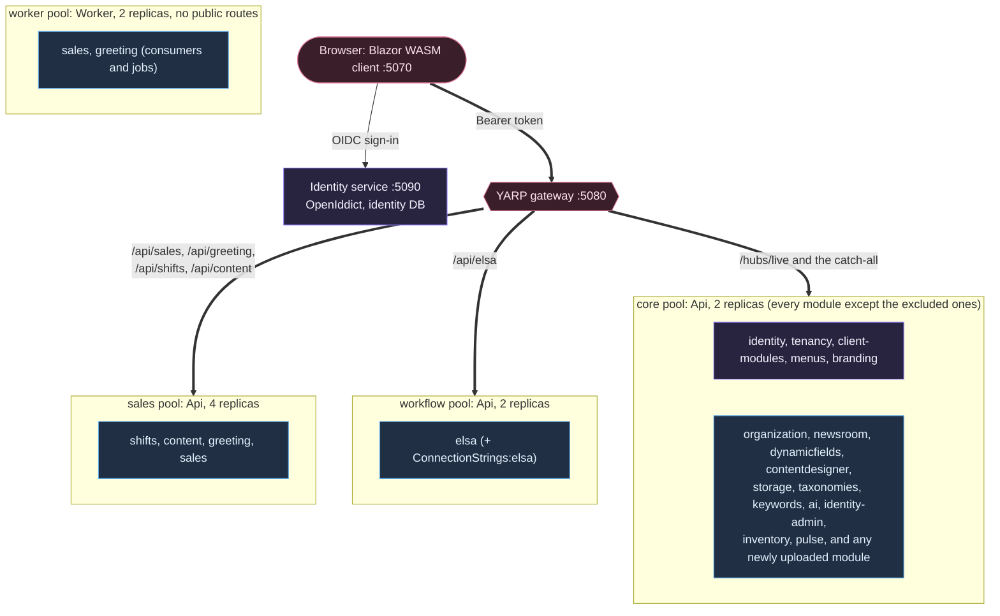

This page shows how the modules depend on each other. Each diagram shows **one kind** of coupling, so no diagram
has to draw them all at once. Shapes and lines follow the [legend](../).

## The modules

| Module (id) | Repository | Server | Client modules | Kind |
|---|---|---|---|---|
| `identity` | Platform `src/WebApi/Modules/Core` | `IdentityModule` (`/api/identity`) | | core |
| `tenancy` | Platform | `TenancyModule` (`/api/tenancy`) | `Module.Tenants` | core |
| `client-modules` | Platform | `ClientModulesModule` (`/api/client-modules`) | | core |
| `menus` | Platform | `MenusModule` (`/api/menus`) | | core |
| `branding` | Platform | `BrandingModule` (`/api/branding`) | | core |
| Identity service | Platform `src/WebApi/Identity` | OpenIddict server: `/connect/*`, `/api/admin/*`, `/api/service/*` | | core (its own process) |
| Shell | Platform `modules/client` | | `UI.MudTail`, `Layouts.Default`, `Layouts.Public`, `Layouts.Admin`, `Module.Admin` | core client |
| `organization` | Module.Organization | central API + host connector (`/api/organization`) | `Module.Organization` | custom, optional |
| `shifts` | Module.Shifts | `/api/shifts` | `Module.Shifts` | custom |
| `content` | Module.Content | `/api/content` | `Module.Content` | custom |
| `newsroom` | Module.NewsRoom | `/api/newsroom` | `Module.NewsRoom` | custom |
| `elsa` | Module.Elsa | Elsa 3.9 engine (`/api/elsa`) | | custom (workflow pool) |
| `dynamicfields` | Module.DynamicFields | `/api/dynamicfields` | `Module.DynamicFields` | custom |
| `contentdesigner` | Module.ContentDesigner | `/api/contentdesigner` | `Module.ContentDesigner` | custom |
| `storage` | Module.Storage | `/api/storage` | `Module.Storage`, `Module.Storage.Shares` | custom |
| `taxonomies` | Module.Taxonomies | `/api/taxonomies` | `Module.Taxonomies` | custom |
| `keywords` | Module.Keywords | `/api/keywords` | `Module.Keywords` | custom |
| `ai` | Module.Ai (local only) | `/api/ai` | `Module.Ai` | custom |
| `identity-admin` | Module.Admin.OpenIddict (local only) | `/api/identity-admin` | `Module.IdentityAdmin` | custom |
| `greeting`, `inventory`, `pulse` | Samples | sample modules | `Module.Dashboard`, `Module.Reports` | sample |
| `modulename` | ModuleTemplate | the Clean Architecture template (`notes`) | `Module.ModuleName` | template |

Every custom module also ships a hidden `WebApi.Modules.{Name}.Client` client module. It holds the generated typed API
client, and the module's own client module lists it in `Dependencies`.

## 1. Package and project references (build time)

These references are fixed at build time. The Module SDK (`ModularBlazor.Module.Sdk`, `Sdk.props`) adds the
platform packages to every module project. Only the cross-module contracts are added by hand.

The host and the core modules reference the platform projects directly, not through the packages:

## 2. Runtime dependencies

### Client modules: manifest `Dependencies` and `Layout`

The browser loads a client module only after the modules it lists in `Dependencies`. A module's `Layout` names the
layout module that hosts its pages.

### Server modules: HTTP calls through the gateway

These calls are made at run time, from a module's `Infrastructure` layer to another module's `/api/{prefix}/...`.
Each call carries the caller's token, or the module's service token. Without its target, a call degrades or
fails, but the module still loads. The table gives the routes the calling code uses.

| Call | Caller → target | Routes |
|---|---|---|
| H1 | content → dynamicfields | `catalog/root-post-fields`, `fields/{key}/versions/{n}`, `content/validate`, `content/validate-node` |
| H2 | content, newsroom, contentdesigner → organization | `local/units...` |
| H3 | newsroom → content | `posts`, `categories`, `contents?assigneeId` (workload reconcile) |
| H4 | newsroom → dynamicfields | `catalog/root-post-fields`, `fields/...`, `content/validate-node` |
| H5 | contentdesigner → content | `categories`, `contents`, `posts/{id}`, `posts/{id}/events`, `public/{publicId}` |
| H6 | contentdesigner → dynamicfields | `catalog/root-post-fields`, `fields/{key}/versions/{n}`, `content/jsonld`, `content/validate` |
| H7 | shifts → central organization | the central API as the caller (`IOrganizationClient`) |
| H8 | elsa → content | `posts/{id}`, `unit`, `assign`, `accept`, `transfer`, `schedule`, `publish`, `contents/{id}`, `contents/{id}/assign`, `contents/{id}/unit`; the poller: `automation/*`, `posts/publish-due` |
| H9 | elsa → newsroom | `bindings/resolve`, `projects/{id}`, `projects/{id}/workflow`, `projects/{id}/state`, `routing/route`, `workload/query` |
| H10 | elsa → organization | `local/units/{id}`, `members`, `categories` |
| H11 | elsa → shifts | `shifts?from&to`, `shifts/{id}`; the poller: `shifts/ended`, `overdue` |
| H12 | ai → content | `posts/{id}` |
| H13 | ai → dynamicfields | `fields/{key}/versions/{n}`, `content/validate-node` |
| H14 | identity-admin → identity service | `api/service/*` (client credentials) |
| H16 | newsroom → shifts | `shifts?from&to` (workload reconcile) |
| H15 | organization connector → central service | `seeds`, `events?after=`, `links` (`Organization:BaseUrl`) |

`taxonomies`, `keywords` and `storage` call no other module. They are leaves: others reach them only from the
browser, through pickers and lookups.

## 3. Event-only coupling (RabbitMQ `integration`)

The publisher only writes an outbox row. The subscriber lists the pattern in its manifest `Subscriptions`, and the
host binds `integration.{module}.{pool}` to it, so events wait while the subscriber is unloaded. Neither side
references the other.

| Flow | Event types |
|---|---|
| E1 | `org.unit-*.v1`, `org.membership-changed.v1` |
| E2 | `org.unit-*.v1` |
| E3 | `org.unit-moved.v1` |
| E4 | `tenancy.seed-changed.v1` (a host subscription) |
| E5 | `shifts.section-moved.v1` |
| E6 | `shifts.published`, `member-added`, `checked-in`, `checked-out`, `handover`, `ended` (`.v1`) |
| E7 | `content.post-state-changed.v1`, `content.post-categories-changed.v1`, `content.work-item-*.v1`, `content.content-deleted.v1`, `content.content-archived.v1` |
| E8 | `content.post-*.v1`, `content.work-item-*.v1` |
| E9 | `newsroom.project-approved.v1`, `newsroom.project-reapproved.v1`, `newsroom.project-state-changed.v1`, `newsroom.project-binding-available.v1` |
| E10 | `shifts.published`, `updated`, `cancelled`, `checked-in`, `checked-out`, `ended`, `section-moved` (`.v1`) |

**No subscriber yet.** These events are published, but no module subscribes to them:

- Organization: `org.person-changed`, `org.position-changed`, `org.tenant-seed-changed`, `org.tenant-link-changed`
  (the planned Webhooks module will act on tenant links)
- Shifts: `shifts.member-removed`
- Content: `content.content-attached`, `detached`, `created`, `changed`, `state-changed`, `assigned`, and `content.validation-failed`
- NewsRoom: no other module takes `newsroom.proposal-*`, `newsroom.project-details-changed` or `newsroom.work-item-*`; NewsRoom consumes them itself, for its live boards and its workload model

The `*.work-item-assigned.v1` and `*.work-item-state-changed.v1` events of Content and NewsRoom come from the shared
work-item contract in `WebApi.Contracts/WorkItems` (`PublishWorkItemAssigned`, `PublishWorkItemStateChanged`).

**Live updates.** Content, Shifts, Organization, Elsa and Ai also push live messages through `ILiveNotifier`. They travel
over the `live` fanout to the hub at `/hubs/live`, and the browser reads them through `ILiveChannel`. This is not
module-to-module coupling: the [context diagram](../context-dataflow/) shows it.

## 4. Pools: who runs where

The pools come from `src/Aspire/Hybird/AppHost.cs`: `Modules__Pool`, `Modules__Role`, `Modules__Enabled__n` and
`Modules__Excluded__n`, plus the YARP routes. Every replica of every pool runs the same WebApi image.

All pools share RabbitMQ, Redis and the PostgreSQL server `tenant-data`. That server holds the tenant store
(`HybirdTenants`, schema `platform`) and one database per tenant. The identity service has its own `identity`
database, and Elsa has `ElsaWorkflows`. The central Organization service needs its own central database
(`CentralDatabaseMigrator`). The lab runs it inside the core pool.
