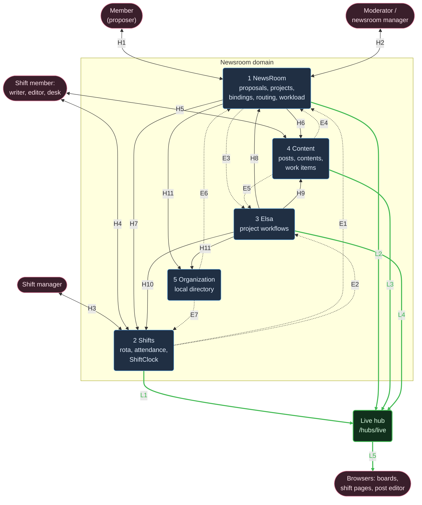

This level-0 diagram covers only the newsroom domain: a proposal becoming a post project, and the shift whose
members produce it. It draws three kinds of flow:

- **HTTP** (solid lines, H): a person, or one module calling another through the gateway.
- **Integration events** (dashed lines, E): a module's outbox, through the RabbitMQ `integration` exchange, to the
  subscriber's queue.
- **Live messages** (green lines, L): a module's `ILiveNotifier` publishes to the live hub, which pushes a
  `LiveMessage(Topic, Type, Payload, Sequence, At)` to the browsers subscribed to that topic.

It reflects `main` of each module repository on 2026-11-28: NewsRoom N3 (bindings, routing, workload, live boards)
and Elsa E2 (default workflows, shift handover) are built.

## HTTP flows

| Flow | Route | Payload (request → response) |
|---|---|---|
| H1 | `/api/newsroom/proposals`, `{id}/submit`, `mine` | `NewProposal`, `ProposalEdit`, `Submission` → `ProposalDto`, `ProposalPage` |
| H2 | `proposals/queue`, `{id}/approve`, `return`, `cancel`; `projects`, `{id}/draft`, `fix`, `kill`; `bindings`, `routing-rules`, `sections/suggestions`, `workload` | `Approval`, `ReturnDecision`, `CancelDecision`, `DraftRequest`, `Correction`, `KillDecision` → `ApprovalDto`, `ProjectDto`, `ProjectPage` |
| H3 | `/api/shifts/templates/{id}/clone`, `shifts`, `{id}/publish`, `units/{id}/attendance` | `TemplateCloneRequest`, `ShiftRequest`, `UnitAttendanceRequest` → `TemplateCloneResult`, `ShiftDto`, `UnitAttendanceDto` |
| H4 | `shifts/{id}/check-in`, `check-out`, `PUT {id}/handover`, `mine` | `HandoverRequest` → `ShiftDto`. Check-in writes the standing grants `shift:{id}` for the member's roles. |
| H5 | `/api/content/posts/{id}`, `contents/{id}`, versions and states | `PostEdit`, `ContentEdit`, `ContentAction`, `VersionRequest` → `PostDetail`, `ContentDetail` |
| H6 | `POST /api/content/posts`, `GET categories`, `contents?assigneeId` (workload reconcile) | `NewPost` → `PostDetail`, `CategoryDto[]`, `ContentSummary[]` |
| H7 | `GET /api/shifts/shifts?from&to` (workload reconcile) | → `ShiftDto[]` |
| H8 | `/api/newsroom/bindings/resolve`, `routing/route`, `workload/query`, `projects/{id}`, `projects/{id}/workflow`, `projects/{id}/state` | → the workflow to run, the routed unit, open items per member, `ProjectDto`; `StateReport` (InProduction, NeedsModeration, ReadyForDesk, Scheduled, Published) |
| H9 | `/api/content/posts/{id}/unit`, `assign`, `accept`, `transfer`, `schedule`, `publish`, `posts/publish-due`; `contents/{id}/assign`, `contents/{id}/unit` | `UnitAssignment`, `ContentAssignment`, `ScheduleRequest`, `VersionRequest` → `PostDetail`, `ContentDetail` |
| H10 | `GET /api/shifts/shifts?from&to`, `shifts/{id}` | → `ShiftDto` (who is on, in which role, checked in) |
| H11 | `/api/organization/local/units/{id}`, `{id}/members`, `{id}/categories` | → `DirectoryUnitDto`, `DirectoryMemberDto` |

## Integration events

| Flow | Event types | Record in `data` | What the subscriber does |
|---|---|---|---|
| E1 | `shifts.published`, `updated`, `cancelled`, `checked-in`, `checked-out`, `ended`, `section-moved` (`.v1`) | `ShiftPublished`, `ShiftUpdated`, `ShiftCancelled` (`ShiftSnapshot`), `ShiftCheckedIn`, `ShiftCheckedOut`, `ShiftEnded`, `SectionMoved` | NewsRoom's workload read model (`shift_records`, `shift_attendance`) |
| E2 | `shifts.published`, `member-added`, `checked-in`, `checked-out`, `handover`, `ended` (`.v1`) | `ShiftPublished`, `ShiftMemberAdded`, `ShiftCheckedIn`, `ShiftCheckedOut`, `ShiftHandover`, `ShiftEnded` | Elsa resumes the waiting workflows of the unit, and hands open work over when a shift ends |
| E3 | `newsroom.project-approved`, `project-reapproved`, `project-state-changed`, `project-binding-available` (`.v1`) | `ProjectApproved`, `ProjectStateChanged`, `ProjectBindingAvailable` | Elsa starts the project's bound workflow, or resumes it |
| E4 | `content.post-state-changed`, `post-categories-changed`, `*.work-item-assigned`, `*.work-item-state-changed`, `content.content-deleted`, `content-archived` | `ContentFeedEvent`, `PostCategoriesChanged`, `WorkItemAssigned`, `WorkItemStateChanged` | NewsRoom moves the project's state and updates `work_items` |
| E5 | `content.post-*.v1`, `content.work-item-*.v1` | `PostCreated`, `PostUnitChanged`, `ContentFeedEvent`, `WorkItemAssigned`, `WorkItemStateChanged` | Elsa's waiting activities (`WaitForStage`, `WaitForRefiling`, `DeskReview`) resume |
| E6 | `org.unit-moved.v1` | `UnitMoved` | NewsRoom re-paths its proposals and projects |
| E7 | `org.unit-*.v1`, `org.membership-changed.v1` | `UnitCreated`, `UnitUpdated`, `UnitMoved`, `UnitRemoved`, `MembershipChanged` | Shifts refreshes `unit_cache` |

NewsRoom also subscribes to its **own** `proposal-submitted`, `proposal-decided`, `project-approved`,
`project-state-changed` and `project-details-changed` events. Its `LiveNudgeHandler` turns them into live messages
(L2) once the change is committed.

## Live messages (green)

| Flow | Publisher | Topics | Message type and payload |
|---|---|---|---|
| L1 | Shifts `ShiftLive` (from `ShiftNotices`) | `shifts:shift:{id}`, then the unit's `unit:{path}` and every ancestor's | `shift.changed`, `ShiftChanged(shiftId)` |
| L2 | NewsRoom `LiveNudgeHandler` | `newsroom:board:{unit}` and `unit:{unit}`, for each unit from the nearest up | `newsroom.proposal.changed` (`ProposalNudge`), `newsroom.project.changed` (`ProjectNudge`) |
| L3 | Content `PostLive` | `content:post:{id}` | `post.changed` |
| L4 | Elsa `Notify`, `Deadline` through `HostLiveMessenger` | `user:{id}` or the unit's topics | `workflow.notification`, `workflow.deadline-missed`, `workflow.published`, `workflow.publish-refused` |
| L5 | Live hub, over the `live` fanout to every replica | the subscriber's topics, checked against each module's `LiveTopics` permission | `LiveMessage(Topic, Type, Payload, Sequence, At)` |

## The shift lifetime

| Stage | What happens | Flows |
|---|---|---|
| Plan | The shift manager clones a template into a shift for a unit and a time window. | H3 |
| Publish | The shift is published. NewsRoom adds it to the workload model, Elsa can now route work to it, and its pages refresh. | H3, E1, E2, L1 |
| Staff | Members are added with their roles. NewsRoom receives the whole rota in `shifts.updated`. | H3, E1, E2, L1 |
| Check in | A member checks in: the standing grants `shift:{id}` open, attendance updates, and Elsa's waiting `AssignInShift` and `WorkInShift` activities look again. | H4, E1, E2, L1 |
| Work | Elsa picks the member: who is checked in (H10), with the fewest open items (H8 `workload/query`), then assigns the post or content (H9). The work items come back to NewsRoom's workload model. | H8, H9, H10, E4, E5, L3 |
| Hand over | The lead writes a handover note. Elsa moves open work to the next shift. | H4, E2, L1 |
| Check out | A member checks out, or `ShiftClock` checks them out at the end. The grants close. | H4, E1, E2, L1 |
| End | `ShiftClock` ends the shift. NewsRoom closes it in the workload model, and Elsa hands the open work over. | E1, E2, L1 |

## The project lifetime

| Stage | What happens | Flows |
|---|---|---|
| Propose | A member drafts a proposal and submits it to a unit. | H1, L2 |
| Moderate | A moderator approves, returns or cancels it. Approval creates the post project and its draft post in Content. | H2, H6, E3, L2 |
| Bind | Elsa resolves the workflow bound to the post kind and unit, and starts it. | E3, H8 |
| Route and produce | `RouteToUnit` and `FileContentInUnit` file the post in the right Section; `ProduceContents`, `AssignInShift` and `WorkInShift` give the contents to shift members. | H8, H9, H10, H11 |
| Desk | `DeskReview` waits for the desk. Elsa reports `ReadyForDesk`, or `NeedsModeration` when the project needs a decision again. | H8, E4, E5, L2 |
| Publish | `PublishPost` schedules or publishes the post. Content's state change moves the project to `Scheduled` or `Published`. | H9, E4, L2, L3 |
| Kill | A moderator can kill the project at any stage. | H2, E3, L2 |
