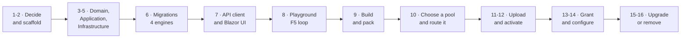
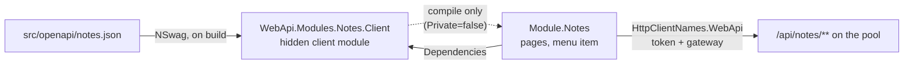
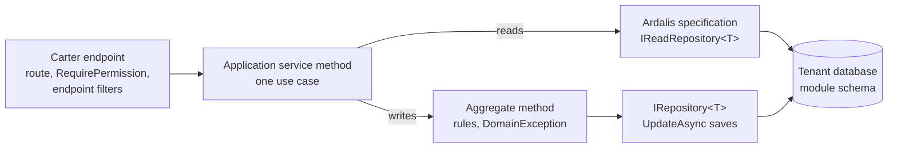
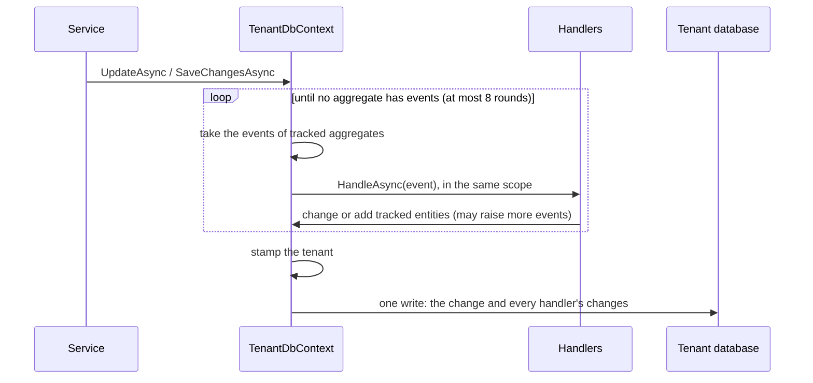
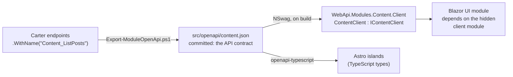

This page walks through one module from start to finish. The example is a small **Notes** module (`notes`), with:

- a tenant-scoped `Note` aggregate;
- two endpoints;
- one permission and one setting;
- a typed API client;
- a Blazor page under the menu item "Notes".

Every step names the real files and commands of the platform repo and of the module's own repo.
`ModularBlazor.Module.Content` is the working example of every part. How the runtime works underneath:
[Runtime modules](/backend/runtime-modules/).

A module is **one bundle with up to three parts**, released together in one version:

| Part | Project | Runs in | Installed on |
| --- | --- | --- | --- |
| Server | `WebApi.Modules.Notes.Infrastructure` (+ `.Domain`, `.Application`) | The WebApi pools | Host modules (`/host-modules`, `POST /api/admin/modules`) |
| API client, hidden | `WebApi.Modules.Notes.Client` (NSwag) | The browser | Client modules (`/client-modules`) |
| UI (optional) | `Module.Notes` (Razor) | The browser, inside `ModularBlazor.BlzWebClient` | Client modules, after the API client |



## 1. Decide what you are building

Answer these before you create a project. Each answer changes a later step.

| Question | Options | Default for a business module |
| --- | --- | --- |
| Core or custom? | **Core** ships with every WebApi release and is seeded as `Active`. **Custom** is built on its own and uploaded by an admin | Custom |
| One project or three? | **Single project** for glue (`greeting`, `identity`). **Layered** (`Domain`, `Application`, `Infrastructure`) for anything with business rules | Layered |
| Tenant data? | A `TenantDbContext` with its own schema in each tenant's database, or no database | Tenant data |
| Which pool? | An existing pool, or a new one when it needs its own scaling, isolation or restarts | An existing `Api` pool |
| Can it unload? | `HotUnload = true` (default), or `false` when a library pins its assemblies (Elsa) | `true` |
| Endpoints or pipeline? | Carter endpoints, or `IModulePipeline` for a library that brings its own middleware | Carter |
| A UI? | A Blazor client module (`Module.<Name>`) with pages and a menu item, or none (other modules or Astro islands call the API) | A client module |

Pick a module **id** now. It must be lowercase `a-z`, `0-9`, `.`, `-`, and it never changes: it names the catalog
entry, the default route prefix (`/api/notes`), the database schema and the `Modules:Enabled` entries of pools.

## 2. Scaffold the repository

A module lives in a repository of its own, next to the platform's, and builds against the platform's NuGet packages
through the **Module SDK**. [Repositories and packages](/backend/repositories/) explains the packages, the feed token and
the CI workflow; this step only creates the files. Copy `global.json`, `NuGet.Config`, `Directory.Build.props` and
`.github/workflows/build.yml` from `ModularBlazor.Module.Content`. Or skip the manual steps: the
[Clean Architecture module template](/backend/module-template-clean-architecture/) (`dotnet new platform-module-ca`)
generates all of it, with an example feature. By hand:

```bash
mkdir ModularBlazor.Module.Notes && cd ModularBlazor.Module.Notes
git init -b main
dotnet new classlib -n WebApi.Modules.Notes.Domain -o src/WebApi.Modules.Notes.Domain
dotnet new classlib -n WebApi.Modules.Notes.Application -o src/WebApi.Modules.Notes.Application
dotnet new classlib -n WebApi.Modules.Notes.Infrastructure -o src/WebApi.Modules.Notes.Infrastructure
dotnet new classlib -n WebApi.Modules.Notes.Client -o src/WebApi.Modules.Notes.Client
dotnet new razorclasslib -n Module.Notes -o src/Module.Notes
dotnet new sln --format slnx -n ModularBlazor.Module.Notes
dotnet sln ModularBlazor.Module.Notes.slnx add src/*/*.csproj
```

The finished repository:

```text
ModularBlazor.Module.Notes/
  global.json  NuGet.Config  Directory.Build.props  ModularBlazor.Module.Notes.slnx
  src/
    WebApi.Modules.Notes.Domain/           step 3
    WebApi.Modules.Notes.Application/      step 4
    WebApi.Modules.Notes.Infrastructure/   step 5-6: the server part's entry assembly
    openapi/notes.json                     step 7: the committed API document
    WebApi.Modules.Notes.Client/           step 7: typed API client, a hidden client module
    Module.Notes/                          step 7: the Blazor UI client module
  playground/                              step 8: Aspire AppHost, not in the .slnx
  .github/workflows/build.yml
```

The client projects and the playground are added in steps 7 and 8; create the server projects first if you
prefer.

Restoring needs `GITHUB_PACKAGES_TOKEN` in the environment (a PAT with `read:packages`).

Delete the generated `Class1.cs` files and reduce each project file to the SDK line and its references.
`TargetFramework`, `Nullable`, `ImplicitUsings` and the `soft.square.net.` assembly/namespace prefix come from the
repository's `Directory.Build.props`; the SDK version comes from `global.json`.

```xml title="src/WebApi.Modules.Notes.Domain/WebApi.Modules.Notes.Domain.csproj"
<Project Sdk="Microsoft.NET.Sdk">
  <Sdk Name="soft.square.net.ModularBlazor.Module.Sdk" />
  <!-- References WebApi.SharedKernel (compile only). -->
</Project>
```

```xml title="src/WebApi.Modules.Notes.Application/WebApi.Modules.Notes.Application.csproj"
<Project Sdk="Microsoft.NET.Sdk">
  <Sdk Name="soft.square.net.ModularBlazor.Module.Sdk" />
  <ItemGroup>
    <ProjectReference Include="..\WebApi.Modules.Notes.Domain\WebApi.Modules.Notes.Domain.csproj" />
  </ItemGroup>
</Project>
```

```xml title="src/WebApi.Modules.Notes.Infrastructure/WebApi.Modules.Notes.Infrastructure.csproj"
<Project Sdk="Microsoft.NET.Sdk">
  <Sdk Name="soft.square.net.ModularBlazor.Module.Sdk" />
  <!-- The entry assembly. Its build output is zipped and uploaded. -->
  <ItemGroup>
    <ProjectReference Include="..\WebApi.Modules.Notes.Application\WebApi.Modules.Notes.Application.csproj" />
  </ItemGroup>
</Project>
```

The SDK recognises each layer by its **project-name suffix**, so the names matter:

| Layer | Gets automatically | Never ships |
| --- | --- | --- |
| `.Domain` | `WebApi.SharedKernel` (`AggregateRoot<T>`, `ITenantOwned`, `DomainException`, `IRepository<T>`) | SharedKernel |
| `.Application` | The above plus `WebApi.Contracts` and `Microsoft.AspNetCore.App` | Contracts |
| `.Infrastructure` | `WebApi.Data` (EF Core, `TenantDbContext`), Carter, `EnableDynamicLoading` (writes the `.deps.json` the loader needs) | Data, EF Core, Carter, Ardalis |

Host-shipped assemblies are compiled against but excluded from the output, so the package holds only your three
assemblies and your private dependencies. **Do not** add your own `PackageReference` to EF Core, Carter or
Ardalis.Specification: the host's copies are used at runtime whatever version you compile against.

The module never references platform source, and the platform never references the module. If the host referenced
it, its types would load into the default context and could never be unloaded or upgraded.

## 3. Domain: the aggregate and its rules

```csharp title="WebApi.Modules.Notes.Domain/Note.cs"
using soft.square.net.WebApi.SharedKernel;

namespace soft.square.net.WebApi.Modules.Notes.Domain;

/// <summary>A note of one tenant (aggregate root).</summary>
public sealed class Note : AggregateRoot<int>, ITenantOwned
{
    private Note() { } // EF Core

    public string TenantId { get; set; } = "";   // set by TenantDbContext; never from a request body
    public string Title { get; private set; } = "";
    public string Text { get; private set; } = "";
    public string AuthorId { get; private set; } = "";

    public static Note Create(string authorId, string title, string text, int maxLength)
    {
        if (string.IsNullOrWhiteSpace(title)) throw new DomainException("A note needs a title.");
        if (text.Length > maxLength) throw new DomainException($"A note has at most {maxLength} characters.");
        return new Note { AuthorId = authorId, Title = title.Trim(), Text = text };
    }
}
```

Rules:

- Keep the domain free of EF Core, HTTP and configuration. Invariants throw `DomainException`.
- Implement `ITenantOwned` on every tenant entity. The tenant filter and the `TenantId` value come from the
  `TenantDbContext`.
- Use private setters and factory methods, so the only way to change state is through a rule.

## 4. Application: use cases, permissions, settings

```csharp title="WebApi.Modules.Notes.Application/Notes.cs"
using Ardalis.Specification;
using Microsoft.Extensions.Options;
using soft.square.net.WebApi.Contracts.Security;
using soft.square.net.WebApi.Modules.Notes.Domain;
using soft.square.net.WebApi.SharedKernel;

namespace soft.square.net.WebApi.Modules.Notes.Application;

public static class NotesPermissions
{
    public const string Write = "notes.write";

    public static IReadOnlyList<PermissionDefinition> All { get; } = [new(Write, "Create notes in this tenant.")];
}

public sealed class NotesOptions
{
    public int MaxLength { get; set; } = 2000;
}

public sealed record NoteDto(int Id, string Title, string Text, string AuthorId);
public sealed record NewNote(string Title, string Text);

public sealed class NoteListSpec : Specification<Note, NoteDto>
{
    public NoteListSpec()
    {
        Query.OrderByDescending(n => n.Id).AsNoTracking();
        Query.Select(n => new NoteDto(n.Id, n.Title, n.Text, n.AuthorId));
    }
}

public sealed class NoteService(IReadRepository<Note> reader, IRepository<Note> notes, IAccessScopes access, IOptions<NotesOptions> options)
{
    private string Me => access.UserId ?? throw new DomainException("Sign in first.");

    public Task<List<NoteDto>> ListAsync(CancellationToken ct) => reader.ListAsync(new NoteListSpec(), ct);

    public async Task<NoteDto> AddAsync(NewNote request, CancellationToken ct)
    {
        var note = Note.Create(Me, request.Title, request.Text, options.Value.MaxLength);
        await notes.AddAsync(note, ct);  // saves immediately
        return new NoteDto(note.Id, note.Title, note.Text, note.AuthorId);
    }
}
```

- Permissions are plain strings named `<module>.<action>`. Declare **every** one you use; activation fails on an
  undeclared permission.
- Resource-level checks (a press, a category) go through `IAccessScopes.HasPermissionAsync(permission, scopes)`,
  as the Content module does. Never put permissions or scopes in tokens.
- `IAccessScopes` (host-provided, scoped) gives the caller's `UserId` (the token's `sub`) and answers permission
  questions for the current tenant.
- No MediatR, no custom `IAuthorizationRequirement`, no named policies: the host would cache their types and the
  module could never unload. Why, and what to use instead: [Data access and use cases](#data-access-and-use-cases).

## 5. Infrastructure: the module, its database and its endpoints

The Infrastructure assembly is the **entry assembly**: it holds the one `IRuntimeModule`, the `DbContext`, the
migrations and every `ICarterModule` (the runtime maps Carter modules of this assembly only).

```csharp title="WebApi.Modules.Notes.Infrastructure/NotesModule.cs"
public sealed class NotesModule : IRuntimeModule
{
    public ModuleManifest Manifest { get; } = new("notes", "Notes", "1.0.0", "notes")
    {
        Description = "Tenant notes (sample).",
        DefaultSettings = new Dictionary<string, string?> { ["Notes:MaxLength"] = "2000" },
        Permissions = NotesPermissions.All
        // HotUnload = false only if a library you host pins its assemblies.
    };

    public void ConfigureServices(IServiceCollection services, IConfiguration settings)
    {
        services.Configure<NotesOptions>(settings.GetSection("Notes")); // settings = manifest defaults + admin overrides
        services.AddTenantDbContext<NotesDbContext>();                  // + IRepository<T>/IReadRepository<T>, + migrations on activation
        services.AddScoped<NoteService>();
    }
}

public sealed class NotesDbContext(DbContextOptions<NotesDbContext> options, ITenantContext tenant) : TenantDbContext(options, tenant)
{
    protected override string Schema => "notes";

    public DbSet<Note> Notes => Set<Note>();

    protected override void ConfigureModel(ModelBuilder modelBuilder) =>
        modelBuilder.Entity<Note>(note =>
        {
            note.ToTable("notes");
            note.Property(n => n.Title).HasMaxLength(200);
            note.Property(n => n.AuthorId).HasMaxLength(128);
            note.Property(n => n.Text).HasMaxLength(4000); // bounded: see the Oracle note in step 6
        });
}

/// <summary>Design time: dotnet-ef reads the engine from "-- --provider X".</summary>
internal sealed class NotesDesignTimeFactory : IDesignTimeDbContextFactory<NotesDbContext>
{
    public NotesDbContext CreateDbContext(string[] args) =>
        new(TenantDbDesignTime.Options<NotesDbContext>(args), TenantDbDesignTime.Tenant);
}

public sealed class NotesEndpoints : ICarterModule
{
    public void AddRoutes(IEndpointRouteBuilder app)
    {
        var notes = app.MapGroup("").AddEndpointFilter(async (context, next) =>
        {
            try { return await next(context); }
            catch (DomainException e) { return Results.Problem(e.Message, statusCode: StatusCodes.Status409Conflict); }
        });

        notes.MapGet("/", (NoteService s, CancellationToken ct) => s.ListAsync(ct))       // signed in (host fallback policy)
            .WithName("Notes_ListNotes");                                                 // NotesClient.ListNotesAsync (step 7)
        notes.MapPost("/", async (NewNote request, NoteService s, CancellationToken ct) =>
            {
                var note = await s.AddAsync(request, ct);
                return Results.Created($"notes/{note.Id}", note);
            })
            .WithName("Notes_AddNote")
            .Produces<NoteDto>(StatusCodes.Status201Created)
            .RequirePermission(NotesPermissions.Write);
    }
}
```

What the host does for every module endpoint, so you don't have to:

| Concern | Default | Change it with |
| --- | --- | --- |
| Route | `/api/{RoutePrefix}` + your route | The manifest's `RoutePrefix` |
| Authentication | Required (host fallback policy) | `.AllowAnonymous()` for a public route, e.g. Content's `/public/{publicId}` |
| Tenant | Required: from the `X-Tenant` header or the tenant's host name; missing → 400, unknown → 404, suspended → 403 | `.TenantOptional()` for platform routes |
| Permission | None beyond sign-in | `.RequirePermission("a")`, or several: `RequirePermission("a", "b")` |
| OpenAPI | Its own document `/openapi/modules/notes.json`, in Scalar while routed | `.WithSummary(...)` |

Optional extras:

- **Background work:** `services.AddHostedService<T>()`. It runs on every replica of every pool that enables the
  module and starts without a tenant. See [Hosted services](/backend/runtime-modules/#hosted-services).
- **A library with its own middleware:** implement `IModulePipeline`. See
  [Private pipelines](/backend/runtime-modules/#private-pipelines).
- **A private NuGet dependency:** a normal `PackageReference` in the layer that needs it. It is copied next to your
  assemblies and loads into the module's own load context.
- **Secrets:** module settings are stored in plain text in the catalog, so they are not a place for secrets. There
  is no general host-secret mechanism yet (only `elsa` has a hard-coded one); keep secrets out of your module or
  propose that mechanism first.

## 6. Migrations for all four engines

A tenant's database can run on PostgreSQL, SQL Server, MySQL or Oracle, so a module ships **one migration set per
engine** in `Migrations/<Provider>`. The platform script `src/WebApi/scripts/Add-Migration.ps1` runs `dotnet ef` once per
engine and keeps the four model snapshots apart. Run it from the `ModularBlazor.Platform` folder, with the module repo
cloned next to it:

```powershell
./src/WebApi/scripts/Add-Migration.ps1 -Project ../ModularBlazor.Module.Notes/src/WebApi.Modules.Notes.Infrastructure -Name InitialCreate
```

It sets `EfDesignAssets=all` while it runs, because dotnet-ef needs the host-shipped assemblies next to the project (the
Module SDK copies them only then).
Check that the model and all four sets agree:

```powershell
$env:EfDesignAssets = 'all'
foreach ($p in 'PostgreSql','SqlServer','MySql','Oracle') {
  dotnet ef migrations has-pending-model-changes --project ../ModularBlazor.Module.Notes/src/WebApi.Modules.Notes.Infrastructure -- --provider $p
}
Remove-Item Env:EfDesignAssets
```

Then **rebuild without** `EfDesignAssets` before you pack (step 9), or the host's assemblies end up in your package.

Engine traps found while writing the Content migrations:

| Trap | Engine | Do this |
| --- | --- | --- |
| An unbounded `string` becomes `NVARCHAR2(2000)` | Oracle | Give every long text a `HasMaxLength`, or map it to `NCLOB` when `Database.ProviderName == "Oracle.EntityFrameworkCore"` |
| `''` is stored as `NULL` | Oracle | A `NOT NULL` column with default `''` cannot be added to a table that has rows: add it nullable, fill it, then make it required |
| A `TEXT`/`longtext` column cannot have a literal default | MySQL | Same pattern: nullable, `UPDATE`, then `AlterColumn` to `NOT NULL` |
| A new unique column on a table with rows | All | Backfill unique values in the migration (`migrationBuilder.Sql(...)`) before `CreateIndex` |

Edits to generated migrations are normal; keep a comment that says why. Migrations run **when the module is
activated**, for every active tenant, and again when a tenant is created. Nothing runs at install time.

## 7. The client parts: API client and Blazor UI

The browser side of the module is two client modules, loaded by `ModularBlazor.BlzWebClient` from the WebApi's
client-modules catalog: the **typed API client** and the **UI**. They are separate on purpose:

- The API client ships **once**, in the bundle that owns the API, as a hidden client module (no pages, no menu
  entry). Every UI that calls the API (this module's, or another bundle's) lists it in `Dependencies` and compiles
  against it without copying it. The browser then holds one copy, in the version that matches the server part.
- The UI is optional. Without it, the API client still serves other modules and Astro islands use the OpenAPI
  document.



### The typed API client

1. Name every endpoint `<Module>_<Action>` (done in step 5).
2. Export the document to `src/openapi/notes.json`, with the module built:

   ```powershell
   # from the ModularBlazor.Platform folder
   ./src/WebApi/scripts/Export-ModuleOpenApi.ps1 -Project ../ModularBlazor.Module.Notes/src/WebApi.Modules.Notes.Infrastructure -ModuleId notes
   ```

3. Copy `nswag.json` and the project file from `WebApi.Modules.Content.Client`, and rename `Content` to `Notes` in
   both (the namespace, `ContentApiException`, the document path, the target name).
4. Make it a client module. The project is a plain class library, so set its layer: the Module SDK recognises only
   Razor projects as clients by itself.

```xml title="src/WebApi.Modules.Notes.Client/WebApi.Modules.Notes.Client.csproj"
<Project Sdk="Microsoft.NET.Sdk">
  <Sdk Name="soft.square.net.ModularBlazor.Module.Sdk" />

  <PropertyGroup>
    <ModuleLayer>Client</ModuleLayer>
    <ModuleOpenApiDocument>$(MSBuildProjectDirectory)/../openapi/notes.json</ModuleOpenApiDocument>
    <GeneratedClient>$(MSBuildProjectDirectory)/Generated/NotesClient.g.cs</GeneratedClient>
  </PropertyGroup>
  <!-- NSwag.MSBuild and the generate target: copied from WebApi.Modules.Content.Client. -->
</Project>
```

```csharp title="src/WebApi.Modules.Notes.Client/ModuleInfo.cs"
using soft.square.net.ModularBlazor.Abstractions;

// Catalog id "WebApi.Modules.Notes.Client" (the assembly name without "soft.square.net."). Hidden: no pages, no menu
// entry; loaded when a module that depends on it is.
[assembly: ClientModule(Name = "Notes API client", Hidden = true)]
```

How the generator is set up and why NSwag: [Typed clients for the module](#typed-clients-for-the-module).

### The Blazor UI

A Razor class library with the Module SDK. It references the API client to compile, but never copies it.

```xml title="src/Module.Notes/Module.Notes.csproj"
<Project Sdk="Microsoft.NET.Sdk.Razor">
  <Sdk Name="soft.square.net.ModularBlazor.Module.Sdk" />

  <ItemGroup>
    <!-- Provided by the Blazor host: compile against them, never ship them. -->
    <PackageReference Include="Microsoft.Extensions.Http" Version="10.0.*" PrivateAssets="all" />
    <PackageReference Include="Microsoft.AspNetCore.Components.WebAssembly.Authentication" Version="10.0.*" PrivateAssets="all" />
    <!-- Its own hidden client module (Dependencies below): compile only. -->
    <ProjectReference Include="..\WebApi.Modules.Notes.Client\WebApi.Modules.Notes.Client.csproj" Private="false" />
  </ItemGroup>
</Project>
```

The SDK's `Client` layer adds `ModularBlazor.Abstractions` (compile only) and the browser platform. It also embeds
every file under `wwwroot/` in the assembly, so a `.dll` alone carries its CSS and JavaScript.

The module's default settings live in the assembly. The client-modules catalog reads them on upload, without running
any code, and pre-fills the install form, where an admin can change them:

```csharp title="src/Module.Notes/ModuleInfo.cs"
using soft.square.net.ModularBlazor.Abstractions;

[assembly: ClientModule(Name = "Notes", Layout = "default", RoutePrefixes = new[] { "notes" },
    Dependencies = new[] { "WebApi.Modules.Notes.Client" }, Styles = new[] { "notes.css" },
    NavTitle = "Notes", NavHref = "notes", NavOrder = 50)]
```

| Setting | Meaning |
| --- | --- |
| `Id` | Catalog id. Default: the assembly name without `soft.square.net.` (`Module.Notes`) |
| `Layout` | The layout key for the module's pages: `default`, or `admin` (with `Layouts.Admin` in `Dependencies`) |
| `RoutePrefixes` | Opening a page under them loads the module (lazy load). Default: the first segment of each `@page` |
| `Dependencies` | Client module ids loaded first. Their assemblies resolve this module's references |
| `Styles`, `Scripts` | Files from `wwwroot/`, added to the page while the module is loaded |
| `NavTitle`, `NavHref`, `NavOrder` | The menu entry. Leave them out for no menu entry |
| `RequiresAuth`, `RequiredRole`, `AvailableToRoles` | Who gets the module in their manifest (default: every signed-in user) |
| `Hidden` | No pages or menu: a library other modules depend on |
| `LoadOnStartup` | Loaded before the first render (layouts, themes). Default: on navigation |

A page calls the API through the host's `WebApi` HttpClient, which goes to the gateway with the user's access token:

```razor title="src/Module.Notes/Pages/Notes.razor"
@page "/notes"
@using soft.square.net.ModularBlazor.Abstractions
@using soft.square.net.WebApi.Modules.Notes.Client
@inject IHttpClientFactory HttpClients

<PageTitle>Notes</PageTitle>
<h1 class="mud-typography mud-typography-h4">Notes</h1>

@if (error is not null) { <p role="alert">@error</p> }
@foreach (var note in notes) { <p><strong>@note.Title</strong> @note.Text</p> }

@code {
    private IReadOnlyList<NoteDto> notes = [];
    private string? error;

    private NotesClient Api => new(HttpClients.CreateClient(HttpClientNames.WebApi));

    protected override async Task OnInitializedAsync()
    {
        try { notes = await Api.ListNotesAsync(); }
        catch (NotesApiException e) when (e.StatusCode == 400) { error = "Sign in to a tenant (your organisation) to see its notes."; }
        catch (NotesApiException e) when (e.StatusCode == 403) { error = "You don't have the permission for this."; }
    }
}
```

Rules for the UI:

- **Tenant-bound APIs need a tenant sign-in.** The platform admin is signed in without a tenant and gets 400 from
  them. Sign in with an organisation on the client's sign-in page, and give the user the module's permissions in
  that tenant (step 13).
- **Handle an expired session:** catch `AccessTokenNotAvailableException` and call `Redirect()`.
  `ContentPageBase` in `Module.Content` does this in one place for every page. It also turns the API's status codes
  and problem-details text into messages and toasts.
- **Use the host's MudTail runtime:** `MudTailDataTable` for lists, and `MudTailRuntime.ToastAsync` for messages.
  Both are in `ModularBlazor.Abstractions.MudTail`.
- **Don't name a page like an API model.** A `PostDetail.razor` page becomes a `PostDetail` class and hides the
  client's `PostDetail` type. Content's page is called `PostPage.razor` for this reason.
- **Check the output:** `src/Module.Notes/bin/Release/net10.0` should hold `soft.square.net.Module.Notes.dll`
  (and its `.pdb`) only. If the API client's DLL or `Microsoft.*` DLLs are there, a reference is missing
  `Private="false"` or `PrivateAssets="all"`.

How the client loads modules, the manifest and the `/client-modules` page:
[The Blazor client for WebApi](/guides/blazor-webapi-client/#client-modules).

## 8. Run it in a playground

A **playground** is a small Aspire AppHost in the module repo, in `playground/`. It runs PostgreSQL, the identity
service, one WebApi and the Blazor client, and the WebApi has your module in it. Press F5 and the platform starts
with your code, without the Hybird lab and without packing anything. Copy `playground/` from
`ModularBlazor.Module.Content` and rename `Content` and `content` to `Notes` and `notes`.

It builds the platform **from source**, from a `ModularBlazor.Platform` checkout next to the module repo:

```text
<workspace>/Platform               git clone https://github.com/soft-square-net/ModularBlazor.Platform Platform
<workspace>/Module.Notes           this repo
```

For another location, pass `-p:PlatformRoot=<path>/`. The playground is **not** in the `.slnx`, because CI builds the
module without a platform checkout.

```xml title="playground/Notes.Playground.csproj (the parts that matter)"
<!-- The platform, from source. -->
<ProjectReference Include="$(PlatformRoot)src\WebApi\WebApi\WebApi.csproj" />
<ProjectReference Include="$(PlatformRoot)src\WebApi\Identity\WebApi.Identity.Server\WebApi.Identity.Server.csproj" />
<ProjectReference Include="$(PlatformRoot)src\apps\blazor\ModularBlazor.BlzWebClient\ModularBlazor.BlzWebClient.csproj" />
<!-- The module's projects: built first, never referenced or started as resources. -->
<ProjectReference Include="..\src\WebApi.Modules.Notes.Infrastructure\WebApi.Modules.Notes.Infrastructure.csproj"
                  IsAspireProjectResource="false" ReferenceOutputAssembly="false" />
<ProjectReference Include="..\src\WebApi.Modules.Notes.Client\WebApi.Modules.Notes.Client.csproj"
                  IsAspireProjectResource="false" ReferenceOutputAssembly="false" />
<ProjectReference Include="..\src\Module.Notes\Module.Notes.csproj"
                  IsAspireProjectResource="false" ReferenceOutputAssembly="false" />
```

After every build, its `PackModuleForUpload` target writes the parts ready to upload:

- `out/notes.zip`: the server part;
- `out/client/`: the two client DLLs.

It has two launch profiles, one per loop:

| Profile | The WebApi gets | Use it for |
| --- | --- | --- |
| `dev` (default) | `Modules__Local__notes=<Infrastructure bin folder>`: in Development, the module is installed from its build output on startup and activated, and reinstalled when the files change | Daily work: change code, build, restart the `webapi` resource in the Aspire dashboard (or F5 again) |
| `install` | Nothing: it starts without the module, as in production | Before a release: upload `out/notes.zip` on `http://localhost:5070/host-modules` and activate it, which runs the real install path |

The AppHost keeps the playground's data in the repo, and away from the platform checkout and the Hybird lab:

```csharp title="playground/AppHost.cs (the module's lines)"
var data = Metadata("PlaygroundData");   // playground/.data, git-ignored
var webApi = builder.AddProject<Projects.WebApi>("webapi", launchProfileName: null)
    // ...
    .WithEnvironment("Modules__Path", Path.Combine(data, mode == "dev" ? "modules" : "modules-install"))
    // The client-modules catalog would otherwise be App_Data/client-modules in the platform checkout, shared with the
    // lab: a host override of that module's setting (Modules:Settings:{id}:{key}).
    .WithEnvironment("Modules__Settings__client-modules__ClientModules__Path",
        Path.Combine(data, mode == "dev" ? "client-modules" : "client-modules-install"));
if (mode == "dev")
    webApi.WithEnvironment("Modules__Local__notes", Metadata("ModuleOutput"));
```

```bash
dotnet run --project playground --launch-profile dev
```

Then:

1. **Upload the client parts.** They load in the browser from the client-modules catalog, which has no local mode.
   On `http://localhost:5070/client-modules`, signed in as `admin@modular.local`, upload
   `soft.square.net.WebApi.Modules.Notes.Client.dll` first, then `soft.square.net.Module.Notes.dll`. Do this once per
   new version of either one. The catalog stays in `playground/.data`.
2. **Use the pages.** Sign out, and sign in again with the organisation `acme`. In Development the platform seeds the
   dev tenants `acme` and `globex`. Give the user the module's permissions in that tenant (step 13) before testing
   writes.

The playground uses the lab's ports (identity 5090, API 5080, client 5070), because the identity service registers
the client for them. Stop the Hybird lab first. Data stays in the playground's Docker volume and in
`playground/.data`; delete both to start over.

## 9. Build and pack

The bundle rule: one release of a module is **one** `<module>-<version>.modpkg`, a zip that holds `module.json`,
`server/`, `client/` and `contracts/`. The platform installs it in one step: the server part first (its tenant
migrations run on activation), then the client parts. The packer and the one-step install are **not built yet**. Until
they are, ship the same parts one by one:

| Part | File | Upload on |
| --- | --- | --- |
| Server | `notes-1.0.0.zip` (below) | `/host-modules`, or `POST /api/admin/modules` |
| API client | `src/WebApi.Modules.Notes.Client/bin/Release/net10.0/soft.square.net.WebApi.Modules.Notes.Client.dll` | `/client-modules`, first |
| UI | `src/Module.Notes/bin/Release/net10.0/soft.square.net.Module.Notes.dll` | `/client-modules`, after the API client |

The playground's build writes all three to `playground/out/` (step 8).

**The server part** is a `.zip` of the **contents** of the Infrastructure project's output folder. Run these in the
module repo.

```powershell
Remove-Item Env:EfDesignAssets -ErrorAction SilentlyContinue
$proj = 'src/WebApi.Modules.Notes.Infrastructure'
dotnet build $proj -c Release
Compress-Archive -Path "$proj/bin/Release/net10.0/*" -DestinationPath notes-1.0.0.zip -Force
```

The same in bash:

```bash
proj=src/WebApi.Modules.Notes.Infrastructure
dotnet build "$proj" -c Release
(cd "$proj/bin/Release/net10.0" && zip -r "$OLDPWD/notes-1.0.0.zip" .)
```

Check what is inside before you upload. A layered module should contain only:

```text
soft.square.net.WebApi.Modules.Notes.Domain.dll
soft.square.net.WebApi.Modules.Notes.Application.dll
soft.square.net.WebApi.Modules.Notes.Infrastructure.dll
soft.square.net.WebApi.Modules.Notes.Infrastructure.deps.json
soft.square.net.WebApi.Modules.Notes.Infrastructure.runtimeconfig.json
(*.pdb, and any private dependencies)
```

If you see `WebApi.Contracts`, `WebApi.Data`, `WebApi.SharedKernel`, `Microsoft.EntityFrameworkCore*`, `Carter` or
`Npgsql`, the build ran with `EfDesignAssets=all`: rebuild without it. Those copies would be ignored at runtime
anyway, but they bloat the package and hide reference mistakes.

| Form | When |
| --- | --- |
| `.zip` | Always for layered modules or modules with dependencies |
| `.dll` | A single-project module with no private dependencies |
| `.nupkg` | `lib/<highest netX.Y>/` is used; its package dependencies are **not** restored |

Bump `Version` in the manifest for every package you ship. A re-upload with the same id is an upgrade (step 15).

**The client parts** are their DLLs as built (`dotnet build -c Release`). A client module's version is its assembly's
informational version (the project's `<Version>`). Raise it with every release: to install the same version with
other files, an admin has to choose **Replace**. Keep one version for the whole bundle, the server manifest's and the
client projects' alike.

## 10. Choose a pool and route it

Every pool runs the same WebApi image. A pool applies a module only if its `Modules:Enabled` list contains the id
(or the list is empty). The gateway decides which pool receives `/api/notes/**`. Both must agree, or requests reach a
pool that never loads the module and get 404.

### Option A: an existing pool

In `src/Aspire/Hybird/AppHost.cs`, add the id to the pool and route the prefix there:

```csharp
var sales = AddPool("sales", role: "Api", replicas: 4, "sales", "greeting", "shifts", "content", "notes");
// in the YARP configuration, before the "/{**catch-all}" route:
yarp.AddRoute("/api/notes/{**catch-all}", salesCluster);
```

Modules that go to the core pool need no gateway route: the catch-all already sends everything else there.

### Option B: a pool of its own

Use it when the module needs its own scaling, a different role, or restarts that must not touch other modules
(always for `HotUnload = false`):

```csharp
var notesPool = AddPool("notes", role: "Api", replicas: 2, "notes");

// in the YARP configuration:
var notesCluster = Cluster(yarp, "notes", notesPool);
yarp.AddRoute("/api/notes/{**catch-all}", notesCluster);
PoolRoute("notes", notesCluster);   // lab only: /pools/notes/** for its admin API, /api/pool and Scalar

// after the configuration, with the other pools:
foreach (var replica in core.Concat(sales).Concat(worker).Concat(workflow).Concat(notesPool))
    gateway.WithReference(replica).WaitFor(replica);
```

`AddPool` already gives every replica the shared catalog folder, the broker, Redis, the tenant store, the tenant
database servers and the identity authority. Add `.WithReference(...)` / `.WithEnvironment(...)` only for what this
module alone needs.

A `Worker` pool loads the module (services, hosted services) without mapping routes. Give it no gateway route.

### Outside the lab

The same three settings per deployment, plus one gateway route:

```text
Modules__Pool=notes
Modules__Role=Api
Modules__Enabled__0=notes
Modules__Path=<the shared catalog all pools use>
```

## 11. Run the lab and get an admin token

```bash
dotnet run --project src/Aspire/Hybird --launch-profile http
```

The admin API needs the `platform.modules.manage` permission, which the `platform-admin` role has. In the lab:

1. Open `http://localhost:5080/scalar/`, choose **Authorize**, and sign in at the identity service with the
   development platform admin `admin@modular.local` (the accounts are listed in
   [Authentication: implementation](/backend/auth-implementation/#data-accounts-and-keys)).
2. Copy the access token Scalar received and keep it in a variable:

```powershell
$TOKEN = '<access token>'
```

For a single WebApi instance without the identity service, use a development token instead:

```bash
dotnet user-jwts create --project src/WebApi/WebApi --name admin --role platform-admin
```

## 12. Upload and activate

**Upload (install).** Any replica of any pool can take the call; the package goes into the shared catalog.

```bash
curl -H "Authorization: Bearer $TOKEN" -F "package=@notes-1.0.0.zip" http://localhost:5080/api/admin/modules
```

```powershell
Invoke-RestMethod -Method Post -Uri http://localhost:5080/api/admin/modules `
  -Headers @{ Authorization = "Bearer $TOKEN" } -Form @{ package = Get-Item ./notes-1.0.0.zip }
```

`201 Created` returns the catalog record (`desiredState: "Installed"`). The runtime read the manifest in a throw-away
load context; nothing is loaded yet and no migration has run.

**Activate.**

```bash
curl -X POST -H "Authorization: Bearer $TOKEN" http://localhost:5080/api/admin/modules/notes/activate
```

On every replica of every pool that enables `notes`, the runtime loads the assemblies, builds the module's services,
migrates the `notes` schema into every active tenant database, starts hosted services and maps the routes. The
broadcast on `modules.state` tells the other replicas; each converges on its own.

**Check each pool.**

```bash
curl -H "Authorization: Bearer $TOKEN" http://localhost:5080/pools/sales/api/admin/modules   # loaded, routes listed
curl -H "Authorization: Bearer $TOKEN" http://localhost:5080/pools/core/api/admin/modules    # enabledInPool: false
```

Each response describes only the replica that answered: `enabledInPool`, `loaded`, `routes`, `hostedServices`, and
`restartRequired` for a `HotUnload = false` module.

**Call it.**

```bash
curl -H "Authorization: Bearer $TOKEN" -H "X-Tenant: acme" http://localhost:5080/api/notes/
```

The first request for a tenant may wait (up to 30 s) while that tenant's migration finishes; a failed migration gives
503 and is retried on the next request.

**Install the client parts.** On the client's `http://localhost:5070/client-modules` page (as `platform-admin`):

1. Upload `soft.square.net.WebApi.Modules.Notes.Client.dll`, check what the page read from it (id, version, hidden),
   and install it as the active version.
2. Upload `soft.square.net.Module.Notes.dll`. The form is pre-filled from its `[assembly: ClientModule]`: change the
   roles, tenants or menu entry if needed, and install it.

The menu item "Notes" appears for every user whose manifest includes the module. The module is downloaded when one of
them first opens `/notes`. The same two steps through the API:

```bash
token=$(curl -s -H "Authorization: Bearer $TOKEN" -F "package=@soft.square.net.Module.Notes.dll" \
  http://localhost:5080/api/client-modules/uploads | jq -r .token)
curl -X POST -H "Authorization: Bearer $TOKEN" -H "Content-Type: application/json" -d '{"activate":true}' \
  http://localhost:5080/api/client-modules/uploads/$token/install
```

## 13. Grant the permission

`notes.write` is now in the permission catalog (`GET /api/identity/permissions`). Give it to a user inside one tenant.
The caller needs `access.grants.manage` (platform admin, or that tenant's admin):

```bash
curl -X POST -H "Authorization: Bearer $TOKEN" -H "X-Tenant: acme" -H "Content-Type: application/json" \
  -d '{"userId":"<user sub>","permission":"notes.write","scope":"tenant"}' \
  http://localhost:5080/api/identity/grants
```

`scope` is `tenant` for the whole tenant, or a resource scope your module checks, such as `press:{id}` or
`category:{id}`. Optional `validFrom` / `validTo` make a time-boxed grant. Grants are evaluated on every request, so a
change applies without a new token.

## 14. Change settings

```bash
curl -X PUT -H "Authorization: Bearer $TOKEN" -H "Content-Type: application/json" \
  -d '{"Notes:MaxLength":"5000"}' http://localhost:5080/api/admin/modules/notes/settings
```

The body replaces the settings. Every replica that has the module loaded swaps to a copy built with the new values,
without a 404 window. A `HotUnload = false` module keeps its running copy and reports `restartRequired` instead.

**Per deployment: host overrides.** The settings above are stored in the shared catalog, so they are the same on
every pool and every instance. For a value that differs per deployment (a folder, a URL), set it in the host's
configuration instead:

```text
Modules__Settings__notes__Notes__MaxLength=5000      # Modules:Settings:{id}:{key}
```

An override wins over the catalog's value when that instance loads the module. It is never written to
`modules.json`, and the log names its keys (not its values) at load. It is read at load time, so restart the
instance to change it. Module playgrounds use it to keep the client-modules catalog in the repo (step 8).

**Client module settings** (roles, tenants, menu entry, load strategy) are changed on `/client-modules` (**Settings**)
or with `PUT /api/client-modules/modules/{id}/settings`.

## 15. Upgrade

1. Change the code, add migrations if the model changed (step 6), and **bump the manifest version** (`1.0.1`).
2. Pack again (step 9) and upload the new `.zip` with the same id.
3. Upload the client parts with their new version, the API client first. Users who have an older version loaded see
   "update available". An older version stays in the catalog: activate it under **Versions** to roll back.

The catalog keeps the module's state and the admin's settings (for keys the new version still has). Every replica
loads the new copy, replaces the routes in one update and only then releases the old copy. New migrations run during
that load. Keep migrations backward compatible (expand, then contract in a later release): during the swap the old
and new copies serve side by side for a moment.

For a `HotUnload = false` module, the upload stores the new version and every replica reports `restartRequired`.
Restart the pool's replicas one at a time.

## 16. Deactivate, unload, uninstall

| Call | Effect | Use it to |
| --- | --- | --- |
| `POST /api/admin/modules/notes/deactivate` | Routes return 404; the module stays loaded | Switch a feature off quickly; activate again is instant |
| `POST /api/admin/modules/notes/unload` | Also stops hosted services, disposes services, unloads assemblies | Free memory, keep the package |
| `DELETE /api/admin/modules/notes` | Unloads everywhere, deletes the package and the catalog entry | Remove the module |

`HotUnload = false` modules answer 409 to unload and uninstall unless you add `?deferred=true`; the routes go now
and the loaded copy at the next restart. Core modules cannot be uninstalled.

Uninstall **does not drop** the module's schema or data in the tenant databases. Remove the pool entry and gateway
route from step 10 as well, or the gateway keeps sending `/api/notes` to a pool that returns 404.

Remove the client parts on `/client-modules` (or `DELETE /api/client-modules/modules/{id}`), the UI first: a module
that others depend on answers 409. **Disable** instead takes it out of every user's manifest and keeps it installed.

## Data access and use cases

Every module follows the same shape: a thin Carter endpoint calls one application-service method; the method checks
rights, loads an aggregate through a repository, calls a domain method and saves. Reads go through Ardalis
specifications. There is no mediator.



### Reads: Ardalis specifications

`Ardalis.Specification` is shipped by the host (with `IRepository<T>` and `IReadRepository<T>` in
`WebApi.SharedKernel`), so every module uses the same copy and the Application layer never references EF Core.

| Do | Don't |
| --- | --- |
| Write a specification for every read that has a name or is reused (`PostListSpec`, `DueScheduledSpec`, `StockItemBySkuSpec`) | Wrap a one-off lookup by id in its own class: `GetByIdAsync` is enough |
| Project lists to DTOs with `Query.Select(...)` and add `AsNoTracking()` | Load full aggregates to build a list response |
| Keep `IRepository<T>` for **aggregate roots only** | Add repositories for child entities or a generic repository over every table |
| Put reporting or awkward SQL in the Infrastructure layer, on the `DbContext` | Bend a specification into a query builder |
| Test specifications with the EF Core in-memory or SQLite provider | Assume a specification behaves the same on all four engines without running it |

```csharp
public sealed class NoteListSpec : Specification<Note, NoteDto>
{
    public NoteListSpec(string? authorId = null)
    {
        if (authorId is not null) Query.Where(n => n.AuthorId == authorId);
        Query.OrderByDescending(n => n.Id).AsNoTracking();
        Query.Select(n => new NoteDto(n.Id, n.Title, n.Text, n.AuthorId));
    }
}
```

`Ardalis.Specification` 9.3.1 targets EF Core 9 and runs on the host's EF Core 10 (verified in the lab, but not an
officially supported pairing). Upgrade it in the host when a release for EF Core 10 exists; modules never reference
it themselves.

### Writes: through the aggregate

1. Load the aggregate (`GetByIdAsync` or a single-result specification).
2. Check the caller's rights for **this** resource with `IAccessScopes.HasPermissionAsync(permission, aggregate.Scopes)`.
3. Call the aggregate's method; it enforces the rules and throws `DomainException`.
4. Save with `UpdateAsync` (repositories save immediately). Use a concurrency token (`Version`) on aggregates that
   people edit at the same time, and return 409 on `DbUpdateConcurrencyException`.

Never change state by updating columns from a service, a hosted service or another module.

### Reactions inside the module: domain events

When one change should cause another in the same module (keep a counter, open a follow-up task, write an audit or
outbox row), raise a domain event from the aggregate and handle it, rather than adding the reaction to every service
method that makes the change. The platform has its own small dispatcher for this; there is no MediatR
`INotification`.

| Piece | Where | What |
| --- | --- | --- |
| `IDomainEvent`, `IHasDomainEvents`, `IDomainEventHandler<TEvent>` | `WebApi.SharedKernel` | The contracts. `AggregateRoot<TId>` implements `IHasDomainEvents` and has `protected Raise(...)` |
| `DomainEventDispatcher` | `WebApi.Data` | Finds the handlers in the module's container. Registered by `AddTenantDbContext` |
| `TenantDbContext.SaveChangesAsync` | `WebApi.Data` | Runs the handlers, then stamps the tenant and writes |

```csharp
// Domain
public sealed record NoteArchived(int NoteId, string AuthorId) : IDomainEvent;

// in Note (with a new IsArchived property)
public void Archive()
{
    if (IsArchived) throw new DomainException("The note is already archived.");
    IsArchived = true;
    Raise(new NoteArchived(Id, AuthorId));
}

// Application
public sealed class CountArchivedNotes(NotesDbContext db) : IDomainEventHandler<NoteArchived>
{
    public async Task HandleAsync(NoteArchived e, CancellationToken cancellationToken)
    {
        var stats = await db.AuthorStats.FindAsync([e.AuthorId], cancellationToken);
        stats?.RecordArchived();   // a tracked change: the save that raised the event writes it
    }
}

// NotesModule.ConfigureServices
services.AddScoped<IDomainEventHandler<NoteArchived>, CountArchivedNotes>();
```

How a save runs:



Rules:

- **Handlers run before the write, in the same save.** Either everything is written or nothing is. This is the
  difference from the common "publish after `SaveChanges`" pattern, where a failing handler leaves the change saved
  and the request failed, and every handler that writes needs a second save.
- **Handlers never save.** They change tracked entities through the module's `DbContext`. Calling `SaveChangesAsync`
  from a handler throws, and so do `IRepository<T>` `AddAsync`, `UpdateAsync` and `DeleteAsync`, because Ardalis
  repositories save at once. Reading with `IReadRepository<T>` or the `DbContext` is fine.
- **Save asynchronously.** `SaveChanges()` (synchronous) throws while an aggregate has pending events.
- **Events stay inside the module.** A handler reaches only the module's own database. For mail, the broker or
  another module, have a handler write an outbox row in the same save, and publish the rows after the commit from a
  [module hosted service](/backend/runtime-modules/#hosted-services). The outbox is not built into the platform yet,
  and modules cannot consume broker messages yet.
- **It stays unloadable.** Neither the dispatcher nor the context caches anything in statics or uses `dynamic`;
  handler lookups are cached only by the module's container, which is disposed when the module unloads.

### Use cases: application services, not MediatR

Use cases are methods on application services registered in the module's container (`AddScoped<NoteService>()`).
**Do not add MediatR**:

- **It breaks unloading.** MediatR caches request handlers in static, process-wide dictionaries keyed by request type.
  If the host shipped it, those caches would hold every module's types forever, so modules could not unload or be
  upgraded in place. If each module shipped its own copy, you would have one mediator per module, which removes the
  point of having one.
- **It adds nothing here.** Each thing teams usually adopt it for is already covered:

| Reason teams use MediatR | What this architecture uses |
| --- | --- |
| Thin endpoints | Carter endpoints that call one service method |
| Cross-cutting behaviour (validation, logging, transactions, idempotency) | Endpoint filters on the module's route group, host middleware, OpenTelemetry |
| Authorization pipeline | `RequirePermission` on routes; `IAccessScopes` for resource-level checks |
| Notifications (`INotification`) inside a module | [Domain events](#reactions-inside-the-module-domain-events), handled in the same save |
| Decoupling between modules | Modules talk over HTTP or the broker, never in-process |
| One handler per use case | One service method per use case, or plain handler classes in the module's container |

- **Licence.** MediatR 13 and later needs a paid commercial licence above a certain company size.

When a service grows large (the Content module's `PostService` is near that point), split it by use-case group,
such as `PostAuthoringService`, `PostReviewService` and `PostDeskService`, or move to one small handler class per use
case registered in the module's container. Neither needs a mediator.

### Cross-cutting concerns: endpoint filters

Put shared behaviour on the module's route group once, instead of in every handler:

```csharp
var notes = app.MapGroup("")
    .AddEndpointFilter(async (context, next) =>
    {
        try { return await next(context); }
        catch (DomainException e) { return Results.Problem(e.Message, statusCode: StatusCodes.Status409Conflict); }
        catch (DbUpdateConcurrencyException) { return Results.Problem("Changed by someone else; reload and retry.", statusCode: StatusCodes.Status409Conflict); }
    });
```

Use the same mechanism for request validation (return 400 with a problem-details `errors` map, not 409), idempotency
keys on retried commands, and audit logging. Filters are module code, built in the module's container, so they
unload with it.

## Typed clients for the module

Every module gets its own client, generated from its own OpenAPI document. There is no shared client for all
modules: one would tie every module release to a host release. `Content` is the working example.



### 1. Name every endpoint

The endpoint name is the OpenAPI operation id, and NSwag turns `Content_ListPosts` into
`ContentClient.ListPostsAsync`. Without names, methods come out as `PostsGET2`.

```csharp
content.MapGet("/presses", (TaxonomyService taxonomy, CancellationToken ct) => taxonomy.PressesAsync(ct))
    .WithName("Content_ListPresses");
```

- Prefix with the module (`Content_`): names must be unique across the whole host.
- Routes mapped twice (Content's `/articles` and `/works` compatibility routes) are named once and the copies are left
  out of the document with `.ExcludeFromDescription()`.
- `Results.Created(...)` hides the response type: add `.Produces<PostDetail>(StatusCodes.Status201Created)`.
- Enums the API sends by name need `[JsonConverter(typeof(JsonStringEnumConverter<T>))]`, query-string enums too
  (`PostView`), or clients see a bare integer.

### 2. Export the document

```powershell
./src/WebApi/scripts/Export-ModuleOpenApi.ps1 -Project ../ModularBlazor.Module.Content/src/WebApi.Modules.Content.Infrastructure -ModuleId content
```

A module's document exists only while the module is routed, so the script builds the host and the module, starts a
throwaway host (Development, no tenants, no database, no lab), installs and activates the module with a
`dotnet user-jwts` admin token, saves `/openapi/modules/content.json` to `src/openapi/content.json` in the module repo and stops the
host. Commit the file: reviews then show every API change as a diff.

In CI, `-Check` exports to a temporary file and exits with 1 when it differs from the committed one.

The host shapes module documents for generators (`ModularOpenApi`):

| Raw ASP.NET Core 10 output | Written as | Why |
| --- | --- | --- |
| `"type": ["integer", "string"]` with a digits pattern (web JSON defaults accept quoted numbers) | `"type": "integer"` | Generators read the string alternative as "any type"; NSwag made every id `object` |
| `"enum": ["Article", …]` with no type | `"type": "string"` added | NSwag otherwise emits no string converter and the client cannot read `"News"` |
| A module service (`PostService`) listed as a second request body next to the real one | The service is dropped (`ModuleServiceParameterFilter`) | With two bodies, the document had no request body at all |

### 3. Generate the C# client

`src/WebApi.Modules.Content.Client` (in `ModularBlazor.Module.Content`) is a plain class library: no reference to the WebApi, and no runtime
dependency beyond `HttpClient` and `System.Text.Json`. With `<ModuleLayer>Client</ModuleLayer>` and an
`[assembly: ClientModule(Hidden = true)]` it ships as a client module of its own, and the UI modules that call the
API depend on it instead of copying it (step 7). NSwag (`NSwag.MSBuild`) runs on build when `content.json` or
`nswag.json` changed, and writes `Generated/ContentClient.g.cs`, which is committed.

The settings that matter in `nswag.json`:

| Setting | Value | Effect |
| --- | --- | --- |
| `className`, `operationGenerationMode` | `{controller}Client`, `MultipleClientsFromOperationId` | `Content_ListPosts` becomes `ContentClient.ListPostsAsync` |
| `injectHttpClient`, `useBaseUrl` | `true`, `false` | Relative URLs on the `HttpClient` you pass, which carries the gateway address, the token and `X-Tenant` |
| `anyType`, `excludedTypeNames` | `System.Text.Json.JsonElement`, `["JsonElement"]` | Post document `content` and `style` stay raw JSON instead of an empty class |
| `exceptionClass` | `ContentApiException` | Non-success responses throw it, with the status code and the problem-details body |

In a Blazor client module:

```csharp
@inject IHttpClientFactory HttpClients

private IContentClient Content => new ContentClient(HttpClients.CreateClient(HttpClientNames.WebApi)); // "WebApi": the gateway, with the token

var desk = await Content.ListPostsAsync(PostView.Desk);
try { await Content.PublishPostAsync(post.Id, new VersionRequest { Version = post.Version }); }
catch (ContentApiException e) when (e.StatusCode == 409) { /* someone else changed it: reload */ }
```

### 4. Add the next module

Copy `WebApi.Modules.Content.Client` next to the module's other projects, rename it, set the namespace, the exception
class and the document path in `nswag.json` and the `.csproj`, export the document, and build.

A **single-project** module (like Greeting or Pulse in `ModularBlazor.Samples`) keeps its client next to the project as
`WebApi.Modules.<Name>.Client` (never inside the module's project folder, where the module would compile it). Pass
`-Output` to the export so the document lands in the module's folder:

```powershell
./src/WebApi/scripts/Export-ModuleOpenApi.ps1 -Project ../ModularBlazor.Samples/samples/Greeting/src/WebApi.Modules.Greeting `
  -ModuleId greeting -Output ../ModularBlazor.Samples/samples/Greeting/src/WebApi.Modules.Greeting/openapi/greeting.json
```

Every custom module with endpoints has a client today:

| Module | Repository | Document | Client project | Clients |
| --- | --- | --- | --- | --- |
| Content | `ModularBlazor.Module.Content` | `src/openapi/content.json` | `src/WebApi.Modules.Content.Client` | `ContentClient` (21 operations) |
| Shifts | `ModularBlazor.Module.Shifts` | `src/openapi/shifts.json` | `src/WebApi.Modules.Shifts.Client` | `ShiftsClient` (15) |
| Inventory | `ModularBlazor.Samples` | `samples/Inventory/src/openapi/inventory.json` | `samples/Inventory/src/WebApi.Modules.Inventory.Client` | `InventoryClient` (4) |
| Greeting | `ModularBlazor.Samples` | `samples/Greeting/src/WebApi.Modules.Greeting/openapi/greeting.json` | `samples/Greeting/src/WebApi.Modules.Greeting.Client` | `GreetingClient` (3) |
| Pulse | `ModularBlazor.Samples` | `samples/Pulse/src/WebApi.Modules.Pulse/openapi/pulse.json` | `samples/Pulse/src/WebApi.Modules.Pulse.Client` | `PulseClient` (1: `/status`) |

Core modules work the same way, with two differences. They are active as soon as the host starts, so the export
installs nothing: `Export-ModuleOpenApi.ps1 -CoreModuleId tenancy` writes
`Modules/Core/WebApi.Modules.Core.Tenancy/openapi/tenancy.json`. And their clients live in `Modules/Core.Clients/`,
because the WebApi build ships every `Modules/Core/*/*.csproj` as a core module. Today that is
`WebApi.Modules.Core.Tenancy.Client` (`TenancyClient`, 13 operations: tenants, activate and suspend, provisioning,
subscriptions and the subscription report).

Routes served by a module's private pipeline (`IModulePipeline`, like Pulse's `/ping`, `/whoami`, `/beats` and `/echo`)
sit behind one catch-all endpoint that the host leaves out of OpenAPI, so they get no client methods. Expose a route as a
Carter endpoint when a client needs it.

### The host's own client: module management

The host's built-in endpoints (the module admin API, `/api/pool`, `/health`) have their own document and client, built
the same way. The project is `src/WebApi/WebApi.Client`, and the document is `src/WebApi/openapi/webapi.json`. Export it
with `-HostDocument` (no module is installed):

```powershell
./src/WebApi/scripts/Export-ModuleOpenApi.ps1 -HostDocument          # add -Check in CI
```

| Client | Methods |
| --- | --- |
| `ModulesClient` | `ListAsync`, `ListUnloadingAsync`, `InstallAsync(FileParameter)`, `ActivateAsync`, `DeactivateAsync`, `UnloadAsync(id, deferred)`, `UpdateSettingsAsync`, `UninstallAsync(id, deferred)` |
| `PoolClient` | `GetAsync` (`PoolInfo`: pool, role, enabled modules, instance) |
| `HealthClient` | `GetAsync` (throws `WebApiException` with status 503 when the replica is unhealthy) |

```csharp
var modules = new ModulesClient(http);   // http: the "WebApi" client, signed in as a platform admin
await using var zip = File.OpenRead("greeting.zip");
var record = await modules.InstallAsync(new FileParameter(zip, "greeting.zip", "application/zip"));
var status = await modules.ActivateAsync(record.Id!);   // status.Routes: the live routes on the replica that answered
```

Lifecycle errors (unknown module, prefix in use, `HotUnload = false` without `deferred`) arrive as `WebApiException`
with the status code and the problem-details body. Uploads are described inline as `"format": "binary"` (the host's
OpenAPI setup does this for every `IFormFile`), which is what makes NSwag generate `FileParameter`.

### Why NSwag

| Option | Runtime dependencies in a client module | Verdict |
| --- | --- | --- |
| **NSwag** | None beyond the BCL | Chosen: client modules are DLLs loaded into WebAssembly at runtime, and every library they need must ship inside each module or be shared by the host at one version |
| Refit (with Refitter) | `Refit`, which the host would have to share | Neat interfaces; adds a shared dependency |
| Kiota | Several `Microsoft.Kiota.*` packages | The heaviest; worth it for many languages from one tool |
| A shared DTO project | A server project referenced by the client | No OpenAPI contract, so nothing for TypeScript clients |

For TypeScript (Astro islands), generate types from the same document with `openapi-typescript` and call the API
with `openapi-fetch`.

`src/ModularBlazor.Abstractions/Api/ApiClient.cs` and the hand-written `IModuleAdminApi` are left over from the old
`ModularBlazor.Host` API (`/api/v1/modules/...`) and do not cover the runtime modules; nothing in the platform uses
them any more. The runtime lifecycle is in `WebApi.Client`'s `ModulesClient`, which the new Blazor client's **Host modules** page uses (see
[The Blazor client for WebApi](/guides/blazor-webapi-client/#host-module-management)).

## Making it a core module instead

A core module ships inside every WebApi release:

1. Put a **single project** in `src/WebApi/Modules/Core/<Project>/` (the WebApi build picks up
   `Modules/Core/*/*.csproj`). `Core/Directory.Build.props` sets `EnableDynamicLoading`, references Contracts and Carter
   without shipping them, and marks it as core.
2. Build WebApi. The module's output is copied to `CoreModules/<AssemblyName>/` in the build and publish output.
3. On startup each replica seeds it into the catalog as `Active`, upgrades it when the shipped version is newer, and
   never downgrades it.

Core modules can be deactivated, unloaded and configured, but not uninstalled or replaced by an upload (409).

## Checklist

- [ ] Id and route prefix chosen; lowercase; unique among installed modules.
- [ ] Its own repository with `global.json` (Module SDK version), `NuGet.Config` and a CI workflow that reads `PACKAGES_TOKEN`.
- [ ] Project names end in `.Domain`, `.Application`, `.Infrastructure`; no reference to platform source.
- [ ] Exactly one public `IRuntimeModule` with a parameterless constructor, in the Infrastructure project.
- [ ] Every `RequirePermission` name is declared in `Manifest.Permissions`.
- [ ] Every tenant entity implements `ITenantOwned`; the `DbContext` derives from `TenantDbContext` with its own `Schema`.
- [ ] Migrations exist for PostgreSQL, SQL Server, MySQL and Oracle; `has-pending-model-changes` says "No changes" for all four.
- [ ] Built in Release **without** `EfDesignAssets`; the `.zip` holds only module assemblies and private dependencies.
- [ ] The id is in the right pool's `Modules:Enabled`, and the gateway routes `/api/<prefix>/**` to that pool.
- [ ] No secrets in `DefaultSettings`.
- [ ] Every endpoint has a `<Module>_<Action>` name; `openapi/<id>.json` re-exported and the client rebuilt.
- [ ] The API client is a hidden client module (`ModuleLayer` `Client`, `[assembly: ClientModule(Hidden = true)]`).
- [ ] The UI lists the API client in `Dependencies`, references it with `Private="false"`, and its output holds its
      own DLL only.
- [ ] A playground runs the module (`dev` loop) and the real install path (`install` loop); it is not in the `.slnx`.
- [ ] One version for the bundle: the manifest's `Version` and the client projects' `<Version>`, bumped for every
      release.

## Troubleshooting

| Symptom | Cause | Fix |
| --- | --- | --- |
| 400 on upload: no `IRuntimeModule` | Zipped the folder instead of its contents, or uploaded the Domain/Application dll | Zip the contents of the Infrastructure `bin/Release/net10.0` |
| 400 on activate: undeclared permission | `RequirePermission("x")` without `x` in the manifest | Add it to `Permissions` |
| 400 on activate: authorization requirement or named policy | The module defines an `IAuthorizationRequirement` or uses `RequireAuthorization("policy")` | Use `RequirePermission` and `IAccessScopes` |
| 409 on activate: route prefix in use | Another module has the same `RoutePrefix` | Choose another prefix |
| 404 on `/api/notes` through the gateway | The gateway sends the prefix to a pool that does not enable the module, or the module is not `Active` | Align `Modules:Enabled` and the YARP route; check `/pools/<pool>/api/admin/modules` |
| 400 "tenant required" | No `X-Tenant` header or tenant host name | Send the tenant, or mark platform routes `.TenantOptional()` |
| 503 on the first request | The tenant's migration failed or is still running | Read the replica's log in the Aspire dashboard; fix the migration and retry |
| 500 "A domain event handler must not save" | A handler called `SaveChangesAsync` or an `IRepository<T>` write method | Change tracked entities and return; the outer save writes them |
| 500 "save with SaveChangesAsync" | Synchronous `SaveChanges()` while an aggregate has pending events | Save asynchronously |
| 500 "still being raised after 8 rounds" | Handlers keep raising events for each other | Break the cycle; an event should describe something that happened once |
| `TypeLoadException` / `MissingMethodException` | Compiled against a different version of a host-shipped assembly | Build against the repository's projects and package versions; don't add your own EF Core or Carter |
| Works on PostgreSQL, fails on Oracle or MySQL | Engine trap from step 6 | Fix the mapping or the migration for that engine |
| Memory still used after unload | Something pins the module (static cache, host singleton, timer) | Check `/api/admin/modules/unloading`; see [Unloading runtime modules](/backend/runtime-module-unloading/) |
| 409 on unload or uninstall | `HotUnload = false` | Add `?deferred=true` and restart the pool |
| The UI module's page fails to load its types | The API client module is not installed or not active | Install `WebApi.Modules.<Name>.Client` first; check the UI's `Dependencies` |
| The UI's output contains the API client's DLL or `Microsoft.*` DLLs | A reference without `Private="false"` / `PrivateAssets="all"` | Fix the reference (step 7); ship the UI's own DLL only |
| `CS1061` on members of an API model inside a page | The page's file name equals the model's name, so the page class hides the model | Rename the page (`PostPage.razor`, not `PostDetail.razor`) |
| The page says 400: no tenant | Signed in without a tenant (the platform admin) to a tenant-bound API | Sign in with an organisation on the client's sign-in page |
| The page says 403 | The user lacks the module's permission in that tenant | Grant it (step 13) |
| The playground's build stops: no `ModularBlazor.Platform` checkout | The platform isn't cloned next to the module repo | Clone it as `<workspace>/Platform`, or pass `-p:PlatformRoot=<path>/` |
| The playground's build can't copy files (`MSB3027`) | The Hybird lab or another playground is running from the same platform checkout | Stop it first: they share the platform's build output and ports |
| Client modules uploaded in a playground show up in the lab | The client catalog is in the platform checkout (`App_Data/client-modules`) | Set `Modules__Settings__client-modules__ClientModules__Path` in the playground (step 8) |
