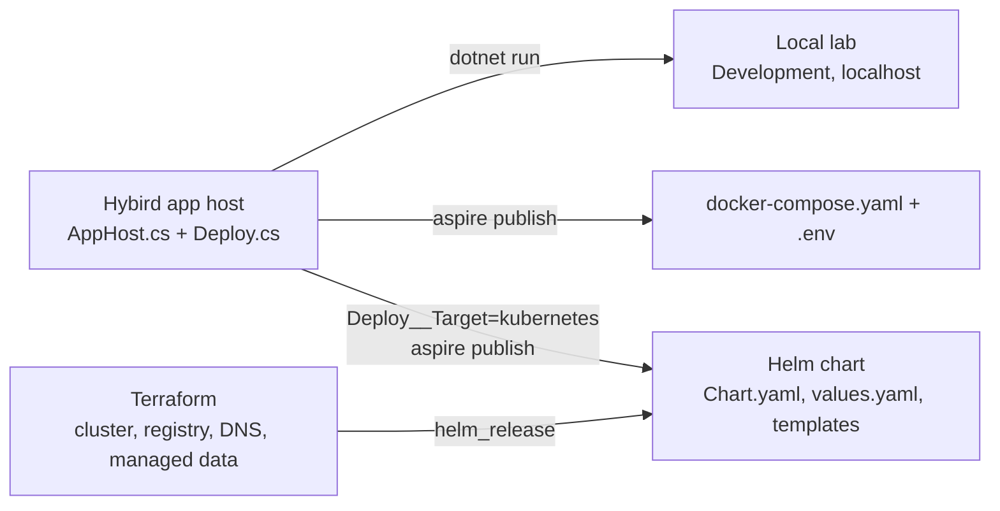

The [Hybird lab](/backend/hybrid-lab/) is not only a local tool. `aspire publish` turns the same app host into
deployment files: **Docker Compose** (`docker-compose.yaml` + `.env`) or a **Helm chart** for Kubernetes. Everything
that differs from the lab lives in `src/Aspire/Hybird/Deploy.cs`; `dotnet run` behaves exactly as before.

```bash
aspire publish --apphost src/Aspire/Hybird/Hybird.csproj -o deploy/compose
```

```bash
Deploy__Target=kubernetes aspire publish --apphost src/Aspire/Hybird/Hybird.csproj -o deploy/helm
```



`aspire publish` only writes files. `aspire deploy` also builds the images and, for Compose, starts them.

## What publish mode changes

| | Run (lab) | Published |
| --- | --- | --- |
| Environment | `Development`, dev certificates, dev accounts | `Production`, `ASPNETCORE_FORWARDEDHEADERS_ENABLED=true` |
| Public URLs | `http://localhost:5090`, `:5080`, `:5070` | `https://` + the parameters `public-identity-host`, `public-gateway-host`, `public-client-host` |
| Identity service | development signing keys, seeded dev users | `signing.pfx` and `encryption.pfx` from `/certs` (password `identity-certificate-password`), one platform admin (`admin-email`, `admin-password`), redirect URIs and CORS for the client host only |
| Module catalog | `App_Data/modules-catalog` in the project folder | one volume every pool replica mounts at `/app/App_Data/modules-catalog` |
| Client | WebAssembly dev server | an nginx image; `OIDC_AUTHORITY` and `WEBAPI_BASE_URL` are written into `appsettings.json` when it starts |
| Gateway | host port 5080 and the `/pools/*` routes | the public entry, no `/pools/*` routes |

Parameters become entries in `.env` (Compose) or `values.yaml` (Helm). TLS ends in front of the services, at the
ingress or at a reverse proxy, so the public URLs are `https` while the services speak plain HTTP inside.

:::caution[The module catalog must be shared]
Uploaded runtime modules live in the catalog folder, and every replica of every pool reads it. Without the shared
volume, a module installed through one replica is missing on the others and disappears when the container restarts.
On Kubernetes the volume is a `ReadWriteMany` PersistentVolumeClaim, so its storage class (`modules-storage-class`)
must support that: Azure Files, EFS, Filestore or NFS.
:::

## Docker Compose

1. Fill `.env`: the parameters, each `*_IMAGE` and each `*_PORT` (`8080` for the .NET images).
2. Put `signing.pfx` and `encryption.pfx` in `certs/` next to `docker-compose.yaml`.
3. `docker compose up -d`. The gateway is on 5080, identity on 5090, the client on 5070. A TLS proxy in front maps the
   three public host names to them.

## Kubernetes with Helm

```bash
kubectl create namespace modularblazor
```

```bash
kubectl -n modularblazor create secret generic identity-certificates --from-file=signing.pfx --from-file=encryption.pfx
```

```bash
helm upgrade --install modularblazor deploy/helm -n modularblazor -f prod-values.yaml
```

`prod-values.yaml` sets the `parameters.*` values: the images in your registry, the host names, the passwords and the
storage class. Each public host gets an ingress (class `nginx`) with TLS from the Secret `<name>-ingress-tls`, which
cert-manager or you create. The pool replicas become StatefulSets because they mount the catalog volume.

## Terraform

Aspire writes no Terraform. The usual split:

- **Terraform** creates what the chart runs on: the cluster (AKS, EKS, GKE), the container registry, DNS, and the
  managed PostgreSQL, Redis and RabbitMQ if you replace the containers.
- **The chart** runs the platform. Terraform installs it with the `helm` provider's `helm_release` resource and passes
  the `parameters.*` values from its own outputs.

## Not covered yet

- Each pool replica is its own resource (see the lab's design notes), so the output names ten images that are all the
  WebApi image. Point them at one tag.
- PostgreSQL, Redis and RabbitMQ are still containers with volumes. In production, use managed services and pass their
  connection strings instead.
- The output has been checked with `docker compose config` and `helm lint`, not yet deployed to a real cluster.
