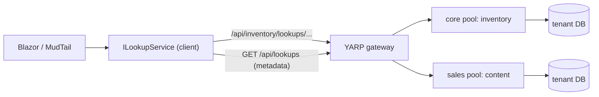
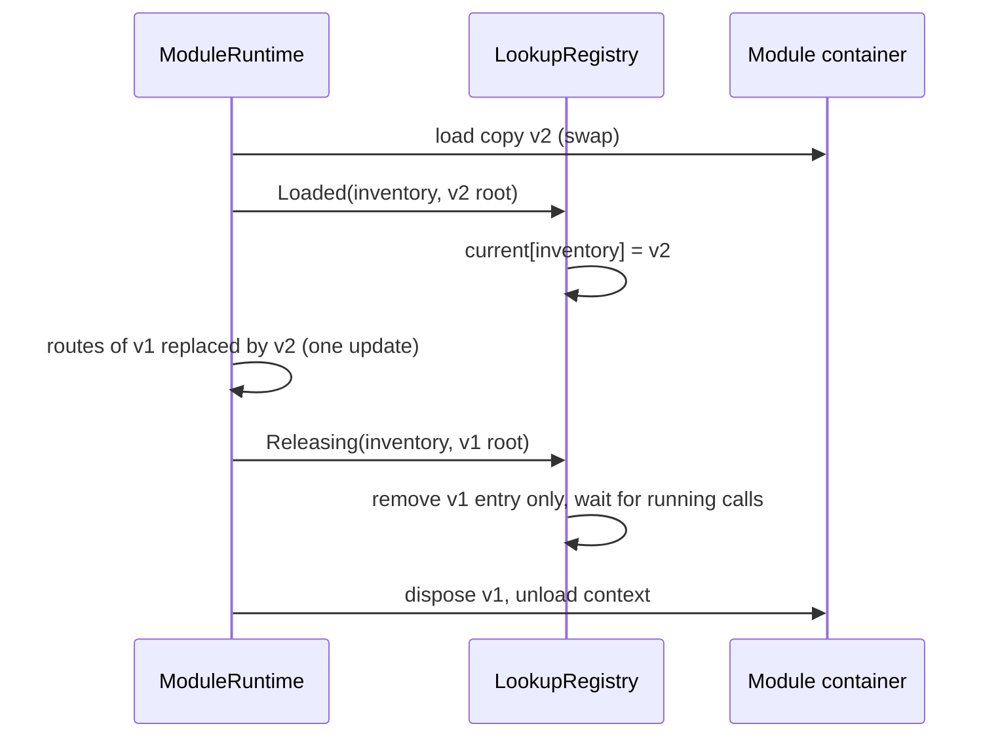

:::note[Proposed design]
This page describes the agreed design of the lookup service. It is not implemented yet; names may change while it
is built.
:::

A **lookup** turns a module's entity into key/text pairs: the key is what a form stores, the text is what a person
sees. Lookups feed MudTail's autocomplete, cascading pickers for trees, a filter picker with chips, and the
DynamicFields editor. They are always served by the module that owns the entity, from the current tenant's database.

| Need | Lookup feature |
| --- | --- |
| Pick one item while typing | Autocomplete (paged search) |
| Pick down a tree (category → sub-category) | Recursive cascade (`ParentField`) |
| Pick a city of the chosen country | Dependent lookup (`ParentProperty`) |
| Browse with filters, pick one or many | Picker with filter chips (`FilterOn`) |
| Show the text of a saved key | Resolve by keys |
| Let another module check a key | `ILookupClient` (in-process or remote) |

## Principles

- **The owner serves its lookups.** Data, endpoint and database stay with the module; nothing central holds data.
- **One place per module.** Every lookup of a module is declared in one class of its Web layer.
- **The central part is a contract**, not a server: one naming scheme, one catalog of metadata, one client service.
- **Nothing pins a module.** Definitions live in the module's container and are disposed with it (see
  [Unloading runtime modules](/backend/runtime-module-unloading/)).
- **Clients never send expressions.** Search fields and filters are checked against an allowlist the module declares.

## Declaring lookups

Each module has one `ILookupModule` in its Web layer. The host discovers it when the module loads, the same way it
discovers `ICarterModule`s.

```csharp
// Web/Endpoints/Lookups/InventoryLookups.cs
public sealed class InventoryLookups : ILookupModule
{
    public void Register(ILookupBuilder l)
    {
        l.For<StockItem>("stock-items")
         .Key(i => i.Id)
         .Text(i => i.Sku + " - " + i.Name)                 // render expression, translated to SQL
         .SearchOn(nameof(StockItem.Sku), nameof(StockItem.Name))
         .Where(i => i.Quantity > 0)                          // fixed filter, always applied
         .OrderBy(i => i.Sku)
         .FilterOn(nameof(StockItem.Name))
         .FilterOn(nameof(StockItem.KindId), valueLookup: "inventory.kinds")
         .FilterOn(nameof(StockItem.Quantity))
         .Columns(i => new { i.Sku, i.Quantity })             // extra columns for the picker
         .Permission(InventoryPermissions.Read);

        l.For<Warehouse>("warehouses").Key(w => w.Id).TextField(nameof(Warehouse.Name));

        l.For<Category>("categories")
         .Key(c => c.Id)
         .TextField(nameof(Category.Name))
         .ParentField(nameof(Category.ParentId));             // enables cascades
    }
}
```

| Builder call | Meaning | Default |
| --- | --- | --- |
| `Key(...)` | The stored value. Sent as a string over the wire. | required |
| `Text(expr)` | Render expression. Translated to SQL, so search, order and paging run in the database. | `TextField` |
| `TextField(name)` | A property name, turned into the same kind of expression. | |
| `Text("ar", expr)` | Text for one culture; the request culture picks it, falling back to the default. | |
| `Columns(...)` + `Render(func)` | For formatting SQL cannot do: SQL selects only these columns, the function formats each row of the page in memory. | |
| `SearchOn(names...)` | Allowlist of fields the free-text search uses. A caller may narrow it, never widen it. | the text |
| `Where(expr)` | Fixed filter, always applied (also for resolve). | |
| `OrderBy(expr)` | Order of the list. | the text |
| `ParentField(name)` | The column that `?parent=` filters: same lookup (tree) or another one (dependent). | |
| `LeafField(name)` | A column that says an item has no children. | `EXISTS` subquery |
| `FilterOn(name, valueLookup?)` | A field the picker may filter on. Operators come from its type. | |
| `Permission(name)` | Required to search or resolve. Must be declared in the manifest like any permission. | authenticated user |

Activation fails when a field name does not exist on the entity, the same way an undeclared permission fails it, so a
typo is caught at load, not on the first keystroke.

:::caution[Render with an expression, not a delegate]
`Text(i => ...)` is an `Expression<Func<T,string>>`. A plain `Func` would load whole entities into memory and break
search and paging on large tables. Use `Columns` + `Render` when you need C# formatting.
:::

The host's engine is generic and works on an `IQueryable<T>` from the module's own `DbContext`, so every query runs
against the current tenant's database. It is not tied to Ardalis; a module that has a base specification can plug it
in. The engine keeps no static caches keyed by type, and builds parameterized expressions so EF reuses query plans.

### A lookup is not the search use case

The template's `SearchNotesQuery` returns full DTOs and a total for a list screen. Reusing it for an autocomplete
would load whole entities, count on every keystroke, require two characters before showing anything, match on text
the user does not see (`Body`) and order by id. A lookup returns two columns, orders by its text and computes
`hasMore` from `take + 1` rows. Share the module's **filter rules** (an expression or base specification in Core)
between both, not the command.

## Endpoints

The host maps the endpoints of every registered lookup into the module's own route group, so they live under the
module's prefix and come and go with the module's routes (activate, deactivate, unload and the blue/green swap).

| Request | Answer |
| --- | --- |
| `GET /api/{prefix}/lookups/{name}?q=&fields=&parent=&skip=&take=` | `{ items: [{ key, text, hasChildren? }], hasMore }` |
| `GET /api/{prefix}/lookups/{name}/keys?keys=3,17` | `[{ key, text, parentKey?, hasChildren? }]` |
| `POST /api/{prefix}/lookups/{name}/query` | `{ items: [{ key, text, extra }], hasMore, total? }` (picker with filters) |
| `GET /api/lookups` | The catalog: every lookup of every installed module (metadata only) |

- An empty `q` returns the first page, so a list can open on focus.
- `hasMore` comes from reading `take + 1` rows; a total is computed only when asked for (the picker asks when its
  filters change, never per keystroke).
- `parent` omitted on a lookup with `ParentField` returns the roots (`ParentId == null`).
- `keys` shows the text of saved values when a record is opened, and lets other modules check keys.
- Each lookup becomes its own OpenAPI operation (for example `Inventory_Lookup_StockItems`), so the module's generated
  client gets a typed method.

## Keys, the catalog and pools

A lookup key is `{routePrefix}.{name}`, for example `inventory.stock-items`. The client turns it into
`/api/inventory/lookups/stock-items`, and the gateway already routes `/api/inventory/**` to the pool that runs the
module. No gateway route is added per lookup and no pool sits in the middle.



The catalog is metadata only: names, labels, permission, search and filter fields, `ParentField`. It is recorded at
**install** time: the step that reads the manifest in a throw-away load context also runs `ILookupModule.Register`
against a builder that records only strings, and stores them in the module's catalog record, like
`ModuleManifest.Permissions`. Any replica of any pool can then list the lookups of a module it never loads.

| Design | Pool separation |
| --- | --- |
| A central data endpoint on core that answers for every module | **Breaks it**: core would proxy to other pools and become a hub every pool depends on |
| An in-process call into another module's lookup | **Breaks it silently**: works when both share a pool, fails after a module moves |
| Endpoints under the module prefix, catalog of metadata, `ILookupClient` | Keeps it |

## Lifecycle and unloading



- The per-replica `LookupRegistry` is an `IModuleLifecycleObserver`. It stores only the module id, the container
  reference and lookup names, never entity types or delegates.
- In a swap the new copy is loaded **before** the old one is released, so the registry keys entries by container
  reference and removes only the entry of the copy being released (the pattern of `ModuleTenantInitializer`).
- Definitions, with their expressions over module types, are singletons in the module's container and are disposed
  with it.
- Cached results are host DTOs made of strings, so a cache can never pin a module.

## Recursive cascades

A lookup with `ParentField` over its own entity drives a cascade: selecting an item at one level opens the next level,
filtered by `parent = selected key`.

```text
levels = [ Level(parent = RootKey) ]            level 0 is always visible

select X at level i:
    drop the levels after i
    if X.hasChildren and i + 1 < MaxDepth: add Level(parent = X.key)
    value = path of levels 0..i

clear level i:
    drop the levels after i
    value = path of levels 0..i-1 (null when i = 0)
```

- A level that changes empties and re-filters the next one; a further level does not exist until the one before it
  has a value.
- `hasChildren` decides whether a next level appears. It comes from `LeafField`, or from an `EXISTS` subquery in the
  same SQL query; index `ParentId` in the module's migration.
- Each level loads its first page when it is focused, debounces and cancels its own requests, and caches the first
  page of each `(lookup, parent)` briefly on the client, because browsing a tree repeats the same requests.
- `MaxDepth` (default 5) caps the cascade and protects against cycles in the data.
- The same mechanism serves dependent lookups across two lookups (country → city): the parent value then comes from a
  sibling field.

For deep or large trees, a later "search the whole tree" mode can show breadcrumbs in one autocomplete; it needs a
materialized path column (`PathField`).

## Picker with filter chips

The picker is a dialog (`Platform/lookup-picker`, opened through [module dialogs](/guides/module-dialogs/)) for
browsing with composed filters and selecting one or many items.

```text
┌ Filter bar:  [Field ▾] [Operator ▾] [Value…] [+ Add]                              ┐
│ Filter chips:   ⧩ Name contains "SKU" ✕    ⧩ Kind = Hardware ✕                     │
│ Results (318)                                          [search in results…]       │
│   ☐ SKU-1 - Widget       SKU-1   12                                                │
│   ☑ SKU-7 - Gear         SKU-7    4                                                │
│ Selected:   SKU-7 - Gear ✕    SKU-12 - Bolt ✕                                      │
└                                                         [Cancel]  [Select 2]       ┘
```

```json
POST /api/inventory/lookups/stock-items/query
{ "q": "", "skip": 0, "take": 50, "includeTotal": true,
  "filters": [ { "field": "Name",   "op": "contains", "value": "SKU" },
               { "field": "KindId", "op": "eq",       "value": "25"  } ] }
```

| Field type | Operators |
| --- | --- |
| text | `eq`, `contains`, `startsWith` |
| number, date | `eq`, `ne`, `gt`, `gte`, `lt`, `lte`, `between` |
| enum, lookup | `eq`, `in` |
| bool | `eq` |
| any | `isEmpty` |

- Chips combine with **AND**; OR goes inside one chip with `in` (`Kind in [Hardware, Tools]`).
- A filter whose field has a `valueLookup` picks its value with an autocomplete, and its chip shows the text
  ("Kind = Hardware"), not the key.
- Only `FilterOn` fields are accepted. Limits: at most 10 filters, 100 values in `in`, a capped value length and
  `take`. An invalid filter is answered with problem details naming it, so the UI can mark that chip.
- No OData `$filter` or Dynamic LINQ strings: a structured filter checked against an allowlist cannot reach columns
  the module did not expose, and cannot inject code (System.Linq.Dynamic.Core had CVE-2023-32571).
- Filter chips (outlined, funnel icon) and selected items (filled chips) look different. The selection is a separate
  set that keeps each item's text, so it survives filter changes.
- On phones the dialog is full screen and the result table becomes a list of cards.

## MudTail and the Blazor client

| Piece | Role |
| --- | --- |
| `ILookupService` (client) | `SearchAsync(key, q, fields, parent, skip, take)`, `ResolveAsync(key, keys)`, `QueryAsync(key, filters, ...)`. Reads the catalog once per session; uses the module's HttpClient, so the token and tenant header never reach JavaScript. |
| `MudAutocomplete.js` remote mode | `search(q, { skip, take, signal })` returning `{ items: [{ key, text }], hasMore }`; debounce (about 250 ms), cancels the previous request, loads more on scroll, sets an initial key and text, emits `{ key, text }`, chips when multiple. |
| `<LookupAutocomplete>` | Blazor wrapper; JavaScript calls back to .NET for each search. |
| `<LookupCascade>` | A list of `LookupAutocomplete` levels driven by the cascade rules above. |
| `Platform/lookup-picker` | The filter picker dialog; the autocomplete offers it through an "Advanced…" button. |

## Server-side consumers

Another module that needs a lookup calls `ILookupClient` with the lookup key. When the owning module is loaded on the
same replica the call runs in-process; otherwise it goes to the owning pool over the internal network, never back
through the public gateway (see [Communication between modules](/backend/communication/)). The call site is the same
in every topology.

- Prefer storing the **key and a text snapshot** over calling another module whenever a record is shown.
- Check keys when a reference is created or changed; refuse the write when the owning module cannot answer.
- Calls carry the user's identity, so a user cannot reference an item they may not see.

## DynamicFields integration

[DynamicFields](/modules/dynamic-fields/) gets one new property kind that lets an author bind a field to any module's
lookup, with no reference to that module.

```csharp
public enum PropertyKind { …, Lookup }

public sealed record LookupBinding(
    string Key,                                   // "inventory.stock-items"
    IReadOnlyList<string>? SearchFields = null,   // a subset of the lookup's allowlist
    string? ParentProperty = null,                // sibling property → dependent lookup
    int MinChars = 0,
    LookupMode Mode = LookupMode.Autocomplete,    // Autocomplete | Picker
    bool Recursive = false,                       // cascade over the lookup's ParentField
    string? RootKey = null,                       // first level starts under this item
    int MaxDepth = 5,
    bool LeafOnly = false,                        // the author must reach an item with no children
    IReadOnlyList<LookupFilter>? PresetFilters = null, // chips the author locks
    bool AllowUserFilters = true,
    int? MaxSelections = null);

public sealed record FieldProperty(…, LookupBinding? Lookup = null);
```

**Stored value**: the key with a text snapshot, and for a cascade the path.

```json
"product":  { "key": "42", "text": "SKU-1 - Widget" }
"category": { "key": "17", "text": "Phones",
              "path": [ { "key": "3", "text": "Electronics" }, { "key": "17", "text": "Phones" } ] }
```

The snapshot renders lists, breadcrumbs and schema.org output without calling the owning pool, and keeps content
readable when that module is inactive or removed. Text is refreshed on save; other cultures are resolved when the
content is rendered, falling back to the snapshot. Lookup values are not translatable. The JSON Schema of the value
is an object with a required `key` and `x-lookup` set to the lookup key.

**Field builder**: the kind "Lookup" shows a lookup chooser fed by the catalog, search-field checkboxes from its
allowlist, "Depends on" (sibling lookup properties), "Recursive" (only when the lookup has a `ParentField`), the start
item, the mode, and the preset filter chips. The live preview already renders the content editor, so the author tries
the autocomplete while building the field. Publishing a field checks the binding against the catalog. `Recursive` with
`Multiple` is refused.

**Validation** stays layered:

1. `ContentTreeValidator` (Core) stays pure and checks the shape only.
2. `ValidateContentHandler` (UseCases) collects every lookup value of the tree, groups them by lookup key and makes
   one `ResolveAsync(key, keys)` call per lookup, with the preset filters. It reports unknown keys, keys outside the
   preset filters, a broken path (each `parentKey` must be the previous key, the first must be `RootKey`), a path
   deeper than `MaxDepth` and a non-leaf end when `LeafOnly` is set, all as `ContentIssue`s with JSON Pointers. No
   recursive SQL is needed, which matters on four database engines.
3. When the owning module cannot answer, the issue blocks publishing.

`Keyword` and `Term` can later become presets of `Lookup` (`keywords.concepts`, `taxonomies.terms`); `Asset` keeps its
gallery dialog. Old kinds stay valid because kinds are stored by name.

## Caching

| Where | What |
| --- | --- |
| Client | First page per `(lookup, parent)` for cascades; short-lived results per query; ETag revalidation (`304`). |
| Server | None in the first version: lookups search live tenant data. |
| Later | For small, hot lists: a version stamp per tenant and lookup in Redis, bumped by the owner on change and broadcast on a `lookups.changed` fanout, with a TTL as a backstop. |

## Later

- Search the whole tree with breadcrumbs (`PathField`).
- Saved filter presets per user.
- Dynamic values: store a filter instead of keys ("related products: Kind is Phones"), evaluated when content is
  rendered, with a cached snapshot.
- A batch endpoint, if forms with many lookups show it is needed.

## How others do it

| System | Similar idea |
| --- | --- |
| Oracle EBS value sets | Independent, dependent and table-validated sets: our static, `ParentProperty` and entity lookups |
| FHIR `ValueSet/$expand`, `$validate-code` | Search with `filter`, `count`, `offset`, `displayLanguage`; our search and `keys` |
| Odoo `name_search` / `name_get` | Every model answers the same search contract |
| ABP, Orchard Core | One lookup endpoint per entity, served by its owner (`GetXxxLookup`, content picker) |
| Dynamics 365 Advanced Find, Jira filters | Filter chips with typed operators over an allowlist |
