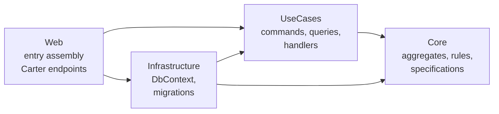

import { Aside, Card, CardGrid, FileTree, Steps, Tabs, TabItem } from '@astrojs/starlight/components';

`ModuleTemplate.CleanArchitecture` is a `dotnet new` template that generates a **complete runtime module** in one
command: a server part in [Ardalis Clean Architecture](https://github.com/ardalis/CleanArchitecture) layers, a typed
API client, a Blazor UI page, unit and integration tests, and an Aspire playground. It builds, its tests pass, and it
installs and runs on the platform as soon as it is generated.

```bash
dotnet new platform-module-ca -n Billing -o Module.Billing
```

| | |
| --- | --- |
| Short name | `platform-module-ca` |
| Package | `soft.square.net.ModularBlazor.ModuleTemplate` |
| Repository | [soft-square-net/ModularBlazor.ModuleTemplate](https://github.com/soft-square-net/ModularBlazor.ModuleTemplate), folder `templates/ModuleTemplate.CleanArchitecture` |
| Generates | One module repository: `ModularBlazor.Module.<Name>.slnx` with 6 projects, 2 test projects and a playground |
| Example feature | A `Note` aggregate with add, edit, delete, get, list and search |

## What it is

A module is one bundle with up to three parts, released together ([Create a module, A to Z](/backend/create-a-module/)
walks through each part by hand). The template gives you all three already wired, around a small example you replace
with your own feature:

<CardGrid>
	<Card title="Server part" icon="seti:c-sharp">
		Core, UseCases, Infrastructure and Web projects. The WebApi loads them into a collectible load context, runs the
		tenant migrations and maps the routes under `/api/<id>`.
	</Card>
	<Card title="API client" icon="puzzle">
		`WebApi.Modules.<Name>.Client`, generated by NSwag from the module's OpenAPI document. It ships once, as a
		hidden client module that other client modules can depend on.
	</Card>
	<Card title="Blazor UI" icon="laptop">
		`Module.<Name>`: a menu entry and a Notes page (list, search, add, edit, delete) loaded by the Blazor client at
		runtime.
	</Card>
	<Card title="Tests and playground" icon="rocket">
		xUnit unit tests (NSubstitute) and integration tests (SQLite), plus an Aspire AppHost that runs the platform
		with your module in it: change, rebuild, restart.
	</Card>
</CardGrid>

## About

The template is taken from the platform's **Content** module, the working example of every part of a module. It keeps
Content's structure and rules and swaps its editorial domain for a small Notes feature, so a new module starts from
code that is already proven on the platform: it installs, unloads cleanly, and passes its tests on every supported
database provider.

### The layers



| Layer | Project | Holds |
| --- | --- | --- |
| Core | `WebApi.Modules.<Name>.Core` | Aggregates and their rules (`Note.Create`, `Note.Edit`, throwing `DomainException`), Ardalis specifications |
| UseCases | `WebApi.Modules.<Name>.UseCases` | One folder per use case: a Mediator command or query and its handler, returning an Ardalis `Result`; permissions; options |
| Infrastructure | `WebApi.Modules.<Name>.Infrastructure` | `<Name>DbContext` (a `TenantDbContext`: per-tenant schema and query filter), entity configurations, migrations for PostgreSQL, SQL Server, MySQL and Oracle |
| Web | `WebApi.Modules.<Name>.Web` | The entry assembly: `IRuntimeModule`, the Carter route table, one REPR endpoint class per route, problem-details mapping |

### Design choices

- **Mediator, private to the module.** [Mediator](https://github.com/martinothamar/Mediator) is source-generated: the
  handlers are found at compile time, with no reflection scan and no shared registry. It and Ardalis.Result are copied
  into the module's build output and never shared with the host, so the module still unloads.
- **Host packages are compile-only.** The platform's contract packages (`WebApi.Contracts`, `WebApi.Data`,
  `ModularBlazor.Abstractions`, ...) come from the Module SDK with `ExcludeAssets=runtime`: the host provides them at run
  time.
- **One endpoint class per route** (REPR), each with an operation id `<Name>_<Action>`, so the generated client gets
  readable method names (`ListNotesAsync`, `EditNoteAsync`).
- **Optimistic concurrency.** A note has a `Version`; edit and delete send it and get `409 Conflict` when someone else
  changed the note in between.
- **Loggers by name.** Code in the module uses `ILoggerFactory`, never `ILogger<T>` of a module type, which would keep
  the module's load context alive.

### The example feature

| Method and route (under `/api/<id>`) | Permission | Use case |
| --- | --- | --- |
| `GET /notes?page=&pageSize=` | `<id>.read` | `ListNotesQuery`: one page, newest first, with the total |
| `GET /notes/search?text=&page=&pageSize=` | `<id>.read` | `SearchNotesQuery`: title or body contains the text (at least 2 characters) |
| `GET /notes/{id}` | `<id>.read` | `GetNoteByIdQuery` |
| `POST /notes` `{ title, body }` | `<id>.write` | `CreateNoteCommand`: `201` with the note |
| `PUT /notes/{id}` `{ version, title, body }` | `<id>.write` | `EditNoteCommand`: `409` if the note changed since `version` |
| `DELETE /notes/{id}?version=` | `<id>.write` | `DeleteNoteCommand`: `204`; `409` if the note changed since `version` |

Every call needs a signed-in caller in a tenant. The module setting `<Name>:MaxPageSize` (default 100) caps the page
size and can be changed on the Host Modules page.

## How to install

The template is packed as a NuGet template package and installed into the .NET SDK with `dotnet new install`.

**Requirements**

- .NET SDK 10 (the generated `global.json` pins the version and the Module SDK).
- A GitHub personal access token (classic) with `read:packages`, in the environment as `GITHUB_PACKAGES_TOKEN`: the
  generated module restores the platform's packages from the soft-square-net GitHub Packages feed (see
  [Repositories and packages](/backend/repositories/)).
- For the playground only: Docker and a checkout of the platform repo next to the module.

<Tabs>
	<TabItem label="From source">
		<Steps>

		1. Clone the template repository and pack it:

		   ```bash
		   git clone https://github.com/soft-square-net/ModularBlazor.ModuleTemplate
		   cd ModularBlazor.ModuleTemplate
		   dotnet pack ModularBlazor.ModuleTemplate.csproj -c Release -o artifacts
		   ```

		2. Install the package:

		   ```bash
		   dotnet new install artifacts/soft.square.net.ModularBlazor.ModuleTemplate.0.1.0.nupkg
		   ```

		3. Check that it is there:

		   ```bash
		   dotnet new list platform-module-ca
		   ```

		</Steps>
	</TabItem>
	<TabItem label="From the package feed">
		Once a release of the package is published to the soft-square-net feed (with `GITHUB_PACKAGES_TOKEN` set and the
		feed in your NuGet configuration):

		```bash
		dotnet new install soft.square.net.ModularBlazor.ModuleTemplate
		```
	</TabItem>
</Tabs>

<Aside type="tip" title="Updating and removing">
	Install a newer package the same way: it replaces the installed one. Remove it with
	`dotnet new uninstall soft.square.net.ModularBlazor.ModuleTemplate`. Modules you already generated are not affected:
	they are plain repositories.
</Aside>

<Aside type="note">
	Packing on Windows may warn `NU5123` (a path is too long) for the SQL Server migration files. The package still works;
	install it on a machine with long paths enabled if `dotnet new install` complains.
</Aside>

## How to use it

### Generate a module

Generate the module next to your platform checkout, so the playground finds the platform:

<FileTree>
- workspace/
  - Platform/ the ModularBlazor.Platform checkout
  - Module.Billing/ the module you generate
</FileTree>

```bash
cd workspace
dotnet new platform-module-ca -n Billing -o Module.Billing
```

`-n` is the module's name in PascalCase, one word (`Billing`, `Inventory`). It replaces the template's placeholder
`ModuleName` everywhere:

| Where | Becomes |
| --- | --- |
| Projects and assemblies | `WebApi.Modules.Billing.Web`, `soft.square.net.WebApi.Modules.Billing.Web.dll`, `Module.Billing` |
| Namespaces and types | `soft.square.net.WebApi.Modules.Billing.*`, `BillingModule`, `BillingDbContext`, `BillingClient` |
| Module id, route prefix, schema (lower case) | `billing`, `/api/billing`, database schema `billing` |
| Permissions | `billing.read`, `billing.write` |
| Files | `src/openapi/billing.json`, `wwwroot/billing.css`, playground volume `billing-playground-data` |

<Aside type="caution">
	The module id never changes after the first install: it names the catalog entry, the route prefix, the database schema
	and the pools' `Modules:Enabled` entries. Choose the name with that in mind.
</Aside>

### What you get

<FileTree>
- Module.Billing/
  - ModularBlazor.Module.Billing.slnx
  - global.json pins the .NET SDK and the Module SDK
  - NuGet.Config the soft-square-net feed (reads GITHUB_PACKAGES_TOKEN)
  - Directory.Build.props
  - .github/workflows/build.yml build and test on every push
  - src/
    - WebApi.Modules.Billing.Core/ NoteAggregate, specifications
    - WebApi.Modules.Billing.UseCases/ Notes/Create, Edit, Delete, GetById, List, Search
    - WebApi.Modules.Billing.Infrastructure/ BillingDbContext, Data/Migrations/\{PostgreSql,SqlServer,MySql,Oracle\}
    - WebApi.Modules.Billing.Web/ BillingModule, BillingRoutes, Notes/ (one endpoint per file)
    - openapi/
      - billing.json the exported OpenAPI document
    - WebApi.Modules.Billing.Client/ NSwag client, Generated/BillingClient.g.cs
    - Module.Billing/ Pages/Notes.razor, BillingPageBase.cs, wwwroot/billing.css
  - tests/
    - WebApi.Modules.Billing.UnitTests/
    - WebApi.Modules.Billing.IntegrationTests/
  - playground/ Aspire AppHost (not in the solution)
  - docs/
    - clean-architecture.md
  - README.md
</FileTree>

### Build and test

```bash
cd Module.Billing
dotnet build
dotnet test
```

The solution builds without a platform checkout (CI does the same). The unit tests cover the aggregate's rules and every
handler; the integration tests run the repository and specifications against SQLite.

### Run it in the playground

The playground starts a small platform (PostgreSQL, the identity service, one WebApi and the Blazor client) and builds
it from the platform checkout next to the module.

<Steps>

1. Stop the platform's lab and any other module playground: they use the same ports (identity 5090, API 5080, client
   5070).

2. Start the playground:

   ```bash
   dotnet run --project playground --launch-profile dev
   ```

   The platform checkout is somewhere else? Add `-p:PlatformRoot=<path to Platform>/`.

3. Open http://localhost:5070, sign in to the tenant `acme` as `acme-admin@modular.local` (the dev passwords are in the
   platform's `WebApi.Identity.Server/appsettings.Development.json`), and open **Billing** in the menu.

4. Add a note, click its row to edit or delete it, and search for it. The API is browsable at
   http://localhost:5080/scalar.

</Steps>

In the `dev` profile the WebApi loads the server part and both client parts straight from their build output, so the
loop is: change code, rebuild, restart the `webapi` resource in the Aspire dashboard. The playground grants
`billing.*` to `acme-admin@modular.local` and `billing.read` to `editor@modular.local` in `acme`; try the second account
to see the page's `403` messages. Data stays in the Docker volume `billing-playground-data` and in `playground/.data`;
delete both to start over.

<Aside type="tip">
	Right after signing in, the client may show a 404 for `/billing` because it renders before the client modules have
	loaded. Click the menu entry and the page appears.
</Aside>

### Install it on a platform

Every build of the playground also prepares the parts for uploading, in `playground/out/`. The `install` profile
(`--launch-profile install`) starts the platform without the module, as in production, so you can try the real path:

<Steps>

1. Upload `playground/out/billing.zip` (the server part: the Web project's build output) on the client's **Host
   modules** page (`/host-modules`, as a platform admin) and activate it. The tenant migrations run per tenant and the
   routes are mapped under `/api/billing`.

2. Upload the client parts from `playground/out/client/` on the **Client modules** page (`/client-modules`), the API
   client first:
   - `soft.square.net.WebApi.Modules.Billing.Client.dll` (hidden)
   - `soft.square.net.Module.Billing.dll` (the Notes page)

3. Grant `billing.read` and `billing.write` to the users who need them, in their tenant.

</Steps>

### Make it yours

Keep the Notes example as a reference while you add your own feature, then delete it. The generated
`docs/clean-architecture.md` describes each step; in short, for a new action:

<Steps>

1. **Core**: the rule on the aggregate, and a specification for a new query shape.
2. **UseCases**: a folder with the command or query and its handler, returning a `Result`. Add a permission if it needs one.
3. **Web**: one endpoint class with an operation id `<Name>_<Action>`, and one line in the route table.
4. **Infrastructure**, if the model changed: the mapping, then a migration for **every** provider with the platform's
   `src/WebApi/scripts/Add-Migration.ps1`.
5. **Client**: export the OpenAPI document again with the platform's `src/WebApi/scripts/Export-ModuleOpenApi.ps1`
   (`-Output <module>/src/openapi/billing.json`) and build: the typed client regenerates. Commit both, so API changes
   show up in review. Use the new method from a page that inherits `BillingPageBase`.
6. **Tests**: the rule, the handler, and the new mapping or specification.

</Steps>

## See also

- [Create a module, A to Z](/backend/create-a-module/): every part of a module, built by hand.
- [Runtime modules](/backend/runtime-modules/) and [Runtime module unloading](/backend/runtime-module-unloading/): how
  modules load and why module code must not leak references.
- [Endpoints with Carter](/backend/endpoints-carter/) and [Tenancy data](/backend/tenancy-data/).
- [Repositories and packages](/backend/repositories/): the feed, its token and CI.
