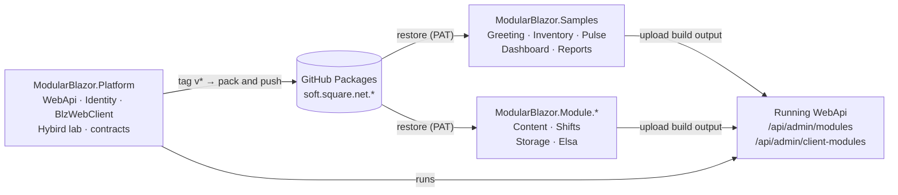

The platform and its modules live in separate repositories of the `soft-square-net` organisation. The platform
publishes the contracts a module compiles against as NuGet packages; a module repo references those packages and
never the platform's source. A module is still installed the same way: its build output is uploaded to a running
WebApi.



## The repositories

| Repository | Holds |
| --- | --- |
| [`ModularBlazor.Platform`](https://github.com/soft-square-net/ModularBlazor.Platform) | The WebApi and its core modules (identity, tenancy, client modules), the OpenIddict identity service, the YARP gateway, `ModularBlazor.BlzWebClient` and its core client modules, MudTail, the Hybird Aspire lab, the contract packages and the Module SDK, and this documentation |
| [`ModularBlazor.Samples`](https://github.com/soft-square-net/ModularBlazor.Samples) | Small demo modules, one folder each under `samples/`: Greeting (single project), Inventory (layered, tenant data), Pulse (own pipeline, hosted service), Dashboard (client `.dll`), Reports (client `.nupkg`) |
| [`ModularBlazor.Module.Content`](https://github.com/soft-square-net/ModularBlazor.Module.Content) | The newsroom's Posts and their workflow. See [Contents](/modules/contents/) |
| [`ModularBlazor.Module.Shifts`](https://github.com/soft-square-net/ModularBlazor.Module.Shifts) | Rota and shift grants |
| [`ModularBlazor.Module.Storage`](https://github.com/soft-square-net/ModularBlazor.Module.Storage) | File storage |
| [`ModularBlazor.Module.Elsa`](https://github.com/soft-square-net/ModularBlazor.Module.Elsa) | Elsa 3.9 as a runtime module. See [Elsa](/modules/elsa/) |
| [`ModularBlazor.ModuleTemplate`](https://github.com/soft-square-net/ModularBlazor.ModuleTemplate) | The starting point for a new module repo (scaffold, still growing) |

`soft-square-net/ModularBlazor` is the old, combined repository. It is obsolete: it still holds the old
`ModularBlazor.Host`, `ModularBlazor.Client` and the modules before they moved, and receives no more changes.

## The packages

The platform's `Platform packages` workflow (`.github/workflows/platform-packages.yml`, script
`build/pack-platform.ps1`) packs six packages in one version:

| Package | A module uses it for |
| --- | --- |
| `soft.square.net.WebApi.Contracts` | `IRuntimeModule`, `ModuleManifest`, tenancy and security contracts |
| `soft.square.net.WebApi.SharedKernel` | `AggregateRoot<T>`, `ITenantOwned`, `DomainException`, `IRepository<T>` |
| `soft.square.net.WebApi.Data` | `TenantDbContext`, the four EF Core providers |
| `soft.square.net.ModularBlazor.Abstractions` | Client modules: `[assembly: ClientModule]`, `IModuleNavigation`, MudTail interop, `HttpClientNames` |
| `soft.square.net.Share.All` | Types shared by client and server |
| `soft.square.net.ModularBlazor.Module.Sdk` | The MSBuild SDK below |

| Trigger | Version | Published |
| --- | --- | --- |
| Push or pull request | `1.0.0-ci.<run>` | No, kept as a workflow artifact |
| Manual run | `1.0.0-ci.<run>` | Yes, as a preview |
| Tag `v1.2.0` | `1.2.0` | Yes |

They go to `https://nuget.pkg.github.com/soft-square-net/index.json`, and to nuget.org as well when the repository
has a `NUGET_API_KEY` secret. Released so far: `1.0.0-preview.1` and `1.0.0-preview.2`.

## The Module SDK

A module project names the SDK on top of `Microsoft.NET.Sdk` (server) or `Microsoft.NET.Sdk.Razor` (client) and lets
it pick the references by the project's **name suffix** (or `<ModuleLayer>` set in the project):

```xml title="src/WebApi.Modules.Notes.Infrastructure/WebApi.Modules.Notes.Infrastructure.csproj"
<Project Sdk="Microsoft.NET.Sdk">
  <Sdk Name="soft.square.net.ModularBlazor.Module.Sdk" />

  <ItemGroup>
    <ProjectReference Include="..\WebApi.Modules.Notes.Application\WebApi.Modules.Notes.Application.csproj" />
  </ItemGroup>
</Project>
```

| Layer | Recognised by | Gets |
| --- | --- | --- |
| `Domain` | `*.Domain` | SharedKernel |
| `Application` | `*.Application` | SharedKernel, Contracts, ASP.NET Core |
| `Infrastructure` | `*.Infrastructure` | Data (EF Core, the providers), Contracts, Carter, ASP.NET Core, `EnableDynamicLoading`: the entry assembly |
| `Module` | any other server project | Contracts, Carter, ASP.NET Core; `ModuleUsesData=true` adds Data. A single-project module (Greeting) sets `EnableDynamicLoading=true` itself |
| `Client` | a Razor SDK project, or `<ModuleLayer>Client</ModuleLayer>` (a generated API client) | Abstractions, the browser platform; `wwwroot` is embedded in the assembly |

Host-shipped assemblies are compile-only, so the build output holds your assemblies and your private dependencies
only, even when a private package (Elsa) depends on EF Core itself. Do not add your own `PackageReference` to EF Core,
Carter or Ardalis.Specification.

The SDK version is pinned once per repository, in `global.json`:

```json title="global.json"
{
  "msbuild-sdks": {
    "soft.square.net.ModularBlazor.Module.Sdk": "1.0.0-preview.2"
  }
}
```

The SDK brings the contract packages in the same version (override `ModularBlazorPlatformVersion` to use another),
so moving a repo to a new platform release is a change of this one line.

For `dotnet ef migrations add`, set `EfDesignAssets=all` (dotnet-ef needs the host assemblies next to the project),
then build again without it before you zip the output.

## A module repo

```text
ModularBlazor.Module.<Name>/
  global.json                 the Module SDK version
  NuGet.Config                nuget.org + the soft-square-net feed
  Directory.Build.props       net10.0, nullable, the soft.square.net. prefix
  ModularBlazor.Module.<Name>.slnx
  src/
    WebApi.Modules.<Name>.Domain/
    WebApi.Modules.<Name>.Application/
    WebApi.Modules.<Name>.Infrastructure/   entry assembly: its build output is the package
    WebApi.Modules.<Name>.Client/           generated API client (NSwag), shipped as a hidden client module
    Module.<Name>/                          Blazor UI client module, optional
    openapi/<id>.json                       the committed API document
  tests/
  playground/                 Aspire AppHost: the platform from a Platform checkout next to the repo, with this module
  .github/workflows/build.yml
```

`NuGet.Config` maps `soft.square.net.*` to the organisation feed and everything else to nuget.org:

```xml title="NuGet.Config"
<packageSourceMapping>
  <packageSource key="soft-square-net"><package pattern="soft.square.net.*" /></packageSource>
  <packageSource key="nuget.org"><package pattern="*" /></packageSource>
</packageSourceMapping>
<packageSourceCredentials>
  <soft-square-net>
    <add key="Username" value="soft-square-net" />
    <add key="ClearTextPassword" value="%GITHUB_PACKAGES_TOKEN%" />
  </soft-square-net>
</packageSourceCredentials>
```

### The feed token

GitHub Packages asks for a token even for public packages.

- **On your machine:** create a personal access token (classic) with `read:packages` and put it in the environment as
  `GITHUB_PACKAGES_TOKEN`. Then `dotnet build ModularBlazor.Module.<Name>.slnx`.
- **In CI:** a repository's own `GITHUB_TOKEN` cannot read packages that belong to another repository, so the workflows
  read the organisation secret `PACKAGES_TOKEN` (a PAT with `read:packages`) and fall back to `GITHUB_TOKEN`:

```yaml title=".github/workflows/build.yml"
permissions:
  contents: read
  packages: read

jobs:
  build:
    runs-on: ubuntu-latest
    env:
      GITHUB_PACKAGES_TOKEN: ${{ secrets.PACKAGES_TOKEN || secrets.GITHUB_TOKEN }}
    steps:
      - uses: actions/checkout@v4
      - uses: actions/setup-dotnet@v4
        with: { dotnet-version: 10.0.x }
      - run: dotnet build ModularBlazor.Module.Name.slnx -c Release
```

The other way is to give each module repository Actions read access in every package's settings.

### Platform scripts against a module repo

Migrations and the OpenAPI export need a running host, so they stay in the platform repo and take the module's path.
Clone both repos side by side:

```powershell
# from the ModularBlazor.Platform folder
./src/WebApi/scripts/Add-Migration.ps1 -Project ../ModularBlazor.Module.Content/src/WebApi.Modules.Content.Infrastructure -Name AddSlug
./src/WebApi/scripts/Export-ModuleOpenApi.ps1 -Project ../ModularBlazor.Module.Content/src/WebApi.Modules.Content.Infrastructure -ModuleId content
./src/WebApi/scripts/Export-ModuleOpenApi.ps1 -Project ../ModularBlazor.Module.Content/src/WebApi.Modules.Content.Infrastructure -ModuleId content -Check
```

### Install and try it

While you work, run the module in its **playground** (`dotnet run --project playground`). In Development, the WebApi
loads the server part straight from its build output (`Modules:Local`). The playground's build also writes every
part ready to upload to `playground/out/`.

To install it elsewhere, zip the contents of the Infrastructure project's `bin/<Configuration>/net10.0`. Upload the
zip in the admin area (`/host-modules`), or to `POST /api/admin/modules` (in the Hybird lab,
`/pools/<pool>/api/admin/modules`). The client modules (`.dll`, `.nupkg` or `.zip`) go on the client's
`/client-modules` page: the hidden API client first, then the UI. Step by step:
[Create a module, A to Z](/backend/create-a-module/), steps 7 to 12.

### Branches and releases

Trunk-based: `main` always builds, short-lived `feat/…` and `fix/…` branches, a release is a tag such as `v1.2.0`. CI
builds every pull request and keeps the build output as an artifact. Planned: one `<module>-<version>.modpkg` bundle
per release (`module.json`, `server/`, `client/`, `contracts/`) that the admin area installs in one step.

## Platform-only work

Changing a contract (a new member on `IRuntimeModule`, a new `TenantDbContext` feature) is a platform change: merge it
to Platform, tag a version, then raise `global.json` in the module repos that need it. A module never patches the
contracts locally.
