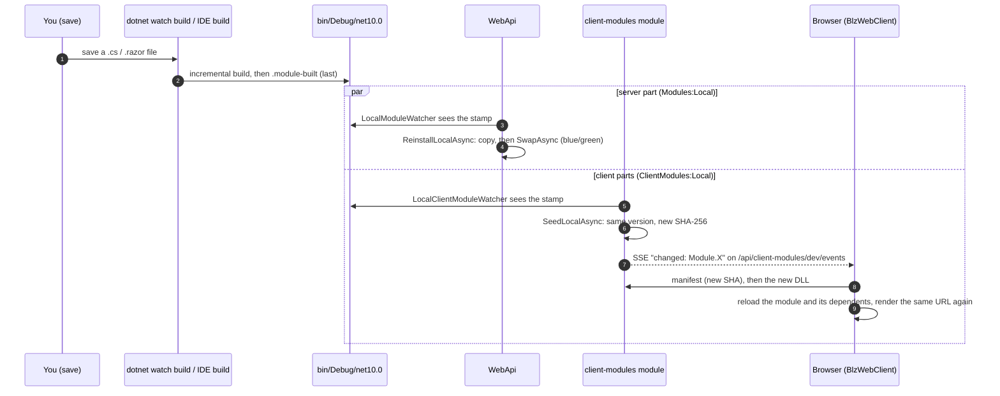

This guide is for developers working on a **module in its own repo** (`Module.*`, or a new one made from the
ModuleTemplate). It covers three things:

- how to start the module's **playground**;
- how to work with **reload on save**: edit, save, and the change is live in a few seconds;
- why the loop is built the way it is, and what it does not do.

You save a file. Then:

| You changed | What happens | Restart? | You keep |
| --- | --- | --- | --- |
| Server code: endpoints, use cases, domain, data (`WebApi.Modules.X.*`) | The module is rebuilt and **swapped** into the running WebApi, blue/green. Requests never see a 404 | No | The WebApi process, other modules, data. The module's in-memory state is lost |
| Client UI (`Module.X`: `.razor`, `.cs`, `wwwroot`, `i18n`) | The module is rebuilt, the client catalog reinstalls it, and the **open page reloads the module in place** and renders the same URL again | No, the page does not reload | Sign-in, URL, other modules. The page's component state is lost |
| The typed API client (`WebApi.Modules.X.Client`) | As above, and the UI module that depends on it reloads too | No | As above |
| Platform code (the WebApi host, BlzWebClient, contracts) | Not covered: restart the resource, or use `dotnet watch` on the platform project | Yes | |

From save to change visible, measured on the Keywords playground: **about 5.5 s** for a client page and **about
5.6 s** for an endpoint. Most of that is `dotnet watch` and the build. See [Timings](#timings).

:::note[Availability]
The dev reload ships with the platform branch `feat/dev-module-reload`. A module's playground uses it as soon as the
playground builds against a Platform checkout that has it. The `.module-built` build stamp comes with the Module SDK
release **after** `1.0.0-preview.3`. Until a module moves to that SDK, the watchers fall back to waiting for the
build output to be quiet for one second. That works, but it is slower.
:::

## Before you start

The playground builds the platform **from source**, from a Platform checkout next to the module repo:

```text
<workspace>/Platform            git clone https://github.com/soft-square-net/ModularBlazor.Platform Platform
<workspace>/Module.Keywords     the module repo (any Module.* repo works the same way)
```

You also need:

- the .NET 10 SDK, the version that `global.json` pins;
- Docker running. The playground starts PostgreSQL in a container;
- `GITHUB_PACKAGES_TOKEN` in the environment: a classic token with `read:packages`. Restoring the Module SDK and the
  platform packages needs it;
- the ports **5090** (identity), **5080** (WebApi) and **5070** (Blazor client) free. Stop the Hybird lab and any
  other playground first, because they all use the same ports.

To build against another Platform checkout (a worktree, a branch), pass `PlatformRoot`:

```powershell
dotnet run --project playground --launch-profile dev --property:PlatformRoot=D:/src/Platform-dev-reload/
```

## Start the playground

### From the terminal

From the module repo's root:

```powershell
dotnet run --project playground --launch-profile dev
```

The Aspire dashboard opens. Its URL and login token are printed in the console. The `dev` profile starts these
resources:

| Resource | What it is |
| --- | --- |
| `tenant-data` | PostgreSQL: the tenant store, the tenants' databases, the identity database |
| `identity` | The OpenIddict identity service on 5090 |
| `webapi` | The WebApi on 5080, with your module loaded from its build output (`Modules:Local`) |
| `blzwebclient` | The Blazor WebAssembly client on 5070, with your client parts installed from their build output (`ClientModules:Local`) |
| `watch-server` | `dotnet watch build` on the module's entry project (`WebApi.Modules.X.Web`) |
| `watch-client` | `dotnet watch build` on the UI project (`Module.X`), which builds the API client too |

Open `http://localhost:5070` and sign in. In Development the platform seeds the tenants `acme` and `globex`. The
playground grants your module's permissions in `acme` to the dev accounts (`Access:DevGrants` in `AppHost.cs`). The
accounts and their passwords are in the platform's `WebApi.Identity.Server/appsettings.Development.json`.

Leave it running, and edit.

### From the IDE

**Visual Studio**

1. Open the module's `.slnx`. The playground is **not** in the solution: CI builds the module without a platform
   checkout. Add `playground/X.Playground.csproj` to your local solution view, or open it next to the solution.
2. Set the playground as the startup project and choose the `dev` launch profile.
3. Press **Ctrl+F5**, or **F5** to debug. The module is loaded from bytes, so breakpoints in module code may not bind.
   Debugging the module itself is easier from its tests.

**Rider**

Open the `.slnx`, attach `playground/X.Playground.csproj`, then run it with its `dev` launch profile. Rider reads
`launchSettings.json` and offers one run configuration per profile.

**VS Code** (C# Dev Kit)

Run the terminal command above from the integrated terminal, or add a launch configuration that runs the playground
project with `--launch-profile dev`.

## Working with reload on save

### Option 1: let the playground build (default)

This option needs nothing beyond starting the playground. `watch-server` and `watch-client` rebuild on every save.
Each one's log is in the Aspire dashboard, under its resource. **Build errors show up there**, and when a build
fails, nothing is swapped: the running copy stays.

### Option 2: build in the IDE

Some people prefer the IDE's build: errors land in the error list, and you decide when to build. Turn the watch
resources off:

```powershell
dotnet run --project playground --launch-profile dev -- --Playground:Watch=false
```

Or set `Playground__Watch=false` in the `dev` profile's `environmentVariables` in
`playground/Properties/launchSettings.json`. Then build the module projects as usual: **Ctrl+Shift+B** in Visual
Studio, **Ctrl+F9** in Rider, or `dotnet build` in a terminal. The WebApi does not care who built: it reacts to the
build output.

:::caution[The IDE's Hot Reload button does nothing for modules]
The 🔥 Hot Reload button in Visual Studio, and Rider's "Apply changes", patch the **processes the IDE started**.
Your module is not one: the WebApi loads it from bytes into its own load context. On the client, the browser
downloads it. Use a build (option 1 or 2) instead. See [Why not .NET Hot Reload?](#why-not-net-hot-reload).
:::

### What you see

- **Server:** the `webapi` log says `Local module keywords rebuilt: reloaded in N ms`. The next request is served by
  the new build, and the module's OpenAPI document (`/openapi/modules/{id}.json`, browsable at `/scalar`) shows it.
- **Client:** the open page renders again with the new build, and a toast says "Reloaded Module.X". The browser
  console says `Dev reload: Module.X`. A module that is not loaded in the page is not touched: it loads the new build
  when you first open it.

## How it works



### 1. The build stamp

Every **Debug** build of a module's entry project or client project ends by touching an empty `.module-built` file
in its output folder. The `WriteModuleBuildStamp` target in the Module SDK's `Sdk.targets` does it. The watchers
react to that file, so they never read half a build. A failed build writes no stamp, so nothing happens. The file is
empty, so it never changes the package hash: a rebuild that changes nothing swaps nothing.

If the folder has no stamp (an older SDK), the watchers wait until no file in the folder has changed for one second.

Turn the stamp off with `-p:ModuleBuildStamp=false`. Release builds never write it.

### 2. The server part: a swap, not a restart

`LocalModuleWatcher` is a hosted service of the WebApi (`src/WebApi/WebApi/Modularity/`). It runs only in
Development, and only when `Modules:Local` is set. For each local folder it:

1. watches for the stamp (and waits 250 ms for the build to settle);
2. calls `ModuleRuntime.ReinstallLocalAsync(folder)`. This copies the folder into the catalog when its hash changed
   (the same `SeedFolderAsync` that runs at startup), then converges;
3. the convergence sees a re-installed module and runs the existing **blue/green `SwapAsync`**. It loads the new copy
   into a new collectible load context and replaces the module's endpoints in one data-source update, so no request
   gets a 404. Then it stops the old copy's hosted services, starts the new one's, and releases the old load context;
4. publishes `local-reload` on the module bus, so other replicas converge too.

The admin's state is kept: settings, and Active or Inactive. A module with `HotUnload = false` is not swapped: its
running copy keeps serving until the WebApi restarts.

### 3. The client parts: reload in the open page

`LocalClientModuleWatcher` is a hosted service of the **client-modules** core module. It watches the folders of the
`ClientModules:Local` DLLs. On a stamp, it runs `ClientModuleCatalog.SeedLocalAsync`. That reinstalls every local
client module whose files changed, as the **same version with a new SHA-256**, dependencies first. Then it publishes
the changed ids.

The browser learns about it through **Server-Sent Events** on `GET /api/client-modules/dev/events`. This endpoint is
anonymous, exists only in Development with `ClientModules:Local` set (404 otherwise), and is kept out of the OpenAPI
document. It sends `hello` on connect and `changed` with the module ids after each rebuild. The stream ends every few
minutes and the client opens it again, so a long-lived request never pins the module's code.

In the client, `DevModuleReloader` (BlzWebClient, started only when the app runs in Development) listens to that
stream. On each event it:

1. checks the manifest (`ModuleManager.RefreshAsync`). A loaded module whose SHA-256 changed is reported in
   `UpdatesAvailable`. In dev mode `AutoReloadUpdates` is on, so there is no "new version" toast;
2. calls `ModuleManager.ReloadWithDependentsAsync(ids)`. It unloads the changed modules and every loaded module that
   depends on them (dependents first), then loads them all again (dependencies first). The DLL URL carries
   `?sha256=`, so no browser cache serves the old file;
3. navigates in-app to the **same URL** (`NavigateTo(Uri, replace: true)`). The Router builds the page from the new
   assemblies. It does not use `NavigationManager.Refresh()`, because without enhanced navigation (a standalone
   WebAssembly app) that reloads the whole page.

On every reconnect the manifest is checked, so a change made while the stream was down is not missed.

## Why not .NET Hot Reload?

.NET Hot Reload (Edit and Continue, `MetadataUpdater.ApplyUpdate`) patches assemblies **in place**: method bodies
change and state is kept. It cannot reach a module, for two reasons:

- **On the server**, a module is loaded **from bytes** into a **collectible `AssemblyLoadContext`**. The runtime does
  not apply updates to such assemblies. Also, `dotnet watch` and the IDE only compute deltas for the projects of the
  app they launched, and the WebApi does not reference the module.
- **In the browser**, a module DLL is downloaded and loaded into its own load context by `ModuleManager`. The
  WebAssembly Hot Reload agent finds assemblies by MVID among those it knows from the launched app's project graph.
  The module is not in that graph.

So the loop is **rebuild + swap**, using machinery the platform already had for uploads: blue/green swaps on the
server, versioned client modules with reload in the client.

### The options we weighed

| Option | How | Save → visible | State kept | Cost |
| --- | --- | --- | --- | --- |
| **C1, chosen:** rebuild, then live reload | The build stamp, the watchers above, SSE, `ReloadWithDependentsAsync`, then render the same URL again | About 5–6 s today, 3–4 s possible | Sign-in, URL, other modules | Small: built on existing pieces |
| C2: true Hot Reload | Compile the module **into** a dev client, so it is in `dotnet watch`'s project graph and the default load context. This needs BlzWebClient split into a library plus a thin app, and a "static module" registration path | About 1 s, CSS instant | Everything | Large refactor. Edits Hot Reload can't apply still need a restart |
| C3: rebuild, then full page reload | The same watchers, then `location.reload()` in the browser | About 6–8 s | Sign-in only | Trivial: the fallback |

The playground used to have a fourth loop: rebuild, restart the `webapi` resource, reload the browser. That still
works, and it is still the loop for platform code.

## Timings

These were measured on the Keywords playground on a developer laptop, with warm build servers:

| Step | Time |
| --- | --- |
| `dotnet watch build`: from save to stamp written (UI project, includes the API client) | about 3.7 s |
| A plain incremental `dotnet build` of the same change, for comparison | about 2.0 s |
| Stamp → catalog reinstall → SSE → manifest → download → reload → render | about 1.8 s |
| **Client page: save → change visible** | **about 5.5 s** |
| **Endpoint: save → served** (stamp; about 6.2 s without the stamp) | **about 5.6 s** |

`dotnet watch` costs about 1.7 s on top of the build. Two ways to get closer to 3 s:

- build in the IDE (option 2) and trigger the build yourself;
- a leaner build-on-save loop in the playground: a file watcher that runs `dotnet build --no-restore`. This is a
  possible follow-up.

## Adding it to a module's playground

A playground made from the ModuleTemplate after this change already has it. For an older playground, add three
things.

```xml title="playground/X.Playground.csproj (in the AssemblyMetadata ItemGroup)"
<!-- Dev loop: the projects "dotnet watch build" rebuilds on save, and the configuration it builds. -->
<AssemblyMetadata Include="ModuleProject" Value="$([System.IO.Path]::GetFullPath('$(MSBuildThisFileDirectory)$(ModuleProject)'))" />
<AssemblyMetadata Include="UiProject" Value="$([System.IO.Path]::GetFullPath('$(MSBuildThisFileDirectory)..\src\Module.X\Module.X.csproj'))" />
<AssemblyMetadata Include="Configuration" Value="$(Configuration)" />
```

```csharp title="playground/AppHost.cs (inside if (mode == &quot;dev&quot;), after the Modules__Local lines)"
// Rebuild on save: the WebApi swaps the server part in; the open browser reloads the client parts.
if (!string.Equals(builder.Configuration["Playground:Watch"], "false", StringComparison.OrdinalIgnoreCase))
{
    foreach (var (name, project) in new[] { ("watch-server", Metadata("ModuleProject")), ("watch-client", Metadata("UiProject")) })
        builder.AddExecutable(name, "dotnet", Path.GetDirectoryName(project)!,
                "watch", "build", "--non-interactive", "--project", project, "--configuration", Metadata("Configuration"))
            .WithEnvironment("DOTNET_WATCH_SUPPRESS_EMOJIS", "1")
            .WaitFor(webApi);
}
```

The third thing is a **Platform checkout** with the dev reload (see the note at the top). The two watch resources
build disjoint project sets (server layers, and API client plus UI), so they never write the same files.

## Limits and good to know

- **Development only.** Every piece is off outside Development: `Modules:Local`, `ClientModules:Local`, the watchers,
  the SSE endpoint, and the client's reloader.
- **State is lost on each reload.** The module's singletons, caches and hosted services start fresh on the server.
  The page's component state starts fresh in the browser. Keep test data in the database, not in memory.
- **Model changes need a migration.** A changed EF Core model swaps in like any other change, but the tenant
  databases only change when you add a migration (see [Create a module](/backend/create-a-module/), step 6).
- **One process.** The SSE feed tells the browsers connected to *this* WebApi. A playground has one WebApi, so this
  is fine. In a multi-replica lab, use the upload path.
- **Memory grows slowly in the browser.** WebAssembly does not collect unloaded load contexts, so each reload keeps
  the old DLL in memory until the page reloads. Press F5 now and then on long sessions.
- **Two quick rebuilds, two reloads.** An API client change rebuilds the API client and then the UI about a second
  apart, so the page may reload twice. It is harmless.
- **CSS and translations live in the DLL.** A client module embeds its `wwwroot` and `i18n/*.json`, so a style or
  text change is a rebuild like any other. The reload brings the new styles in.
- **Platform code is not reloaded.** Changes to the WebApi host, BlzWebClient, the contracts or a core module need a
  restart of that resource.

## Troubleshooting

| Symptom | Likely cause, and the fix |
| --- | --- |
| Nothing happens on save | Check the `watch-server` or `watch-client` log in the dashboard: a build error? With `Playground:Watch=false`, did you build? Is the playground on a Platform checkout that has the dev reload? |
| The `webapi` log says `Local module folder … does not exist: not watched` | The module was not built before the WebApi started. Build it, then restart the `webapi` resource |
| Server change applied, but the log says `could not be swapped in; the running copy stays` | The new build failed to load: a missing dependency, or a manifest error. The exception is in the log |
| The server log says the running copy is kept until a restart | The module opts out of hot unload (`HotUnload = false`). Restart the `webapi` resource after each change |
| The page does not update, but the server log shows the client module reinstalled | Look in the browser console for `Dev reload:` lines or `reconnecting`. Is the client in Development? The reloader starts only when `IWebAssemblyHostEnvironment.IsDevelopment()` |
| The page reloads completely instead of in place | An older BlzWebClient that used `NavigationManager.Refresh()`. Update the Platform checkout |
| Slow: about 1 s more than the timings above | The module's SDK has no build stamp yet (`1.0.0-preview.3`): the watchers wait for a quiet second. Move to the next SDK preview |
| `Modules:Local is ignored` / `ClientModules:Local is ignored outside Development` | The WebApi does not run with `ASPNETCORE_ENVIRONMENT=Development`. The playground sets it; a custom host must too |

## Reference

| Setting or endpoint | Where | Meaning |
| --- | --- | --- |
| `Modules:Local:{id}` | WebApi | A server module's build output folder. Installed on start, swapped on every rebuild |
| `Modules:Settings:client-modules:ClientModules:Local:{id}` | WebApi (host override) | A client module's DLL, .nupkg, .zip or folder. Installed on start, reinstalled on every rebuild |
| `Playground:Watch` | Playground AppHost | `false` turns off the `watch-server` and `watch-client` resources |
| `ModuleBuildStamp` | MSBuild property | `false` stops a Debug build from writing `.module-built` |
| `GET /api/client-modules/dev/events` | client-modules module | SSE: `hello`, then `changed` (comma-separated ids). Development with local client modules only |

The code behind it is in the Platform repo:

- `src/WebApi/WebApi/Modularity/LocalModuleWatcher.cs`
- `src/WebApi/WebApi/Modularity/ModuleRuntime.cs` (`LocalFolders`, `ReinstallLocalAsync`)
- `src/WebApi/Modules/Core/WebApi.Modules.Core.ClientModules/LocalClientModuleWatcher.cs`
- `src/WebApi/Modules/Core/WebApi.Modules.Core.ClientModules/ClientModulesEndpoints.cs` (`/dev/events`)
- `src/apps/blazor/ModularBlazor.BlzWebClient/Services/DevModuleReloader.cs`
- `src/apps/blazor/ModularBlazor.BlzWebClient/Services/ModuleManager.cs` (`ReloadWithDependentsAsync`, `AutoReloadUpdates`)
- `src/ModularBlazor.Module.Sdk/Sdk/Sdk.targets` (`WriteModuleBuildStamp`)

Related pages: [Create a module, A to Z](/backend/create-a-module/) (step 8, the playground),
[Runtime modules](/backend/runtime-modules/) (install, swap, unload) and
[Runtime module unloading](/backend/runtime-module-unloading/).
