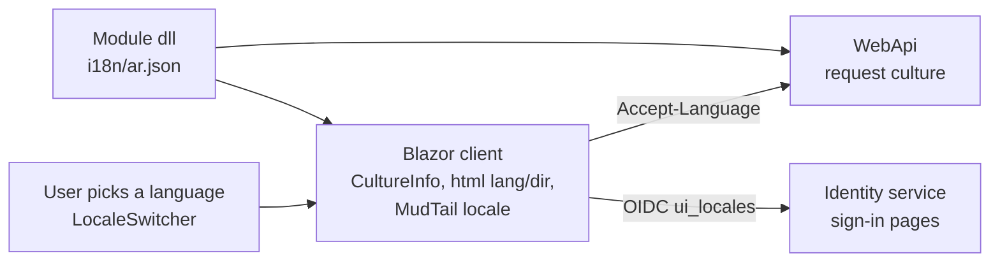

The platform is in **Arabic by default**, written right to left, and in **English**. The Blazor client, its layouts and
modules, the WebApi's messages and the identity service's sign-in pages all follow the language the user picks. Content
(a post's text) is translated separately, as described in [Translating content](#translating-content).



## Texts in code: English keys, embedded JSON

A text is written in English in the code and read through `IStringLocalizer<T>`. The English text is the key:

```razor
@inject IStringLocalizer<Notes> L

<h1>@L["Notes"]</h1>
<button>@L["Save"]</button>
<p>@L["{0} notes", notes.Count]</p>
```

Each project keeps one file per language in `i18n/`, keyed by the English text:

```json title="src/Module.Notes/i18n/ar.json"
{
  "Notes": "الملاحظات",
  "Save": "حفظ",
  "{0} notes": "{0} ملاحظة"
}
```

- **A missing translation shows the English text**, never a raw key. An `en.json` is only needed to reword the English.
- **The files are embedded in the assembly** as `i18n/{culture}.json`. The Module SDK does this for every layer, client
  and server; in the platform repo, `modules/client/Directory.Build.targets` does it for the shipped client modules.
- **Why not `.resx`:** resources go to satellite assemblies (`ar/x.resources.dll`), but a module is one uploaded
  assembly in its own, unloadable load context. Embedded JSON travels inside the module, works in any pool and in the
  browser, and no module reads another module's texts.
- **Lookup order** for `L["Save"]` in assembly A, culture `ar-EG`: A's `ar-EG`, A's `ar`, then the shared texts
  (`ModularBlazor.Abstractions`: Save, Cancel, ...) in `ar-EG` and `ar`, then the key itself.

The factory is `EmbeddedJsonStringLocalizerFactory` in `Share.All`, the same on the client and on the server. It keeps
parsed texts in a weak table, so a module's load context can still unload.

## The Blazor client

| Piece | What it does |
| --- | --- |
| `ILocaleService` (`ModularBlazor.Abstractions.Localization`) | The current culture, whether it is right to left, the languages offered, `SetCultureAsync`, and a `Changed` event |
| `LocaleSwitcher` | The language menu. The layouts and the sign-in page show it |
| Configuration | `wwwroot/appsettings.json`: `"Localization": { "DefaultCulture": "ar", "Cultures": ["ar", "en"] }` |
| The choice | Kept in the browser (`localStorage`, `mb.culture`). `index.html` applies it to `<html lang dir>` before Blazor starts, so the first paint already has the right direction |

Switching sets `CultureInfo` (texts, dates, numbers), `<html lang dir>`, MudTail's locale and the `Accept-Language` of
every API call, then renders the whole app again: components only need to read their texts with `L[...]`. Write CSS
with logical properties (`margin-inline-start`, `padding-inline`, `inset-inline-end`), never left and right, so one
stylesheet works in both directions.

**Menu titles** are translated too. On upload, the client-modules catalog reads the titles of a module's menu entries
from its `i18n/*.json` (metadata only, no code runs) and stores them with the entry (`Titles`), so the menu is in the
user's language before the module is downloaded.

## The WebApi

Every request runs in the caller's culture, found in this order: `?culture=ar`, then `Accept-Language`. It must be one
of `Localization:Cultures` (default `ar`, `en`); otherwise `Localization:DefaultCulture` (default `ar`) applies. The
response says which one in `Content-Language`. There is no culture cookie: the WebApi is called with a bearer token.

A runtime module injects `IStringLocalizer<T>` for its own types. Its messages (validation, problem details) come out
in the caller's language, from the module's own `i18n/*.json`.

## The identity service

The sign-in, tenant choice, sign-out and invitation pages are in Arabic by default. They follow the app: the client
sends its language as the OIDC `ui_locales` parameter, and every page has `?culture=` language links. A choice is kept
in the culture cookie.

## Translating content

The texts above are the application's. A post's own text is translated per post, as an overlay on its document:

- **DynamicFields** defines the format. A translation is, per node id (`$root` for the root) and content key, the
  translated text and a hash of the source text it was made from. `POST /api/dynamicfields/content/translations/check`
  lists what is translatable and what is current, stale or missing; `.../apply` returns the tree in the reader's
  language (the culture's overlay, then its parents', then the source).
- **Contents** keeps one overlay per language beside each post (`PUT` / `DELETE
  /api/content/posts/{id}/translations/{language}`, for whoever may edit the post). Publishing takes the translations
  with the document. `GET /api/content/public/{publicId}?culture=ar` merges the culture's translation over the
  published document.
- The post page has a **Translations** section that opens DynamicFields' translate dialog when that module is installed.

## Adding a language to a module

1. Add `i18n/{culture}.json` to each project that has texts (pages, menu titles, use-case messages).
2. Build. The SDK embeds the files; nothing else changes.
3. To offer a new language in the app, add it to `Localization:Cultures` in the client's `appsettings.json`, the
   WebApi's and the identity service's configuration.
