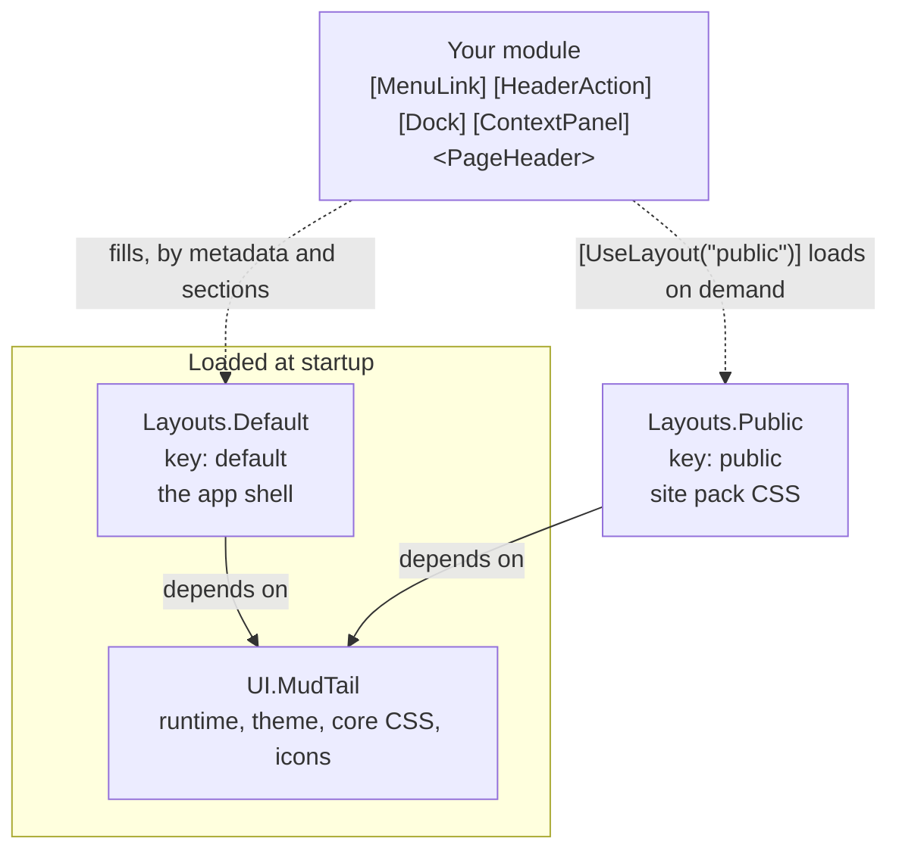

A page in the client is drawn by a **layout**, a `LayoutComponentBase` in a client module. Layouts are modules like
any other: they are uploaded to the catalog, can be swapped, and the host loads the one a page asks for. Modules never
reference a layout. They fill its places through metadata (menus, header actions, docks, context panels) and through
Blazor sections (the page's title, breadcrumbs and buttons), so the same module works under any layout.



## The three modules

| Module | Loads | Holds |
| --- | --- | --- |
| **UI.MudTail** | at startup, hidden | The one MudTail runtime (`js/module.js`), its theme, the core stylesheet (`css/mudtail.min.css`) and the icon sprite. Every layout and module shares it. |
| **Layouts.Default** | at startup, hidden | Layout key `default`: the signed-in application's shell. Its own CSS (`css/main.min.css`) only. |
| **Layouts.Public** | on demand, hidden | Layout key `public`: the public site (masthead, mega-nav, footer) and MudTail's site pack (`css/site.min.css`: editorial, sport, gallery). |

Swapping a layout keeps the runtime: the theme, the toasts and every component a module created stay as they are.

### Using MudTail from a module

Inject `MudTailRuntime` (ModularBlazor.Abstractions) rather than importing a script of your own:

```csharp
@inject MudTailRuntime MudTail

await MudTail.ToastAsync(L["Saved"], "success");

if (await MudTail.GetAsync() is { } mud)                // null when UI.MudTail failed to load
{
    _tabs = await mud.InvokeAsync<IJSObjectReference>("create", "tabs", host, options, DotNetObjectReference.Create(this));
}
```

`GetAsync()` returns the object `moduleHost.get('UI.MudTail')` hands out, with MudTail's whole Blazor interop (see
`src/MudTail/README.md`) plus a few shell helpers: `iconNames()`, `addIcons(...)`, `mode()` / `setMode(...)` and
`watchMedia(queries, dotNetRef)`.

**Code loaded on first use.** The four largest components, `dock`, `tree`, `image-editor` and `explorer`, are not in
`module.js`. `create('tree', …)` imports the component and its stylesheet the first time; `InvokeAsync` waits for it as
usual. `load('explorer')` imports one ahead of time. Everything else, the data table included, is there from the start.

### Icons

The shell draws Lucide icons from a sprite UI.MudTail puts at the top of `<body>`. The `Icon` of a menu entry, header
action, dock or context panel is a name from it (`users`, `bell`, `messages-square`, …). A module that needs another
icon adds it:

```csharp
await mud.InvokeVoidAsync("addIcons", new Dictionary<string, string> { ["rocket"] = "<path d=\"…\"/>" });
```

An unknown name falls back to the entry's first letter.

## Picking a layout

A layout registers itself under a key; a page or module asks for one:

```razor title="Layouts.Public/PublicLayout.razor"
@inherits LayoutComponentBase
@attribute [LayoutKey("public")]
```

```razor title="A page of your module"
@page "/news/{Slug}"
@attribute [UseLayout("public")]     @* "none" renders the page with no layout *@
```

```csharp title="Or all of a module's pages"
[assembly: ClientModule(Name = "News", Layout = "public")]
```

The page's own `[UseLayout]` wins, then the module's `Layout`, then `default` (also used for a key no module
provides). A Blazor `[Layout(typeof(...))]` on the page still overrides all of them. The catalog records which keys each
module provides (`ProvidesLayouts`), so when a page asks for a key no loaded module has, the host loads the module that
provides it first and only then renders the page. That is how Layouts.Public stays out of an admin-only tenant's
download.

`[LayoutInfo]` next to `[LayoutKey]` says what a layout offers (its role, sections, menu zones and contribution kinds).
It is optional metadata the catalog reads on upload; the roles are in `LayoutRoles` (`app`, `admin`, `public`,
`auth`, `blank`).

## The page's own header

A page fills the layout's title, breadcrumbs and action buttons with `<PageHeader>`:

```razor
<PageHeader Title="@L["Posts"]">
  <Breadcrumbs><a href="content">@L["Content"]</a></Breadcrumbs>
  <Actions><button class="mud-btn mud-btn--primary" @onclick="New">@L["New post"]</button></Actions>
</PageHeader>
```

The title is also the browser tab's title. Under the hood these are Blazor sections, named in `LayoutSections`:

| Section | Default layout shows it |
| --- | --- |
| `LayoutSections.Title` | in the top bar |
| `LayoutSections.Breadcrumbs` | above the title |
| `LayoutSections.PageActions` | at the end of the top bar |
| `LayoutSections.ContextPanel` | first in the context panel, before the modules' tabs |

Fill one directly with `<SectionContent SectionName="@LayoutSections.ContextPanel">…</SectionContent>`. A layout without
an outlet for a section just leaves it out, and the content goes with the page.

## What modules add to the shell

Besides menu links ([Menus](/guides/menus/)), a module can add three kinds of components to the layout, declared as
assembly attributes. Like menu entries, the catalog reads them from the module's metadata on upload, so the layout
knows the entry (its title, icon and badge) **before the module is downloaded**, and the entry goes when the module
leaves the user's catalog.

```csharp title="Module.Chat/AssemblyInfo.cs"
[assembly: HeaderAction("bell", "Notifications", typeof(NotificationBell), Icon = "bell", Order = 10)]
[assembly: Dock("chat", "Chat", typeof(ChatDock), Icon = "messages-square", Badge = "api/chat/unread")]
[assembly: ContextPanel("comments", "Comments", typeof(PostComments), Icon = "message-circle",
    ForContext = new[] { "content.post" }, Permissions = new[] { "content.comments.read" })]
```

| Attribute | Where it shows | When its module loads |
| --- | --- | --- |
| `HeaderAction` | A small component in the top bar, before the user menu | It renders once the module is loaded, so such a module usually loads with the Preload strategy |
| `Dock` | A tab in the footer dock bar; the panel stays open across pages, and can be pinned | When the dock is first opened |
| `ContextPanel` | A tab in the panel beside the page, for some routes or for what the page has selected | When the tab is first opened |

Common properties: `Icon`, `Order` (lower first, default 100), `Permissions` (the user needs any one; none: everyone
who gets the module). `Dock` and `ContextPanel` take `Badge` and `BadgeRefresh` like a menu link. Titles are English
and translated from the module's `i18n/*.json`, as menu titles are.

The component may take the context the layout hands it:

```razor
@code {
  [Parameter] public ContributionContext? Context { get; set; }
  // Context.ContributionId = "Module.Chat:comments"; for a context panel, ContextKey / ContextValue
}
```

Each one renders inside an error boundary: a failing contribution shows as unavailable and leaves the shell working.

### Context panels and the page context

A context panel lets a module add to another module's pages without referencing it. It shows when its route matches
(`ForRoutes`: `"content/posts/*"` is one segment, `"content/**"` everything under it) or when the page has set one of
its context keys (`ForContext`). The page owns the keys and declares them as constants (`"{module}.{entity}"`):

```csharp
@inject IPageContext PageContext

void Select(Post post) => PageContext.Set(ContentContext.Post, post.Id.ToString());   // a row was selected
void Unselect() => PageContext.Clear(ContentContext.Post);
```

The panel is then opened for that key and value (`Context.ContextKey`, `Context.ContextValue`); it is recreated when
the value changes. Everything in the page context is cleared on navigation.

A layout reads the entries from `IShellContributions` (`Of(ShellContributionKinds.Dock)`, `ResolveAsync(entry)` to load
the module and get the component type). Modules never call it; they only declare.

A fourth kind, `[DockPanel]`, adds a pane to another module's studio rather than to the layout; layouts don't show it.
See [Studio panels](/guides/studio-panels/).

## Branding

Each tenant has a brand: name, short name, logos for light and dark backgrounds, favicon, primary and secondary
colours, corner radius, font, the default colour mode, the modes users may pick, and whether users may change the
colours. Layouts read it from `IBranding.Current` (a `BrandInfo`) and re-render on its `Changed` event:

```razor
@inject IBranding Branding

<a class="brand" href="">@Branding.Current.DisplayShortName</a>
```

The **branding** core module of the WebApi keeps it in two layers, the platform's and each tenant's on top, like the
menus:

| Endpoint | Who | Does |
| --- | --- | --- |
| `GET /api/branding` | anyone (the sign-in page is branded too) | The request's tenant's effective brand |
| `GET /api/branding/assets/{folder}/{name}` | anyone | A brand image, cached for good |
| `GET`, `PUT /api/branding/admin` | `branding.manage` in the tenant, or `platform.modules.manage` | One layer, to edit; the save carries the version it read |
| `POST /api/branding/admin/assets/{kind}` | the same | Uploads `logo`, `logo-dark` or `favicon` (.png, .jpg, .webp, .svg, .ico; at most 512 KB) |

The host page keeps the last brand it received in the browser and applies its colours and mode before Blazor starts,
so a returning visitor's first paint is already branded. A user's own choice of mode (and, when the brand allows it,
colours) is kept in the browser too and wins over the brand.

## Permissions

`Permissions` on `MenuLink`, `MenuGroup` and the three contribution attributes hides what the user cannot use. The
WebApi filters the module manifest by the caller's grants, so the client never receives an entry the user may not see,
and the manifest's ETag changes when a grant does.

For a page's own buttons, inject `IUserPermissions`:

```razor
@inject IUserPermissions Permissions

@if (Permissions.Has("content.posts.publish"))
{
  <button @onclick="Publish">@L["Publish"]</button>
}
```

It reads the user's grants from the identity module (`GET api/identity/me`); `IsLoaded` is false until then, and while
signed out, so treat everything as not granted. It only shapes the UI: the API checks every call itself.

## The Default layout

Layouts.Default 2.0 is the shell of the signed-in app:

- **Navigation drawer** with the `main` and `secondary` menu zones. Below 1024 px it is an overlay; from 1024 to
  1279 px it starts as an icon rail, with flyouts for groups; from 1280 px it is expanded unless the user minimised it.
- **Top bar:** menu toggle, breadcrumbs and title, the page's actions, the modules' header actions, the context-panel
  toggle, the theme button and the user menu (the `user` zone).
- **Context panel** at the inline end: inline from 1280 px, a sheet over the page below.
- **Dock bar** at the bottom, with a tab per dock; one dock can be pinned open.
- **Theme drawer:** colour mode, palette, corners, density (comfortable or compact) and digits (Latin or Arabic-Indic),
  within what the brand allows.

Everything uses inline-start and inline-end, so the shell mirrors in Arabic. The drawer mode, open groups, pinned dock
and density are saved per browser.

## The Public layout

Layouts.Public draws a news-site page from MudTail's `mud-site` classes: masthead with the brand's logo, a mega-nav,
reading progress, and a footer. The mega-nav's sections come from the **`public`** menu zone (falling back to `main`
when no module fills it): a `MenuGroup` is a section, its links the section's panel, and a group inside it a column of
the panel. Its behaviours (`mega-nav`, `reading-progress`, `theme-toggle`) come from UI.MudTail's `data-mud`
attributes, so the layout has no script of its own.

## Assets

A module's `wwwroot` is embedded in its DLL. On upload the WebApi extracts it and serves each file from its own URL,
`api/client-modules/files/{id}/{version}/{token}/{path}`, where the token changes with the content (so the files can be
cached for good) and scripts come with an integrity hash the browser checks. A script's relative imports (`./chunks/…`)
resolve against that URL.

When the catalog has no served copy of a file (for example a package uploaded before the files were extracted), the
host hands the code to the browser from the package it downloaded, in memory. A script's chunks are linked from memory
as well, so code-split modules such as UI.MudTail still work; MudTail's component stylesheets are not loaded in that
mode.
