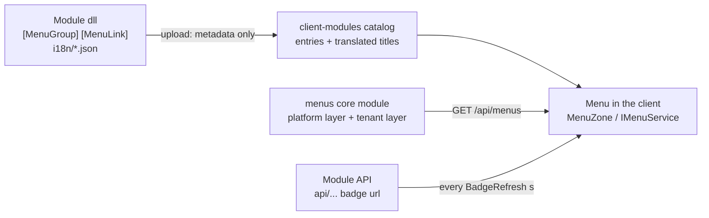

The client has three menus, called **zones**: `main`, `secondary` and `user`. A client module puts links and groups
(submenus) in them with assembly attributes. The catalog reads them from the module's metadata on upload, as it reads
`[ClientModule]`, so the entries are in the menu before the module is downloaded. Administrators then change the
menus on the client's **Menus** page, kept by the WebApi's `menus` core module.



## Declaring entries

```csharp title="Module.Admin/AssemblyInfo.cs"
[assembly: MenuGroup("admin", "Administration", Href = "admin", Zone = "secondary", Order = 90)]
[assembly: MenuLink("members", "Members", "admin/members", Parent = "admin", Order = 20)]
```

Another module joins that group by its full id, `{moduleId}:{id}`:

```csharp title="Module.Tenants/AssemblyInfo.cs"
[assembly: MenuLink("tenants", "Tenants", "tenants", Zone = "secondary", Parent = "Module.Admin:admin", Order = 10)]
```

| Property | `MenuGroup` | `MenuLink` | Meaning |
| --- | --- | --- | --- |
| `id` | yes | yes | Unique in the module; the full id is `{moduleId}:{id}` |
| `title` | yes | yes | English; translated from the module's `i18n/*.json` |
| `href` | `Href`, optional | yes | One of the module's own pages (under its route prefixes) |
| `Zone` | yes | yes | `main` (default), `secondary` or `user` |
| `Parent` | yes | yes | A group's id in this module, or `{moduleId}:{id}` in another |
| `Icon`, `Order` | yes | yes | `Order` sorts within the parent (default 100) |
| `Badge`, `BadgeRefresh` | yes | yes | See [Badges](#badges) |

Rules:

- **Links stay inside the module.** The upload warns about and leaves out a link to anything else (an external
  address, another module's page). Administrators can add those on the Menus page.
- **The entries follow the module.** They leave the menu when the module leaves the user's catalog: deactivated,
  deleted, no longer for their roles or tenant.
- **Placement.** A child shows in its parent's zone. If the parent's module is not there, the child goes to the top
  of its own zone. A group with nothing in it and no `Href` is hidden.
- **Old modules.** A module without menu attributes keeps its `NavTitle` entry, as a link in `main`.
- **Titles** are English in code and translated at upload from the module's `i18n/{culture}.json` (see
  [Languages](/guides/i18n/)).

## Showing a zone in a layout

```razor
<MenuZone Zone="@MenuZones.Main" />
<MenuZone Zone="@MenuZones.Secondary" />
```

A layout that draws its own menu reads the tree from `IMenuService.Zone(MenuZones.User)` and re-renders on its
change event.

## The Menus page

Administrators change the menus on `/menus`. The `menus` core module (version 1.0.0) keeps the changes:

| Endpoint | Who | Does |
| --- | --- | --- |
| `GET /api/menus` | anyone | The changes that apply to the caller's tenant, with an ETag (304 when unchanged) |
| `GET /api/menus/admin` | `menus.manage` in the tenant, or `platform.modules.manage` | One layer, to edit |
| `PUT /api/menus/admin` | the same | Saves a layer. The save carries the version it read; 409 when someone saved meanwhile |

There are two layers: the **platform's** (every tenant; platform admins, without a tenant) and **each tenant's** on top
of it (the tenant's `menus.manage` permission, or a platform admin naming the tenant). In a layer an administrator can:

- **Change any entry by its id:** hide it, rename it per language, move it to another zone or group, reorder it.
- **Add links and groups of their own,** to pages of the app or to external `http(s)` addresses (opened in a new tab),
  for everyone, signed-in users or visitors only. Added entries are known as `@platform:{id}` and `@tenant:{id}`.

The module never reads the modules' entries. It stores changes by id and the client applies them, so an entry whose
module leaves the catalog simply has nothing to change.

## Badges

An entry can show a badge (a count, "new") from the module's own API:

```csharp
[assembly: MenuLink("tenants", "Tenants", "tenants", Zone = "secondary", Parent = "Module.Admin:admin",
    Badge = "api/tenancy/subscriptions/attention", BadgeRefresh = 300)]
```

- The client asks the url (relative to the WebApi; it must start with `api/`) with the user's token when the entry is
  in the menu, then every `BadgeRefresh` seconds (15 to 3600; default 60). Entries with the same url share one request.
- **The answer** is a number, an array (its length), or an object:

  ```json
  { "count": 3, "tone": "warning", "label": "3 subscriptions need attention" }
  ```

  `text` (up to 12 characters) can replace `count`. The tones are `neutral`, `info`, `success`, `warning` and `error`.
- 0, an empty array or 204 shows no badge. An error (403, 404) shows none and is asked again after ten minutes.
- A loaded module's code injects `IMenuBadges`: `RefreshAsync(entryId)` after it changed what is counted,
  `Set(entryId, badge)` for an entry without a url.
- Layouts style `.menu-badge` and `.menu-badge--{tone}`.

The Tenancy module's `GET /api/tenancy/subscriptions/attention` is the example behind the Tenants badge.
