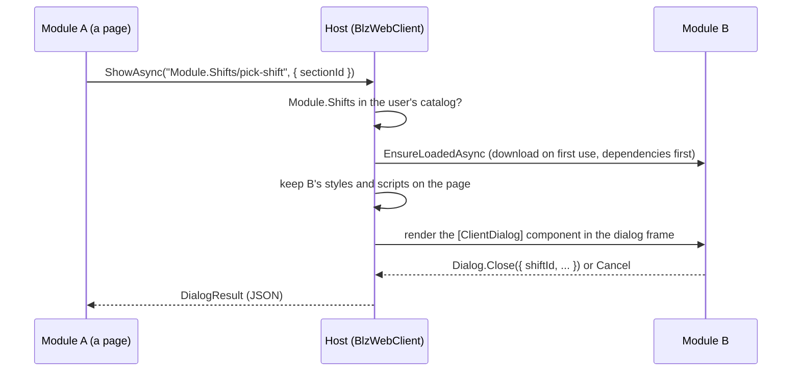

Client modules are built and installed separately, so one never references another. A module can still open a
dialog that another module provides: it asks the host by **dialog id**. The host loads the owning module, shows the
dialog in MudTail's dialog frame and returns the result to the caller.



Everything runs in the browser, in one .NET runtime: there is no server round trip, broker or SignalR hub. When the
server or another user needs to ask a user something, deliver that event to the client (SignalR) and show the dialog
through the same service.

## Provide a dialog (module B)

Put `[ClientDialog]` on a component. Its id is `"{module id}/{name}"` and must start with the module's own catalog id
(the host ignores, with a console message, an id under another module's id).

```razor title="Module.Shifts/Dialogs/PickShiftDialog.razor"
@attribute [ClientDialog("Module.Shifts/pick-shift", Title = "Pick a shift")]

@*
  Contract, for other modules:
    parameters  { sectionId?: number }
    result      { shiftId, section, startsAt }
*@

<div class="mud-dialog-content">
  …the module's own UI, calling its own API…
</div>
<div class="mud-dialog-actions">
  <button type="button" class="mud-button-root mud-button-text mud-button-medium" @onclick="Dialog.Cancel">Cancel</button>
  <button type="button" class="mud-button-root mud-button-filled mud-button-primary mud-button-medium"
          @onclick="() => Dialog.Close(new { shiftId = _id, section = _section, startsAt = _startsAt })">Choose</button>
</div>

@code {
  [CascadingParameter] public IDialogReference Dialog { get; set; } = default!;

  private sealed record Parameters(int? SectionId);

  protected override async Task OnAfterRenderAsync(bool firstRender)
  {
    if (!firstRender) return;
    var sectionId = Dialog.GetParameters<Parameters>()?.SectionId;
    …
  }
}
```

The host draws the frame: overlay, title bar, close button. The component draws the body and its buttons, usually a
`div.mud-dialog-content` and a `div.mud-dialog-actions`, and ends the dialog through the cascading
`IDialogReference`:

| Member | What it does |
| --- | --- |
| `Close(object? data)` | Closes the dialog with a result; the caller receives `data` as JSON |
| `Cancel()` | Closes it without a result |
| `GetParameters<T>()` | The caller's parameters in the dialog's own type |
| `Parameters` | The same, as a `JsonElement` |

The dialog is an ordinary component of its module: it injects services (`IHttpClientFactory`, `MudTailRuntime`, ...)
and uses the module's own styles, which stay on the page while the dialog is open, whichever page opened it.

## Open a dialog (module A)

Inject `IModuleDialogs` and await the result. Module A declares no dependency on module B and references none of its
types; it reads the result into a record of its own.

```razor
@inject IModuleDialogs Dialogs

@code {
  private sealed record PickedShift(int ShiftId, string Section, DateTimeOffset StartsAt);

  private async Task PickAsync()
  {
    var result = await Dialogs.ShowAsync("Module.Shifts/pick-shift", new { sectionId = 3 },
        new DialogOptions { Title = "Pick a sports shift" });
    if (result.Canceled) return;
    var picked = result.As<PickedShift>();
  }
}
```

| | |
| --- | --- |
| `ShowAsync(id, parameters?, options?, cancellationToken?)` | Completes when the dialog closes. Parameters and the result travel as web JSON (camelCase, case-insensitive) |
| `DialogResult.Canceled` | True after ✕, Escape, an overlay click, `Cancel()`, a navigation away from the page, or the cancellation token |
| `DialogResult.As<T>()` / `Data` | The result in the caller's type, or as a `JsonElement` |
| `DialogOptions` | `Title`, `MaxWidth` (a CSS length), `CloseOnOverlayClick`, `CloseOnEscape`; unset values come from `[ClientDialog]` |
| `IsAvailable(id)` | Whether the owning module is in the user's catalog, to hide a button that cannot work. Nothing is downloaded |
| `ModuleDialogException` | Unknown id, a module the user may not use, a module that failed to load, or a module without that dialog |

A dialog may open another one: they stack, the newest on top, and only the top one takes clicks.

## The contract

The dialog id and the two JSON shapes are the contract between the modules, like an HTTP route and its bodies. Write
them down next to the component (as above), keep them backward compatible, and give a changed contract a new id
(`Module.Shifts/pick-shift-v2`) while callers move over. Nothing checks a contract at compile time: test the
call in a playground that installs both modules.

Access follows the catalog. The user's catalog only holds the modules their roles and tenant allow, so a dialog of a
module the user may not use fails with `ModuleDialogException` (check `IsAvailable` first). What the dialog may read or
change is still decided by its module's API, as for its pages.

## How the host does it

- `ModuleManager` registers each loaded module's `[ClientDialog]` components, the way it registers `[LayoutKey]`
  layouts, and drops them when the module is unloaded.
- `ModuleDialogService` (`IModuleDialogs`) checks the catalog, calls `EnsureLoadedAsync` for the owning module (its
  dependencies first, as for a page), and holds the module in `ActiveModuleService` while the dialog is open, so its
  styles and scripts apply on another module's page.
- `Components/ModuleDialogHost.razor`, rendered once in `App.razor` outside the Router, shows the open dialogs in
  MudTail's `mud-dialog-*` frame. Each dialog sits in an `ErrorBoundary`, so a failing dialog shows its error instead of
  breaking the page. Focus moves into a dialog when it opens.
