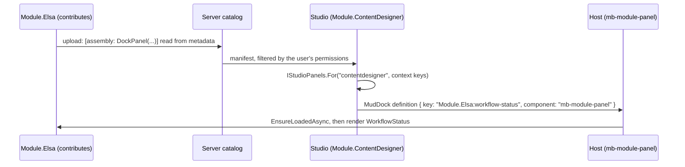

A **studio** is a module's full workspace built on MudTail's MudDock: the Content Designer, say, with its Explorer,
Designer canvas, Properties and Problems panes. Other modules add panes to it without referencing it: the Elsa module
adds a Workflow status panel to the Content Designer, a newsroom module adds a wire feed. Each pane is a component of
its own module, which is downloaded only when the pane is first shown.



## Contribute a panel

Declare it as an assembly attribute, like the [shell contributions](/guides/layouts/#what-modules-add-to-the-shell):

```csharp title="Module.Elsa/AssemblyInfo.cs"
[assembly: DockPanel("workflow-status", "Workflow", typeof(WorkflowStatusPanel),
    ForStudio = "contentdesigner",             // the studio's key, a constant the studio module publishes
    ForContext = new[] { "content.post" },     // only while the studio shows a post
    Area = DockPanelAreas.Right,               // left, right (default) or bottom
    Icon = "workflow", Order = 50,
    Permissions = new[] { "elsa.workflows.read" })]
```

| Property | Meaning |
| --- | --- |
| `ForStudio` | Required. The studio's key, lower case (`"contentdesigner"`). A panel without one is left out with a warning |
| `ForContext` | Context keys (`"{module}.{entity}"`). The studio lists the panel only while its current item has one of them. None: always |
| `Area` | Where a tool pane goes first: `left`, `right` or `bottom`. The user may move it; the studio keeps the arrangement |
| `Document` | `true`: it opens as a document tab in the centre (one per item: an editor, a preview, an Elsa Studio iframe), not as a tool pane |
| `Icon`, `Order`, `Permissions` | As for every contribution: Lucide icon, lower first, any one of the permissions |

The catalog reads the attribute from the module's metadata when it is uploaded, so the studio lists the pane before the
module is downloaded. The server leaves out the panels whose permissions the user holds none of, as it does for menu
entries. Titles are English and translated from the module's `i18n/*.json`.

The component is an ordinary component of its module. It may take these parameters, and gets only those it declares:

```razor title="Module.Elsa/Panels/WorkflowStatusPanel.razor"
@inject IModuleDialogs Dialogs

@code {
  [Parameter] public ContributionContext? Context { get; set; } // ContextKey "content.post", ContextValue the post id
  [Parameter] public string PanelId { get; set; } = "";         // MudDock's panel instance id
  [Parameter] public string Title { get; set; } = "";

  [CascadingParameter] public Task<AuthenticationState>? Auth { get; set; }
  [CascadingParameter(Name = "Culture")] public string? Culture { get; set; }
}
```

It runs like a page: the sign-in state and the `Culture` cascade are there, `lang` and `dir` follow the language, and
the app's services work from inside it (`IModuleDialogs`, `IPageContext`, `IStringLocalizer<T>`). Its module's styles and
scripts stay on the page while the panel is mounted. It renders in an error boundary: a failing panel shows its error
and a **Try again** button, and the studio keeps working.

## Host the panels (the studio)

The studio asks `IStudioPanels` for its panels and gives MudDock one definition per panel, with the host's generic root
component (`StudioPanels.RootComponent`, `"mb-module-panel"`) as the component and **the panel's id as the key**:

```csharp
@inject IStudioPanels Panels
@inject IPageContext PageContext

var contributed = Panels.For(ContentDesignerStudio.Key, PageContext.Values.Keys)
  .Select(p => new
  {
    key = p.Id,                            // "Module.Elsa:workflow-status"
    title = p.LocalTitle,
    icon = p.Icon,
    document = p.Document,
    allowMultiple = p.Document,
    component = StudioPanels.RootComponent // "mb-module-panel"
  });

_dock = await mud.InvokeAsync<IJSObjectReference>("create", "dock", host, new
{
  storageKey = "contentdesigner.layout",
  definitions = ownPanels.Concat<object>(contributed).ToArray(),
}, DotNetObjectReference.Create(this));

Panels.Changed += Rebuild;                 // sign-in, sign-out, a module installed or unloaded
```

Place a new tool pane with `addPanel(key, groupId, zone)` in the zone its `Area` names. The studio sets what it shows in
the page context (`PageContext.Set(ContentContext.Post, postId)`); each mounted panel picks the first of its `ForContext`
keys that is set and re-renders when the value changes.

| `IStudioPanels` | |
| --- | --- |
| `For(studio, contextKeys?)` | The studio's panels in order (`Order`, module id, id). With context keys: only those whose `ForContext` is empty or holds one |
| `Find(id)` | One panel by its id, or null when the user's catalog has no such panel |
| `Changed` | The list may have changed |

`ShellContribution.IsForStudio(studio, keys)` is the same test, for a studio that filters a list itself.

## How the host does it

MudDock mounts each pane as a Blazor [JS root component](https://learn.microsoft.com/aspnet/core/blazor/components/js-spa-frameworks#render-razor-components-from-javascript),
and root components must be registered in `Program.cs` before the app starts, which a lazily loaded module cannot do.
So BlzWebClient registers one, `Components/ModulePanelHost.razor`, as `mb-module-panel`:

- It reads the panel id from its `PanelKey` (MudDock passes `panelId`, `panelKey` and `title`), or from a `Contribution`
  parameter when mounted without MudDock (`Blazor.rootComponents.add(el, "mb-module-panel", { contribution: id })`).
  `ContextKey` / `ContextValue` parameters override the page context.
- It finds the panel in `IStudioPanels`, loads its module through `IShellContributions.ResolveAsync` and renders the
  component with `DynamicComponent`, inside an `ErrorBoundary` and the `Culture` cascade.
- A JS root component shares the app's renderer and DI scope in WebAssembly, so scoped services are the app's own; the
  dialogs a panel opens show in `ModuleDialogHost` like any other.
- **Collectible unload:** nothing keeps a module type statically. The contribution is strings (the component's full
  name); the panel holds the resolved `Type` only while its module is loaded. When `ModuleManager` unloads or replaces
  the module, the panel drops the type and re-renders without it, and picks up the new type when the module is loaded
  again (a development reload, say). A panel that leaves the user's catalog shows as not available.
