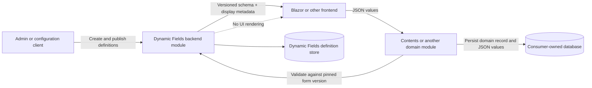

Dynamic Fields is an optional **backend schema and validation module**. It lets authorized users define nested fields, compose new fields and forms from reusable definitions, validate JSON data, and import/export portable JSON packages.

It has **no representation layer**: it does not render HTML, Blazor components, controls, CSS, or form pages. It returns a stable schema plus display metadata. A frontend or consuming module decides how to render that schema. Server-side validation remains authoritative regardless of client.

## Recommendation

Use [JSON Schema Draft 2020-12](https://json-schema.org/specification) as the data-validation language, wrapped in a platform-owned versioned JSON package that carries form identity and display metadata. Reuse components through pinned, tenant-local versions and compile them into a self-contained schema at publish/export time. Avoid a proprietary tree-only validator and avoid arbitrary remote `$ref` resolution. JSON Schema supports modular schemas through `$defs` and `$ref`; the platform should constrain those features for safe, reproducible forms. [JSON Schema composition](https://json-schema.org/understanding-json-schema/structuring)

| Dynamic Fields owns | Consumer owns | Frontend owns |
| --- | --- | --- |
| Field/component definitions, form schema versions, schema composition, publishing, import/export, and validation results | Domain records, domain lifecycle, persistence of submitted values, and policy for when values are required | UI components, layout/rendering, client-side convenience validation, accessibility, and interaction design |

Dynamic Fields can be disabled or absent in an ERP deployment. A module may use only its static domain fields, or declare an optional capability dependency when it needs dynamic values. In the newsroom profile, published forms will define the `content` of a Post document and of each nested node (article/news, video, document, image, album and mixed posts). Contents already stores that document with a `schemaId`/`schemaVersion` per node, which is the form key/version pair here. Contents still owns the Post envelope, submitted payload values, revisions, authorization, and editorial lifecycle; Dynamic Fields owns only reusable form definitions, immutable schema versions, and validation. The module now exists (see [Status](#status)), and Contents uses it: its **post kinds are root post field keys**, it validates contents before review and posts before approve, schedule and publish, and it uses DynamicFields for [translations](/modules/contents/#translations). See [Post document](/modules/contents/posts/#post-document-implemented).

:::note[Content versus style]
A Post node carries separate `content` and `style` objects. Dynamic Fields validates `content` only. `style` holds responsive presentation values that Contents keeps as opaque JSON. This does not conflict with the rule that form `presentation` metadata never contains CSS or component names: `style` is Post data, not part of a form definition. Whether `style` gets its own schema (for example a theme-token allowlist) is still an open decision.
:::

## Suggested page structure

- [Definition model and nested field types](/modules/dynamic-fields/definition-model/) covers the authoring model, reusable components, and stable field identity.
- [Conditional visibility](/modules/dynamic-fields/conditional-visibility/) covers fields shown or required based on other values or trusted record/form state.
- [Composition, validation, and safety rules](/modules/dynamic-fields/composition-validation/) covers reference pinning, nesting limits, validation semantics, and security.
- [JSON package, APIs, and module integration](/modules/dynamic-fields/json-and-integration/) covers import/export, lifecycle, permissions, and consuming-module patterns.

## Module boundary diagram

## Status

> **Implemented** in the repository
> [`ModularBlazor.Module.DynamicFields`](https://github.com/soft-square-net/ModularBlazor.Module.DynamicFields)
> (branch `master`), in the [Clean Architecture layers](/backend/module-template-clean-architecture/), with a client
> module in Arabic and English. It took a simpler shape than the strategy pages below, which stay as the design
> background: export/import packages and conditional visibility are not built.

The module's id, route prefix and database schema are `dynamicfields`; its permissions are `dynamicfields.read` and
`dynamicfields.manage`.

**A field** is one kind of content (a news post, a paragraph, an image, an album) as one schema.org type, with:

- its **values**: key, label, kind (Text, RichText, Integer, Decimal, Boolean, Date, DateTime, Url, Choice, Asset,
  Keyword, Term), required, list or single, limits, and the schema.org property it is published as;
- its **style** choices: theme tokens, optionally per breakpoint (`{ "base": "full", "md": "half" }`), never free CSS
  (this settles the open question in the note above);
- the fields it may contain as **children**, with counts. Fields are reusable;
- optionally another client module's **editor dialog** for it.

Publishing a draft freezes it as the next numbered version and pins each child to its newest published version. A post
is a tree of content nodes; each names a field version and holds its `content` and `style`. Contents stores the tree;
this module checks it (at most 500 nodes and 12 levels).

| Route (under `/api/dynamicfields`) | Does |
| --- | --- |
| `GET /fields`, `POST /fields`, `GET /fields/{key}`, `DELETE /fields/{key}` | List, create, read and delete (until published) fields |
| `PUT /fields/{key}/draft`, `POST /fields/{key}/publish` | Edit the draft (with its `version`; 409 when changed); publish the next version |
| `GET /fields/{key}/versions/{number}` | A published version, with its content and style as JSON Schema 2020-12 |
| `POST /content/validate`, `POST /content/validate-node` | Validate a content tree, or one node: `{ valid, issues: [{ path, message }], warnings }`. Only `issues` make content invalid (see [v2](#v2-plan)) |
| `POST /content/translations/check`, `.../apply` | Check a translation overlay; serve the tree in a culture (see [Languages](/guides/i18n/#translating-content)) |
| `GET /catalog/schema-org` | The curated schema.org types and properties, and the style presets |
| `GET /catalog/starter-fields`, `POST .../install` | The starter library (`block.heading`, `block.image`, `post.article`, ...) and installing it |
| `GET /catalog/root-post-fields` | The post kinds: every field whose newest published version is a root, with its `urlPrefix` (`DynamicFields_ListRootPostFields`) |

### Post kinds and URL prefixes

A **root post field** is a post kind. It has a static **URL prefix** (`urlPrefix`, ASCII, may contain `/`, at most
200 characters), required to publish a root and unique among a tenant's published roots (409 otherwise). A non-root
field with a prefix is 409. Published URLs are `/{urlPrefix}/{slug}`. Contents caches the list per tenant; there is no
invalidation event yet.

| Starter kind | schema.org | URL prefix |
| --- | --- | --- |
| `post.article` | Article | `articles` |
| `post.news` | NewsArticle | `news` |
| `post.review` | Review | `reviews` |
| `post.blog` | BlogPosting | `blog` |
| `post.video` | VideoObject | `videos` |
| `post.reportage` | ReportageNewsArticle | `reportage` |
| `post.photo-story` | Article | `photo-stories` |
| `post.other` | Article | `posts` |

A tenant installs the starter fields before these kinds exist. A starter whose prefix is already taken is installed as
a draft. Read prefixes from the catalog route rather than hard-coding them: fields published before the migration
`AddUrlPrefix` got a prefix suggested from their key.

The client module has the **Fields** page (`/dynamicfields`), the **field builder** with a live preview and JSON-LD,
and two dialogs other modules open through [module dialogs](/guides/module-dialogs/):
`Module.DynamicFields/edit-content` (the one generic editor for a node's values and style) and
`Module.DynamicFields/translate-content`. Asset, Keyword and Term values get a Pick button when
`Module.Keywords/pick-concepts` or `Module.Taxonomies/pick-terms` is installed.

The field builder (`/dynamicfields/build`) uses MudTail's theme tokens only (colours, radius, shadows), so it follows
the classic and earth styles, dark mode and RTL (PR #13). It has a sticky header with Save, Publish and Try; a section
bar (What it is · Values · Style · What it can contain · Advanced) with a count per section, ✓ when done and ! when
something needs attention (a value without a label or schema.org property, a child field not published); Builder and
JSON as a segmented control; and values as cards. It was not checked in a browser yet.

## v2 plan

Agreed on 2026-11-28. Only phase 0 is built.

| Phase | Scope | Status |
| --- | --- | --- |
| P0 | One style vocabulary with the Content Designer, and a `warnings` list in the validation report | **Merged** (PR #12, with ContentDesigner PR #11) |
| P1 | A JSON Schema 2020-12 dialect with its own vocabularies, and one engine on the server and in the browser. The C# field model stays the source of truth and compiles to the dialect | Planned |
| P2 | Typed style, a picker dialog for each kind of value (colour and font pickers in the Platform), the Studio using them | Planned |
| P3 | A step-by-step builder (a stepper) on the restyled builder | Planned |
| P4 | Checks in the browser, and checks that produce warnings | Planned |

What P0 changed:

- **`StyleVocabulary`** lists every style token and value that MudTail's `_style-tokens.scss` styles, the same table as
  the Studio's `StyleTokens`. Every preset is tested to stay within it. Presets gained columns 5 and 12 and aspects
  `3-4` and `9-16`; the heading level preset stays `h2`–`h6`, so a heading block cannot add a second `h1`. Published
  field versions do not change. The table still exists in two repositories, each pinned by a test; a single source
  comes with typed style (P2).
- **`ContentReport.warnings`**: advice that never makes content invalid. `valid` and `issues` are unchanged, because
  Content and NewsRoom refuse on any listed issue. No check produces a warning yet.
- **Colours are theme tokens only** for now (no hex or inline CSS), because of the Studio's token rendering, AMP and the
  dark theme.
