:::note[Status: designed, not built yet]
NewsRoom is phase **P4** of the newsroom plan. Its repository
([`ModularBlazor.Module.NewsRoom`](https://github.com/soft-square-net/ModularBlazor.Module.NewsRoom)) was created on
2026-11-28 and holds only a README. The build plan (wave 5: N1 skeleton and proposals, N2 moderation and post
projects, N3 bindings, routing and the read model, N4 the basic client) is approved but not started.
Everything it builds on is merged: [Organization](#what-it-builds-on) units, Shifts v2 (units, roles as data,
templates, check-in grants, the shift clock), and the Contents newsroom core (kinds as DynamicFields root fields,
categories and units, work items, validation guards). This page describes the agreed design. The API names may still
change when it is built.
:::

The **NewsRoom** module owns the editorial *planning* of a story: the **proposal** a member sends, the **moderation**
decision, and the **post project** that follows each approved post from production to publication. It does not own
posts, contents, shifts or units. It drives them through the owning modules' contracts:

- **Organization** owns the unit tree (Org → Sector → Department → Section) and its members.
- **Shifts** owns who is on duty in each unit, and grants their rights between check-in and check-out.
- **Contents** owns posts and contents, their stages and their checks against DynamicFields.
- **DynamicFields** owns the field definitions: the proposal form, and the root post fields that *are* the post kinds.
- **Elsa** runs the workflow bound to each post kind, and a sub-workflow per content kind.

The module's id will be `newsroom`. Shifts and NewsRoom **require** the Organization module.

## The flow

```mermaid
flowchart LR
    Member["Member"] -->|"proposal: title, image, body, suggested categories"| Proposal["Proposal (NewsRoom)"]
    Proposal -->|"submit"| Moderator["Moderator: planning desk or shift role"]
    Moderator -->|"approve: kind + Section, one or more"| Project["PostProject (NewsRoom)"]
    Moderator -->|"cancel or return"| Proposal
    Project -->|"create draft post"| Content["Contents: post + contents"]
    Project -->|"start bound workflow"| Elsa["Elsa: workflow per post kind"]
    Elsa -->|"category check, then set unit"| Content
    Elsa -->|"assign in the running shift"| Shifts["Shifts: who is on duty"]
    Content -->|"stage and validation events"| Elsa
    Elsa -->|"desk review, schedule, publish"| Content
```

1. A **member** (a person linked to an identity, usually an employee) writes a **proposal**: a title, an optional
   image and body, and suggested categories.
2. The **moderator** approves or cancels it, or returns it for changes. On approval they set, for **each post** the
   proposal becomes, the **post kind** and the **Section** that will produce it. One proposal can become several posts.
3. For each post, NewsRoom asks Contents to create the draft post (seeded from the proposal), creates a
   **PostProject**, and starts the Elsa workflow **bound** to that kind and Section.
4. The workflow checks that the post's categories belong to the Section, sets the post's unit, splits the work into
   contents, and assigns each to someone **on shift** in the right unit.
5. Contents check every content against its DynamicFields definition before review, and the whole post before it is
   approved, scheduled or published.

## Pages

- [Proposals and projects](/modules/newsroom/proposals-and-projects/): the two entities, their states, and moderation.
- [Workflows and assignment](/modules/newsroom/workflows-and-assignment/): bindings, routing, the Section categories
  rule, shift assignment, events and live updates.

## What it builds on

| Module | What NewsRoom uses |
| --- | --- |
| Organization | `IUnitDirectory` (units, ancestors, `CategoriesOf`, `MembersOf`), `UnitScopes.For(path)`, `org.*.v1` events. A Section's categories may be `*` (all). |
| Shifts | `Shifts.Contracts` events (`shifts.checked-in.v1`, `checked-out`, `handover`, `ended`, ...), the running shift of a unit and its rota roles. Rights exist only between check-in and check-out. |
| Contents | `Content.Contracts`: `content.post-created.v1`, `work-item-assigned`, `work-item-state-changed`, `validation-failed`, `post-unit-changed`, `post-categories-changed`. Content stages are the work-item states. |
| DynamicFields | The proposal field `proposal.default`, and the published root post fields (`post.article`, `post.news`, `post.video`, ...) with their URL prefixes. |
| Platform | [Integration events](/backend/integration-events/), [live updates](/backend/live-updates/), the work-item contract (`WorkItemRef`, `WorkItemSnapshot`) and grants on unit scopes. |

## Permissions

`newsroom.moderate` is agreed. The other names are proposed and will be fixed when the module is built.

| Permission | Lets you |
| --- | --- |
| `newsroom.propose` | Write and submit proposals |
| `newsroom.moderate` | Approve, cancel or return proposals, and set the kind and Section of each post. Held on a unit scope: either standing (a planning-desk position) or from a shift role (only while checked in). |
| `newsroom.projects` | See and follow post projects in your units |
| `newsroom.manage` | Edit workflow bindings and routing rules |

## What it replaces

When NewsRoom ships, three temporary pieces go away:

- Elsa's `NewsroomAutomationService` poller (today it finds ended shifts through `GET /shifts/ended` and calls the
  Content handover).
- Content's `/automation/*` endpoints.
- Content's shift-based Accept and Assign. The setting `Content:Newsroom:WorkflowOwnsAssignment` (default `false`)
  then becomes `true`, so only the workflow assigns.
