:::note[Status: partly built]
NewsRoom is phase **P4** of the newsroom plan, built in wave 5 in the repository
[`ModularBlazor.Module.NewsRoom`](https://github.com/soft-square-net/ModularBlazor.Module.NewsRoom) (Platform
1.0.0-preview.8).

- **Merged:** N1, the skeleton and proposals (PR #1), and N2, moderation and post projects (PR #2). Proposals, the
  moderator's decision, post projects up to publication and the API the workflow uses all exist. The Elsa side (E1) is
  merged too: an approved project starts a workflow. See [Elsa](/modules/elsa/#wave-5-plan).
- **Planned:** N3, workflow bindings, routing rules, the read model and live topics; N4, the full client. Today the
  client has only a "My proposals" page.
- **Not verified:** no end-to-end run with a live Content, DynamicFields, Organization and identity service. The tests
  fake their APIs, although Elsa's `check-newsroom.ps1` ran one project from approval to a published post against the
  real modules.

[Proposals and projects](/modules/newsroom/proposals-and-projects/) describes what is built. [Workflows and
assignment](/modules/newsroom/workflows-and-assignment/) is still mostly design.
:::

The **NewsRoom** module owns the editorial *planning* of a story: the **proposal** a member sends, the **moderation**
decision, and the **post project** that follows each approved post from production to publication. It does not own
posts, contents, shifts or units. It drives them through the owning modules' contracts:

- **Organization** owns the unit tree (Org → Sector → Department → Section) and its members.
- **Shifts** owns who is on duty in each unit, and grants their rights between check-in and check-out.
- **Contents** owns posts and contents, their stages and their checks against DynamicFields.
- **DynamicFields** owns the field definitions: the proposal form, and the root post fields that *are* the post kinds.
- **Elsa** runs the workflow bound to each post kind, and a sub-workflow per content kind.

The module's id, route prefix and database schema are `newsroom`. Shifts and NewsRoom **require** the Organization
module. It runs on PostgreSQL, SQL Server, MySQL and Oracle, in English and Arabic.

## The flow

```mermaid
flowchart LR
    Member["Member"] -->|"proposal: title, image, body, suggested categories"| Proposal["Proposal (NewsRoom)"]
    Proposal -->|"submit"| Moderator["Moderator: planning desk or shift role"]
    Moderator -->|"approve: kind + Section, one or more"| Project["PostProject (NewsRoom)"]
    Moderator -->|"cancel or return"| Proposal
    Project -->|"create draft post"| Content["Contents: post + contents"]
    Project -->|"start bound workflow"| Elsa["Elsa: workflow per post kind"]
    Elsa -->|"category check, then set unit"| Content
    Elsa -->|"assign in the running shift"| Shifts["Shifts: who is on duty"]
    Content -->|"stage and validation events"| Elsa
    Elsa -->|"desk review, schedule, publish"| Content
```

1. A **member** (a person linked to an identity, usually an employee) writes a **proposal**: a title, an optional
   image and body, and suggested categories.
2. The **moderator** approves or cancels it, or returns it for changes. On approval they set, for **each post** the
   proposal becomes, the **post kind** and the **Section** that will produce it. One proposal can become several posts.
3. For each post, NewsRoom asks Contents to create the draft post (seeded from the proposal), creates a
   **PostProject**, and starts the Elsa workflow **bound** to that kind and Section.
4. The workflow checks that the post's categories belong to the Section, sets the post's unit, splits the work into
   contents, and assigns each to someone **on shift** in the right unit.
5. Contents check every content against its DynamicFields definition before review, and the whole post before it is
   approved, scheduled or published.

## Pages

- [Proposals and projects](/modules/newsroom/proposals-and-projects/): the two entities, their states, and moderation.
- [Workflows and assignment](/modules/newsroom/workflows-and-assignment/): bindings, routing, the Section categories
  rule, shift assignment, events and live updates.

## What it builds on

| Module | What NewsRoom uses |
| --- | --- |
| Organization | `IUnitDirectory` (units, ancestors, `CategoriesOf`, `MembersOf`), `UnitScopes.For(path)`, `org.*.v1` events. A Section's categories may be `*` (all). |
| Shifts | `Shifts.Contracts` events (`shifts.checked-in.v1`, `checked-out`, `handover`, `ended`, ...), the running shift of a unit and its rota roles. Rights exist only between check-in and check-out. |
| Contents | `Content.Contracts`: `content.post-created.v1`, `work-item-assigned`, `work-item-state-changed`, `validation-failed`, `post-unit-changed`, `post-categories-changed`. Content stages are the work-item states. |
| DynamicFields | The proposal field `proposal.default` (each tenant creates it once from `docs/proposal.default.json` in the repository; DynamicFields has no starter for it), and the published root post fields (`post.article`, `post.news`, `post.video`, ...) with their URL prefixes. |
| Platform | [Integration events](/backend/integration-events/), [live updates](/backend/live-updates/), the work-item contract (`WorkItemRef`, `WorkItemSnapshot`) and grants on unit scopes. |

## Permissions

| Permission | Lets you |
| --- | --- |
| `newsroom.propose` | Write and submit proposals. Authors also need `dynamicfields.read`, because NewsRoom checks the form as them. |
| `newsroom.moderate` | Approve, cancel or return proposals, and fix or kill post projects. Held on a unit scope: either standing (a planning-desk position) or from a shift role (only while checked in). The moderator also needs Content's author permission in the post's categories, because Content makes the draft post as them. |
| `newsroom.projects` | Follow post projects on your Section or proposal unit |
| `newsroom.workflow` | The workflow service: read projects and their proposals (never drafts) and report project states. Grant it to `elsa-workflows` tenant-wide. |
| `newsroom.manage` | Edit workflow bindings and routing rules (declared, not used until N3) |

A grant is tenant-wide or on a unit scope (`unit:{id}`), which covers the unit and every unit below it. When
Organization moves a unit (`org.unit-moved.v1`), the stored unit paths follow.

## Settings

| Key | What it is |
| --- | --- |
| `NewsRoom:ApiBaseUrl` | Where NewsRoom calls DynamicFields and Content. Empty by default, so create, submit and approve answer 503 until it is set. |
| `NewsRoom:MaxProjectsPerApproval` | How many post projects one approval may make (10) |
| `NewsRoom:DraftLeaseSeconds` | How long a draft-post request holds its project before another may retry (90) |

## What it replaces

When the workflows take over (Elsa's step E3), three temporary pieces go away:

- Elsa's `NewsroomAutomationService` poller (today it finds ended shifts through `GET /shifts/ended` and calls the
  Content handover).
- Content's `/automation/*` endpoints.
- Content's shift-based Accept and Assign. The setting `Content:Newsroom:WorkflowOwnsAssignment` (default `false`)
  then becomes `true`, so only the workflow assigns.
