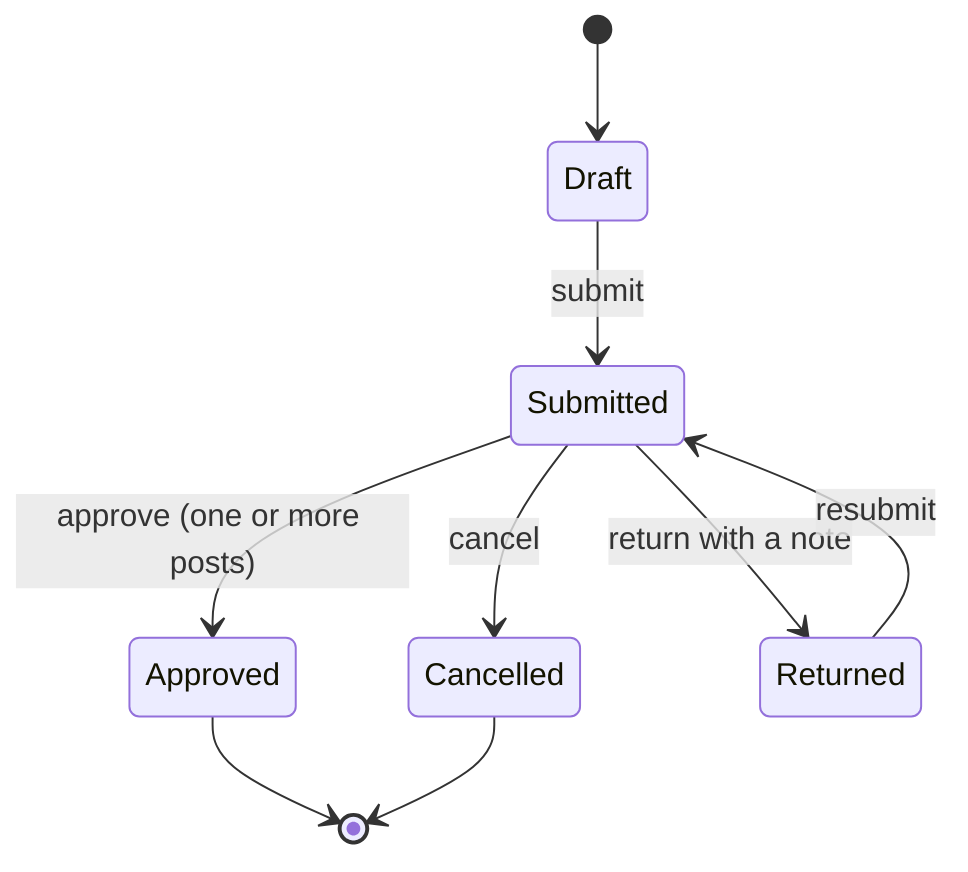
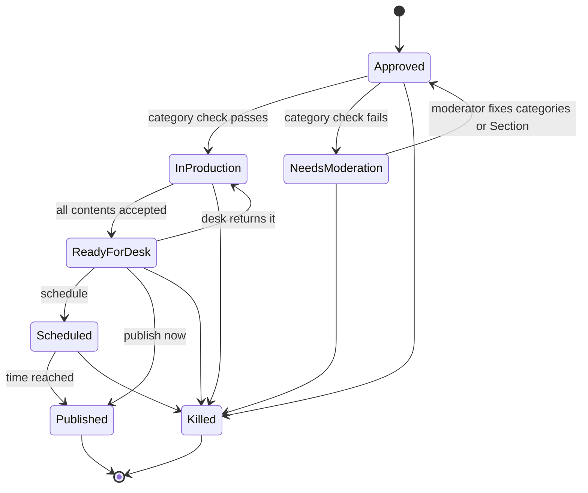

:::note[Status: designed]
This is the agreed design for phase P4. Names may change when the module is built.
:::

## Proposal

A proposal is a member's story idea. Its form is the DynamicFields field **`proposal.default`**, so a tenant can
extend it with its own fields. The default form has:

- a **title** (required);
- an optional **image**, **body** and other fields the tenant adds;
- **suggested categories**: post categories from Contents. They become the initial categories of each post made from
  the proposal.

- The author edits it while it is **Draft** or **Returned**. Submitting validates it against `proposal.default`.
- Only a moderator moves it out of **Submitted**.
- Events: `newsroom.proposal-submitted.v1` and `newsroom.proposal-decided.v1` (approved, cancelled or returned).

## Moderation

The moderator needs **`newsroom.moderate`** on a unit scope that covers the proposal's unit. That right comes from
either:

- a **position** on a unit, such as the planning desk, which is a standing grant; or
- a **shift role** that includes it, which is granted only while the moderator is checked in to the shift.

Manager authority flows down the tree: a grant on a Department covers its Sections.

When the moderator **approves**, they add one line per post the proposal should become. Each line sets:

| Field | Meaning |
| --- | --- |
| Post kind | A published DynamicFields root post field, such as `post.news` or `post.video`. The kind gives the post its URL prefix. |
| Section | The Organization Section that will produce the post. NewsRoom suggests one by matching the categories (see [the Section categories rule](/modules/newsroom/workflows-and-assignment/#the-section-categories-rule)). |
| Categories | Start from the proposal's suggestions, and can be changed per post. All must be in the same press. |

For each line, NewsRoom:

1. asks Contents to create the **draft post**, seeded from the proposal (title, image, body), with the kind and
   categories;
2. creates a **PostProject** linked to the proposal and the post;
3. starts the Elsa workflow **bound** to the kind and Section. If no binding exists, nothing is assigned and the
   project is reported as a setup error.

## PostProject

A PostProject follows one post from approval to publication. It is NewsRoom's work item
(`WorkItemRef("newsroom", "project", id)`).

- **Approved → InProduction** runs the category check first. If the post's categories do not belong to the Section,
  the project goes to **NeedsModeration** and returns to the moderator. The workflow does not fail.
- **InProduction**: the contents are written, reviewed and accepted in Contents. Their stages are the work-item states:
  `assigned → in-progress → submitted → in-review → accepted | returned`.
- **ReadyForDesk**: the desk reviews the whole post. Contents runs DynamicFields `validate` on the post before it can
  be approved, scheduled or published.
- **Killed** can be reached from any state before Published.
- Event: `newsroom.project-state-changed.v1`.

## One proposal, several posts

A single story often needs, say, a news post now and a video post later. The moderator approves the proposal once,
with two lines. Each line becomes its own post and its own project, with its own kind, Section and workflow. The
projects keep the link to their proposal, so the planning board can show them together.
